# Лабораторна робота 2. Створення складних SQL запитів

## Загальна інформація

**Здобувач освіти:** Кондратюк Дмитро  
**Група:** ІПЗ-32  
**Обраний рівень складності:** 3 (відмінно)

Усі запити виконано в Supabase (PostgreSQL) на навчальній базі «Техномаркет» із ЛР1: 25 товарів, 15 клієнтів, 31 замовлення (15.01.2024 – 20.08.2024), 47 позицій замовлень, 8 співробітників, 10 категорій. Номери запитів збігаються з іменами файлів скріншотів у папці `screenshots/lab02/` (наприклад, запит 2.3 → `2.3.png`).

**Домовленості для всіх запитів:**
- виручка рахується як `quantity × unit_price × (1 − discount)`, де `unit_price` береться з `order_items` (ціна на момент продажу, а не поточна ціна в каталозі). Знижка зберігається як частка (максимум 0.20 — див. перевірку 0.3 нижче);
- у вихідному наборі даних у 21 із 47 позицій `order_items` ціна не збігається з каталожною ціною записаного товару (див. розділ «Перевірка якості даних»). Базу не змінювано; виручка скрізь рахується за цінами з `order_items`, тому суми по категоріях (наприклад, у 6.9) не слід звіряти з каталогом.
- для «продажів» враховуються доставлені замовлення (`delivered`) або всі, окрім скасованих (`<> cancelled`) — це вказано в кожному запиті; скасованих замовлень у базі немає.

## Підготовка: перевірка бази

```sql
SELECT table_name
FROM information_schema.tables
WHERE table_schema = 'public'
  AND table_type = 'BASE TABLE'
ORDER BY table_name;
```

**Результат виконання:** у публічній схемі 8 таблиць: categories, customers, employees, order_items, orders, products, regions, suppliers.

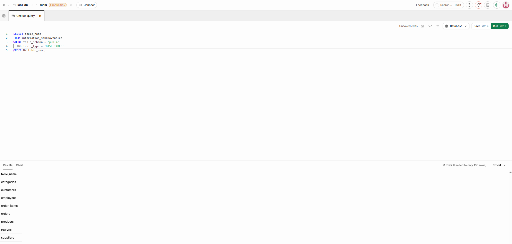

Службові перевірки перед початком роботи (типи ключових стовпців і діапазон даних):

```sql
SELECT table_name, column_name, data_type
FROM information_schema.columns
WHERE table_schema = 'public'
  AND (table_name, column_name) IN (
      ('order_items','discount'), ('order_items','unit_price'), ('order_items','quantity'),
      ('orders','freight'), ('orders','order_date'), ('orders','order_status'),
      ('customers','customer_type'), ('products','unit_price'), ('employees','reports_to'))
ORDER BY table_name, column_name;
```

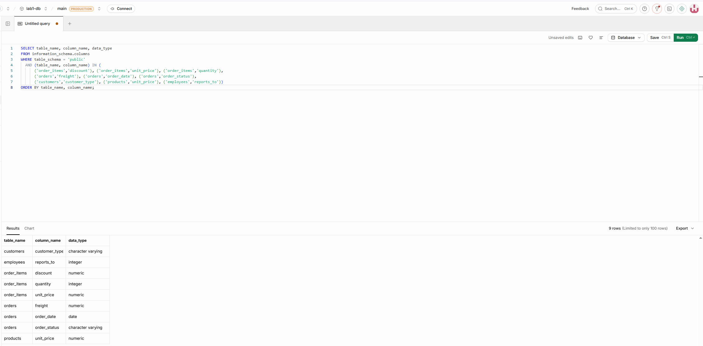

```sql
SELECT MIN(discount) AS min_discount,
       MAX(discount) AS max_discount,
       COUNT(*)      AS items_count,
       (SELECT COUNT(*) FROM employees WHERE reports_to IS NULL) AS top_managers,
       (SELECT MIN(order_date) FROM orders) AS first_order,
       (SELECT MAX(order_date) FROM orders) AS last_order
FROM order_items;
```

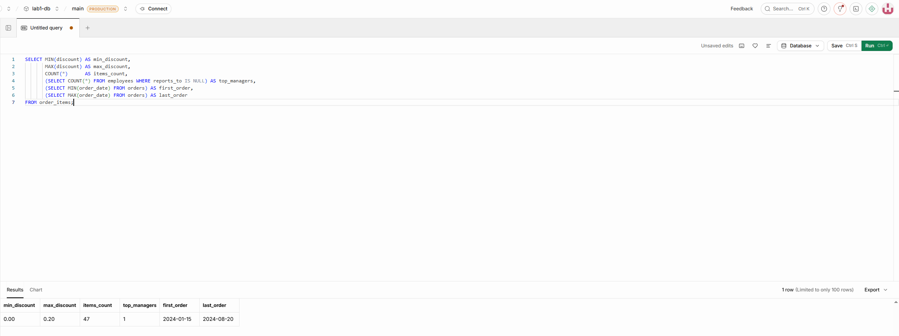

**Висновок із перевірок:** `discount`, `unit_price`, `freight` мають тип `numeric`, `order_date` — `date`, `order_status` і `customer_type` — `character varying`. Максимальна знижка 0.20 (тобто частка, а не відсотки), тому формула виручки `(1 − discount)` коректна. У таблиці `employees` рівно один керівник верхнього рівня (`reports_to IS NULL`), отже рекурсивний запит (6.6) має одну кореневу вершину.


### Перевірка якості даних

Під час аналізу результатів 3.3 і 5.7 помітно, що найбільше продається iPad Air M2 за ціною, у шість разів нижчою за каталожну. Тому ціни в `order_items` порівняно з каталогом:

```sql
SELECT p.product_name, p.unit_price AS catalog_price,
       oi.unit_price AS sold_price, COUNT(*) AS lines
FROM order_items oi
JOIN products p ON p.product_id = oi.product_id
WHERE oi.unit_price <> p.unit_price
GROUP BY 1, 2, 3
ORDER BY 1;
```

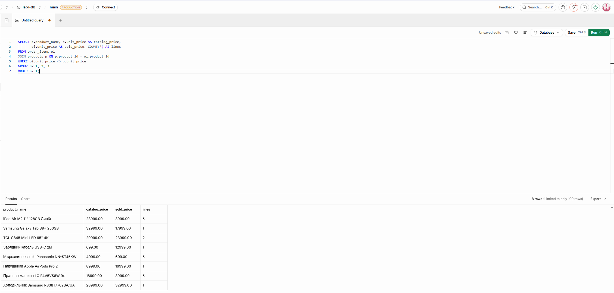

**Результат виконання:** 8 товарів, 21 із 47 позицій замовлень мають `unit_price`, що не збігається з `products.unit_price`. Для з'ясування причини перевірено, яким товарам каталогу належать ці «чужі» ціни:

```sql
SELECT p.product_name AS recorded_product,
       oi.unit_price  AS sold_price,
       p.unit_price   AS catalog_price_of_recorded,
       (SELECT string_agg(p2.product_name, ' / ')
        FROM products p2
        WHERE p2.unit_price = oi.unit_price) AS products_with_this_price,
       COUNT(*) AS lines
FROM order_items oi
JOIN products p ON p.product_id = oi.product_id
WHERE oi.unit_price <> p.unit_price
GROUP BY p.product_name, oi.unit_price, p.unit_price
ORDER BY 1;
```

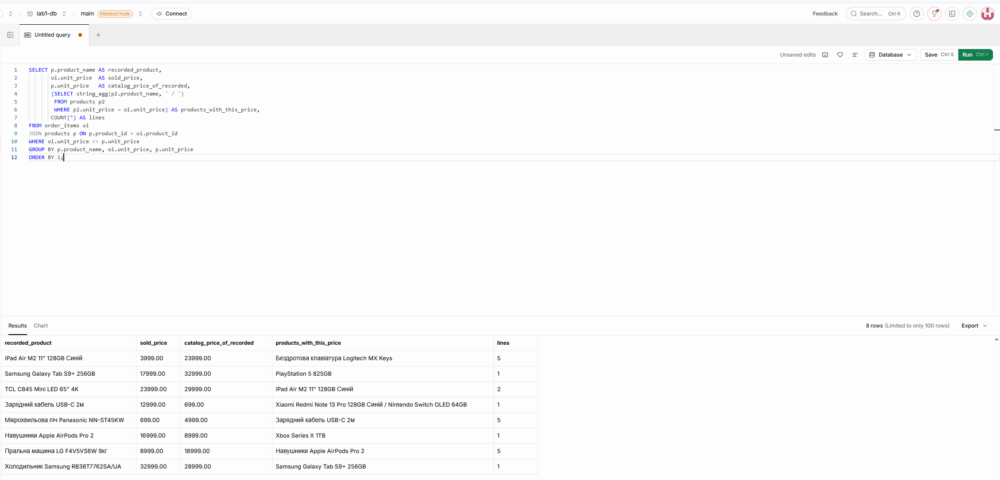

**Результат виконання:** у кожному такому рядку `sold_price` дорівнює каталожній ціні іншого товару: наприклад, 3 999 — ціна клавіатури Logitech MX Keys, 23 999 — ціна iPad Air M2, 16 999 — ціна Xbox Series X (для 12 999 є два кандидати). Усі чотири товари, що в запитах 3.5 і 4.2 виглядають непроданими (Logitech MX Keys, PlayStation 5, Xbox Series X, Nintendo Switch OLED), фігурують серед таких «власників» цін. Імовірна причина — неточне співставлення `product_id` у вихідному наборі даних.

**Рішення:** базу даних надано викладачем, тому її не змінювано, а всі запити виконано на даних «як є». Наслідки для результатів:

- **Не залежать від помилки:** суми та кількості за замовленнями, клієнтами, регіонами, місяцями, статусами й типами клієнтів (2.2, 2.4, 5.5, 6.4, 6.10–6.12), оскільки вони рахуються з ціни та кількості в самих позиціях; також запити лише за каталогом (2.1, 2.3, 3.1, 5.1–5.4, ранжування цін у питанні 7).
- **Відображають дані в наданому вигляді:** результати, що пов'язують позиції з товарами та категоріями (1.3, 3.3, 3.5, 4.2, 5.7, розбивка за категоріями в 6.1, 6.3, 6.9 і `get_sales_report('category')`). Висновки на кшталт «iPad Air M2 — лідер продажів» слід розуміти як властивість наданого набору даних.

---
## Виконання завдань
---

### Рівень 1

#### 1. З'єднання таблиць

**Завдання 1.1:** INNER JOIN — список товарів з категоріями та постачальниками

```sql
SELECT p.product_name, c.category_name, s.company_name, p.unit_price
FROM products p
INNER JOIN categories c ON p.category_id = c.category_id
INNER JOIN suppliers s ON p.supplier_id = s.supplier_id
ORDER BY c.category_name, p.product_name;
```

**Результат виконання:** отримано 25 товарів. Кожен товар має і категорію, і постачальника, тому INNER JOIN не втратив жодного рядка (наприклад, у категорії «Аксесуари та комплектуючі»: клавіатура Logitech MX Keys — 3 999, кабель USB-C — 699, AirPods Pro 2 — 8 999).

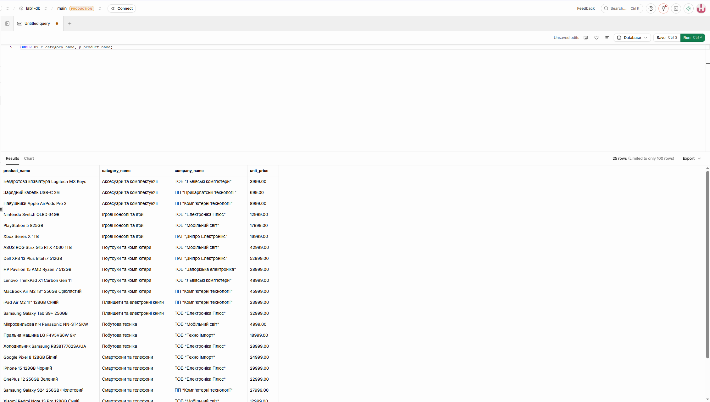

**Пояснення:** з'єднуються три таблиці: `products` → `categories` (за `category_id`) та `products` → `suppliers` (за `supplier_id`). INNER JOIN залишає лише ті рядки, для яких знайдено пару в обох довідниках; результат відсортовано за категорією та назвою.

**Аналіз складності:** три таблиці, обидва з'єднання за зовнішніми ключами; для малих довідників планувальник обирає Hash Join. Складність ≈ O(n + m) на з'єднання плюс O(n log n) на сортування. Для великих обсягів потрібні індекси на зовнішніх ключах (`idx_products_category` та `idx_products_supplier` вже існують).

**Завдання 1.2:** LEFT JOIN — клієнти з кількістю замовлень

```sql
SELECT c.contact_name, c.customer_type, r.region_name,
       COUNT(o.order_id) AS order_count
FROM customers c
LEFT JOIN orders o ON c.customer_id = o.customer_id
LEFT JOIN regions r ON c.region_id = r.region_id
GROUP BY c.customer_id, c.contact_name, c.customer_type, r.region_name
ORDER BY order_count DESC;
```

**Результат виконання:** 15 клієнтів; найбільше замовлень у Петрова Івана Миколайовича (3), у решти по 2 — разом 31 замовлення.

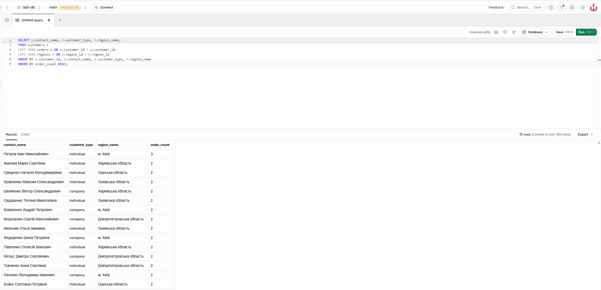

**Пояснення:** LEFT JOIN залишає всіх клієнтів із таблиці `customers`, навіть якщо в них немає замовлень (тоді `COUNT(o.order_id) = 0`). INNER JOIN такого клієнта просто відкинув би. У поточних даних кожен клієнт має замовлення, тому обидва типи з'єднання дали б однаковий результат; реальну різницю видно в запиті 2.1 (три категорії без жодного товару) та в парі 4.6/4.7.

**Аналіз складності:** два LEFT JOIN і групування (HashAggregate), складність O(n + m); із ростом таблиці `orders` вирішальним стає індекс `idx_orders_customer`.

**Завдання 1.3:** множинне з'єднання — детальна інформація про замовлення (6 таблиць)

```sql
SELECT o.order_id,
       o.order_date,
       o.order_status,
       cu.contact_name AS customer,
       e.last_name || ' ' || e.first_name AS employee,
       p.product_name,
       c.category_name,
       oi.quantity,
       oi.unit_price,
       ROUND((oi.quantity * oi.unit_price * (1 - oi.discount))::numeric, 2) AS line_total
FROM orders o
JOIN customers cu   ON o.customer_id = cu.customer_id
JOIN employees e    ON o.employee_id = e.employee_id
JOIN order_items oi ON o.order_id = oi.order_id
JOIN products p     ON oi.product_id = p.product_id
JOIN categories c   ON p.category_id = c.category_id
ORDER BY o.order_date DESC, o.order_id
LIMIT 20;
```

**Результат виконання:** виведено 20 останніх позицій: від замовлення №31 (20.08.2024, статус pending) до №17. Наприклад, Dell XPS 13 Plus: 3 шт. по 52 999 зі знижкою 15 % дають `line_total` = 135 147,45.

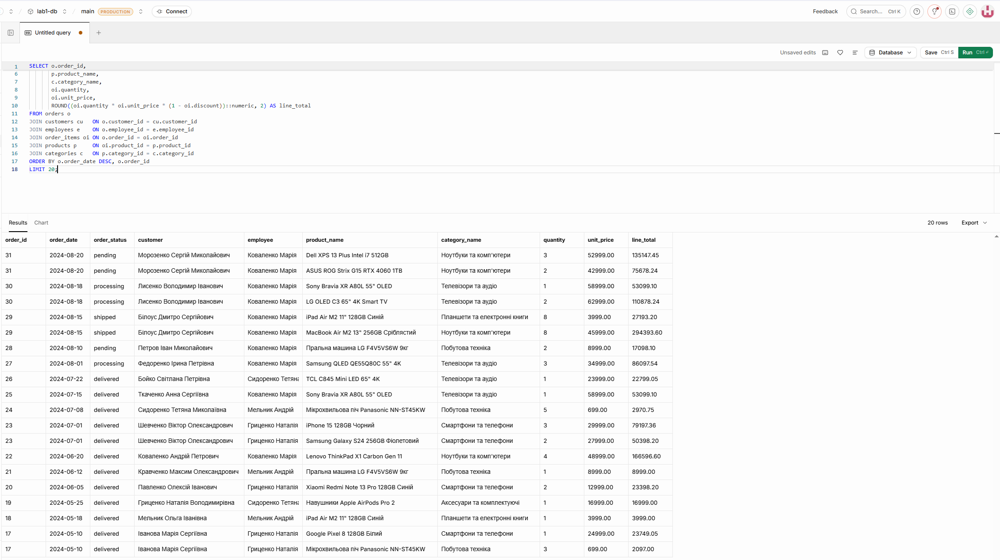

**Пояснення:** з'єднуються `orders` → `customers` (клієнт), `employees` (менеджер), `order_items` (позиції), `products` (товар) та `categories` (категорія). Усі з'єднання INNER за зовнішніми ключами; `line_total` = `quantity × unit_price × (1 − discount)`.

**Аналіз складності:** п'ять з'єднань. Логічна послідовність: спершу невеликі довідники (`customers`, `employees`), потім найбільша таблиця `order_items`, потім `products` і `categories`; фактичний порядок обирає планувальник. Складність ≈ O(n log n) через сортування за датою та `LIMIT`. Для великих даних важливі індекси `orders(order_date)` та `order_items(order_id)` — обидва існують.

#### 2. Агрегатні функції

**Завдання 2.1:** статистика товарів за категоріями (COUNT, AVG, MIN, MAX)

```sql
SELECT c.category_name,
       COUNT(p.product_id) AS product_count,
       AVG(p.unit_price)   AS avg_price,
       MIN(p.unit_price)   AS min_price,
       MAX(p.unit_price)   AS max_price
FROM categories c
LEFT JOIN products p ON c.category_id = p.category_id
GROUP BY c.category_id, c.category_name
ORDER BY product_count DESC;
```

**Результат виконання:** 10 категорій. У «Ноутбуків та комп'ютерів» 5 товарів, середня ціна 43 999 (мінімум 28 999, максимум 52 999); у «Смартфонів» 5 товарів, середня 23 799. Три категорії (Спортивні технології, Фото та відео, Розумний дім) не мають товарів: `COUNT = 0`, а AVG/MIN/MAX повертають NULL.

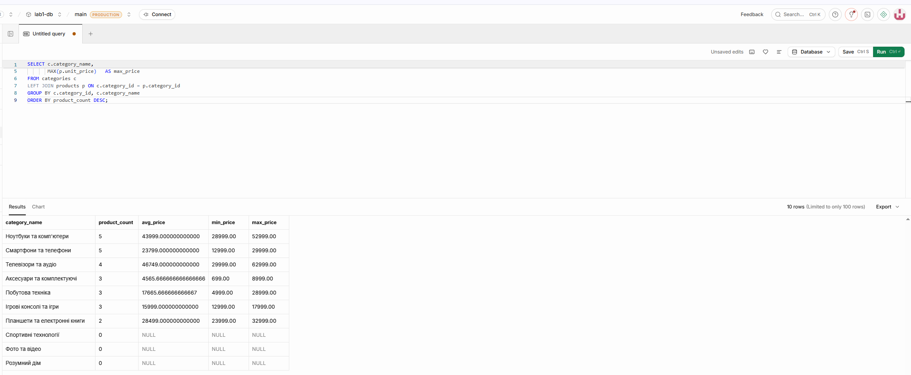

**Пояснення:** `COUNT(p.product_id)` рахує лише не-NULL значення, тому порожні категорії дають 0, а не 1. LEFT JOIN потрібен, щоб такі категорії не зникли з результату.

**Аналіз складності:** O(n + m) і HashAggregate; таблиці малі, тож запит виконується за соті частки мілісекунди.

**Завдання 2.2:** продажі за регіонами з використанням HAVING (SUM, GROUP BY)

```sql
-- Продажі = сума рядків замовлень зі знижкою; скасовані замовлення не враховуємо
SELECT r.region_name,
       COUNT(DISTINCT o.order_id) AS orders_count,
       SUM(oi.quantity)           AS items_sold,
       ROUND(SUM(oi.quantity * oi.unit_price * (1 - oi.discount))::numeric, 2) AS total_sales
FROM orders o
JOIN customers cu   ON o.customer_id = cu.customer_id
JOIN regions r      ON cu.region_id = r.region_id
JOIN order_items oi ON o.order_id = oi.order_id
WHERE o.order_status <> 'cancelled'
GROUP BY r.region_id, r.region_name
HAVING SUM(oi.quantity * oi.unit_price * (1 - oi.discount)) > 100000
ORDER BY total_sales DESC;
```

**Результат виконання:** поріг 100 000 пройшли 3 з 5 регіонів: Дніпропетровська область — 894 191,64 (6 замовлень, 33 од.), м. Київ — 889 560,66 (9 замовлень, 33 од.), Харківська область — 333 315,00 (6 замовлень, 16 од.). Решту двох регіонів відсіяв HAVING (у плані виконання: `Rows Removed by Filter: 2`, див. 7.1).

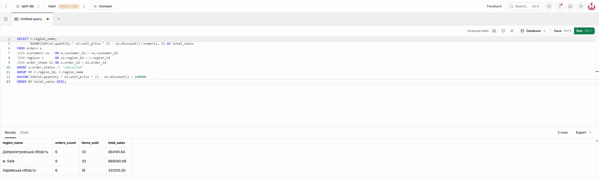

**Пояснення:** WHERE відсікає окремі рядки (скасовані замовлення; у даних їх немає), GROUP BY формує групи за регіоном, а HAVING відсікає групи за значенням агрегату. Умову на `SUM(...)` не можна записати у WHERE, бо на етапі WHERE агрегати ще не обчислені.

**Аналіз складності:** чотири таблиці, два Hash Join, потім GroupAggregate і Sort; O(n + m) + O(g log g), де g — кількість груп.

**Завдання 2.3:** постачальники з кількістю товарів більше 2 (HAVING)

```sql
SELECT s.company_name, s.city,
       COUNT(p.product_id) AS product_count,
       ROUND(AVG(p.unit_price)::numeric, 2) AS avg_price
FROM suppliers s
JOIN products p ON s.supplier_id = p.supplier_id
GROUP BY s.supplier_id, s.company_name, s.city
HAVING COUNT(p.product_id) > 2
ORDER BY product_count DESC, s.company_name;
```

**Результат виконання:** 4 постачальники мають понад 2 товари: «Електроніка Плюс» (Київ) — 6 товарів, середня ціна 27 165,67; «Комп'ютерні технології» (Львів) — 5; «Мобільний світ» (Харків) — 4; «Техно Імпорт» (Одеса) — 3.

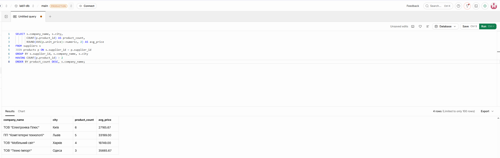

**Пояснення:** `COUNT(p.product_id) > 2` перевіряється після групування за постачальником, тому записано в HAVING.

**Аналіз складності:** O(n + m), HashAggregate.

**Завдання 2.4:** групування за статусом замовлення (COUNT, SUM, AVG, MIN, MAX)

```sql
SELECT order_status,
       COUNT(*)                             AS orders_count,
       ROUND(SUM(freight)::numeric, 2)      AS total_freight,
       ROUND(AVG(freight)::numeric, 2)      AS avg_freight,
       MIN(order_date)                      AS first_order,
       MAX(order_date)                      AS last_order
FROM orders
GROUP BY order_status
ORDER BY orders_count DESC;
```

**Результат виконання:** delivered — 26 замовлень (доставка 4 700,00; середня 180,77; період 15.01–22.07.2024), pending — 2, processing — 2, shipped — 1.

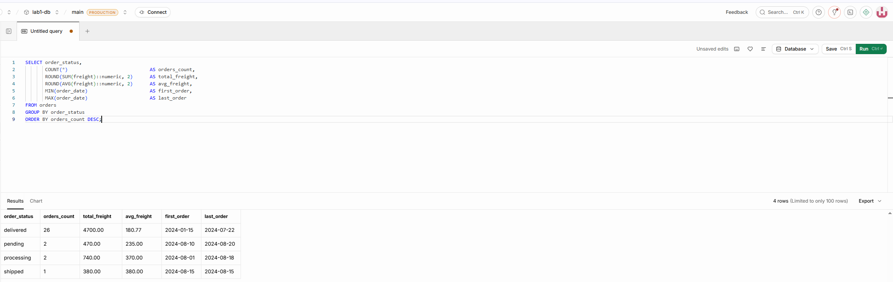

**Пояснення:** усі п'ять агрегатних функцій в одному запиті; групування за статусом — інший критерій, ніж у 2.1–2.3. MIN і MAX працюють також із датами.

**Аналіз складності:** один прохід по таблиці `orders` + HashAggregate, O(n).

#### 3. Базові підзапити

**Завдання 3.1:** товари з ціною вище середньої по категорії (корельований підзапит у WHERE)

```sql
SELECT p.product_name, p.unit_price, c.category_name
FROM products p
INNER JOIN categories c ON p.category_id = c.category_id
WHERE p.unit_price > (
    SELECT AVG(p2.unit_price)
    FROM products p2
    WHERE p2.category_id = p.category_id
)
ORDER BY c.category_name, p.unit_price DESC;
```

**Результат виконання:** 14 із 25 товарів дорожчі за середню ціну своєї категорії (наприклад, Dell XPS, Lenovo ThinkPad та MacBook Air серед ноутбуків; LG OLED C3 і Sony Bravia серед телевізорів).

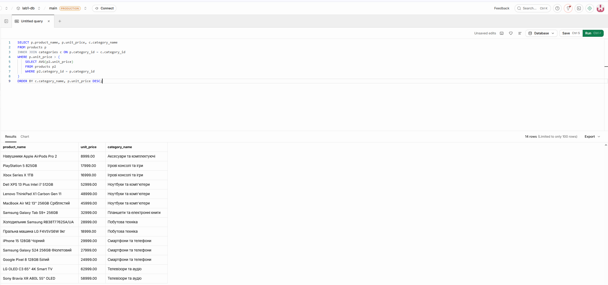

**Пояснення:** для кожного рядка `p` зовнішнього запиту підзапит перераховує `AVG(p2.unit_price)` по категорії саме цього товару (`p2.category_id = p.category_id`) — підзапит залежить від зовнішнього рядка, тому він корельований.

**Аналіз складності:** теоретично O(n²): підзапит виконується для кожного рядка (у плані — SubPlan 1 зі Seq Scan по `products p2`); Memoize у плані кешує не підзапит, а пошук у `categories` по `category_id` у з'єднанні (Hits: 7, Misses: 7), підзапит же виконується для кожного рядка. Оптимізований варіант із віконною функцією наведено в розділі «Аналіз продуктивності» (запит 7.14).

**Завдання 3.2:** клієнти із замовленнями у 2024 році (підзапит з IN)

```sql
SELECT customer_id, contact_name, company_name, city
FROM customers
WHERE customer_id IN (
    SELECT customer_id
    FROM orders
    WHERE order_date >= '2024-01-01' AND order_date < '2025-01-01'
)
ORDER BY contact_name;
```

**Результат виконання:** усі 15 клієнтів мають замовлення у 2024 році (база містить дані за 15.01–20.08.2024).

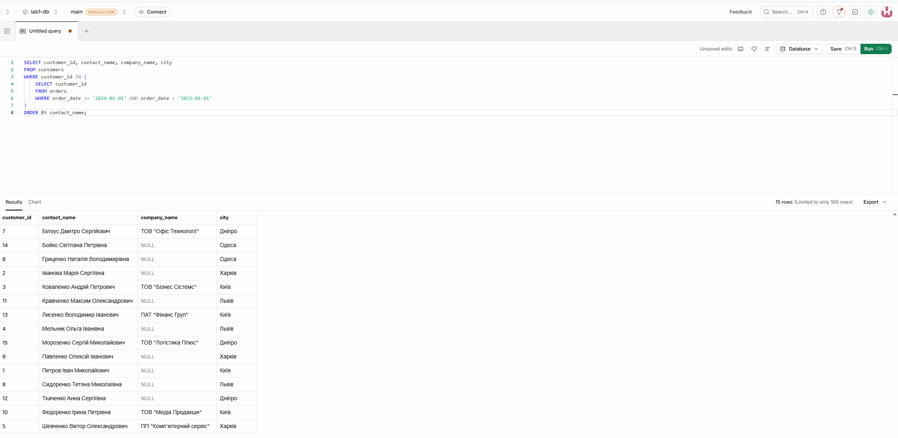

**Пояснення:** підзапит повертає множину `customer_id`, `IN` перевіряє належність до неї. Діапазон дат записано напіввідкритим (`>= 2024-01-01 AND < 2025-01-01`), щоб він був придатний для використання індексу по даті.

**Аналіз складності:** планувальник перетворює IN на semi-join; O(n + m).

**Завдання 3.3:** товари із загальною кількістю продажів (підзапит у SELECT)

```sql
SELECT p.product_id, p.product_name, p.unit_price,
       COALESCE((SELECT SUM(oi.quantity)
                 FROM order_items oi
                 WHERE oi.product_id = p.product_id), 0) AS total_sold
FROM products p
ORDER BY total_sold DESC, p.product_name;
```

**Результат виконання:** 25 товарів; лідери за кількістю проданих одиниць: iPad Air M2 — 19, MacBook Air M2 — 15, мікрохвильова піч Panasonic — 13. Чотири товари не продавалися й отримали 0 завдяки `COALESCE` (ці рядки внизу списку не вмістилися на скріншот; їх видно у 3.5 і 4.2).

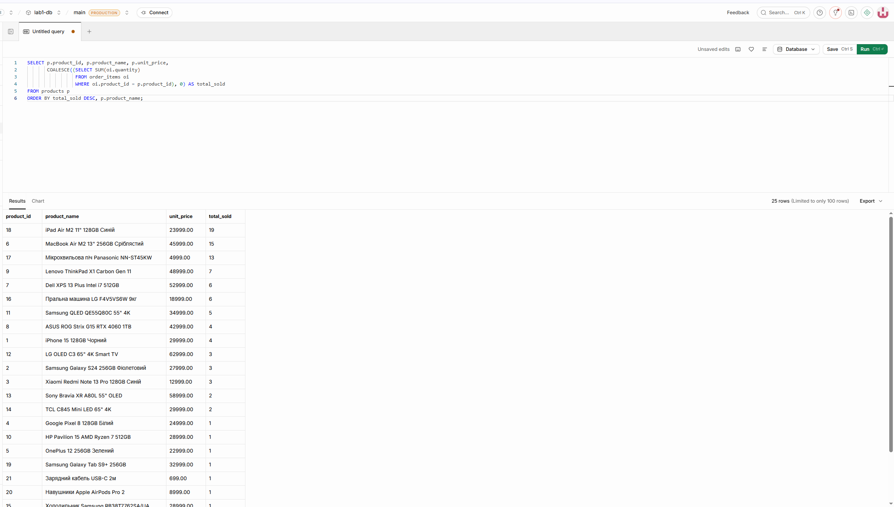

**Пояснення:** скалярний підзапит у SELECT додає обчислюване поле `total_sold`; він повертає один рядок на кожен товар. `COALESCE` замінює NULL (немає продажів) на 0.

**Аналіз складності:** скалярний підзапит виконується для кожного рядка, тобто O(n·m) без індексу. За статистикою pg_stat_statements (7.13) цей запит входить до найповільніших SELECT (≈ 1,6 мс на першому запуску); швидша альтернатива — LEFT JOIN із попередньою агрегацією `order_items`.

**Завдання 3.4:** клієнти з принаймні одним доставленим замовленням (EXISTS)

```sql
SELECT c.customer_id, c.contact_name, c.city
FROM customers c
WHERE EXISTS (
    SELECT 1
    FROM orders o
    WHERE o.customer_id = c.customer_id
      AND o.order_status = 'delivered'
)
ORDER BY c.contact_name;
```

**Результат виконання:** усі 15 клієнтів мають хоча б одне доставлене замовлення.

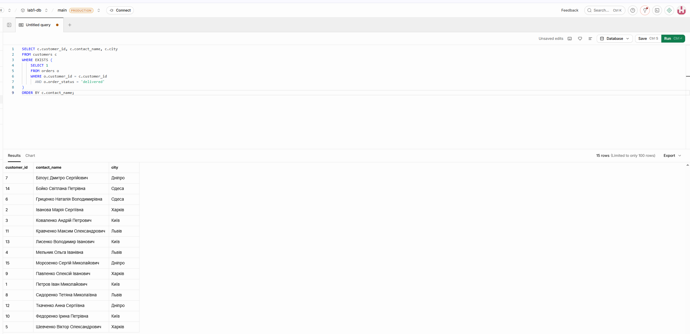

**Пояснення:** `EXISTS` лише перевіряє наявність рядка та зупиняється на першому знайденому збігу (semi-join), на відміну від JOIN, який повертав би дублікати для клієнтів з кількома замовленнями.

**Аналіз складності:** O(n + m); підзапит не матеріалізує результат.

**Завдання 3.5:** товари, які жодного разу не продавалися (NOT EXISTS)

```sql
SELECT p.product_id, p.product_name, p.unit_price
FROM products p
WHERE NOT EXISTS (
    SELECT 1
    FROM order_items oi
    WHERE oi.product_id = p.product_id
)
ORDER BY p.product_name;
```

**Результат виконання:** 4 товари: Nintendo Switch OLED, PlayStation 5, Xbox Series X та бездротова клавіатура Logitech MX Keys. Результат узгоджується із запитом 4.2.

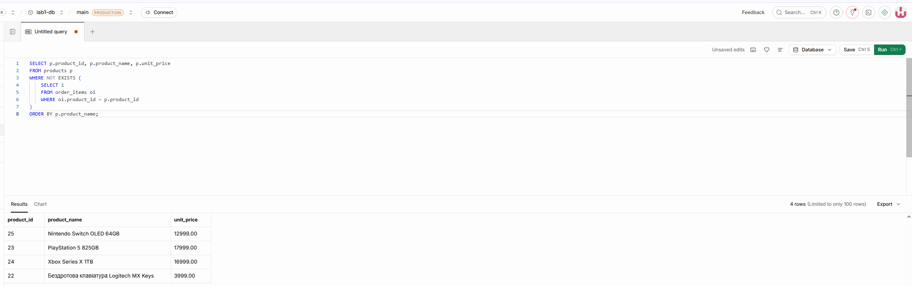

**Пояснення:** NOT EXISTS — це anti-join. Він безпечніший за `NOT IN`, який повертає порожній результат, якщо підзапит містить хоча б один NULL.

**Аналіз складності:** O(n + m) за наявності індексу `idx_order_items_product`.

### Рівень 2

#### 4. Складні з'єднання

**Завдання 4.1:** RIGHT JOIN — аналіз категорій та товарів

```sql
SELECT c.category_name,
       COUNT(p.product_id) AS products_count,
       COALESCE(AVG(p.unit_price), 0) AS avg_price
FROM products p
RIGHT JOIN categories c ON p.category_id = c.category_id
GROUP BY c.category_id, c.category_name
ORDER BY products_count DESC;
```

**Результат виконання:** 10 категорій; три категорії без товарів мають `products_count = 0` і `avg_price = 0` (NULL замінено на 0 через `COALESCE`).

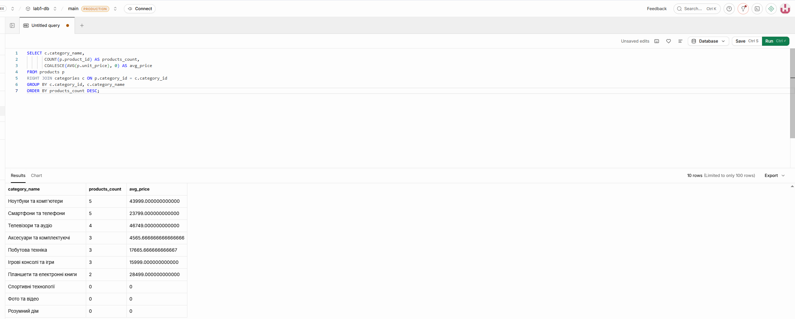

**Пояснення:** RIGHT JOIN зберігає всі рядки правої таблиці (`categories`). Це дзеркальний запис LEFT JOIN: `A RIGHT JOIN B` ≡ `B LEFT JOIN A`; на практиці частіше пишуть LEFT JOIN.

**Аналіз складності:** Hash Join (за потреби — Hash Right Join) і HashAggregate, O(n + m). RIGHT JOIN не дорожчий за LEFT JOIN: це лише інший запис того самого з'єднання. Оптимізація: записати як `categories c LEFT JOIN products p` — результат той самий, читається природніше.

**Завдання 4.2:** FULL OUTER JOIN — товари та їхні продажі

```sql
SELECT p.product_name,
       s.total_qty,
       CASE WHEN s.product_id IS NULL THEN 'Не продавався'
            WHEN p.product_id IS NULL THEN 'Товар відсутній у каталозі'
            ELSE 'Продається'
       END AS sales_status
FROM products p
FULL OUTER JOIN (
    SELECT product_id, SUM(quantity) AS total_qty
    FROM order_items
    GROUP BY product_id
) s ON p.product_id = s.product_id
ORDER BY s.total_qty NULLS FIRST, p.product_name;
```

**Результат виконання:** 25 рядків: 4 товари зі статусом «Не продавався» (`total_qty = NULL`), решта — «Продається». Рядків «Товар відсутній у каталозі» немає, бо зовнішній ключ `order_items.product_id` гарантує існування товару.

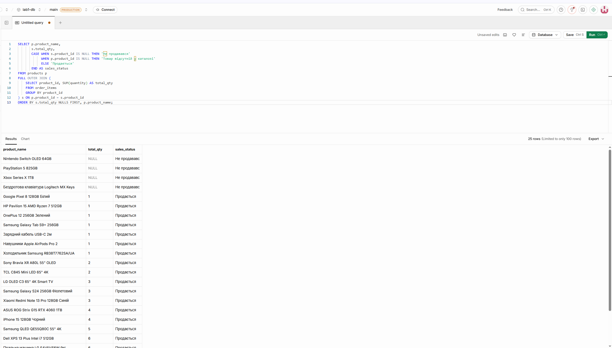

**Пояснення:** FULL OUTER JOIN зберігає рядки з обох боків: непродані товари і (теоретично) продажі товарів, яких немає в каталозі. Продажі попередньо агрегуються підзапитом по `product_id`, щоб з'єднання не множило рядки.

**Аналіз складності:** спершу HashAggregate по `order_items` (O(m)), потім Hash Full Join із `products` (O(n + g), де g — кількість товарів із продажами) і сортування O(n log n). За `pg_stat_statements` (7.13) це один із найповільніших SELECT (≈ 1,68 мс на першому запуску). Оптимізація: зовнішній ключ `order_items.product_id` гарантує існування товару, тому FULL JOIN можна замінити на LEFT JOIN з тим самим результатом і простішим планом.

**Завдання 4.3:** Self-join — співробітники та їхні керівники

```sql
SELECT e1.first_name || ' ' || e1.last_name AS employee,
       e1.title AS employee_title,
       e2.first_name || ' ' || e2.last_name AS manager,
       e2.title AS manager_title
FROM employees e1
LEFT JOIN employees e2 ON e1.reports_to = e2.employee_id
ORDER BY e2.last_name, e1.last_name;
```

**Результат виконання:** 8 співробітників: Петренко Олександр (генеральний директор) не має керівника (NULL); Іваненко, Коваленко та Шевченко підпорядковані йому; Білоус і Сидоренко — Іваненку; Гриценко й Мельник — Коваленко.

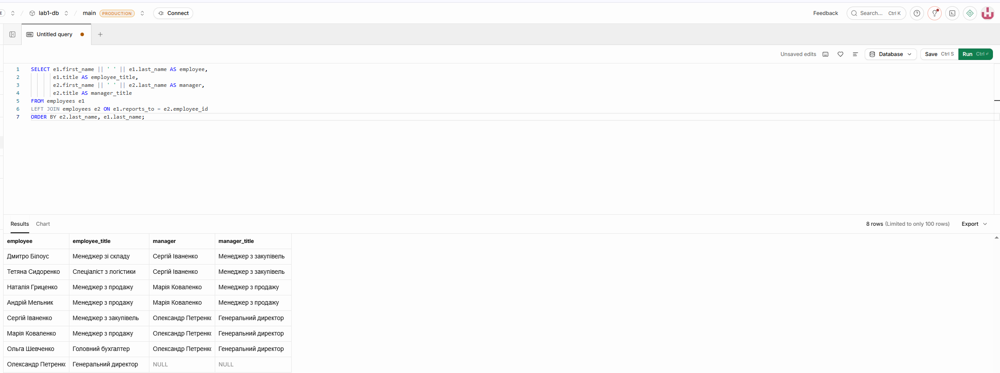

**Пояснення:** таблиця `employees` з'єднується сама з собою за `e1.reports_to = e2.employee_id`: `e1` — підлеглий, `e2` — керівник. LEFT JOIN залишає директора, у якого керівника немає.

**Аналіз складності:** self-join за `reports_to = employee_id` — Hash Join, O(n); таблиця містить 8 рядків, тож вартість мізерна. На великих таблицях керівника шукають за первинним ключем, а підлеглих прискорює індекс `idx_employees_reports_to`. Сортування — O(n log n).

**Завдання 4.4:** Self-join — пари клієнтів з одного міста

```sql
SELECT a.city,
       a.contact_name AS customer_1,
       b.contact_name AS customer_2
FROM customers a
JOIN customers b
  ON a.city = b.city
 AND a.customer_id < b.customer_id   -- прибирає дублі пар (A,B)/(B,A) і пари самого з собою
ORDER BY a.city, customer_1, customer_2;
```

**Результат виконання:** 16 пар: Київ — 6, Дніпро — 3, Львів — 3, Харків — 3, Одеса — 1.

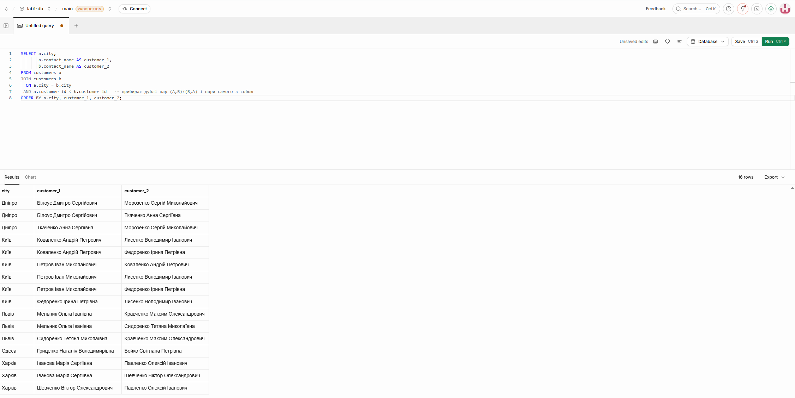

**Пояснення:** умова `a.customer_id < b.customer_id` прибирає дублікати (A, B) / (B, A) і пари клієнта із самим собою. Кількість пар у місті з n клієнтів дорівнює n(n − 1)/2: у Києві 4 клієнти → 6 пар.

**Аналіз складності:** у гіршому випадку O(n²) (декартів добуток у межах міста); для великих таблиць потрібен індекс по `city`.

**Завдання 4.5:** умовне з'єднання — доставлені замовлення 2024 року по кожному клієнту

```sql
-- Умови в ON, а не в WHERE: клієнти без таких замовлень залишаються в результаті з нулем
SELECT cu.contact_name, cu.customer_type,
       COUNT(o.order_id) AS delivered_orders_2024,
       COALESCE(ROUND(SUM(o.freight)::numeric, 2), 0) AS freight_sum
FROM customers cu
LEFT JOIN orders o
       ON cu.customer_id = o.customer_id
      AND o.order_status = 'delivered'
      AND o.order_date >= '2024-01-01'
      AND o.order_date <  '2025-01-01'
GROUP BY cu.customer_id, cu.contact_name, cu.customer_type
ORDER BY delivered_orders_2024 DESC, cu.contact_name;
```

**Результат виконання:** 15 клієнтів: 11 мають по 2 доставлені замовлення, 4 — по 1 (разом 26); приклад — Коваленко Андрій: 2 замовлення, сума доставки 500,00.

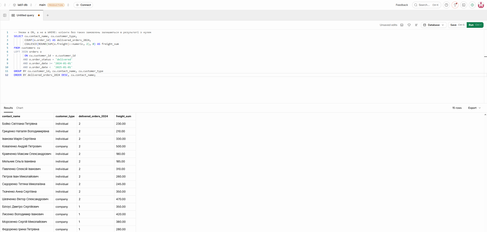

**Пояснення:** додаткові умови (`order_status = delivered`, діапазон дат) записано в `ON`, а не у `WHERE`: вони визначають, які замовлення «прикріплюються» до клієнта, а самі клієнти зберігаються у результаті.

**Аналіз складності:** Hash Left Join і HashAggregate, O(n + m). Умови в `ON` відсіюють рядки `orders` ще до з'єднання, тому в хеш-таблицю потрапляє лише потрібна підмножина; цій фільтрації відповідає індекс `idx_orders_status_date (order_status, order_date)`. На навчальних даних планувальник обере Seq Scan.

**Завдання 4.6:** умова в ON: усі клієнти зберігаються

```sql
SELECT cu.contact_name,
       COUNT(o.order_id) AS delivered_since_july
FROM customers cu
LEFT JOIN orders o
       ON cu.customer_id = o.customer_id
      AND o.order_status = 'delivered'
      AND o.order_date >= '2024-07-01'
GROUP BY cu.customer_id, cu.contact_name
ORDER BY delivered_since_july DESC, cu.contact_name;
```

**Результат виконання:** 15 рядків: 4 клієнти мають по 1 доставленому замовленню з 01.07.2024 (Бойко, Сидоренко, Ткаченко, Шевченко), 11 клієнтів — 0.

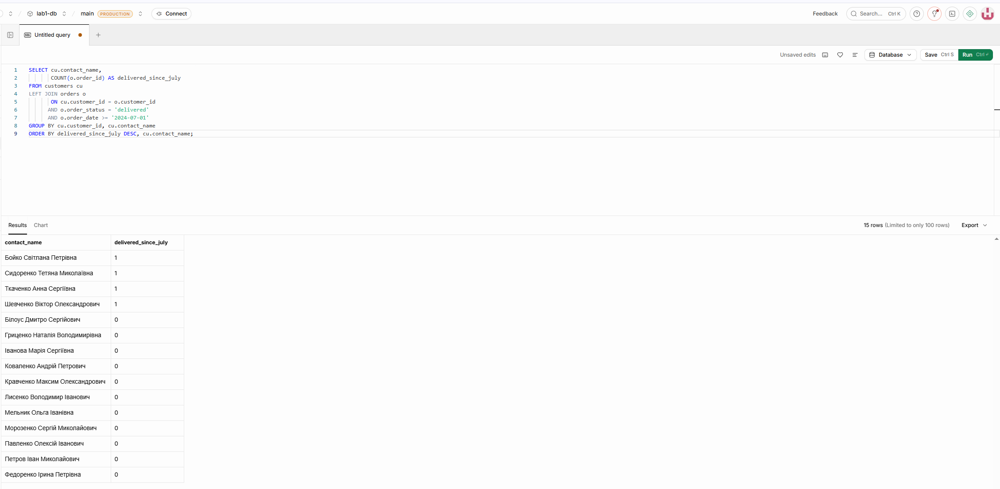

**Пояснення:** клієнти без збігів залишаються з NULL у стовпцях замовлення, тому `COUNT(o.order_id) = 0`.

**Аналіз складності:** така сама, як у 4.5: Hash Left Join і HashAggregate, O(n + m); фільтр за статусом і датою застосовується до `orders` до з'єднання (допоможе `idx_orders_status_date`).

**Завдання 4.7:** та сама умова у WHERE: LEFT JOIN перетворюється на INNER JOIN

```sql
SELECT cu.contact_name,
       COUNT(o.order_id) AS delivered_since_july
FROM customers cu
LEFT JOIN orders o ON cu.customer_id = o.customer_id
WHERE o.order_status = 'delivered'
  AND o.order_date >= '2024-07-01'
GROUP BY cu.customer_id, cu.contact_name
ORDER BY delivered_since_july DESC, cu.contact_name;
```

**Результат виконання:** лише 4 рядки — ті самі 4 клієнти; клієнти з нулем зникли.

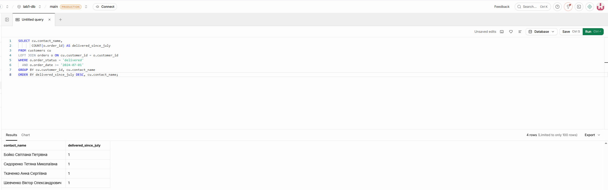

**Пояснення:** WHERE виконується після з'єднання й відкидає рядки з NULL у `o.order_status`, тому LEFT JOIN фактично стає INNER JOIN. Порівняння 4.6 і 4.7 показує типову помилку: умови до правої таблиці LEFT JOIN слід писати в ON.

**Аналіз складності:** O(n + m), як у 4.6. Оскільки умова у WHERE відкидає рядки з NULL у правій таблиці, планувальник може перетворити LEFT JOIN на INNER JOIN і вільніше вибирати порядок з'єднань. Різниця між 4.6 і 4.7 — у семантиці результату (15 проти 4 рядків), а не у вартості.

#### 5. Віконні функції

**Завдання 5.1:** ранжування товарів за ціною в категоріях (ROW_NUMBER, RANK, DENSE_RANK)

```sql
SELECT p.product_name,
       c.category_name,
       p.unit_price,
       RANK()       OVER (PARTITION BY c.category_name ORDER BY p.unit_price DESC) AS price_rank,
       DENSE_RANK() OVER (PARTITION BY c.category_name ORDER BY p.unit_price DESC) AS price_dense_rank,
       ROW_NUMBER() OVER (PARTITION BY c.category_name ORDER BY p.unit_price DESC) AS row_num
FROM products p
JOIN categories c ON p.category_id = c.category_id
ORDER BY c.category_name, p.unit_price DESC;
```

**Результат виконання:** 25 рядків. Усередині категорій немає товарів з однаковою ціною, тому три функції дають однакові номери (наприклад, ноутбуки: Dell XPS — 1, Lenovo ThinkPad — 2, MacBook Air — 3, ASUS ROG — 4, HP Pavilion — 5). Різницю між функціями показують запити 5.6 і 5.7.

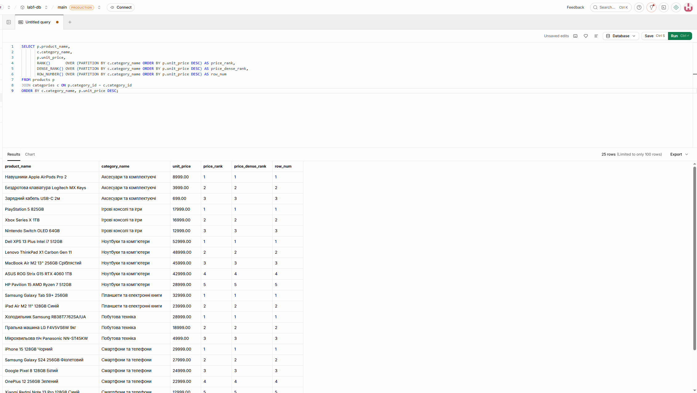

**Пояснення:** `PARTITION BY c.category_name` розбиває рядки на групи-«вікна», `ORDER BY p.unit_price DESC` задає порядок усередині вікна. На відміну від GROUP BY, рядки не згортаються.

**Аналіз складності:** сортування всередині партицій, O(n log n).

**Завдання 5.2:** порівняння замовлень з попередніми/наступними датами (LAG, LEAD)

```sql
SELECT cu.contact_name,
       o.order_id,
       o.order_date,
       o.freight,
       LAG(o.order_date)  OVER w AS prev_order_date,
       o.order_date - LAG(o.order_date) OVER w AS since_prev,
       LEAD(o.order_date) OVER w AS next_order_date,
       ROUND((o.freight - LAG(o.freight) OVER w)::numeric, 2) AS freight_change
FROM orders o
JOIN customers cu ON o.customer_id = cu.customer_id
WINDOW w AS (PARTITION BY o.customer_id ORDER BY o.order_date, o.order_id)
ORDER BY cu.contact_name, o.order_date;
```

**Результат виконання:** 31 рядок (усі замовлення). Наприклад, Білоус Дмитро: замовлення №7 (25.02.2024) та №29 (15.08.2024) — між ними 172 дні, вартість доставки зросла на 30,00. Для першого замовлення клієнта попередня дата — NULL.

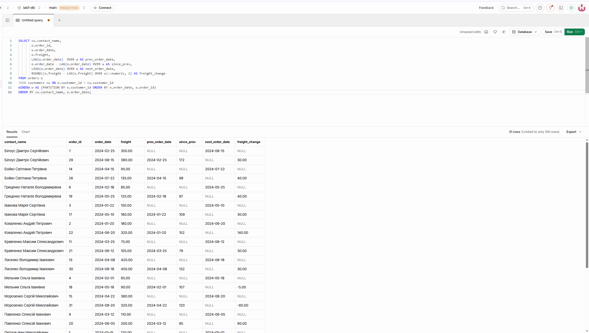

**Пояснення:** `LAG` бере значення з попереднього рядка у вікні клієнта, `LEAD` — з наступного. Вікно задано один раз через `WINDOW w AS (PARTITION BY customer_id ORDER BY order_date, order_id)` і використано чотири рази; `order_id` у `ORDER BY` забезпечує детермінований порядок при однакових датах.

**Аналіз складності:** одне сортування за `(customer_id, order_date)`, O(n log n); складений індекс `idx_orders_customer_date` може прибрати це сортування на великих даних.

**Завдання 5.3:** аналітика в розрізі категорій (AVG і SUM з PARTITION BY)

```sql
SELECT p.product_name,
       c.category_name,
       p.unit_price,
       ROUND(AVG(p.unit_price) OVER (PARTITION BY c.category_id)::numeric, 2) AS category_avg,
       ROUND((p.unit_price - AVG(p.unit_price) OVER (PARTITION BY c.category_id))::numeric, 2) AS diff_from_avg,
       ROUND((p.unit_price * 100.0 / SUM(p.unit_price) OVER (PARTITION BY c.category_id))::numeric, 1) AS pct_of_category
FROM products p
JOIN categories c ON p.category_id = c.category_id
ORDER BY c.category_name, p.unit_price DESC;
```

**Результат виконання:** 25 рядків; наприклад, AirPods Pro 2 (8 999) дорожчі за середню ціну «Аксесуарів» (4 565,67) на 4 433,33 і становлять 65,7 % суми цін категорії.

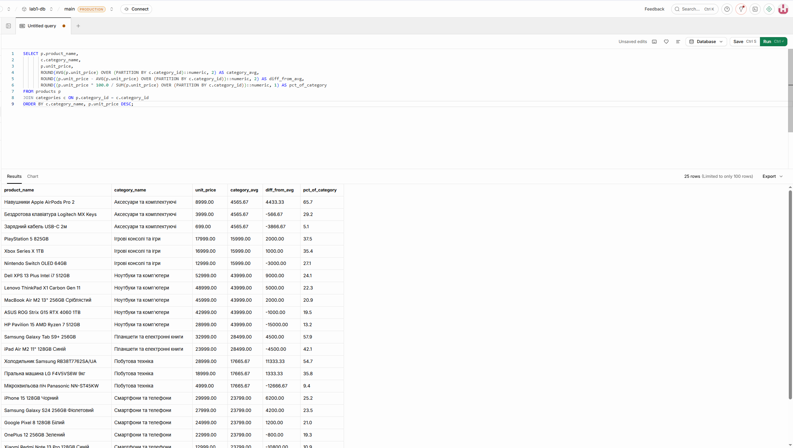

**Пояснення:** агрегатні функції як віконні: `AVG(...) OVER (PARTITION BY ...)` повертає середнє категорії в кожному рядку товару без згортання, тому поруч видно і ціну, і відхилення.

**Аналіз складності:** три віконні функції мають однакове вікно `PARTITION BY category_id`, тому обчислюються за один прохід WindowAgg після одного сортування, O(n log n). Без `ORDER BY` у вікні агрегат рахується по всій партиції, а не наростаючим підсумком. На великих даних індекс за `category_id` (наприклад, `idx_products_category_price`) може прибрати сортування.

**Завдання 5.4:** Top-N у групі — 2 найдорожчі товари кожної категорії

```sql
SELECT category_name, product_name, unit_price, rn AS place_in_category
FROM (
    SELECT c.category_name, p.product_name, p.unit_price,
           ROW_NUMBER() OVER (PARTITION BY c.category_id
                              ORDER BY p.unit_price DESC, p.product_id) AS rn
    FROM products p
    JOIN categories c ON p.category_id = c.category_id
) t
WHERE rn <= 2
ORDER BY category_name, rn;
```

**Результат виконання:** 14 рядків — по 2 товари у кожній із 7 непорожніх категорій (наприклад, телевізори: LG OLED C3 — 62 999 і Sony Bravia XR — 58 999).

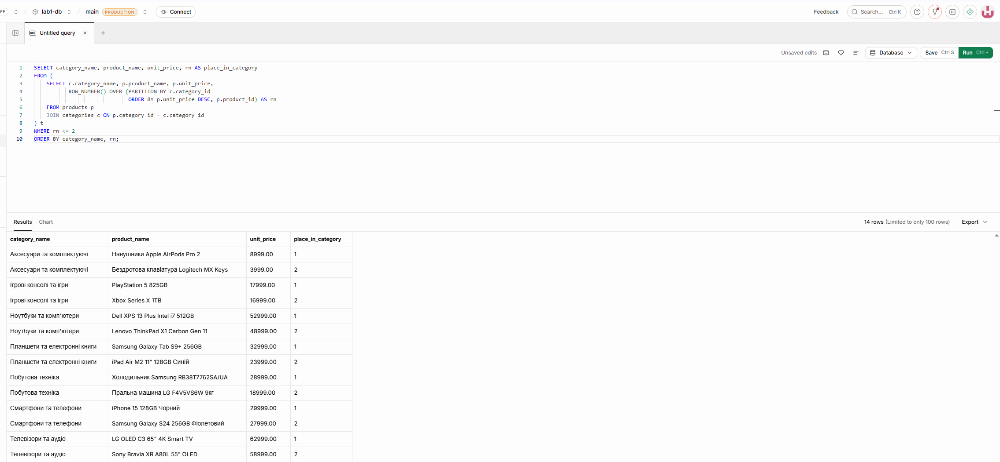

**Пояснення:** віконну функцію не можна використати безпосередньо у WHERE, тому `ROW_NUMBER()` обчислюється у підзапиті, а фільтр `rn <= 2` — у зовнішньому запиті.

**Аналіз складності:** сортування за `(category_id, unit_price DESC, product_id)` і WindowAgg, O(n log n). Фільтр `rn <= 2` винесено у зовнішній запит, але планувальник може застосувати його як Run Condition у WindowAgg і не нумерувати зайві рядки (така умова видна в плані 8.3 для аналогічного запиту). Індекс `idx_products_category_price` на великих даних дозволяє читати рядки майже впорядкованими.

**Завдання 5.5:** помісячна виручка: приріст (LAG) і накопичувальна сума

```sql
WITH monthly AS (
    SELECT DATE_TRUNC('month', o.order_date)::date AS month,
           ROUND(SUM(oi.quantity * oi.unit_price * (1 - oi.discount))::numeric, 2) AS revenue
    FROM orders o
    JOIN order_items oi ON o.order_id = oi.order_id
    WHERE o.order_status = 'delivered'
    GROUP BY DATE_TRUNC('month', o.order_date)
)
SELECT month,
       revenue,
       LAG(revenue) OVER (ORDER BY month) AS prev_month_revenue,
       ROUND((revenue - LAG(revenue) OVER (ORDER BY month)) * 100.0
             / NULLIF(LAG(revenue) OVER (ORDER BY month), 0), 2) AS growth_percent,
       SUM(revenue) OVER (ORDER BY month) AS running_total
FROM monthly
ORDER BY month;
```

**Результат виконання:** помісячна виручка доставлених замовлень: січень 143 141,35 → лютий 256 169,82 (+78,96 %) → березень 145 752,43 (−43,10 %) → квітень 415 015,64 (+184,74 %) → травень 104 803,13 (−74,75 %) → червень 198 993,80 (+89,87 %) → липень 208 464,46 (+4,76 %). Накопичена виручка — 1 472 340,63. Серпня в результаті немає: усі серпневі замовлення ще не доставлені.

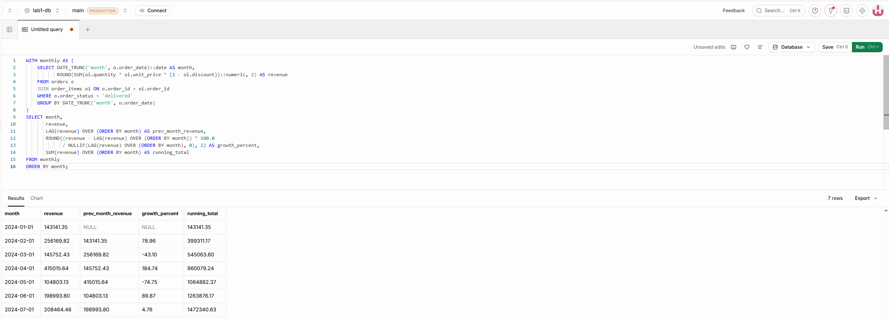

**Пояснення:** CTE `monthly` рахує виручку по місяцях; `LAG(revenue)` бере попередній місяць для обчислення приросту (`NULLIF(..., 0)` захищає від ділення на нуль), `SUM(revenue) OVER (ORDER BY month)` дає накопичувальну суму.

**Аналіз складності:** CTE `monthly` — один прохід по `orders` ⨝ `order_items` і HashAggregate за місяцем, O(n + m); віконні функції працюють уже над кількома рядками (по одному на місяць), O(g log g). Три виклики `LAG` і `SUM` з однаковим вікном `ORDER BY month` використовують одне сортування. Фільтр і групування за датою обслуговує індекс `idx_orders_status_date`; для регулярних звітів цю агрегацію вже винесено в `mv_monthly_sales` (6.1).

**Завдання 5.6:** ROW_NUMBER, RANK і DENSE_RANK на клієнтах за кількістю замовлень

```sql
-- Рейтинг клієнтів за кількістю замовлень; при однаковій кількості видно різницю між функціями
SELECT cu.contact_name,
       COUNT(o.order_id) AS orders_count,
       ROW_NUMBER() OVER (ORDER BY COUNT(o.order_id) DESC, cu.contact_name) AS row_num,
       RANK()       OVER (ORDER BY COUNT(o.order_id) DESC) AS rank_num,
       DENSE_RANK() OVER (ORDER BY COUNT(o.order_id) DESC) AS dense_rank_num
FROM customers cu
LEFT JOIN orders o ON cu.customer_id = o.customer_id
GROUP BY cu.customer_id, cu.contact_name
ORDER BY orders_count DESC, cu.contact_name;
```

**Результат виконання:** Петров Іван (3 замовлення) — місце 1 за всіма функціями; решта 14 клієнтів мають по 2 замовлення: `RANK` і `DENSE_RANK` дають усім 2, а `ROW_NUMBER` нумерує 2…15 (порядок при рівності задано другим ключем — іменем).

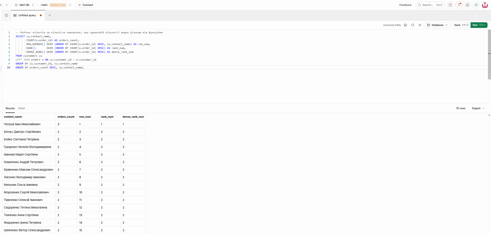

**Пояснення:** при рівних значеннях `ROW_NUMBER` усе одно присвоює унікальні номери. Усі рівні значення в цьому прикладі стоять після єдиного лідера, тому прогалини в `RANK` не видно — детальніше в наступному запиті.

**Аналіз складності:** LEFT JOIN із HashAggregate за клієнтом, O(n + m), далі віконні функції над 15 рядками. `ROW_NUMBER` має додатковий ключ сортування, тому його вікно відрізняється від вікон `RANK` і `DENSE_RANK`, і планувальник виконує два проходи WindowAgg; на таких обсягах вартість непомітна.

**Завдання 5.7:** RANK проти DENSE_RANK на товарах за кількістю продажів (збіги посередині рейтингу)

```sql
SELECT p.product_name,
       SUM(oi.quantity) AS total_sold,
       ROW_NUMBER() OVER (ORDER BY SUM(oi.quantity) DESC, p.product_name) AS row_num,
       RANK()       OVER (ORDER BY SUM(oi.quantity) DESC) AS rank_num,
       DENSE_RANK() OVER (ORDER BY SUM(oi.quantity) DESC) AS dense_rank_num
FROM products p
JOIN order_items oi ON p.product_id = oi.product_id
GROUP BY p.product_id, p.product_name
ORDER BY total_sold DESC, p.product_name;
```

**Результат виконання:** Dell XPS 13 і пральна машина LG мають по 6 проданих одиниць: `RANK` = 5 і 5, `DENSE_RANK` = 5 і 5, а наступний товар (Samsung QLED, 5 шт.) отримує `RANK` = 7, але `DENSE_RANK` = 6. Три товари по 3 шт. (LG OLED, Samsung S24, Xiaomi Redmi Note 13): `RANK` = 10, `DENSE_RANK` = 8. Група з 7 товарів по 1 шт.: `RANK` = 15, `DENSE_RANK` = 10; `ROW_NUMBER` скрізь унікальний (15–21).

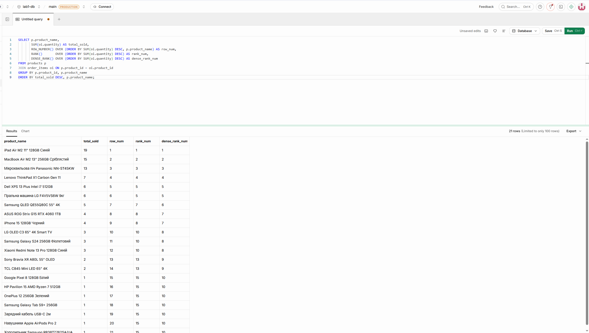

**Пояснення:** `RANK` після групи збігів «перестрибує» номери (5, 5, 7), `DENSE_RANK` іде без пропусків (5, 5, 6), `ROW_NUMBER` ігнорує збіги.

**Аналіз складності:** Hash Join `products` ⨝ `order_items`, HashAggregate за товаром, O(n + m), потім два вікна (одне для `ROW_NUMBER` з додатковим ключем, друге спільне для `RANK` і `DENSE_RANK`) над 21 рядком. Із ростом `order_items` вирішальним стає індекс `idx_order_items_product`.

### Рівень 3

#### 6. Матеріалізовані представлення, рекурсивні запити, динамічний SQL

**Завдання 6.1:** матеріалізоване представлення для аналізу продажів

```sql
CREATE MATERIALIZED VIEW mv_monthly_sales AS
SELECT
    EXTRACT(YEAR  FROM o.order_date)::int AS year,
    EXTRACT(MONTH FROM o.order_date)::int AS month,
    c.category_name,
    COALESCE(r.region_name, 'Невідомо')   AS region_name,
    ROUND(SUM(oi.quantity * oi.unit_price * (1 - oi.discount))::numeric, 2) AS total_revenue,
    COUNT(DISTINCT o.order_id)            AS orders_count,
    -- середня виручка на одне замовлення (а не на один рядок замовлення)
    ROUND((SUM(oi.quantity * oi.unit_price * (1 - oi.discount))
           / COUNT(DISTINCT o.order_id))::numeric, 2) AS avg_order_value
FROM orders o
JOIN order_items oi ON o.order_id = oi.order_id
JOIN products p     ON oi.product_id = p.product_id
JOIN categories c   ON p.category_id = c.category_id
JOIN customers cu   ON o.customer_id = cu.customer_id
LEFT JOIN regions r ON cu.region_id = r.region_id
WHERE o.order_status = 'delivered'
GROUP BY 1, 2, 3, 4;
```

**Результат виконання:** представлення `mv_monthly_sales` створено (`Success. No rows returned`).

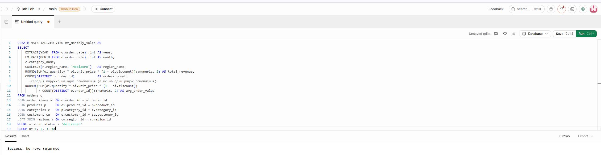

**Пояснення:** представлення зберігає попередньо обчислений результат п'яти з'єднань і агрегації за роком, місяцем, категорією та регіоном (враховуються лише доставлені замовлення). Порівняно з методичкою внесено три зміни: (1) `avg_order_value` рахується як виручка, поділена на кількість замовлень, а не як середнє по рядках позицій; (2) `COALESCE(region_name, ...)` прибирає NULL, щоб на стовпцях можна було побудувати унікальний індекс; (3) `GROUP BY 1, 2, 3, 4` посилається на стовпці результату.

**Аналіз складності:** створення виконує важкий запит один раз: п'ять з'єднань, агрегація за чотирма ключами та `COUNT(DISTINCT)`, вартість ≈ запиту 7.3, O(n + m) + сортування груп (за `pg_stat_statements` — найдовша операція, ≈ 32,99 мс). Результат займає лише 34 рядки, а вартість переноситься на `REFRESH`.

**Переваги матеріалізованих представлень:** результат зберігається фізично, тому читання не повторює дороге з'єднання й агрегацію (запит 7.3: 0,648 мс і 217 буферів проти 0,113 мс і 1 буфера для запиту 7.4 — у 5,7 раза швидше); до представлення можна додавати індекси; воно зручне для звітів, що не потребують даних у реальному часі. Недолік — дані застарівають, їх потрібно оновлювати (`REFRESH`).

**Індекси для представлення:**

```sql
-- Унікальний індекс потрібен для REFRESH ... CONCURRENTLY
CREATE UNIQUE INDEX ux_mv_monthly_sales
    ON mv_monthly_sales (year, month, category_name, region_name);

-- Індекс з методички (для вибірок за періодом)
CREATE INDEX idx_mv_monthly_sales_date
    ON mv_monthly_sales (year, month);
```

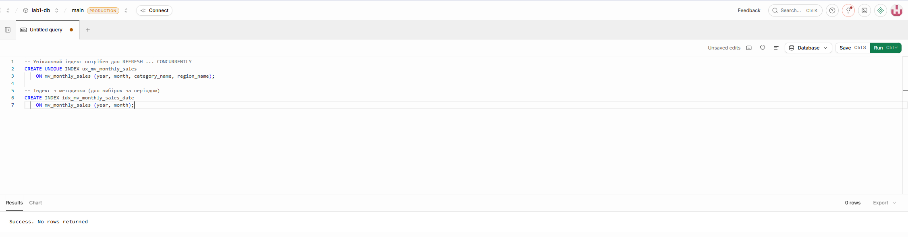

Унікальний індекс необхідний для `REFRESH MATERIALIZED VIEW CONCURRENTLY` (оновлення без блокування читачів); другий індекс — за періодом (як у методичці; його ліва частина `(year, month)` частково перекривається унікальним, тому на практиці він не обов'язковий).

**Завдання 6.3:** читання з представлення

```sql
SELECT *
FROM mv_monthly_sales
ORDER BY year, month, category_name, region_name
LIMIT 20;
```

**Результат виконання:** показано перші 20 із 34 рядків (кількість рядків видно в плані 7.4). Наприклад: січень 2024, «Ноутбуки та комп'ютери», м. Київ — 82 798,20; квітень 2024, ноутбуки, Дніпропетровська область — 2 замовлення, 159 526,39, середнє на замовлення 79 763,20.

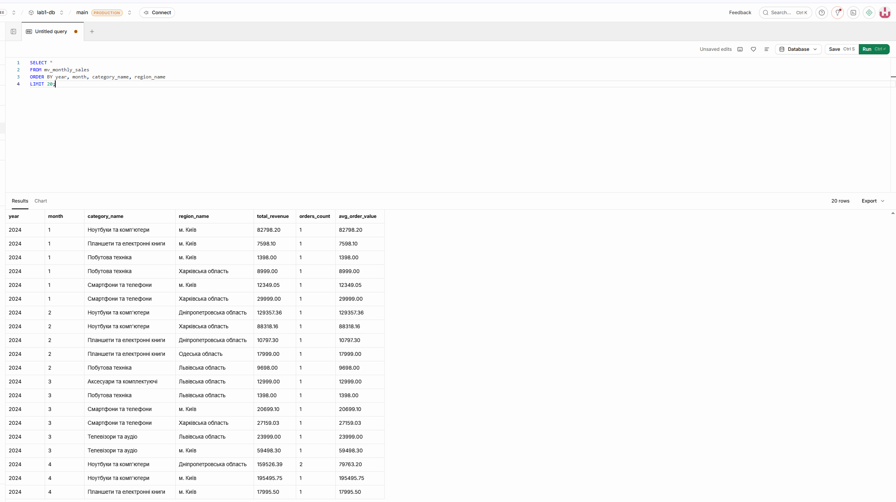

**Аналіз складності:** читання одного невеликого об'єкта без з'єднань: сканування 34 рядків і сортування з `LIMIT 20` (top-N), O(k log k). Стовпці `ORDER BY` збігаються з унікальним індексом `ux_mv_monthly_sales`, тому на великому представленні планувальник міг би читати рядки за індексом без сортування.

**Завдання 6.4:** виручка по місяцях із представлення

```sql
SELECT year, month,
       SUM(total_revenue) AS revenue
FROM mv_monthly_sales
GROUP BY year, month
ORDER BY year, month;
```

**Результат виконання:** сім місяців, значення збігаються із CTE-запитом 5.5 (143 141,35; 256 169,82; 145 752,43; 415 015,64; 104 803,13; 198 993,80; 208 464,46) — перехресна перевірка коректності представлення.

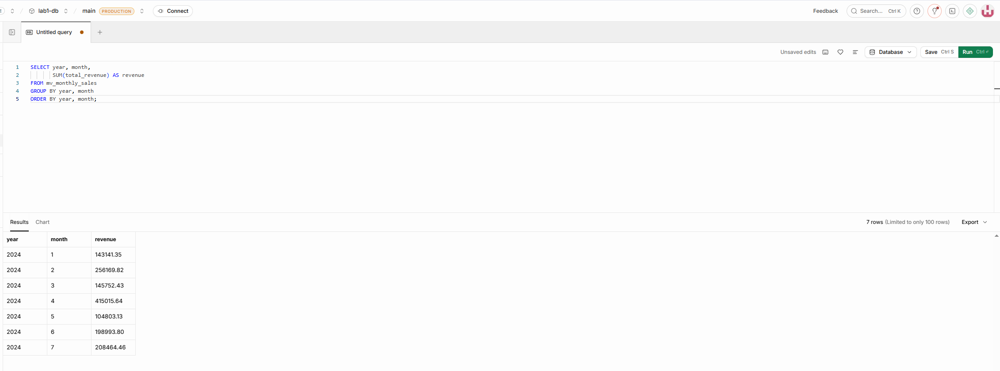

**Аналіз складності:** HashAggregate лише по 34 рядках представлення замість п'яти з'єднань по базових таблицях — O(k). Той самий результат, що й у 5.5, але дешевший, бо важку частину виконано один раз під час створення або оновлення представлення.

**Завдання 6.5:** оновлення представлення без блокування читачів

```sql
REFRESH MATERIALIZED VIEW CONCURRENTLY mv_monthly_sales;
```

**Результат виконання:** `Success. No rows returned`.

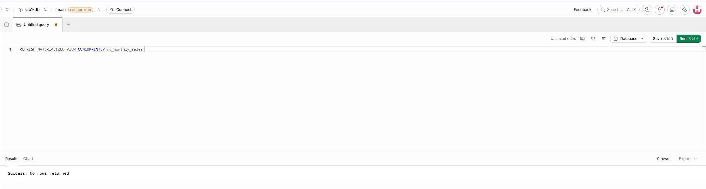

**Пояснення:** `CONCURRENTLY` будує нову версію даних поряд зі старою й підміняє її, тому читачі не блокуються. Для цього потрібен унікальний індекс без умови WHERE (створений у 6.2).

**Аналіз складності:** `REFRESH ... CONCURRENTLY` повторно виконує запит представлення (вартість як у 7.3), записує результат у тимчасову таблицю й порівнює його зі старим вмістом за унікальним індексом, змінюючи лише відмінні рядки. Це дорожче за звичайний `REFRESH`, зате читачі не блокуються.

**Завдання 6.6:** рекурсивний CTE — ієрархія співробітників

```sql
WITH RECURSIVE employee_hierarchy AS (
    -- Базовий випадок: топ-менеджери (без керівника)
    SELECT employee_id, first_name, last_name, title, reports_to,
           0 AS level,
           CAST(last_name || ' ' || first_name AS VARCHAR(1000)) AS hierarchy_path
    FROM employees
    WHERE reports_to IS NULL

    UNION ALL

    -- Рекурсивний випадок: підлеглі
    SELECT e.employee_id, e.first_name, e.last_name, e.title, e.reports_to,
           eh.level + 1,
           CAST(eh.hierarchy_path || ' -> ' || e.last_name || ' ' || e.first_name AS VARCHAR(1000))
    FROM employees e
    JOIN employee_hierarchy eh ON e.reports_to = eh.employee_id
    WHERE eh.level < 10   -- захист від зациклення
)
SELECT * FROM employee_hierarchy
ORDER BY hierarchy_path;
```

**Результат виконання:** 8 співробітників, 3 рівні: рівень 0 — Петренко Олександр; рівень 1 — Іваненко, Коваленко, Шевченко; рівень 2 — Білоус і Сидоренко (під Іваненком), Гриценко та Мельник (під Коваленко). Повний шлях відображено в `hierarchy_path`, наприклад «Петренко Олександр -> Коваленко Марія -> Мельник Андрій».

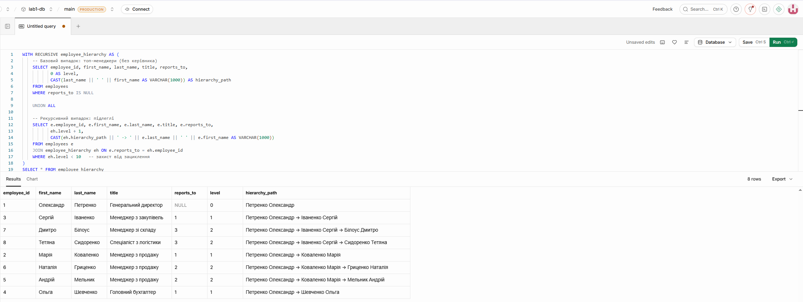

**Пояснення:** базовий випадок вибирає кореневу вершину (`reports_to IS NULL`), рекурсивна частина через `UNION ALL` приєднує підлеглих попереднього рівня; умова `level < 10` захищає від зациклення при помилкових даних.

**Аналіз складності:** кожен рівень — окремий прохід із з'єднанням за `reports_to`; загальна складність O(n) для дерева (кожен співробітник обробляється один раз); індекс `idx_employees_reports_to` прискорює пошук підлеглих.

**Завдання 6.7:** рекурсивний CTE (творчий) — кількість підлеглих кожного керівника на всіх рівнях

```sql
WITH RECURSIVE subs AS (
    -- кожен співробітник — «керівник самого себе» на глибині 0
    SELECT employee_id AS manager_id, employee_id AS sub_id, 0 AS depth
    FROM employees

    UNION ALL

    SELECT s.manager_id, e.employee_id, s.depth + 1
    FROM employees e
    JOIN subs s ON e.reports_to = s.sub_id
    WHERE s.depth < 10
)
SELECT m.last_name || ' ' || m.first_name AS manager,
       m.title,
       COUNT(*) FILTER (WHERE s.depth = 1) AS direct_reports,
       COUNT(*) FILTER (WHERE s.depth > 0) AS all_subordinates
FROM subs s
JOIN employees m ON m.employee_id = s.manager_id
GROUP BY m.employee_id, m.last_name, m.first_name, m.title
ORDER BY all_subordinates DESC, manager;
```

**Результат виконання:** Петренко: 3 прямих і 7 усього; Іваненко та Коваленко: по 2 прямих і по 2 усього; решта — 0/0.

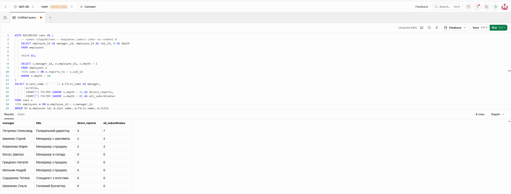

**Пояснення:** кожен співробітник спершу «підпорядкований самому собі» на глибині 0, далі рекурсія додає всіх нащадків, зберігаючи кореневого керівника. `COUNT(*) FILTER (WHERE ...)` одним проходом рахує прямих (depth = 1) і всіх (depth > 0) підлеглих.

**Аналіз складності:** проміжна множина `subs` містить по одному рядку на кожну пару «керівник — підлеглий на будь-якій глибині»: загалом O(n·h), де h — висота дерева (обмежена умовою `depth < 10`). Для цих даних це 19 рядків (8 + 7 + 4 на глибинах 0, 1, 2). Кожна ітерація рекурсії шукає підлеглих за `reports_to` (індекс `idx_employees_reports_to`), а `COUNT(*) FILTER` обчислює обидва показники за один прохід.

**Завдання 6.8:** динамічний SQL — функція параметризованої аналітики продажів

```sql
CREATE OR REPLACE FUNCTION get_sales_report(
    p_group_by  text DEFAULT 'category',   -- 'category' | 'region' | 'month' | 'customer_type'
    p_date_from date DEFAULT NULL,
    p_date_to   date DEFAULT NULL,
    p_status    text DEFAULT 'delivered'   -- NULL = усі статуси
)
RETURNS TABLE (group_name text, orders_count bigint, items_sold bigint, revenue numeric)
LANGUAGE plpgsql
AS $$
DECLARE
    v_expr text;
    v_sql  text;
BEGIN
    -- Білий список виразів групування: у динамічний SQL потрапляє лише наш власний текст (захист від SQL-ін'єкцій)
    v_expr := CASE p_group_by
        WHEN 'category'      THEN 'c.category_name'
        WHEN 'region'        THEN 'COALESCE(r.region_name, ''Невідомо'')'
        WHEN 'month'         THEN 'TO_CHAR(o.order_date, ''YYYY-MM'')'
        WHEN 'customer_type' THEN 'cu.customer_type::text'
        ELSE NULL
    END;

    IF v_expr IS NULL THEN
        RAISE EXCEPTION 'Невідомий параметр групування: %. Допустимо: category, region, month, customer_type', p_group_by;
    END IF;

    v_sql := format($f$
        SELECT (%s)::text AS group_name,
               COUNT(DISTINCT o.order_id) AS orders_count,
               SUM(oi.quantity)::bigint   AS items_sold,
               ROUND(SUM(oi.quantity * oi.unit_price * (1 - oi.discount))::numeric, 2) AS revenue
        FROM orders o
        JOIN order_items oi ON o.order_id = oi.order_id
        JOIN products p     ON oi.product_id = p.product_id
        JOIN categories c   ON p.category_id = c.category_id
        JOIN customers cu   ON o.customer_id = cu.customer_id
        LEFT JOIN regions r ON cu.region_id = r.region_id
        WHERE ($1 IS NULL OR o.order_date >= $1)
          AND ($2 IS NULL OR o.order_date <  $2 + 1)
          AND ($3 IS NULL OR o.order_status::text = $3)
        GROUP BY 1
        ORDER BY revenue DESC
    $f$, v_expr);

    -- Значення фільтрів передаються як параметри ($1..$3), а не вклеюються в текст
    RETURN QUERY EXECUTE v_sql USING p_date_from, p_date_to, p_status;
END;
$$;
```

**Результат виконання:** функцію `get_sales_report` створено.

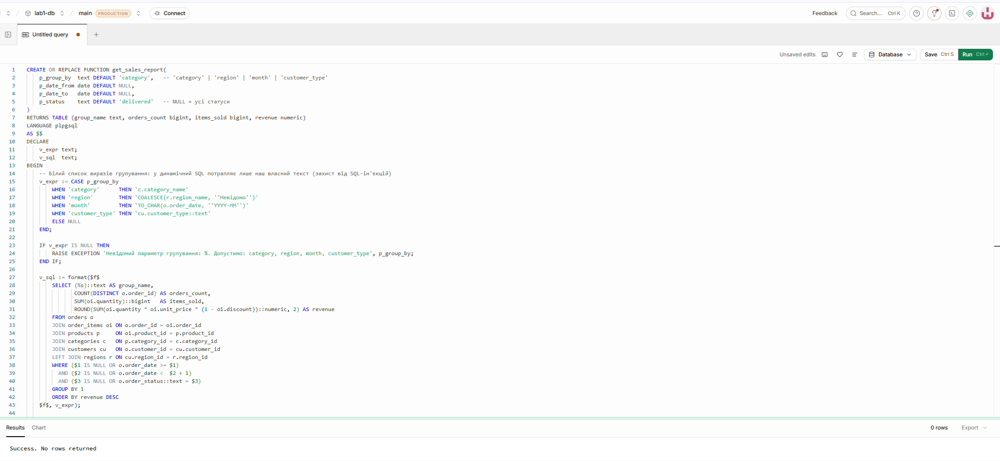

**Пояснення:** функція приймає тип групування (`category`, `region`, `month`, `customer_type`), період дат і статус замовлення. Вираз групування вибирається з **білого списку** (`CASE`), тому в динамічний запит потрапляє лише власний текст функції — це захист від SQL-ін'єкцій; невідоме значення викликає `RAISE EXCEPTION`. Текст запиту збирається через `format()`, а значення фільтрів передаються як параметри `$1..$3` у `EXECUTE ... USING`, а не вклеюються в текст. Значення за замовчуванням дозволяють викликати функцію з одним параметром, а `NULL` у фільтрі означає «без обмеження».

**Аналіз складності:** внутрішній запит — п'ять з'єднань і HashAggregate, O(n + m) плюс сортування груп. `EXECUTE` планує запит під час кожного виклику (план динамічного SQL не кешується), тому додається невеликий час планування; натомість планувальник бачить значення параметрів і може обрати точніший план. Для частих викликів з однаковими параметрами доцільно читати дані з `mv_monthly_sales`.

**Завдання 6.9:** виклик: продажі за категоріями

```sql
SELECT * FROM get_sales_report('category');
```

**Результат виконання:** 6 категорій: Ноутбуки — 822 092,46 (7 замовлень, 20 од.), Смартфони — 266 948,99, Телевізори — 217 354,53, Побутова техніка — 77 557,75, Планшети — 58 388,90, Аксесуари — 29 998,00. Сума 1 472 340,63 збігається з накопиченою виручкою у 5.5.

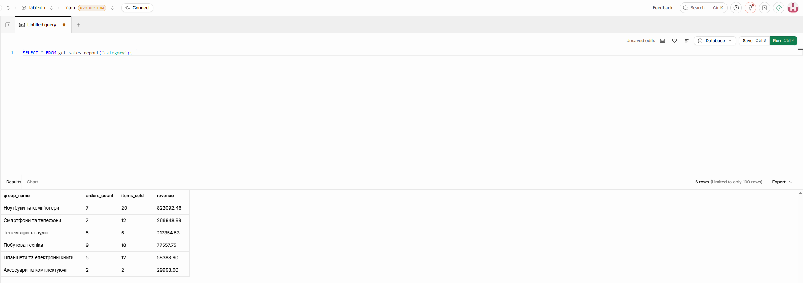

**Аналіз складності:** виклик заново виконує п'ятитабличне з'єднання й агрегацію, вартість близька до 7.3, а кількість груп обмежена кількістю категорій. Виручку за категоріями можна отримати й із `mv_monthly_sales` простим `GROUP BY category_name` без з'єднань.

**Завдання 6.10:** виклик: продажі за регіонами за перше півріччя 2024

```sql
SELECT * FROM get_sales_report('region', '2024-01-01', '2024-06-30');
```

**Результат виконання:** Київ — 622 387,68 (6 замовлень, 25 од.), Дніпропетровська — 308 680,05, Харківська — 203 719,44, Одеська — 67 997,00, Львівська — 61 092,00. Сума 1 263 876,17 збігається з накопиченою виручкою на кінець червня у 5.5.

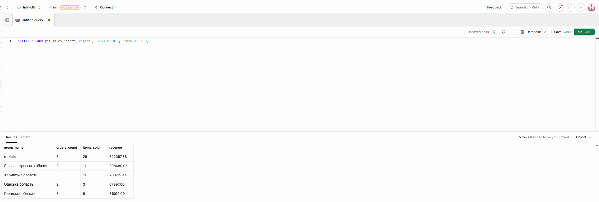

**Аналіз складності:** те саме п'ятитабличне з'єднання, але з фільтром за датою; групи — п'ять регіонів. Оскільки межі періоду збігаються з межами місяців, ту саму виручку можна взяти з `mv_monthly_sales` (`month <= 6`, `GROUP BY region_name`).

**Завдання 6.11:** виклик: продажі за місяцями

```sql
SELECT * FROM get_sales_report('month');
```

**Результат виконання:** 7 місяців; найбільша виручка — квітень (415 015,64), найменша — травень (104 803,13).

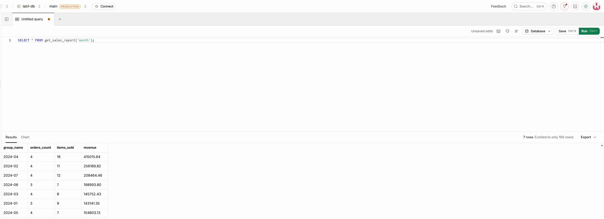

**Аналіз складності:** групування за `TO_CHAR(o.order_date, 'YYYY-MM')` виконується над результатом з'єднання, O(n + m) + сортування 7 груп. Вираз у `GROUP BY` унеможливлює використання індексу за датою для групування, а готову помісячну виручку вже містить `mv_monthly_sales` (6.4).

**Завдання 6.12:** виклик: за типом клієнта, усі статуси замовлень

```sql
SELECT * FROM get_sales_report('customer_type', NULL, NULL, NULL);
```

**Результат виконання:** company — 12 замовлень, 64 од., 1 823 214,64; individual — 19 замовлень, 35 од., 448 711,46 (разом 31 замовлення, тобто враховано всі статуси).

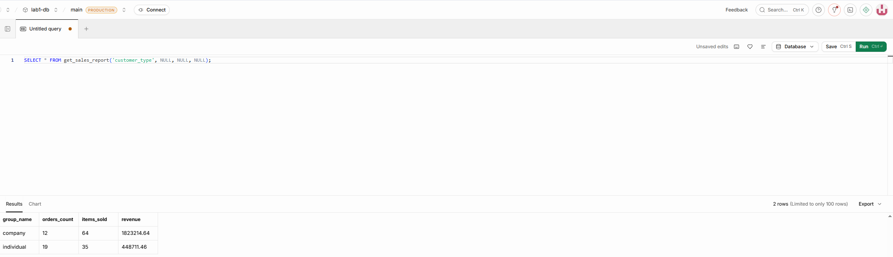

**Пояснення:** `NULL` у четвертому параметрі вимикає фільтр за статусом.

**Аналіз складності:** вартість така сама, як у 6.9, але без фільтра за статусом читаються всі 31 замовлення; груп лише дві. `mv_monthly_sales` тут не підходить: вона містить тільки доставлені замовлення і не має стовпця `customer_type`.

**Завдання 6.13–6.14:** збережена процедура оновлення представлення

```sql
CREATE OR REPLACE PROCEDURE refresh_sales_mv()
LANGUAGE plpgsql
AS $$
BEGIN
    REFRESH MATERIALIZED VIEW CONCURRENTLY mv_monthly_sales;
    RAISE NOTICE 'mv_monthly_sales оновлено: %', NOW();
END;
$$;
```

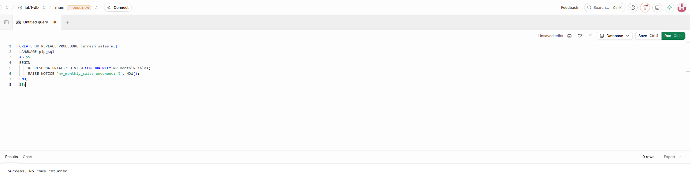

```sql
CALL refresh_sales_mv();
```

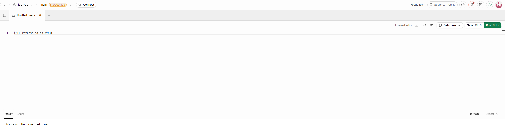

**Пояснення:** процедура інкапсулює оновлення `mv_monthly_sales`, і її можна запускати за розкладом (наприклад, через pg_cron) або після завантаження нових даних. На відміну від функції, процедура викликається через `CALL` і не повертає значення.

**Аналіз складності:** вартість процедури дорівнює вартості `REFRESH MATERIALIZED VIEW CONCURRENTLY` (див. 6.5); сам виклик `CALL` — одна операція без результуючого набору. Для регулярного запуску важкі оновлення доцільно планувати на непікові години.

---
## Аналіз продуктивності
---

### Дослідження планів виконання

Для аналізу використано `EXPLAIN (ANALYZE, BUFFERS)`. Таблиці навчальної бази дуже малі (25–47 рядків), тому всі запити виконуються за соті та десяті частки мілісекунди, а різницю між запусками визначає переважно кеш. Перший запуск «холодний», тому для порівняння використано повторні запуски (скріншоти з суфіксом `b`, на яких видно рядок `Execution Time`). Усі повторні запуски виконано вже після створення індексів, тому їх часи між собою відображають лише шум вимірювання.

| Запит | Execution Time, мс | Planning Time, мс | Ключові вузли плану |
|---|---|---|---|
| 7.1b — продажі за регіонами (2.2), повторний запуск | 0,472 | 1,564 | 2 × Hash Join, Seq Scan по order_items, GroupAggregate |
| 7.8b — той самий запит, ще один повторний запуск | 0,493 | 1,685 | Index Scan лише по regions_pkey |
| 7.2b — корельований підзапит (3.1), повторний запуск | 0,441 | 0,943 | SubPlan 1 (Seq Scan), Memoize + Index Scan по categories_pkey |
| 7.9b — той самий запит, ще один повторний запуск | 0,436 | 0,940 | без змін |
| **7.3 — запит основи представлення (5 JOIN)** | **0,648** | **2,296** | Hash Join, Nested Loop × 2, Memoize, GroupAggregate; 217 буферів |
| 7.4 — читання з представлення | 0,113 | 0,296 | Seq Scan on mv_monthly_sales; 1 буфер |
| 7.14 — віконна функція замість підзапиту | 0,366 | 0,774 | WindowAgg, одне сканування products |
| 8.3 — топ-5, віконні функції | 0,421 | 0,829 | WindowAgg, Run Condition |
| 8.4 — топ-5, корельований підзапит | 0,479 | 0,860 | SubPlan 1 для кожного рядка |

**Найповільніший запит** серед досліджених — аналітичний запит із п'ятьма з'єднаннями та агрегацією, який лежить в основі матеріалізованого представлення (7.3): 0,648 мс виконання і 2,296 мс планування, 217 буферів у верхньому вузлі. За статистикою `pg_stat_statements` (7.13) найдовше виконувався сам `CREATE MATERIALIZED VIEW` (в середньому 32,99 мс), серед аналітичних SELECT — FULL OUTER JOIN із запиту 4.2 (1,68 мс) і підзапит у SELECT із 3.3 (1,60 мс на першому запуску).

```sql
EXPLAIN (ANALYZE, BUFFERS)
SELECT
    EXTRACT(YEAR  FROM o.order_date)::int AS year,
    EXTRACT(MONTH FROM o.order_date)::int AS month,
    c.category_name,
    COALESCE(r.region_name, 'Невідомо')   AS region_name,
    ROUND(SUM(oi.quantity * oi.unit_price * (1 - oi.discount))::numeric, 2) AS total_revenue,
    COUNT(DISTINCT o.order_id)            AS orders_count,
    ROUND((SUM(oi.quantity * oi.unit_price * (1 - oi.discount))
           / COUNT(DISTINCT o.order_id))::numeric, 2) AS avg_order_value
FROM orders o
JOIN order_items oi ON o.order_id = oi.order_id
JOIN products p     ON oi.product_id = p.product_id
JOIN categories c   ON p.category_id = c.category_id
JOIN customers cu   ON o.customer_id = cu.customer_id
LEFT JOIN regions r ON cu.region_id = r.region_id
WHERE o.order_status = 'delivered'
GROUP BY 1, 2, 3, 4;
```

**План виконання (EXPLAIN ANALYZE):**

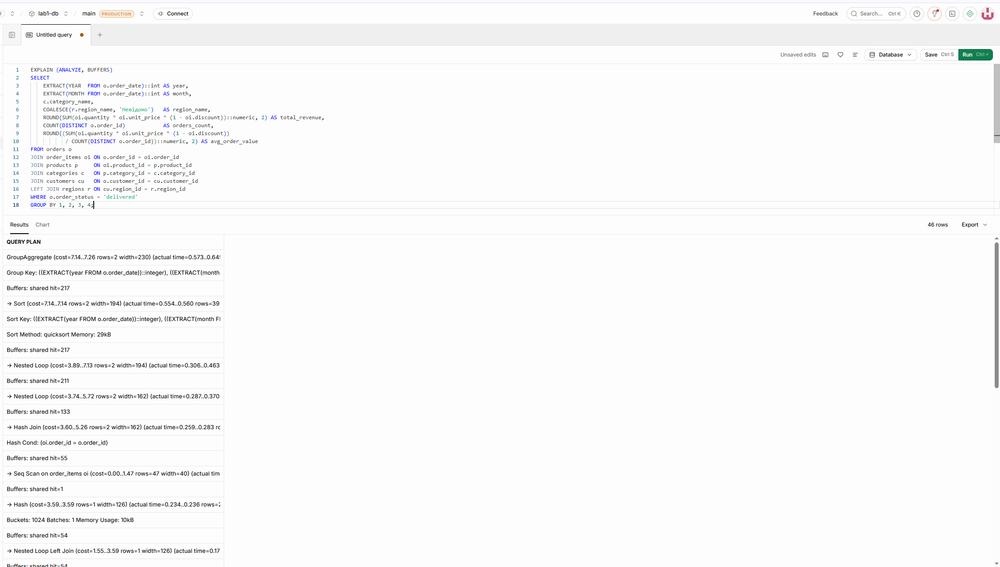

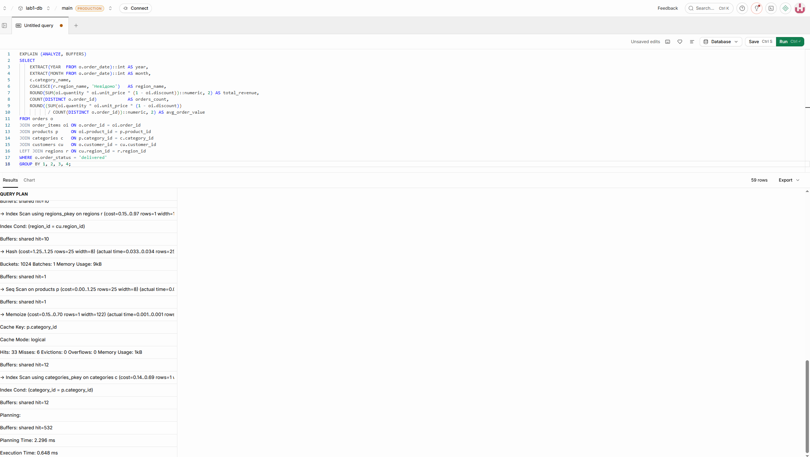

Для порівняння — читання тих самих даних із представлення (7.4):

```sql
EXPLAIN (ANALYZE, BUFFERS)
SELECT * FROM mv_monthly_sales;
```

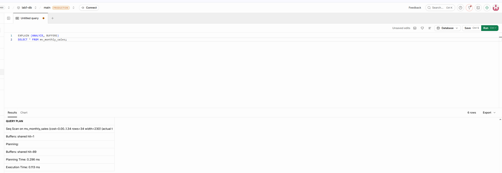

Інші плани, на яких базується аналіз (запити 2.2 і 3.1 відповідно):

```sql
EXPLAIN (ANALYZE, BUFFERS)
SELECT r.region_name,
       COUNT(DISTINCT o.order_id) AS orders_count,
       SUM(oi.quantity)           AS items_sold,
       ROUND(SUM(oi.quantity * oi.unit_price * (1 - oi.discount))::numeric, 2) AS total_sales
FROM orders o
JOIN customers cu   ON o.customer_id = cu.customer_id
JOIN regions r      ON cu.region_id = r.region_id
JOIN order_items oi ON o.order_id = oi.order_id
WHERE o.order_status <> 'cancelled'
GROUP BY r.region_id, r.region_name
HAVING SUM(oi.quantity * oi.unit_price * (1 - oi.discount)) > 100000
ORDER BY total_sales DESC;
```

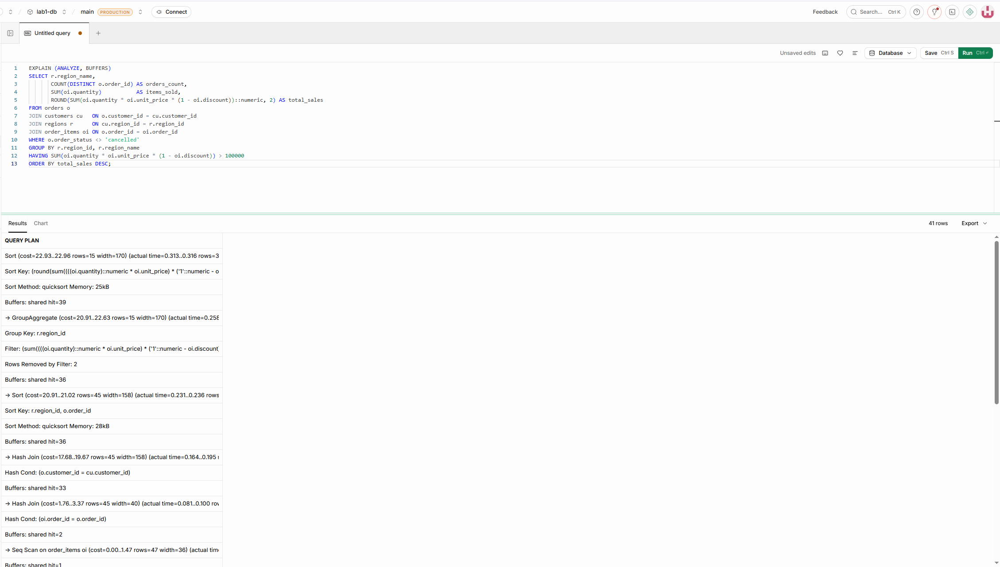

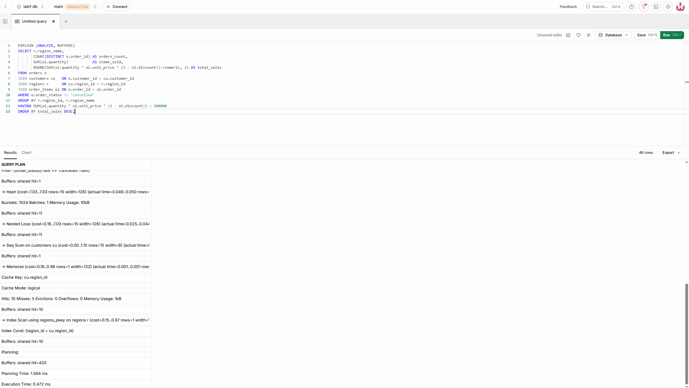

```sql
EXPLAIN (ANALYZE, BUFFERS)
SELECT p.product_name, p.unit_price, c.category_name
FROM products p
INNER JOIN categories c ON p.category_id = c.category_id
WHERE p.unit_price > (
    SELECT AVG(p2.unit_price)
    FROM products p2
    WHERE p2.category_id = p.category_id
)
ORDER BY c.category_name, p.unit_price DESC;
```


**Запропоновані оптимізації:**

1. **Матеріалізоване представлення для повторюваної аналітики.** Результат п'яти з'єднань зберігається один раз і оновлюється `REFRESH ... CONCURRENTLY` (процедура 6.13). Виміряно: 0,648 → 0,113 мс виконання (у 5,7 раза), 2,296 → 0,296 мс планування, 217 → 1 буфер.
2. **Заміна корельованого підзапиту віконною функцією.** `AVG(...) OVER (PARTITION BY category_id)` читає `products` один раз замість виконання підзапиту для кожного рядка. Виміряно (7.14 проти 7.9b — запит 3.1): 0,436 → 0,366 мс (різниця 0,07 мс лежить у межах шуму, тому головний аргумент структурний: одне сканування `products` замість підзапиту на кожен рядок), буферів на планування 262 → 184.
3. **Складені індекси під типові фільтри та вікна** (див. нижче). На навчальній базі планувальник їх не обирає, але на великих таблицях вони дають вибірку без повного сканування.
4. **Параметризована функція** (6.8) замість копіювання схожих запитів: одна перевірена реалізація, менший ризик помилок; **ANALYZE** після масових змін даних, щоб планувальник мав актуальну статистику.

Оптимізований варіант запиту 3.1 (7.14):

```sql
EXPLAIN (ANALYZE, BUFFERS)
SELECT product_name, unit_price, category_name
FROM (
    SELECT p.product_name, p.unit_price, c.category_name,
           AVG(p.unit_price) OVER (PARTITION BY p.category_id) AS category_avg
    FROM products p
    JOIN categories c ON p.category_id = c.category_id
) t
WHERE unit_price > category_avg
ORDER BY category_name, unit_price DESC;
```

Перший запуск був «холодним» (3,713 мс: вузол Nested Loop — 1,68 мс, Memoize — 0,067 мс), повторний — 0,366 мс. Для порівняння взято повторний запуск.


### Створені індекси

Перед створенням індексів перевірено, які вже існують (7.5). Три з потрібних індексів існували ще з ЛР1 (`idx_order_items_order`, `idx_order_items_product`, `idx_employees_reports_to`), тому `CREATE INDEX IF NOT EXISTS` їх пропустив і створив чотири нові складені індекси.


```sql
CREATE INDEX IF NOT EXISTS idx_orders_customer_date     ON orders (customer_id, order_date);
CREATE INDEX IF NOT EXISTS idx_orders_status_date       ON orders (order_status, order_date);
CREATE INDEX IF NOT EXISTS idx_order_items_order        ON order_items (order_id);
CREATE INDEX IF NOT EXISTS idx_order_items_product      ON order_items (product_id);
CREATE INDEX IF NOT EXISTS idx_products_category_price  ON products (category_id, unit_price);
CREATE INDEX IF NOT EXISTS idx_customers_type_region    ON customers (customer_type, region_id);
CREATE INDEX IF NOT EXISTS idx_employees_reports_to     ON employees (reports_to);

ANALYZE orders;
ANALYZE order_items;
ANALYZE products;
ANALYZE customers;
ANALYZE employees;
```


Після створення в схемі стало 17 індексів з префіксом `idx_`:


**Індекс 1:**

```sql
CREATE INDEX IF NOT EXISTS idx_orders_customer_date ON orders (customer_id, order_date);
```

**Обґрунтування:** покриває фільтр за клієнтом і діапазоном дат (3.2, 4.5) та вікна `PARTITION BY customer_id ORDER BY order_date` (5.2), прибираючи окреме сортування. Складений індекс із `customer_id` на початку також обслуговує запити лише за клієнтом.

**Індекс 2:**

```sql
CREATE INDEX IF NOT EXISTS idx_orders_status_date ON orders (order_status, order_date);
```

**Обґрунтування:** майже кожен аналітичний запит фільтрує `order_status` (delivered / не cancelled) і групує за датою (5.5, 6.1, 6.9–6.12).

**Індекс 3:**

```sql
CREATE INDEX IF NOT EXISTS idx_products_category_price ON products (category_id, unit_price);
```

**Обґрунтування:** запити «ціна в межах категорії» (3.1, 5.1, 5.3, 5.4, 8.1, 8.2) шукають та сортують за парою `(category_id, unit_price)`.

**Індекс 4:**

```sql
CREATE INDEX IF NOT EXISTS idx_customers_type_region ON customers (customer_type, region_id);
```

**Обґрунтування:** групування клієнтів за типом і регіоном (6.12, 2.2). Додатково для представлення створено унікальний індекс `ux_mv_monthly_sales` (6.2), без якого `REFRESH CONCURRENTLY` неможливий.

### Чи використовує планувальник нові індекси?

Порівняння перших запусків до створення індексів і після (7.1 → 7.8, 7.2 → 7.9) показує, що **нові складені індекси в планах не з'явились**: на скріншотах повторних запусків доступ до даних — це Seq Scan по таблицях, а індексні вузли лише Index Scan по первинних ключах (`regions_pkey`, `categories_pkey`), які існували й раніше. Змінилося інше, і це наслідок оновленої статистики після `ANALYZE`, а не нових індексів:

- **7.1 → 7.8 (запит 2.2):** оцінка вартості верхнього вузла зменшилась з 22.96 до 14.50, буферів у верхньому вузлі стало 19 замість 39, час верхнього вузла 0,316 → 0,285 мс.
- **7.2 → 7.9 (запит 3.1):** оцінка вартості 44.76 → 41.81, буферів 60 → 46; у плані з'явився вузол Memoize (кеш пошуку в `categories`). Час верхнього вузла 1,246 → 1,822 мс — більший, що пояснюється «холодним» запуском, а не індексами.

Повторні запуски з видимим `Execution Time` (7.1b, 7.8b: 0,472 і 0,493 мс; 7.2b, 7.9b: 0,441 і 0,436 мс) зроблено вже після створення індексів, і вони відрізняються лише на шум вимірювання. Причина відсутності ефекту проста: таблиці вміщуються в одну-дві сторінки, і для планувальника послідовне сканування дешевше за індекс.

Плани після створення індексів (ті самі запити, що в 7.1 і 7.2):


Це підтверджує точковий запит 7.10, який планувальник виконав послідовним скануванням (cost 1.46, 0,095 мс). Після примусового вимкнення Seq Scan (7.11) він використав індекс `idx_orders_customer_date` (cost 2.38, 0,836 мс):

```sql
EXPLAIN (ANALYZE, BUFFERS)
SELECT * FROM orders
WHERE customer_id = 3 AND order_date >= '2024-01-01';
```


```sql
SET enable_seqscan = off;

EXPLAIN (ANALYZE, BUFFERS)
SELECT * FROM orders
WHERE customer_id = 3 AND order_date >= '2024-01-01';
```


Індекс придатний для запиту, але повільніший на цьому обсязі: виконання 0,836 мс проти 0,095 мс, бо сторінку індексу довелося читати вперше (`read=1`), а сторінка таблиці вже була в кеші. Планувальник зробив правильний вибір (cost 1.46 проти 2.38). Перевага індексів проявиться на зростаючих таблицях (тисячі рядків і більше). Після експерименту налаштування повернуто командою `RESET enable_seqscan;` (крок 7.12, без скриншота).

### Найповільніші запити за статистикою

```sql
SELECT ROUND(mean_exec_time::numeric, 3)  AS mean_ms,
       ROUND(total_exec_time::numeric, 3) AS total_ms,
       calls,
       LEFT(query, 90) AS query_start
FROM pg_stat_statements
WHERE query ILIKE '%order_items%'
  AND query NOT ILIKE '%pg_stat_statements%'
  AND query NOT ILIKE 'EXPLAIN%'
ORDER BY mean_exec_time DESC
LIMIT 10;
```


Найбільший середній час має DDL (`CREATE MATERIALIZED VIEW` — 32,99 мс за 2 виклики, `CREATE FUNCTION` — 9,16 мс); серед SELECT найповільніші — 4.2 (FULL OUTER JOIN, 1,68 мс) та 3.3 (підзапит у SELECT, 1,60 мс). Це перші («холодні») запуски, тому значення завищені.

## Порівняльний аналіз

### Ефективність різних підходів

**Завдання:** знайти топ-5 найдорожчих товарів у кожній категорії

**Підхід 1: віконні функції**

```sql
SELECT category_name, product_name, unit_price, rn AS place_in_category
FROM (
    SELECT c.category_name, p.product_name, p.unit_price,
           ROW_NUMBER() OVER (PARTITION BY p.category_id
                              ORDER BY p.unit_price DESC, p.product_id) AS rn
    FROM products p
    JOIN categories c ON p.category_id = c.category_id
) t
WHERE rn <= 5
ORDER BY category_name, rn;
```


**Підхід 2: корельований підзапит**

```sql
-- Товар потрапляє в топ-5, якщо дорожчих (або однаково дорогих, але з меншим id) за нього в категорії менше 5
SELECT c.category_name, p.product_name, p.unit_price
FROM products p
JOIN categories c ON p.category_id = c.category_id
WHERE (
    SELECT COUNT(*)
    FROM products p2
    WHERE p2.category_id = p.category_id
      AND (p2.unit_price > p.unit_price
           OR (p2.unit_price = p.unit_price AND p2.product_id < p.product_id))
) < 5
ORDER BY c.category_name, p.unit_price DESC, p.product_id;
```


Обидва запити повертають однакові 25 рядків (у кожній категорії не більше 5 товарів, тому «топ-5» охоплює всі товари; у запиті 5.4 з `rn <= 2` фільтр працює наочно). Тому порівняння показує різницю в структурі планів, а не в обсязі відфільтрованих даних.

**Плани виконання:**


**Час виконання:**
- Віконні функції: 0,421 мс (планування 0,829 мс; оцінена вартість 9,24; 27 буферів у верхньому вузлі)
- Корельований підзапит: 0,479 мс (планування 0,860 мс; оцінена вартість 46,25; 49 буферів у верхньому вузлі)

**Висновок:** за часом виконання віконна функція трохи краща (0,421 проти 0,479 мс, ≈ 12 %), але на 25 рядках така різниця лежить у межах шуму. Переконливіші структурні показники: оцінена вартість у 5 разів нижча, а буферів прочитано майже вдвічі менше. Причина в структурі планів: віконна функція один раз сортує `products` за `(category_id, unit_price DESC)` і нумерує рядки (`WindowAgg`, складність O(n log n)), а корельований підзапит запускає `SubPlan` на кожен рядок зовнішнього запиту (теоретично O(n²)). На 25 рядках абсолютна різниця крихітна, але зі зростанням таблиці вона збільшуватиметься.

## Контрольні запитання

**1. В чому різниця між INNER JOIN та LEFT JOIN? Коли доцільно використовувати кожен з них?**

INNER JOIN повертає лише ті рядки, для яких знайдено пару в обох таблицях; LEFT JOIN зберігає всі рядки лівої таблиці, а відсутні дані правої замінює на NULL. INNER JOIN доцільний, коли потрібні лише повні зв'язки, наприклад «товар — категорія — постачальник» (запит 1.1). LEFT JOIN потрібен, коли не можна втрачати записи головної таблиці: клієнти з кількістю замовлень (1.2) або категорії без товарів (2.1: три категорії дали `COUNT = 0`, а INNER JOIN їх би прибрав). Також умови до правої таблиці в LEFT JOIN слід писати в ON, а не в WHERE (4.6 проти 4.7: 15 рядків проти 4).

**2. Чому не можна використовувати WHERE для фільтрації результатів агрегатних функцій? Яка роль HAVING?**

Порядок виконання: FROM → WHERE → GROUP BY → HAVING → SELECT → ORDER BY. WHERE працює до групування, коли агрегатів ще не існує, тому `WHERE SUM(...) > 100000` недопустимий. HAVING фільтрує вже сформовані групи. У запиті 2.2 WHERE відсікає скасовані замовлення (окремі рядки), а `HAVING SUM(quantity * unit_price * (1 - discount)) > 100000` залишив 3 регіони з 5.

**3. Як працюють корельовані підзапити і чим відрізняються від звичайних? Наведіть приклад.**

Звичайний підзапит не залежить від зовнішнього запиту й обчислюється один раз. Корельований посилається на стовпці зовнішнього запиту та логічно виконується для кожного його рядка. Приклад (запит 3.1):

```sql
SELECT p.product_name, p.unit_price, c.category_name
FROM products p
INNER JOIN categories c ON p.category_id = c.category_id
WHERE p.unit_price > (
    SELECT AVG(p2.unit_price)
    FROM products p2
    WHERE p2.category_id = p.category_id
)
ORDER BY c.category_name, p.unit_price DESC;
```

Для кожного товару `p` перераховується середня ціна його категорії; результат — 14 товарів. У плані це `SubPlan 1` зі Seq Scan, а Memoize кешує пошук у `categories` у з'єднанні (Hits: 7, Misses: 7). Альтернатива — віконна функція (7.14): `products` читається один раз (0,366 проти 0,436 мс — різниця в межах шуму, але без підзапиту на кожен рядок).

**4. Коли доцільно використовувати віконні функції замість GROUP BY?**

GROUP BY згортає рядки в групи, а віконна функція рахує показник «по вікну», зберігаючи кожен вихідний рядок. Це потрібно, коли разом з деталями (кожне замовлення, кожен товар) треба показати показник групи або сусідні рядки: порівняння замовлення клієнта з попереднім (LAG/LEAD, 5.2), відхилення ціни від середньої по категорії (5.3), рейтинг і Top-N у групі (5.1, 5.4), накопичувальна виручка та приріст за місяцями (5.5).

**5. Що таке матеріалізовані представлення і які переваги вони дають?**

Це представлення, результат якого фізично зберігається в базі та оновлюється командою `REFRESH MATERIALIZED VIEW`. Для аналітики продажів це означає, що складне з'єднання та агрегація виконуються один раз. У лабораторній роботі: читання з `mv_monthly_sales` займає 0,113 мс і 1 буфер проти 0,648 мс і 217 буферів для базового запиту (у 5,7 раза швидше); до представлення можна додавати індекси; `REFRESH CONCURRENTLY` оновлює його без блокування читачів. Недолік — дані можуть застаріти між оновленнями.

**6. Як оптимізувати запити з множинними з'єднаннями таблиць orders, order_items, products, customers?**

(1) Індекси на зовнішні ключі та поля фільтрів: `order_items(order_id)`, `order_items(product_id)`, `orders(customer_id, order_date)`, `orders(order_status, order_date)`. (2) Фільтрувати якомога раніше (WHERE до з'єднань, напіввідкритий діапазон дат). (3) Вибирати лише потрібні стовпці замість `SELECT *`. (4) Не використовувати корельовані підзапити там, де їх можна замінити JOIN або віконною функцією. (5) Для повторюваних звітів — матеріалізоване представлення. (6) Підтримувати свіжу статистику (`ANALYZE`) та перевіряти плани через `EXPLAIN (ANALYZE, BUFFERS)`. Як показав розділ 7, на малих таблицях ефект індексів не видно, і це нормально: планувальник обирає дешевший план.

**7. Яка різниця між RANK() та DENSE_RANK()? Наведіть приклад з конкретними даними.**

При однакових значеннях обидві функції дають однаковий номер, але `RANK()` після групи збігів пропускає номери, а `DENSE_RANK()` — ні. На даних запиту 5.7 (кількість проданих одиниць): два товари по 6 шт. отримали `RANK` = 5, 5, а наступний (5 шт.) — `RANK` = 7, але `DENSE_RANK` = 6. Аналогічно для цін усього каталогу: iPhone 15 і TCL C845 мають однакову ціну 29 999, тому обидва отримують місце 9; далі HP Pavilion і холодильник Samsung (по 28 999) мають `RANK` = 11 (місце 10 пропущено), а `DENSE_RANK` = 10; наступний товар (Samsung S24, 27 999) отримує `RANK` = 13 і `DENSE_RANK` = 11.

Запит, на якому одержано цей приклад:

```sql
SELECT product_name, unit_price,
       RANK()       OVER (ORDER BY unit_price DESC) AS rank_num,
       DENSE_RANK() OVER (ORDER BY unit_price DESC) AS dense_rank_num
FROM products
ORDER BY unit_price DESC, product_name;
```


## Висновки

**Самооцінка**: 5

**Обґрунтування**: виконано всі завдання рівнів 1, 2 і 3. Рівень 1: з'єднання (INNER, LEFT, 6 таблиць), агрегати з HAVING, підзапити у WHERE і SELECT, IN, EXISTS та NOT EXISTS. Рівень 2: RIGHT та FULL OUTER JOIN, два варіанти self-join, умовне з'єднання (порівняння ON і WHERE), ранжування, LAG/LEAD, PARTITION BY, Top-N, накопичувальні показники. Рівень 3: матеріалізоване представлення з індексами та оновленням без блокування, два рекурсивні запити, функція з динамічним SQL (захист білим списком і параметрами `USING`) та процедура. Окремо проведено аналіз продуктивності: виміряно перевагу матеріалізованого представлення (у 5,7 раза), перевірено оптимізацію корельованого підзапиту, створено індекси й чесно показано, що на малих таблицях планувальник їх не використовує, а також пояснено причину. Результати кількох запитів перехресно звірено між собою (1 472 340,63 у 5.5, 6.4, 6.9; 1 263 876,17 у 5.5 і 6.10). Недоліки: вимірювання на навчальній базі мають шум порядку соток мілісекунди, тож висновки про швидкість базуються переважно на структурі планів, вартості та кількості буферів.
