# Звіт з лабораторної роботи 3. Модифікація даних та транзакції

**Виконав:** Кондратюк Дмитро  
**Група:** ІПЗ-32  
**Варіант:** Система управління бібліотекою  
**Рівень складності:** 3 (відмінно)

## Мета роботи

Здобути практичні навички безпечної модифікації даних у реляційних базах даних, опанувати механізми транзакцій для забезпечення цілісності даних, навчитися працювати з обмеженнями цілісності та каскадними операціями при зміні взаємопов'язаних записів.

## Виконання роботи

### Підготовка середовища

Усі запити виконано в PostgreSQL 16.15, що працює в Docker-контейнері `lab3-pg`, через клієнт `psql`. База даних називається `library_lab3`. Основну частину роботи виконано 18 жовтня 2026 року, окремі кроки повторювались 20–22 жовтня (див. розділ «Особливості виконання»).

Запущено контейнер PostgreSQL, створено базу даних і підключено до неї клієнт `psql`:

```bash
docker run --name lab3-pg -e POSTGRES_PASSWORD=postgres -p 5432:5432 -d postgres:16
docker exec -it lab3-pg psql -U postgres
```

```sql
CREATE DATABASE library_lab3;
\q
```

Після цього підключення до створеної бази виконується так:

```bash
docker exec -it lab3-pg psql -U postgres -d library_lab3
```

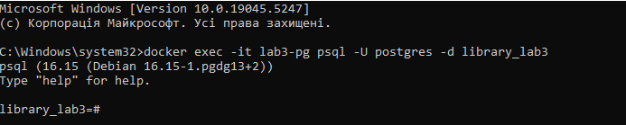

Для кроків з паралельним доступом (блокування, рівні ізоляції) відкривалося друге вікно `psql` до тієї ж бази. Вікна позначено в промпті як `T1` і `T2` командою `\set PROMPT1 'T1 %/%R%x%# '`. Значення `NULL` у виводі `psql` відображається порожньою клітинкою.

### Рівень 1. Базові операції модифікації

#### Крок 1. Створення структури бази даних

Створено чотири таблиці з обмеженнями цілісності. Порядок створення враховує зовнішні ключі: спочатку `authors`, потім `books`, `readers` і `lendings`.

```sql
CREATE TABLE authors (
    author_id SERIAL PRIMARY KEY,
    first_name VARCHAR(50) NOT NULL,
    last_name VARCHAR(50) NOT NULL,
    birth_year INTEGER CHECK (birth_year >= 1000 AND birth_year <= EXTRACT(YEAR FROM CURRENT_DATE)),
    country VARCHAR(50),
    created_at TIMESTAMP DEFAULT CURRENT_TIMESTAMP
);

CREATE TABLE books (
    book_id SERIAL PRIMARY KEY,
    isbn VARCHAR(17) UNIQUE NOT NULL,
    title VARCHAR(200) NOT NULL,
    author_id INTEGER NOT NULL,
    publication_year INTEGER CHECK (publication_year >= 1450),
    genre VARCHAR(50),
    total_copies INTEGER DEFAULT 1 CHECK (total_copies >= 0),
    available_copies INTEGER DEFAULT 1 CHECK (available_copies >= 0),
    created_at TIMESTAMP DEFAULT CURRENT_TIMESTAMP,
    FOREIGN KEY (author_id) REFERENCES authors(author_id) ON DELETE RESTRICT,
    CHECK (available_copies <= total_copies)
);

CREATE TABLE readers (
    reader_id SERIAL PRIMARY KEY,
    first_name VARCHAR(50) NOT NULL,
    last_name VARCHAR(50) NOT NULL,
    email VARCHAR(100) UNIQUE NOT NULL,
    phone VARCHAR(20),
    library_card_number VARCHAR(20) UNIQUE NOT NULL,
    registration_date DATE DEFAULT CURRENT_DATE,
    status VARCHAR(20) DEFAULT 'Active' CHECK (status IN ('Active', 'Blocked', 'Inactive'))
);

CREATE TABLE lendings (
    lending_id SERIAL PRIMARY KEY,
    book_id INTEGER NOT NULL,
    reader_id INTEGER NOT NULL,
    lending_date DATE DEFAULT CURRENT_DATE,
    due_date DATE NOT NULL,
    return_date DATE,
    FOREIGN KEY (book_id) REFERENCES books(book_id) ON DELETE RESTRICT,
    FOREIGN KEY (reader_id) REFERENCES readers(reader_id) ON DELETE RESTRICT,
    CHECK (due_date > lending_date),
    CHECK (return_date IS NULL OR return_date >= lending_date)
);
```

Застосовані обмеження:

- `PRIMARY KEY` на `*_id` гарантує унікальність записів.
- `NOT NULL` на іменах, `isbn`, `author_id` забороняє неповні записи.
- `UNIQUE` на `isbn`, `email` і `library_card_number` виключає дублікати книг і читачів.
- `CHECK` перевіряє діапазони (рік народження, рік видання, кількість примірників), допустимі статуси читача та логіку дат (`due_date > lending_date`).
- `CHECK (available_copies <= total_copies)` не дає видати більше книг, ніж є.
- `FOREIGN KEY ... ON DELETE RESTRICT` не дозволяє видалити автора, книгу чи читача, на яких є посилання.

**Результат створення структури:**

```
CREATE TABLE
CREATE TABLE
CREATE TABLE
CREATE TABLE
```

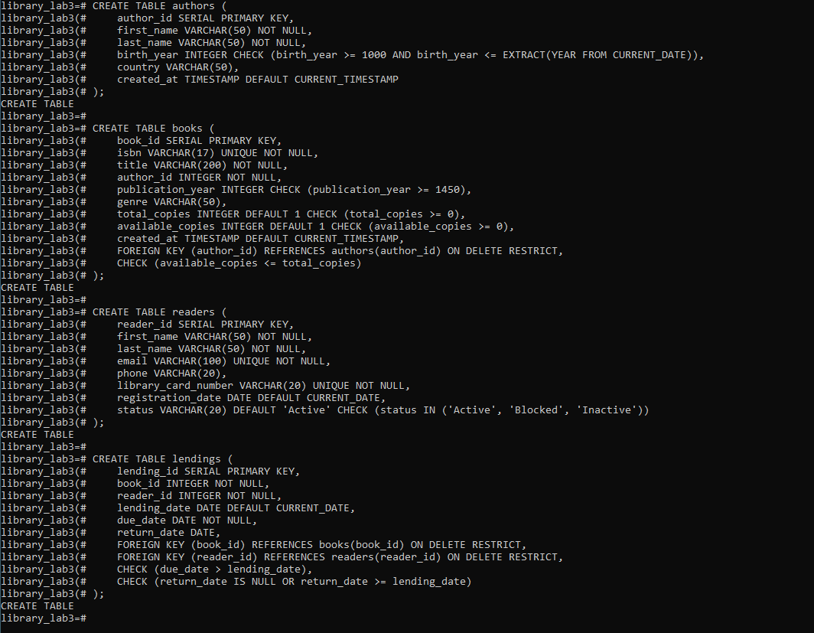

Перевірка структури командами `\dt` і `\d books`: у базі 4 таблиці, у `books` видно первинний ключ, унікальний ключ по `isbn`, чотири перевірки `CHECK` і зовнішній ключ на `authors` з `ON DELETE RESTRICT`, а також посилання на `books` з боку `lendings`.

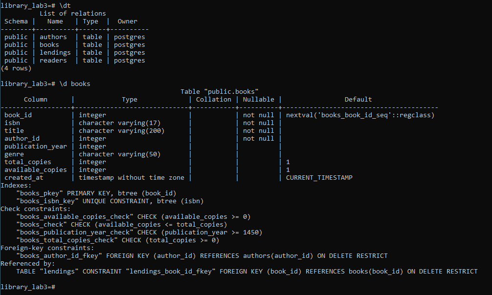

#### Крок 2. Додавання тестових даних

```sql
INSERT INTO authors (first_name, last_name, birth_year, country)
VALUES
    ('Тарас', 'Шевченко', 1814, 'Україна'),
    ('Іван', 'Франко', 1856, 'Україна'),
    ('Леся', 'Українка', 1871, 'Україна'),
    ('Михайло', 'Коцюбинський', 1864, 'Україна'),
    ('Панас', 'Мирний', 1849, 'Україна');

INSERT INTO books (isbn, title, author_id, publication_year, genre, total_copies, available_copies)
VALUES
    ('978-966-03-4561-2', 'Кобзар', 1, 1840, 'Поезія', 10, 8),
    ('978-966-03-4562-9', 'Захар Беркут', 2, 1883, 'Історична проза', 5, 4),
    ('978-966-03-4563-6', 'Лісова пісня', 3, 1911, 'Драма', 7, 7),
    ('978-966-03-4564-3', 'Тіні забутих предків', 4, 1911, 'Повість', 6, 5),
    ('978-966-03-4565-0', 'Хіба ревуть воли, як ясла повні', 5, 1880, 'Повість', 4, 4);

INSERT INTO readers (first_name, last_name, email, phone, library_card_number)
VALUES
    ('Олена', 'Петренко', 'olena.petrenko@email.com', '+380501234567', 'LIB-2024-001'),
    ('Андрій', 'Коваленко', 'andrii.kovalenko@email.com', '+380502345678', 'LIB-2024-002'),
    ('Марія', 'Сидоренко', 'maria.sydorenko@email.com', '+380503456789', 'LIB-2024-003'),
    ('Іван', 'Мельник', 'ivan.melnyk@email.com', '+380504567890', 'LIB-2024-004');
```

Сервер відповів `INSERT 0 5`, `INSERT 0 5` і `INSERT 0 4`.

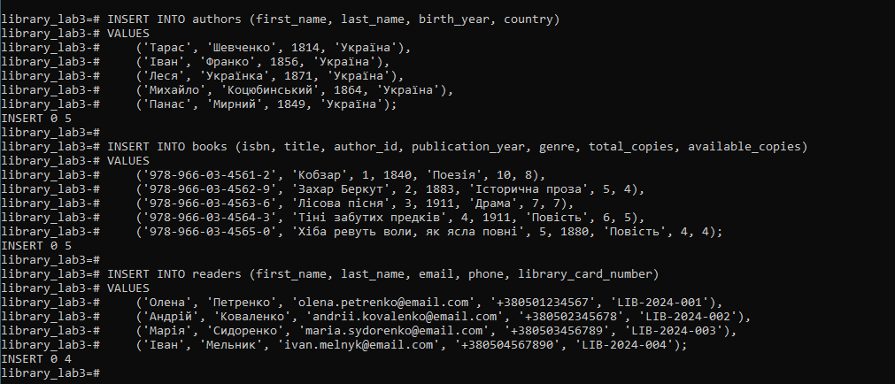

Перевірка вставлених даних:

```sql
SELECT * FROM authors ORDER BY birth_year;
SELECT book_id, title, total_copies, available_copies FROM books ORDER BY book_id;
SELECT reader_id, first_name, last_name, status FROM readers ORDER BY reader_id;
```

**Результат:**

| author_id | first_name | last_name | birth_year | country | created_at |
|---|---|---|---|---|---|
| 1 | Тарас | Шевченко | 1814 | Україна | 2026-10-18 14:57:07 |
| 5 | Панас | Мирний | 1849 | Україна | 2026-10-18 14:57:07 |
| 2 | Іван | Франко | 1856 | Україна | 2026-10-18 14:57:07 |
| 4 | Михайло | Коцюбинський | 1864 | Україна | 2026-10-18 14:57:07 |
| 3 | Леся | Українка | 1871 | Україна | 2026-10-18 14:57:07 |

| book_id | title | total_copies | available_copies |
|---|---|---|---|
| 1 | Кобзар | 10 | 8 |
| 2 | Захар Беркут | 5 | 4 |
| 3 | Лісова пісня | 7 | 7 |
| 4 | Тіні забутих предків | 6 | 5 |
| 5 | Хіба ревуть воли, як ясла повні | 4 | 4 |

| reader_id | first_name | last_name | status |
|---|---|---|---|
| 1 | Олена | Петренко | Active |
| 2 | Андрій | Коваленко | Active |
| 3 | Марія | Сидоренко | Active |
| 4 | Іван | Мельник | Active |

Значення `created_at` виставлено за замовчуванням.

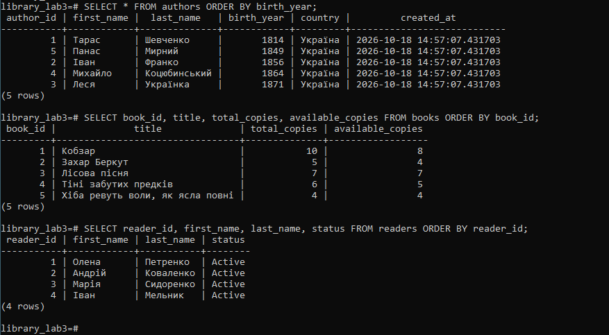

#### Крок 3. Безпечне оновлення записів

Принцип: спочатку `SELECT` з тією самою умовою, потім `UPDATE` з `WHERE`, потім `SELECT` для перевірки.

```sql
SELECT book_id, title, total_copies, available_copies FROM books WHERE book_id = 1;

UPDATE books
SET available_copies = available_copies - 1
WHERE book_id = 1 AND available_copies > 0;

SELECT book_id, title, total_copies, available_copies FROM books WHERE book_id = 1;
```

**Результат:**

До оновлення:

| book_id | title | total_copies | available_copies |
|---|---|---|---|
| 1 | Кобзар | 10 | 8 |

```
UPDATE 1
```

Після оновлення:

| book_id | title | total_copies | available_copies |
|---|---|---|---|
| 1 | Кобзар | 10 | 7 |

Умова `available_copies > 0` не дозволила б піти нижче нуля.

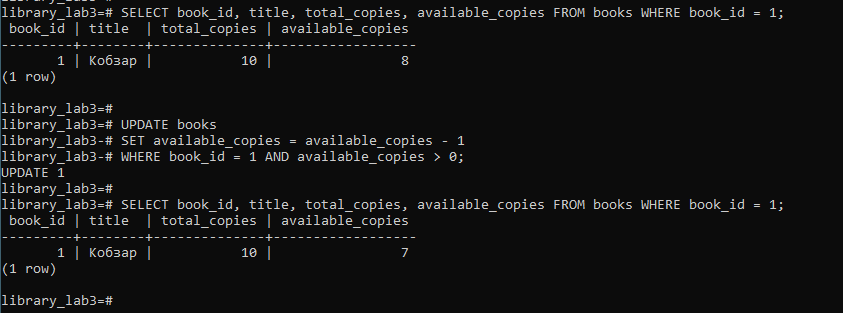

Цей самий блок було виконано ще раз (див. розділ «Особливості виконання»), тому значення зменшилось до 6.

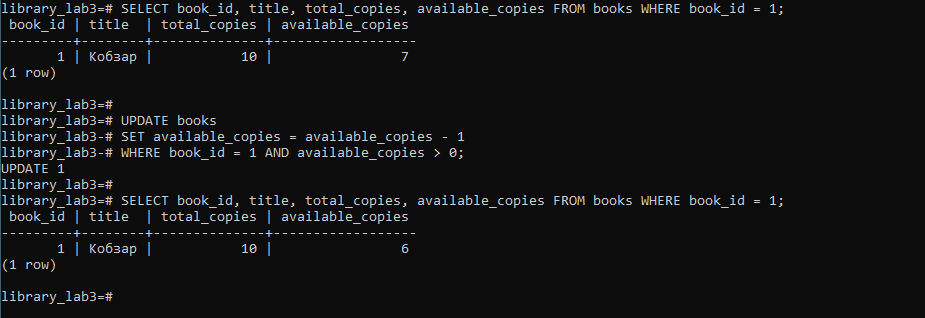

Далі показано оновлення за умовою, що зачіпає кілька рядків: спершу рахуємо, скільки рядків потрапить під умову, а тоді виконуємо `UPDATE ... RETURNING`.

```sql
SELECT COUNT(*) FROM books WHERE genre = 'Поезія';

UPDATE books
SET total_copies = total_copies + 2
WHERE genre = 'Поезія'
RETURNING book_id, title, total_copies, available_copies;
```

**Результат:**

Під умову потрапив один рядок (`count = 1`).

| book_id | title | total_copies | available_copies |
|---|---|---|---|
| 1 | Кобзар | 12 | 6 |

```
UPDATE 1
```

Без `WHERE` було б змінено всі 5 книг.

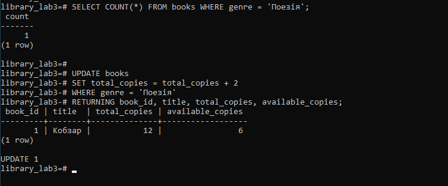

#### Крок 4. Операції з транзакціями

Видача книги складається з двох пов'язаних змін (запис у `lendings` і зменшення `available_copies`), тому вони виконуються в одній транзакції:

```sql
BEGIN;

INSERT INTO lendings (book_id, reader_id, due_date)
VALUES (1, 1, CURRENT_DATE + INTERVAL '14 days')
RETURNING lending_id, book_id, reader_id, due_date;

UPDATE books
SET available_copies = available_copies - 1
WHERE book_id = 1 AND available_copies > 0
RETURNING book_id, title, available_copies;

SELECT l.lending_id, b.title, r.first_name, r.last_name, l.due_date
FROM lendings l
JOIN books b ON l.book_id = b.book_id
JOIN readers r ON l.reader_id = r.reader_id
WHERE l.lending_id = 1;

COMMIT;
```

**Результат INSERT:**

| lending_id | book_id | reader_id | due_date |
|---|---|---|---|
| 1 | 1 | 1 | 2026-11-01 |

**Результат UPDATE:**

| book_id | title | available_copies |
|---|---|---|
| 1 | Кобзар | 5 |

**Результат перевірки:**

| lending_id | title | first_name | last_name | due_date |
|---|---|---|---|---|
| 1 | Кобзар | Олена | Петренко | 2026-11-01 |

**Результат:**

```
COMMIT
```

**Аналіз транзакції:**

Транзакція забезпечила атомарність видачі книги: запис у `lendings` і зменшення `available_copies` виконалися як єдине ціле. Якби одна з операцій завершилась помилкою, обидві було б скасовано. Значення 5 (а не 7) пояснюється повторним виконанням кроку 1.3 (див. «Особливості виконання»).

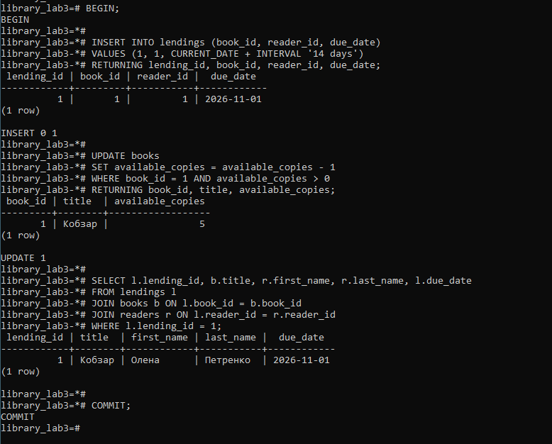

#### Крок 5. Демонстрація ROLLBACK

**Сценарій А. Порушення зовнішнього ключа.** Спроба видалити автора, у якого є книги:

```sql
BEGIN;
SELECT book_id, title FROM books WHERE author_id = 1;
DELETE FROM authors WHERE author_id = 1;
```

Отримано помилку: `update or delete on table "authors" violates foreign key constraint "books_author_id_fkey" on table "books"`, `Key (author_id)=(1) is still referenced from table "books"`.

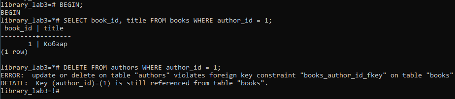

Після помилки транзакція переходить у стан «перервана» (у промпті `=!#`): будь-яка наступна команда повертає `current transaction is aborted, commands ignored until end of transaction block`.

```sql
SELECT 1;
```

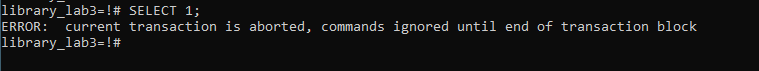

Транзакцію скасовано:

```sql
ROLLBACK;
SELECT * FROM authors WHERE author_id = 1;
```

Автор Тарас Шевченко залишився в таблиці, промпт повернувся до `=#`.

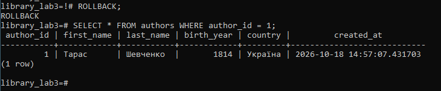

**Сценарій Б. Порушення CHECK усередині транзакції.** Показано, що відкочується не лише невдала команда, а й усі попередні, виконані в цій самій транзакції:

```sql
BEGIN;

INSERT INTO lendings (book_id, reader_id, due_date)
VALUES (5, 2, CURRENT_DATE + INTERVAL '7 days');

SELECT COUNT(*) AS lendings_in_transaction FROM lendings WHERE book_id = 5;

UPDATE books SET available_copies = available_copies - 5 WHERE book_id = 5;
```

Усередині транзакції `INSERT` видно (`lendings_in_transaction = 1`), а `UPDATE` завершується помилкою `new row for relation "books" violates check constraint "books_available_copies_check"` (доступно було 4 примірники, а списується 5, тому виходить -1).

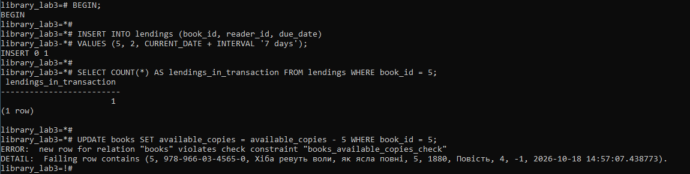

```sql
ROLLBACK;

SELECT COUNT(*) AS lendings_after_rollback FROM lendings WHERE book_id = 5;
SELECT book_id, title, available_copies FROM books WHERE book_id = 5;
```

Після відкату `lendings_after_rollback = 0`, а в книги 5 лишилось 4 примірники. Тобто `INSERT` у видачі теж скасувався.

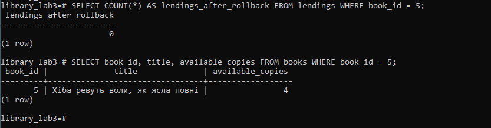

**Висновок:**

Обмеження `ON DELETE RESTRICT` запобігає видаленню автора, у якого є книги, а після помилки транзакція переходить у стан «перервана», і її можна лише скасувати. Команда `ROLLBACK` повернула базу до стану до початку транзакції. У сценарії Б разом із невдалим `UPDATE` скасувалась і вже виконана вставка у `lendings`: це і є атомарність.

#### Крок 6. Безпечне видалення

Спочатку перевірка, кого можна видаляти (читачі зі статусом `Inactive` без активних видач):

```sql
SELECT r.reader_id, r.first_name, r.last_name, r.status, COUNT(l.lending_id) AS active_lendings
FROM readers r
LEFT JOIN lendings l ON r.reader_id = l.reader_id AND l.return_date IS NULL
GROUP BY r.reader_id, r.first_name, r.last_name, r.status
HAVING COUNT(l.lending_id) = 0 AND r.status = 'Inactive';
```

**Результат:**

```
(0 rows)
```

Жодного читача зі статусом `Inactive` без активних видач ще немає.

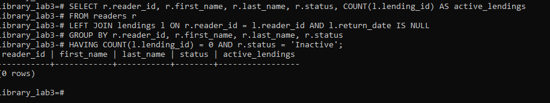

Для демонстрації додано тестового читача зі статусом `Inactive`:

```sql
INSERT INTO readers (first_name, last_name, email, library_card_number, status)
VALUES ('Тестовий', 'Читач', 'test@example.com', 'LIB-TEST-001', 'Inactive')
RETURNING reader_id;
```

**Результат:**

| reader_id |
|---|
| 5 |

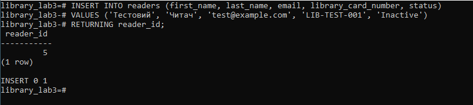

Видалення з перевіркою, що в читача немає незакритих видач:

```sql
DELETE FROM readers
WHERE status = 'Inactive'
  AND reader_id NOT IN (
      SELECT DISTINCT reader_id FROM lendings WHERE return_date IS NULL
  )
RETURNING reader_id, first_name, last_name;

SELECT COUNT(*) FROM readers WHERE email = 'test@example.com';
```

**Результат:**

| reader_id | first_name | last_name |
|---|---|---|
| 5 | Тестовий | Читач |

```
DELETE 1
```

Контрольний `COUNT(*)` повернув `0`: запис видалено.

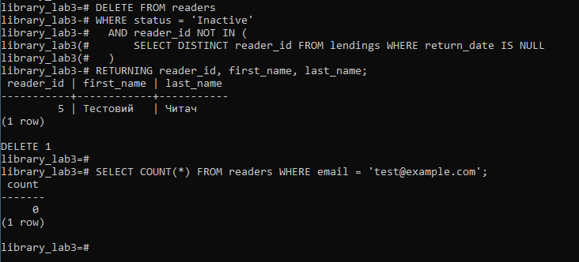

### Рівень 2. Розширена функціональність

#### Крок 1. Додавання нових таблиць

```sql
CREATE TABLE reservations (
    reservation_id SERIAL PRIMARY KEY,
    book_id INTEGER NOT NULL,
    reader_id INTEGER NOT NULL,
    reservation_date TIMESTAMP DEFAULT CURRENT_TIMESTAMP,
    expiration_date TIMESTAMP NOT NULL,
    status VARCHAR(20) DEFAULT 'Active' CHECK (status IN ('Active', 'Fulfilled', 'Cancelled', 'Expired')),
    FOREIGN KEY (book_id) REFERENCES books(book_id) ON DELETE CASCADE,
    FOREIGN KEY (reader_id) REFERENCES readers(reader_id) ON DELETE CASCADE
);

CREATE TABLE audit_log (
    log_id SERIAL PRIMARY KEY,
    table_name VARCHAR(50) NOT NULL,
    operation VARCHAR(10) NOT NULL,
    record_id INTEGER NOT NULL,
    old_data JSONB,
    new_data JSONB,
    changed_at TIMESTAMP DEFAULT CURRENT_TIMESTAMP,
    changed_by VARCHAR(100) DEFAULT CURRENT_USER
);
```

Таблиця `reservations` пов'язана з `books` і `readers` через `ON DELETE CASCADE`: бронювання не має сенсу без книги чи читача. Таблиця `audit_log` зберігає історію змін: ім'я таблиці, тип операції, ідентифікатор запису, старий і новий стан у форматі JSONB, час і користувача.

Структуру обох таблиць перевірено командами `\d reservations` і `\d audit_log`:

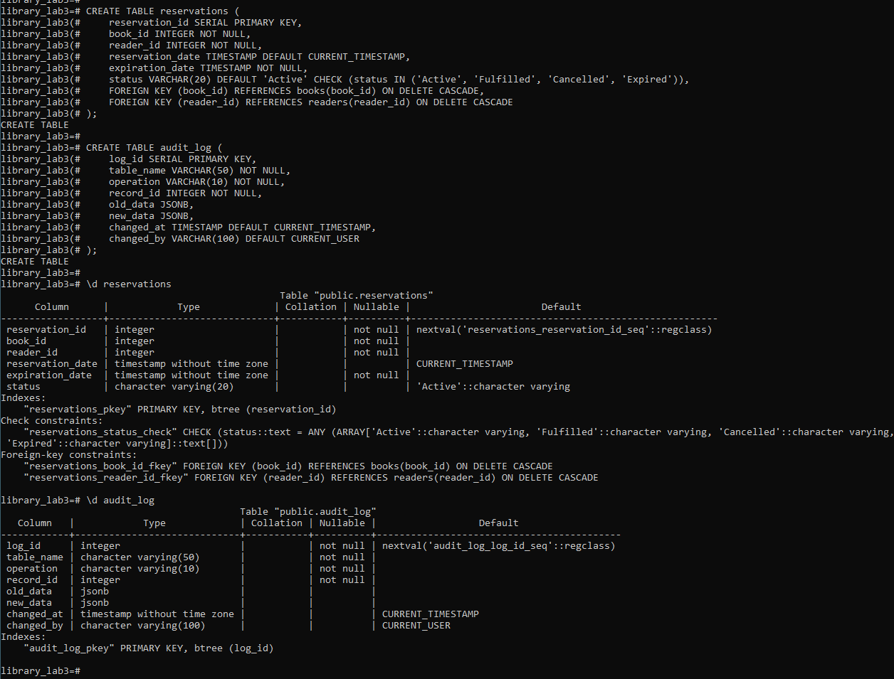

#### Крок 2. Складні транзакції

Сценарій: читач повертає книгу, на яку є бронювання від іншого читача. Спочатку створено бронювання на «Кобзар» від Андрія Коваленка:

```sql
INSERT INTO reservations (book_id, reader_id, expiration_date)
VALUES (1, 2, CURRENT_TIMESTAMP + INTERVAL '3 days')
RETURNING reservation_id;
```

Створено бронювання `reservation_id = 1`.

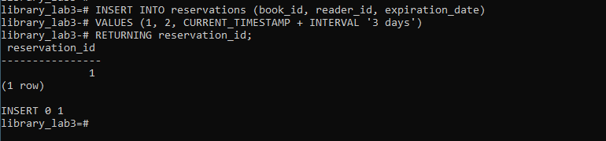

Повернення книги виконується однією транзакцією з чотирьох операцій над двома таблицями: закрити видачу, повернути примірник у наявність, знайти першу активну бронь, позначити її виконаною.

```sql
BEGIN;

UPDATE lendings
SET return_date = CURRENT_DATE
WHERE lending_id = 1 AND return_date IS NULL
RETURNING lending_id, book_id, reader_id, return_date;

UPDATE books
SET available_copies = available_copies + 1
WHERE book_id = (SELECT book_id FROM lendings WHERE lending_id = 1)
RETURNING book_id, title, available_copies;

SELECT reservation_id, reader_id, reservation_date
FROM reservations
WHERE book_id = 1 AND status = 'Active'
ORDER BY reservation_date
LIMIT 1;

UPDATE reservations
SET status = 'Fulfilled'
WHERE reservation_id = 1
RETURNING reservation_id, status;

COMMIT;
```

**Результат:**

| lending_id | book_id | reader_id | return_date |
|---|---|---|---|
| 1 | 1 | 1 | 2026-10-18 |

| book_id | title | available_copies |
|---|---|---|
| 1 | Кобзар | 6 |

| reservation_id | reader_id | reservation_date |
|---|---|---|
| 1 | 2 | 2026-10-18 15:03:52 |

| reservation_id | status |
|---|---|
| 1 | Fulfilled |

```
COMMIT
```

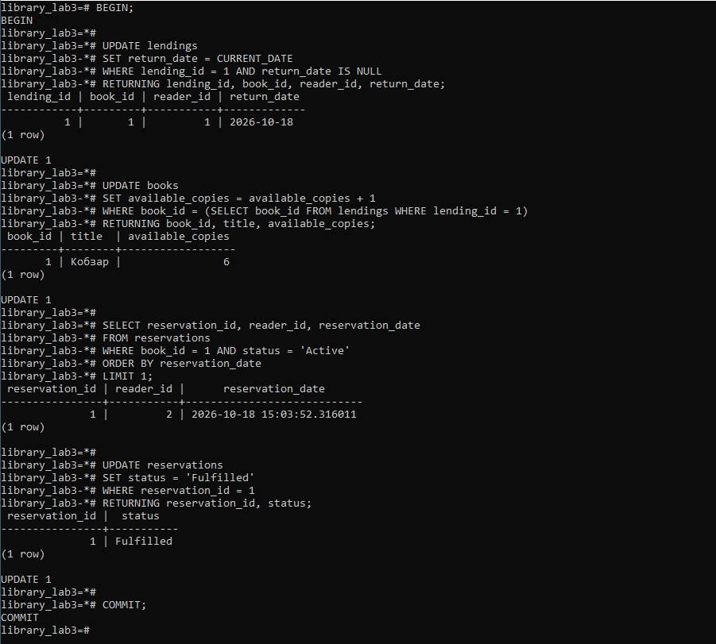

Підсумкова перевірка зв'язаних даних:

```sql
SELECT l.lending_id, b.title,
       r1.first_name || ' ' || r1.last_name AS borrower,
       l.return_date,
       r2.first_name || ' ' || r2.last_name AS next_reader,
       res.status AS reservation_status
FROM lendings l
JOIN books b ON l.book_id = b.book_id
JOIN readers r1 ON l.reader_id = r1.reader_id
LEFT JOIN reservations res ON b.book_id = res.book_id AND res.reservation_id = 1
LEFT JOIN readers r2 ON res.reader_id = r2.reader_id
WHERE l.lending_id = 1;
```

| lending_id | title | borrower | return_date | next_reader | reservation_status |
|---|---|---|---|---|---|
| 1 | Кобзар | Олена Петренко | 2026-10-18 | Андрій Коваленко | Fulfilled |

**Аналіз:**

Складна транзакція виконала чотири взаємопов'язані операції над двома таблицями. Завдяки атомарності всі зміни або застосовуються разом, або не застосовуються взагалі, що зберігає консистентність бізнес-процесу повернення книги.

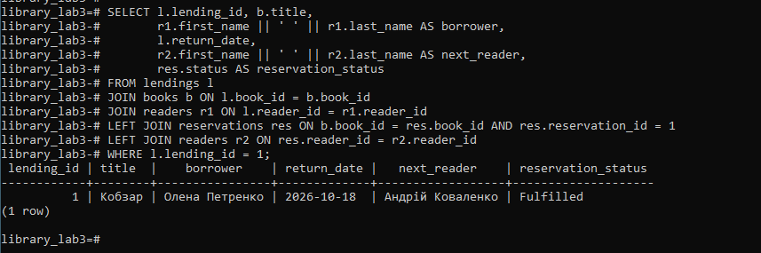

#### Крок 3. Використання SAVEPOINT

Сценарій: у транзакції додається автор та дві його книги. Друга вставка навмисно порушує унікальність ISBN. Завдяки `SAVEPOINT` відкочується лише невдала частина, а автор і перша книга зберігаються.

```sql
BEGIN;

INSERT INTO authors (first_name, last_name, birth_year, country)
VALUES ('Ольга', 'Кобилянська', 1863, 'Україна')
RETURNING author_id;

SAVEPOINT after_author;

INSERT INTO books (isbn, title, author_id, publication_year, genre, total_copies, available_copies)
VALUES ('978-966-03-4566-7', 'Земля',
        (SELECT author_id FROM authors WHERE last_name = 'Кобилянська'),
        1902, 'Роман', 3, 3)
RETURNING book_id, title;

SAVEPOINT after_first_book;
```

Додано автора `author_id = 6` та книгу «Земля» (`book_id = 6`), поставлено дві точки збереження.

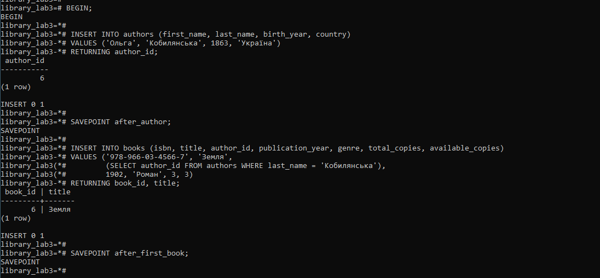

Спроба вставити книгу з тим самим ISBN:

```sql
INSERT INTO books (isbn, title, author_id, publication_year, genre)
VALUES ('978-966-03-4566-7', 'Інша книга',
        (SELECT author_id FROM authors WHERE last_name = 'Кобилянська'),
        1905, 'Роман');
```

Помилка: `duplicate key value violates unique constraint "books_isbn_key"`, `Key (isbn)=(978-966-03-4566-7) already exists`. Транзакція перейшла в стан `=!#`.

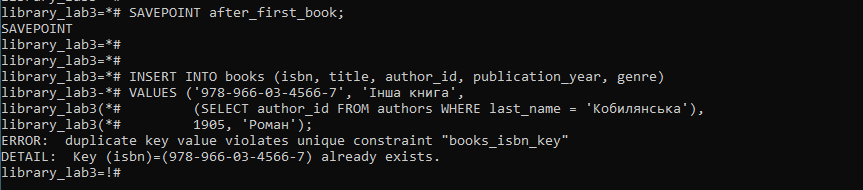

Відкат до точки `after_first_book` повертає транзакцію в робочий стан без втрати автора й першої книги; далі додається коректна друга книга і виконується `COMMIT`:

```sql
ROLLBACK TO SAVEPOINT after_first_book;

INSERT INTO books (isbn, title, author_id, publication_year, genre, total_copies, available_copies)
VALUES ('978-966-03-4567-4', 'Царівна',
        (SELECT author_id FROM authors WHERE last_name = 'Кобилянська'),
        1896, 'Повість', 2, 2)
RETURNING book_id, title;

COMMIT;

SELECT a.first_name, a.last_name, b.book_id, b.title, b.isbn
FROM authors a
JOIN books b ON a.author_id = b.author_id
WHERE a.last_name = 'Кобилянська'
ORDER BY b.book_id;
```

У результаті в базі автор Ольга Кобилянська і дві книги: «Земля» (`book_id = 6`) та «Царівна» (`book_id = 8`). Номер 7 пропущено, бо невдала вставка з дублікатом теж «з'їла» значення з послідовності (послідовності не відкочуються разом з транзакцією).

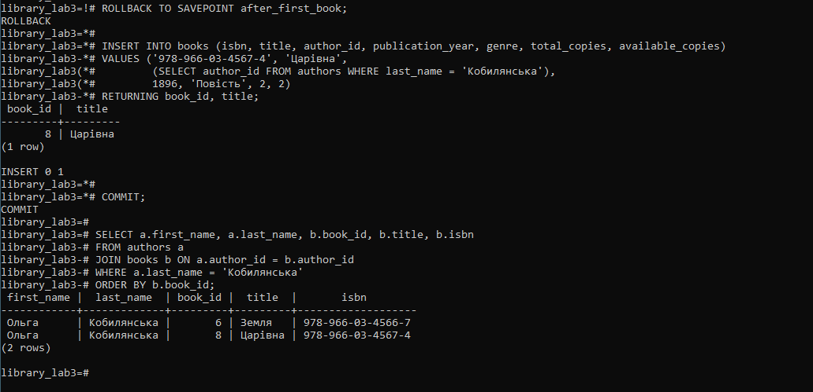

**Висновок:**

`SAVEPOINT` дозволив зберегти частину транзакції (автора й першу книгу) при відкаті помилкової операції. Після помилки транзакція була в стані «перервана», але `ROLLBACK TO SAVEPOINT` повернув її в робочий стан без повного відкату.

#### Крок 4. Каскадні операції

У схемі використано різні поведінки зовнішніх ключів: `RESTRICT` для зв'язків автор → книги, книга → видачі, читач → видачі та `CASCADE` для бронювань. Для решти варіантів (`ON UPDATE CASCADE`, `SET NULL`, `SET DEFAULT`) нижче створено окремі демонстраційні таблиці.

**Каскадне видалення.** Створено тестового автора, книгу та бронювання на неї:

```sql
BEGIN;

INSERT INTO authors (first_name, last_name, birth_year, country)
VALUES ('Тестовий', 'Автор', 1900, 'Україна')
RETURNING author_id;

INSERT INTO books (isbn, title, author_id, publication_year, genre, total_copies, available_copies)
VALUES ('978-966-00-0000-0', 'Тестова книга',
        (SELECT author_id FROM authors WHERE last_name = 'Автор'),
        2000, 'Тест', 1, 0)
RETURNING book_id;

INSERT INTO reservations (book_id, reader_id, expiration_date)
VALUES ((SELECT book_id FROM books WHERE isbn = '978-966-00-0000-0'), 1, CURRENT_TIMESTAMP + INTERVAL '7 days')
RETURNING reservation_id;

COMMIT;
```

Створено автора 7, книгу 9 і бронювання 2.

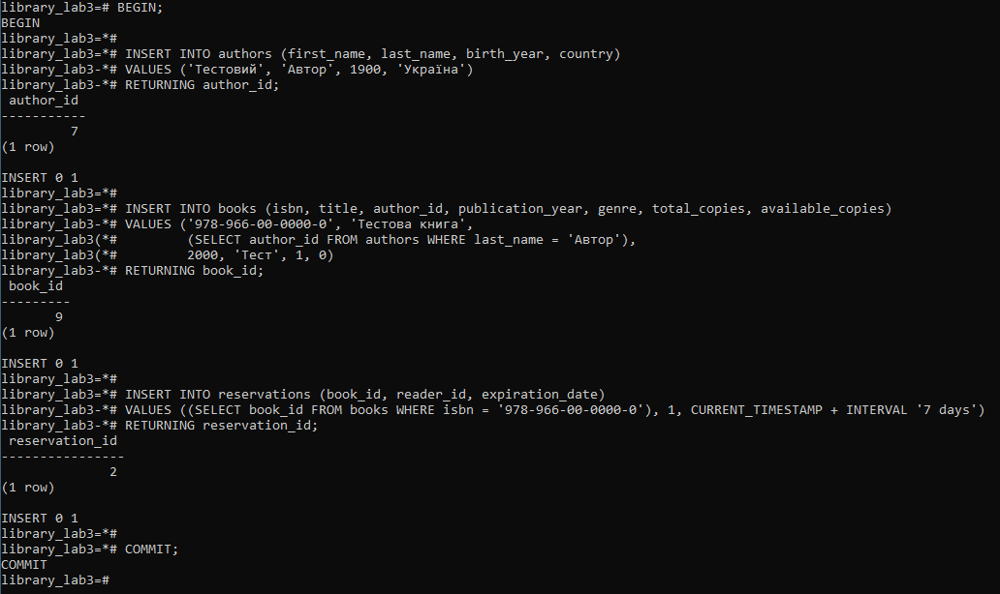

Перевірка зв'язку, видалення книги та перевірка каскаду:

```sql
SELECT b.book_id, b.title, b.isbn, r.reservation_id, r.status
FROM books b
LEFT JOIN reservations r ON b.book_id = r.book_id
WHERE b.isbn = '978-966-00-0000-0';

DELETE FROM books WHERE isbn = '978-966-00-0000-0' RETURNING book_id, title;

SELECT * FROM reservations WHERE reader_id = 1;
```

До видалення бронювання 2 було активним. Після `DELETE 1` запит до бронювань читача 1 повернув `(0 rows)`: бронювання видалилось автоматично разом із книгою.

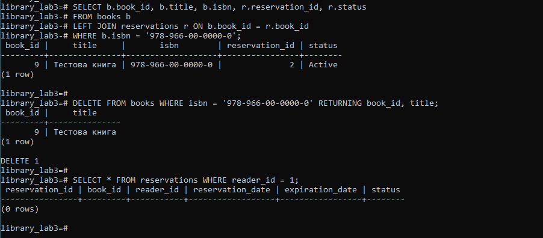

**RESTRICT.** Автора без книг видалено успішно, а автора з книгами (Кобилянська) видалити не вдалося:

```sql
DELETE FROM authors WHERE last_name = 'Автор' RETURNING author_id;
DELETE FROM authors WHERE last_name = 'Кобилянська';
```

Перший запит: `DELETE 1`. Другий: помилка `violates foreign key constraint "books_author_id_fkey"`, `Key (author_id)=(6) is still referenced from table "books"`.

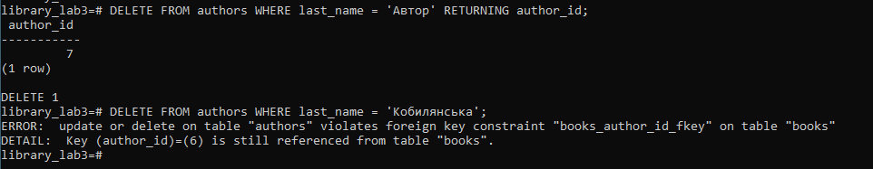

**Інші варіанти зовнішніх ключів.** Демонстраційні таблиці з `ON UPDATE CASCADE`, `ON DELETE SET NULL` і `ON DELETE SET DEFAULT`:

```sql
CREATE TABLE demo_publishers (publisher_id INTEGER PRIMARY KEY, name VARCHAR(100) NOT NULL);
CREATE TABLE demo_categories (category_id INTEGER PRIMARY KEY, name VARCHAR(100) NOT NULL);
CREATE TABLE demo_editions (
    edition_id SERIAL PRIMARY KEY,
    title VARCHAR(100) NOT NULL,
    publisher_id INTEGER REFERENCES demo_publishers(publisher_id) ON UPDATE CASCADE ON DELETE SET NULL,
    category_id INTEGER DEFAULT 1 REFERENCES demo_categories(category_id) ON DELETE SET DEFAULT
);

INSERT INTO demo_publishers VALUES (10, 'Видавництво А'), (20, 'Видавництво Б');
INSERT INTO demo_categories VALUES (1, 'Без категорії'), (2, 'Поезія');
INSERT INTO demo_editions (title, publisher_id, category_id) VALUES ('Видання 1', 10, 2), ('Видання 2', 20, 2);

UPDATE demo_publishers SET publisher_id = 11 WHERE publisher_id = 10;
SELECT * FROM demo_editions ORDER BY edition_id;

DELETE FROM demo_publishers WHERE publisher_id = 20;
SELECT * FROM demo_editions ORDER BY edition_id;

DELETE FROM demo_categories WHERE category_id = 2;
SELECT * FROM demo_editions ORDER BY edition_id;
```

| Дія | Результат у `demo_editions` |
|---|---|
| `UPDATE` ключа видавця 10 → 11 (`ON UPDATE CASCADE`) | у «Видання 1» `publisher_id` змінився на 11 |
| `DELETE` видавця 20 (`ON DELETE SET NULL`) | у «Видання 2» `publisher_id = NULL` |
| `DELETE` категорії 2 (`ON DELETE SET DEFAULT`) | в обох видань `category_id = 1` (значення за замовчуванням) |

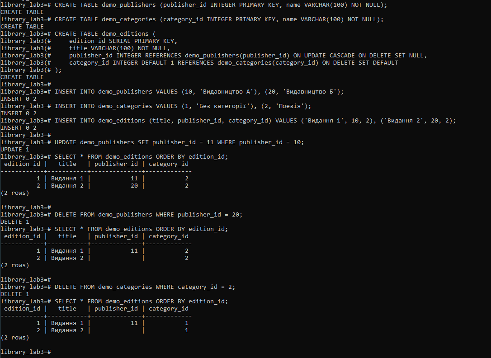

Демонстраційні таблиці після перевірки видалено:

```sql
DROP TABLE demo_editions, demo_publishers, demo_categories;
```

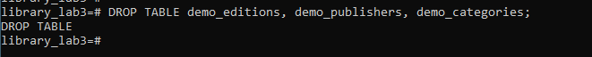

**Аналіз:**

`ON DELETE CASCADE` працює коректно: при видаленні книги автоматично видалились усі пов'язані бронювання. Натомість `ON DELETE RESTRICT` на зв'язку `books` → `authors` не дозволяє видалити автора, поки в нього є книги. Інші варіанти зовнішніх ключів (`ON UPDATE CASCADE`, `SET NULL`, `SET DEFAULT`) перевірено на окремих демонстраційних таблицях.

#### Крок 5. Тригери для аудиту

Тригер на таблиці `books` записує кожну зміну (вставку, оновлення, видалення) в `audit_log`:

```sql
CREATE OR REPLACE FUNCTION log_books_changes()
RETURNS TRIGGER AS $$
BEGIN
    IF TG_OP = 'INSERT' THEN
        INSERT INTO audit_log (table_name, operation, record_id, new_data)
        VALUES ('books', 'INSERT', NEW.book_id, row_to_json(NEW)::jsonb);
    ELSIF TG_OP = 'UPDATE' THEN
        INSERT INTO audit_log (table_name, operation, record_id, old_data, new_data)
        VALUES ('books', 'UPDATE', NEW.book_id, row_to_json(OLD)::jsonb, row_to_json(NEW)::jsonb);
    ELSIF TG_OP = 'DELETE' THEN
        INSERT INTO audit_log (table_name, operation, record_id, old_data)
        VALUES ('books', 'DELETE', OLD.book_id, row_to_json(OLD)::jsonb);
    END IF;
    RETURN NULL;
END;
$$ LANGUAGE plpgsql;

CREATE TRIGGER books_audit_trigger
AFTER INSERT OR UPDATE OR DELETE ON books
FOR EACH ROW
EXECUTE FUNCTION log_books_changes();
```

Перевірка: вставка, оновлення і видалення тестової книги.

```sql
INSERT INTO books (isbn, title, author_id, publication_year, genre, total_copies, available_copies)
VALUES ('978-966-03-9999-9', 'Нова книга', 2, 2024, 'Сучасна', 5, 5);

UPDATE books SET available_copies = available_copies - 1 WHERE isbn = '978-966-03-9999-9';

DELETE FROM books WHERE isbn = '978-966-03-9999-9';

SELECT log_id, operation, record_id,
       COALESCE(new_data->>'title', old_data->>'title') AS title,
       old_data->>'available_copies' AS old_copies,
       new_data->>'available_copies' AS new_copies,
       to_char(changed_at, 'YYYY-MM-DD HH24:MI:SS') AS changed_time,
       changed_by
FROM audit_log
WHERE table_name = 'books'
ORDER BY log_id DESC
LIMIT 10;

SELECT operation, COUNT(*) AS operations_count
FROM audit_log
WHERE table_name = 'books'
GROUP BY operation;
```

| log_id | operation | record_id | title | old_copies | new_copies | changed_by |
|---|---|---|---|---|---|---|
| 3 | DELETE | 10 | Нова книга | 4 | | postgres |
| 2 | UPDATE | 10 | Нова книга | 5 | 4 | postgres |
| 1 | INSERT | 10 | Нова книга | | 5 | postgres |

Підсумок за типами: по одній операції `DELETE`, `INSERT`, `UPDATE`. Тригер зафіксував старий і новий стан, час і користувача. Порожня клітинка у виводі означає `NULL`.

**Висновок:**

Тригер коректно записує всі операції з таблицею `books` в `audit_log`. Зберігаються і старі, і нові значення, що дозволяє відстежити повну історію змін. Час операції та користувач фіксуються автоматично.

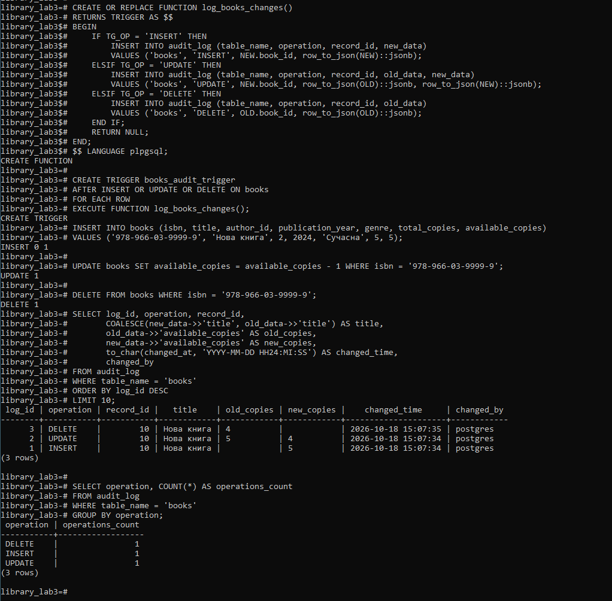

#### Крок 6. Блокування записів

Для імітації паралельної роботи двох користувачів відкрито два вікна `psql` (T1 і T2).

**T1** починає транзакцію і блокує рядок книги 1:

```sql
BEGIN;
SELECT book_id, title, available_copies FROM books WHERE book_id = 1 FOR UPDATE;
```

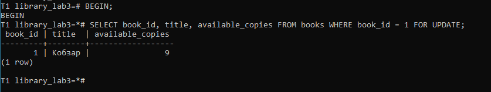

T1 бачить 9 примірників і тримає блокування. **T2** спробував отримати блокування без очікування (`NOWAIT`) і одразу отримав помилку `could not obtain lock on row in relation "books"`:

```sql
SELECT book_id, title FROM books WHERE book_id = 1 FOR UPDATE NOWAIT;
```

Потім T2 запросив звичайне блокування, і запит завис, очікуючи завершення транзакції T1:

```sql
BEGIN;
SELECT book_id, title, available_copies FROM books WHERE book_id = 1 FOR UPDATE;
```

На скриншоті видно обидві дії T2: помилку `NOWAIT` і наступний `FOR UPDATE`, який не повертає результату, бо чекає на T1:

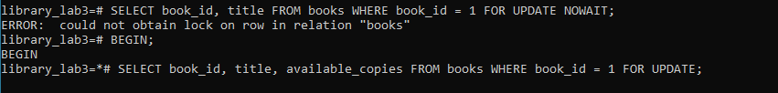

Із T1 переглянуто стан сесій у `pg_stat_activity`: сесія T2 (`pid = 46`) активна й очікує `Lock / transactionid`. Після цього T1 оновив рядок і зафіксував транзакцію:

```sql
SELECT pid, state, wait_event_type, wait_event, left(query, 60) AS query
FROM pg_stat_activity
WHERE datname = 'library_lab3' AND pid <> pg_backend_pid();

UPDATE books SET available_copies = available_copies + 1 WHERE book_id = 1 RETURNING book_id, available_copies;
COMMIT;
```

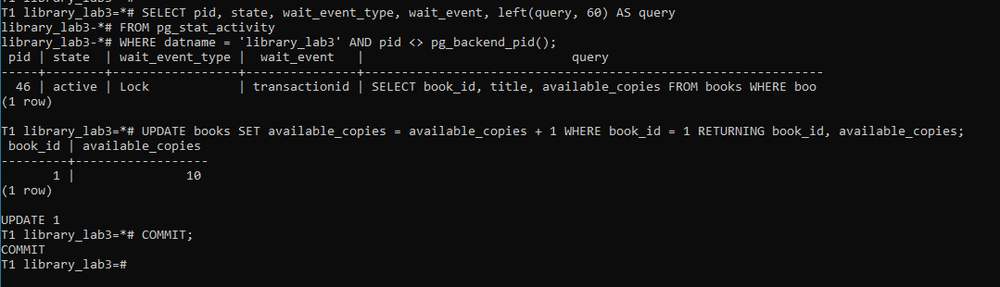

Одразу після `COMMIT` у T1 запит у T2 розблокувався й повернув уже оновлене значення (10), тобто T2 побачив зміни T1 і не працював зі застарілими даними:

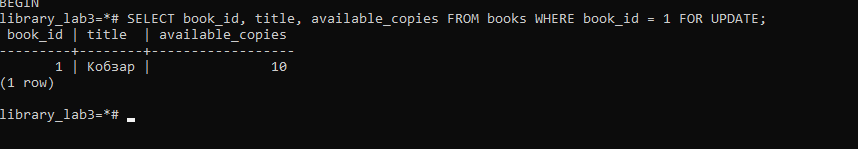

T2 виконав свою зміну і завершив транзакцію:

```sql
UPDATE books SET available_copies = available_copies - 1 WHERE book_id = 1 RETURNING book_id, available_copies;
COMMIT;
SELECT book_id, title, available_copies FROM books WHERE book_id = 1;
```

Остаточне значення 9: обидва оновлення застосовано послідовно, жодне не загубилось (проблема «втраченого оновлення» не виникла).

**Аналіз:**

`FOR UPDATE` забезпечив послідовне виконання транзакцій: T2 чекав завершення T1, що запобігло проблемі втрачених оновлень (lost update). Обидва оновлення застосувалися коректно: 9 → 10 → 9. `FOR UPDATE NOWAIT` дозволяє не чекати, а одразу отримати помилку.

**Без блокування (потенційна проблема):**

```
T1: READ available_copies = 9
T2: READ available_copies = 9
T1: UPDATE available_copies = 10
T2: UPDATE available_copies = 8
Результат: оновлення T1 втрачено (у базі 8 замість 9)
```

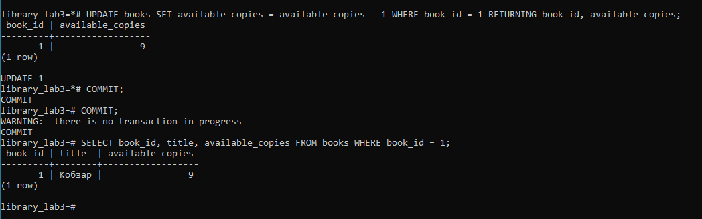

### Рівень 3. Творче розширення

#### Крок 1. Система версіонування

Кожна вставка чи оновлення книги створює нову версію запису в `books_versions` (стан у форматі JSONB, інтервал дії `valid_from` – `valid_to`). Функція `get_book_version` повертає стан книги на вказаний момент часу.

```sql
CREATE TABLE books_versions (
    version_id SERIAL PRIMARY KEY,
    book_id INTEGER NOT NULL,
    version_number INTEGER NOT NULL,
    data JSONB NOT NULL,
    valid_from TIMESTAMP DEFAULT CURRENT_TIMESTAMP,
    valid_to TIMESTAMP,
    created_by VARCHAR(100) DEFAULT CURRENT_USER,
    UNIQUE(book_id, version_number)
);

CREATE OR REPLACE FUNCTION create_book_version()
RETURNS TRIGGER AS $$
DECLARE
    v_version_number INTEGER;
BEGIN
    UPDATE books_versions
    SET valid_to = CURRENT_TIMESTAMP
    WHERE book_id = NEW.book_id AND valid_to IS NULL;

    SELECT COALESCE(MAX(version_number), 0) + 1
    INTO v_version_number
    FROM books_versions
    WHERE book_id = NEW.book_id;

    INSERT INTO books_versions (book_id, version_number, data)
    VALUES (NEW.book_id, v_version_number, row_to_json(NEW)::jsonb);

    RETURN NEW;
END;
$$ LANGUAGE plpgsql;

CREATE TRIGGER book_versioning_trigger
AFTER INSERT OR UPDATE ON books
FOR EACH ROW
EXECUTE FUNCTION create_book_version();

CREATE OR REPLACE FUNCTION get_book_version(p_book_id INTEGER, p_date TIMESTAMP)
RETURNS JSONB AS $$
BEGIN
    RETURN (
        SELECT data
        FROM books_versions
        WHERE book_id = p_book_id
            AND valid_from <= p_date
            AND (valid_to IS NULL OR valid_to > p_date)
        LIMIT 1
    );
END;
$$ LANGUAGE plpgsql;
```

Версії створюються лише для змін, зроблених після появи тригера, тому перевірку виконано на новій книзі (між змінами зроблено паузи по 1 секунді, щоб мітки часу версій відрізнялись):

```sql
INSERT INTO books (isbn, title, author_id, publication_year, genre, total_copies, available_copies)
VALUES ('978-966-03-7777-7', 'Версійована книга', 3, 2020, 'Тест', 10, 10);

SELECT pg_sleep(1);

UPDATE books SET available_copies = 8 WHERE isbn = '978-966-03-7777-7';

SELECT pg_sleep(1);

UPDATE books SET available_copies = 5, genre = 'Оновлений жанр' WHERE isbn = '978-966-03-7777-7';

SELECT version_id, book_id, version_number,
       data->>'title' AS title,
       data->>'available_copies' AS copies,
       data->>'genre' AS genre,
       to_char(valid_from, 'YYYY-MM-DD HH24:MI:SS') AS valid_from,
       to_char(valid_to, 'YYYY-MM-DD HH24:MI:SS') AS valid_to
FROM books_versions
WHERE book_id = (SELECT book_id FROM books WHERE isbn = '978-966-03-7777-7')
ORDER BY version_number;
```

| version_id | book_id | version_number | copies | genre | valid_from | valid_to |
|---|---|---|---|---|---|---|
| 1 | 11 | 1 | 10 | Тест | 2026-10-18 15:11:06 | 2026-10-18 15:11:07 |
| 2 | 11 | 2 | 8 | Тест | 2026-10-18 15:11:07 | 2026-10-18 15:11:08 |
| 3 | 11 | 3 | 5 | Оновлений жанр | 2026-10-18 15:11:08 | NULL |

Інтервал дії кожної версії закінчується в момент початку наступної, поточна версія має `valid_to = NULL`.

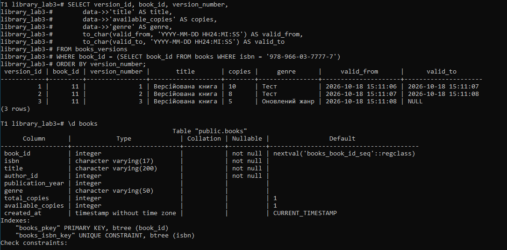

Отримання історичного стану на момент створення версії 2:

```sql
SELECT jsonb_pretty(get_book_version(
    (SELECT book_id FROM books WHERE isbn = '978-966-03-7777-7'),
    (SELECT valid_from FROM books_versions
     WHERE book_id = (SELECT book_id FROM books WHERE isbn = '978-966-03-7777-7')
       AND version_number = 2)
));
```

Функція повернула стан до другого оновлення: `available_copies = 8`, `genre = Тест`. Це підтверджує, що можна відновити вигляд запису на будь-який момент.

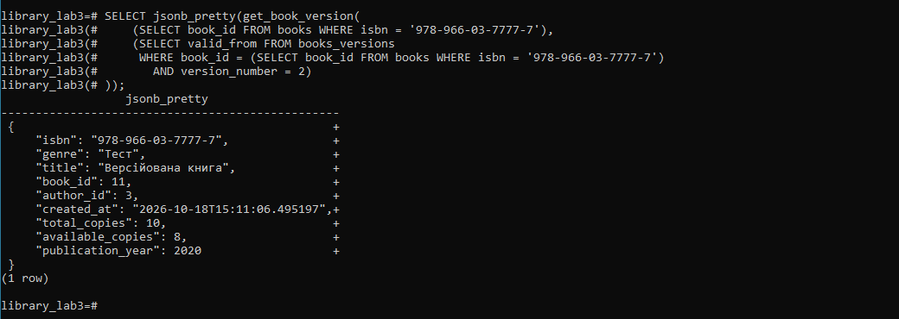

Структура `books` після створення всіх тригерів (`\d books`): тригер версіонування `book_versioning_trigger`, тригер аудиту `books_audit_trigger` і тригер автоматичних контрольних точок `books_auto_backup_trigger` (див. крок 5).

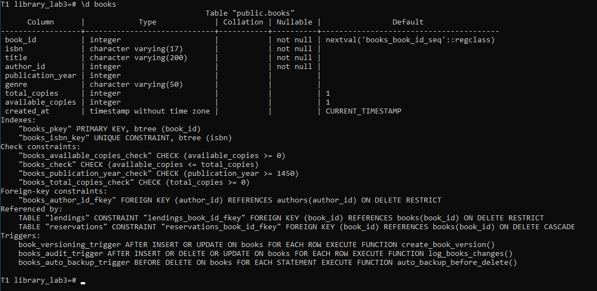

#### Крок 2. Відкладені операції

Таблиця `scheduled_operations` зберігає операції, які треба виконати в заданий час. Функція `execute_scheduled_operations()` виконує всі прострочені операції зі статусом `Pending`, фіксує успіх (`Executed`) або помилку (`Failed` з текстом помилки) і повертає кількість успішних. Кожна операція виконується у власному блоці з обробником винятків, тому збій однієї не зупиняє решту.

```sql
CREATE TABLE scheduled_operations (
    operation_id SERIAL PRIMARY KEY,
    operation_type VARCHAR(50) NOT NULL,
    target_table VARCHAR(50) NOT NULL,
    operation_data JSONB NOT NULL,
    scheduled_for TIMESTAMP NOT NULL,
    status VARCHAR(20) DEFAULT 'Pending' CHECK (status IN ('Pending', 'Executed', 'Failed', 'Cancelled')),
    executed_at TIMESTAMP,
    error_message TEXT,
    created_at TIMESTAMP DEFAULT CURRENT_TIMESTAMP
);

CREATE OR REPLACE FUNCTION execute_scheduled_operations()
RETURNS INTEGER AS $$
DECLARE
    v_operation RECORD;
    v_count INTEGER := 0;
BEGIN
    FOR v_operation IN
        SELECT * FROM scheduled_operations
        WHERE status = 'Pending' AND scheduled_for <= CURRENT_TIMESTAMP
        ORDER BY operation_id
    LOOP
        BEGIN
            CASE v_operation.operation_type
                WHEN 'UPDATE_BOOK_STATUS' THEN
                    UPDATE books
                    SET available_copies = (v_operation.operation_data->>'available_copies')::INTEGER
                    WHERE book_id = (v_operation.operation_data->>'book_id')::INTEGER;

                WHEN 'EXPIRE_RESERVATION' THEN
                    UPDATE reservations
                    SET status = 'Expired'
                    WHERE reservation_id = (v_operation.operation_data->>'reservation_id')::INTEGER;

                WHEN 'BLOCK_READER' THEN
                    UPDATE readers
                    SET status = 'Blocked'
                    WHERE reader_id = (v_operation.operation_data->>'reader_id')::INTEGER;

                WHEN 'CREATE_BACKUP' THEN
                    PERFORM create_backup_point(
                        COALESCE(v_operation.operation_data->>'name', 'scheduled_checkpoint'),
                        'Створено відкладеною операцією');
            END CASE;

            UPDATE scheduled_operations
            SET status = 'Executed', executed_at = CURRENT_TIMESTAMP
            WHERE operation_id = v_operation.operation_id;

            v_count := v_count + 1;
        EXCEPTION WHEN OTHERS THEN
            UPDATE scheduled_operations
            SET status = 'Failed',
                executed_at = CURRENT_TIMESTAMP,
                error_message = SQLERRM
            WHERE operation_id = v_operation.operation_id;
        END;
    END LOOP;

    RETURN v_count;
END;
$$ LANGUAGE plpgsql;
```

Тест: створено бронювання, яке має «прострочитися», і три відкладені операції на +30 секунд. Третя має невідомий тип, щоб показати обробку помилки.

```sql
INSERT INTO reservations (book_id, reader_id, expiration_date, status)
VALUES (2, 3, CURRENT_TIMESTAMP + INTERVAL '1 minute', 'Active')
RETURNING reservation_id;

INSERT INTO scheduled_operations (operation_type, target_table, operation_data, scheduled_for)
VALUES
    ('EXPIRE_RESERVATION', 'reservations',
     jsonb_build_object('reservation_id', (SELECT MAX(reservation_id) FROM reservations)),
     CURRENT_TIMESTAMP + INTERVAL '30 seconds'),
    ('BLOCK_READER', 'readers', jsonb_build_object('reader_id', 4), CURRENT_TIMESTAMP + INTERVAL '30 seconds'),
    ('UNKNOWN_OP', 'books', '{}'::jsonb, CURRENT_TIMESTAMP + INTERVAL '30 seconds')
RETURNING operation_id, operation_type, scheduled_for;

SELECT execute_scheduled_operations();

SELECT operation_id, operation_type, status, executed_at FROM scheduled_operations ORDER BY operation_id;
```

Одразу після створення функція повернула 0 (час ще не настав), усі три операції мають статус `Pending`.

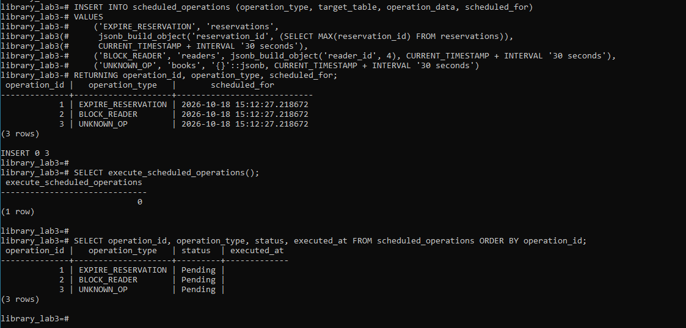

Для автоматичного виконання функцію запущено в циклі засобами `psql` кожні 10 секунд:

```sql
SELECT execute_scheduled_operations() AS executed \watch 10
```

Перший запуск (15:12:19) повернув 0, другий (15:12:29), коли настав запланований час, повернув 2 (дві успішні операції).

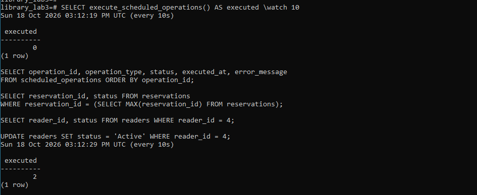

Перевірка результатів:

```sql
SELECT operation_id, operation_type, status, executed_at, error_message
FROM scheduled_operations ORDER BY operation_id;

SELECT reservation_id, status FROM reservations
WHERE reservation_id = (SELECT MAX(reservation_id) FROM reservations);

SELECT reader_id, status FROM readers WHERE reader_id = 4;

UPDATE readers SET status = 'Active' WHERE reader_id = 4;
```

| operation_id | operation_type | status | error_message |
|---|---|---|---|
| 1 | EXPIRE_RESERVATION | Executed | |
| 2 | BLOCK_READER | Executed | |
| 3 | UNKNOWN_OP | Failed | case not found |

Бронювання 3 отримало статус `Expired`, читач 4 став `Blocked` (після перевірки його повернуто в `Active`). Невідома операція позначена як `Failed` з текстом помилки, решта операцій не постраждали.

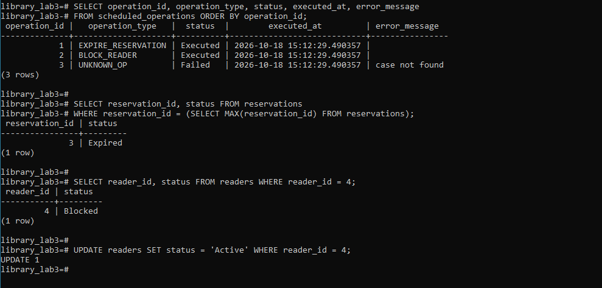

#### Крок 3. Складна бізнес-логіка

Функція `extend_lending(p_lending_id, p_days)` продовжує термін видачі лише за виконання бізнес-правил: видача існує і не закрита, читач не заблокований, у читача немає прострочених книг.

```sql
CREATE OR REPLACE FUNCTION extend_lending(
    p_lending_id INTEGER,
    p_days INTEGER DEFAULT 7
)
RETURNS TABLE (
    success BOOLEAN,
    message TEXT,
    new_due_date DATE
) AS $$
DECLARE
    v_reader_status VARCHAR(20);
    v_overdue_count INTEGER;
    v_current_due_date DATE;
    v_reader_id INTEGER;
BEGIN
    SELECT r.status, l.due_date, l.reader_id
    INTO v_reader_status, v_current_due_date, v_reader_id
    FROM lendings l
    JOIN readers r ON l.reader_id = r.reader_id
    WHERE l.lending_id = p_lending_id AND l.return_date IS NULL;

    IF NOT FOUND THEN
        RETURN QUERY SELECT FALSE, 'Видача не знайдена або книга вже повернена'::TEXT, NULL::DATE;
        RETURN;
    END IF;

    IF v_reader_status = 'Blocked' THEN
        RETURN QUERY SELECT FALSE, 'Читач заблокований'::TEXT, NULL::DATE;
        RETURN;
    END IF;

    SELECT COUNT(*)
    INTO v_overdue_count
    FROM lendings
    WHERE reader_id = v_reader_id
        AND return_date IS NULL
        AND due_date < CURRENT_DATE;

    IF v_overdue_count > 0 THEN
        RETURN QUERY SELECT FALSE, 'У читача є прострочені книги'::TEXT, NULL::DATE;
        RETURN;
    END IF;

    UPDATE lendings
    SET due_date = due_date + p_days
    WHERE lending_id = p_lending_id;

    RETURN QUERY SELECT TRUE, 'Термін продовжено'::TEXT, (v_current_due_date + p_days)::DATE;
END;
$$ LANGUAGE plpgsql;
```

Код функції в базі (`\sf extend_lending`):

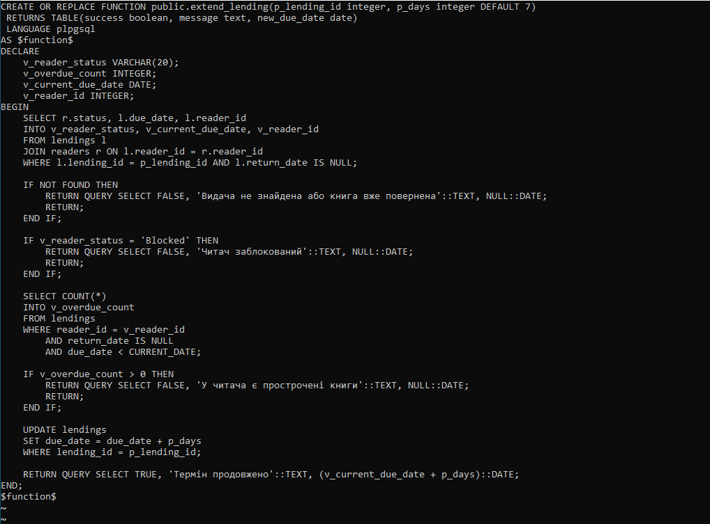

**Сценарій 1: успіх.** Читачу 3 видано книгу 4 на 7 днів і продовжено ще на 14:

```sql
INSERT INTO lendings (book_id, reader_id, due_date)
VALUES (4, 3, CURRENT_DATE + 7)
RETURNING lending_id, due_date;

SELECT * FROM extend_lending(
    (SELECT lending_id FROM lendings WHERE book_id = 4 AND reader_id = 3 AND return_date IS NULL), 14);
```

Видача 5 мала термін 2026-10-29, функція повернула `success = t`, `Термін продовжено`, нова дата 2026-11-12.

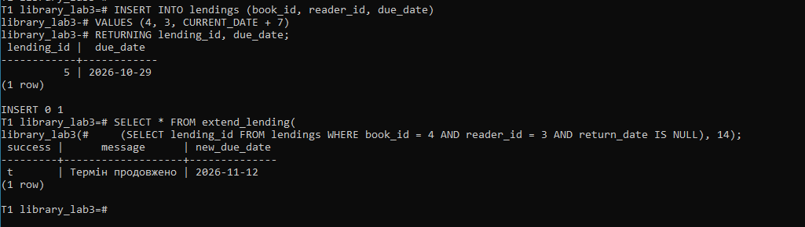

**Підготовка до сценаріїв 2–4.** Для перевірки відмов використано видачу книги 2 читачем 2 (`lending_id = 3`). Її створено командою:

```sql
INSERT INTO lendings (book_id, reader_id, due_date)
VALUES (2, 2, CURRENT_DATE + 7)
RETURNING lending_id, due_date;
```

Видача отримала `lending_id = 3`: її створено 18 жовтня, ще до повторного виконання сценарію 1 (22 жовтня). Станом на 22 жовтня її термін дорівнює 2026-11-08 (після продовження на 14 днів); поточний стан таблиці `lendings` показано в кінці цього кроку.

**Сценарії 2–4: відмови.**

```sql
-- 2. Заблокований читач
UPDATE readers SET status = 'Blocked' WHERE reader_id = 2;
SELECT * FROM extend_lending(
    (SELECT lending_id FROM lendings WHERE book_id = 2 AND reader_id = 2 AND return_date IS NULL), 7);

-- 3. У читача є прострочена видача
UPDATE readers SET status = 'Active' WHERE reader_id = 2;
INSERT INTO lendings (book_id, reader_id, lending_date, due_date)
VALUES (3, 2, CURRENT_DATE - 20, CURRENT_DATE - 5);
SELECT * FROM extend_lending(
    (SELECT lending_id FROM lendings WHERE book_id = 2 AND reader_id = 2 AND return_date IS NULL), 7);

-- 4. Видача вже повернена
SELECT * FROM extend_lending(1, 7);
```

| Сценарій | success | message |
|---|---|---|
| 2. Заблокований читач | f | Читач заблокований |
| 3. Прострочена видача | f | У читача є прострочені книги |
| 4. Повернена видача | f | Видача не знайдена або книга вже повернена |

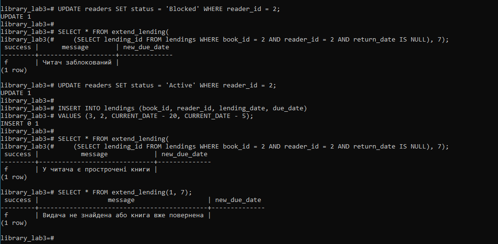

Підсумковий стан таблиці `lendings` після всіх сценаріїв:

```sql
SELECT lending_id, book_id, reader_id, lending_date, due_date, return_date FROM lendings ORDER BY lending_id;
```

| lending_id | book_id | reader_id | lending_date | due_date | return_date |
|---|---|---|---|---|---|
| 1 | 1 | 1 | 2026-10-18 | 2026-11-01 | 2026-10-18 |
| 3 | 2 | 2 | 2026-10-18 | 2026-11-08 | |
| 4 | 3 | 2 | 2026-09-28 | 2026-10-13 | |
| 5 | 4 | 3 | 2026-10-22 | 2026-11-12 | |

Видача 3 призначена для сценаріїв 2–3, видача 4 це створена в сценарії 3 прострочена видача, а видача 5 це успішно продовжена видача зі сценарію 1. Номер 2 пропущено через відкат у кроці 1.5.

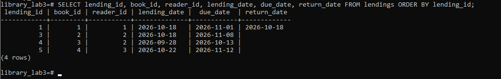

#### Крок 4. Система прав доступу

Створено три ролі та по одному користувачу на кожну. Роль `librarian_write` отримала також права на службові таблиці `audit_log` і `books_versions`, інакше оновлення книг не працювало б: тригери виконуються з правами користувача, який змінює дані, і мають право писати в журнал.

```sql
CREATE ROLE librarian_read;
CREATE ROLE librarian_write;
CREATE ROLE library_admin;

GRANT SELECT ON ALL TABLES IN SCHEMA public TO librarian_read;

GRANT SELECT, INSERT, UPDATE ON books, lendings, reservations TO librarian_write;
GRANT DELETE ON reservations TO librarian_write;
GRANT USAGE, SELECT ON ALL SEQUENCES IN SCHEMA public TO librarian_write;
GRANT INSERT ON audit_log TO librarian_write;
GRANT SELECT, INSERT, UPDATE ON books_versions TO librarian_write;

GRANT ALL PRIVILEGES ON ALL TABLES IN SCHEMA public TO library_admin;
GRANT ALL PRIVILEGES ON ALL SEQUENCES IN SCHEMA public TO library_admin;

CREATE USER librarian1 WITH PASSWORD 'secure_password1';
CREATE USER librarian2 WITH PASSWORD 'secure_password2';
CREATE USER admin1 WITH PASSWORD 'admin_password';

GRANT librarian_read TO librarian1;
GRANT librarian_write TO librarian2;
GRANT library_admin TO admin1;
```

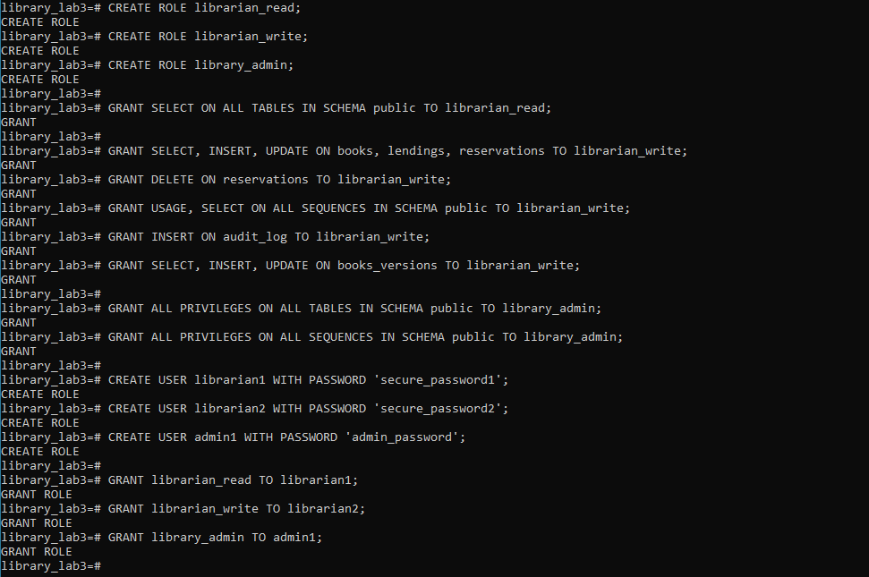

**librarian1 (тільки читання):** `SELECT` працює, `UPDATE` забороняється.

```sql
SET ROLE librarian1;
SELECT book_id, title, available_copies FROM books WHERE book_id = 1;
UPDATE books SET available_copies = 5 WHERE book_id = 1;
RESET ROLE;
```

Результат: читання успішне, оновлення завершилось помилкою `permission denied for table books`.

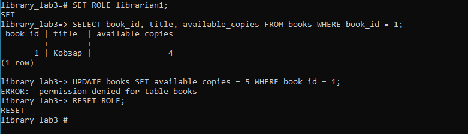

**librarian2 (читання та запис):** оновлення книги дозволено, видалення автора заборонено.

```sql
SET ROLE librarian2;
UPDATE books SET available_copies = available_copies + 1 WHERE book_id = 1 RETURNING book_id, title, available_copies;
DELETE FROM authors WHERE author_id = 1;
RESET ROLE;
```

Результат: `UPDATE 1` (доступно стало 5), видалення завершилось помилкою `permission denied for table authors`.

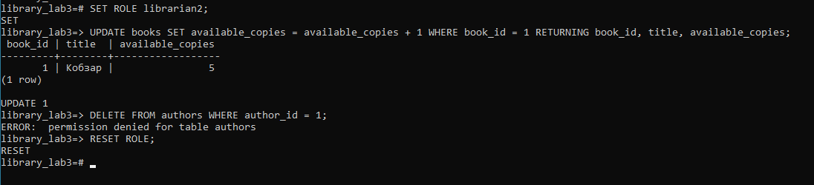

**admin1 (повні права)** та перевірка журналу аудиту:

```sql
SET ROLE admin1;
INSERT INTO authors (first_name, last_name, birth_year, country) VALUES ('Адмін', 'Тест', 1990, 'Україна') RETURNING author_id;
DELETE FROM authors WHERE last_name = 'Тест' RETURNING author_id;
RESET ROLE;

SELECT log_id, operation, record_id, changed_by
FROM audit_log WHERE table_name = 'books' ORDER BY log_id DESC LIMIT 3;
```

Адміністратор вставив і видалив автора (`author_id = 8`). У журналі запис про оновлення книги 1 (`log_id = 9`) має `changed_by = librarian2`, тобто аудит фіксує, хто саме змінив дані.

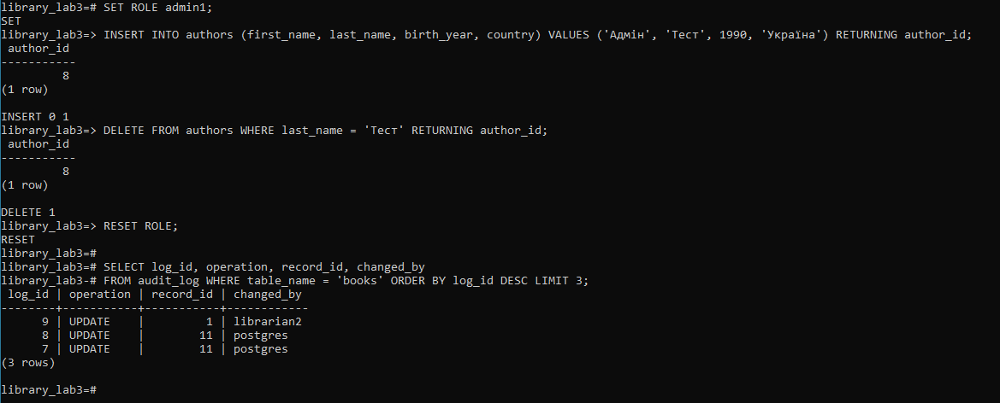

#### Крок 5. Контрольні точки та відновлення даних

Реалізовано повну версію: знімок п'яти таблиць у JSONB, відновлення всіх таблиць, автоматична контрольна точка перед будь-яким `DELETE` з `books` і створення точки за розкладом через відкладену операцію `CREATE_BACKUP`. Відновлення вимикає користувацькі тригери таблиці `books`, очищає таблиці одним `TRUNCATE` (зв'язані таблиці в одній команді, тому `CASCADE` не потрібен), заново вставляє дані зі знімка та вирівнює лічильники `SERIAL`.

```sql
CREATE TABLE backup_points (
    backup_id SERIAL PRIMARY KEY,
    backup_name VARCHAR(100) NOT NULL,
    backup_timestamp TIMESTAMP DEFAULT CURRENT_TIMESTAMP,
    description TEXT,
    data_snapshot JSONB
);

CREATE OR REPLACE FUNCTION create_backup_point(p_name TEXT, p_description TEXT DEFAULT NULL)
RETURNS INTEGER AS $$
DECLARE
    v_backup_id INTEGER;
BEGIN
    INSERT INTO backup_points (backup_name, description, data_snapshot)
    VALUES (p_name, p_description, jsonb_build_object(
        'authors',      COALESCE((SELECT jsonb_agg(to_jsonb(a)) FROM authors a), '[]'::jsonb),
        'books',        COALESCE((SELECT jsonb_agg(to_jsonb(b)) FROM books b), '[]'::jsonb),
        'readers',      COALESCE((SELECT jsonb_agg(to_jsonb(r)) FROM readers r), '[]'::jsonb),
        'lendings',     COALESCE((SELECT jsonb_agg(to_jsonb(l)) FROM lendings l), '[]'::jsonb),
        'reservations', COALESCE((SELECT jsonb_agg(to_jsonb(x)) FROM reservations x), '[]'::jsonb)
    ))
    RETURNING backup_id INTO v_backup_id;

    RETURN v_backup_id;
END;
$$ LANGUAGE plpgsql;

CREATE OR REPLACE FUNCTION restore_from_backup(p_backup_id INTEGER)
RETURNS BOOLEAN AS $$
DECLARE
    v_snapshot JSONB;
BEGIN
    SELECT data_snapshot INTO v_snapshot FROM backup_points WHERE backup_id = p_backup_id;

    IF v_snapshot IS NULL THEN
        RAISE EXCEPTION 'Backup point % not found', p_backup_id;
    END IF;

    -- на час відновлення вимикаємо користувацькі тригери таблиці books (аудит, версії)
    ALTER TABLE books DISABLE TRIGGER USER;

    TRUNCATE TABLE lendings, reservations, books, readers, authors;

    INSERT INTO authors      SELECT * FROM jsonb_populate_recordset(NULL::authors, v_snapshot->'authors');
    INSERT INTO readers      SELECT * FROM jsonb_populate_recordset(NULL::readers, v_snapshot->'readers');
    INSERT INTO books        SELECT * FROM jsonb_populate_recordset(NULL::books, v_snapshot->'books');
    INSERT INTO lendings     SELECT * FROM jsonb_populate_recordset(NULL::lendings, v_snapshot->'lendings');
    INSERT INTO reservations SELECT * FROM jsonb_populate_recordset(NULL::reservations, v_snapshot->'reservations');

    ALTER TABLE books ENABLE TRIGGER USER;

    -- вирівнюємо лічильники SERIAL, щоб нові записи не конфліктували з відновленими
    PERFORM setval(pg_get_serial_sequence('authors', 'author_id'), COALESCE((SELECT MAX(author_id) FROM authors), 1));
    PERFORM setval(pg_get_serial_sequence('books', 'book_id'), COALESCE((SELECT MAX(book_id) FROM books), 1));
    PERFORM setval(pg_get_serial_sequence('readers', 'reader_id'), COALESCE((SELECT MAX(reader_id) FROM readers), 1));
    PERFORM setval(pg_get_serial_sequence('lendings', 'lending_id'), COALESCE((SELECT MAX(lending_id) FROM lendings), 1));
    PERFORM setval(pg_get_serial_sequence('reservations', 'reservation_id'), COALESCE((SELECT MAX(reservation_id) FROM reservations), 1));

    RETURN TRUE;
END;
$$ LANGUAGE plpgsql;

CREATE OR REPLACE FUNCTION auto_backup_before_delete()
RETURNS TRIGGER AS $$
BEGIN
    PERFORM create_backup_point('auto_before_delete_books',
        'Автоматична контрольна точка перед DELETE з books, користувач ' || CURRENT_USER);
    RETURN NULL;
END;
$$ LANGUAGE plpgsql;

CREATE TRIGGER books_auto_backup_trigger
BEFORE DELETE ON books
FOR EACH STATEMENT
EXECUTE FUNCTION auto_backup_before_delete();
```

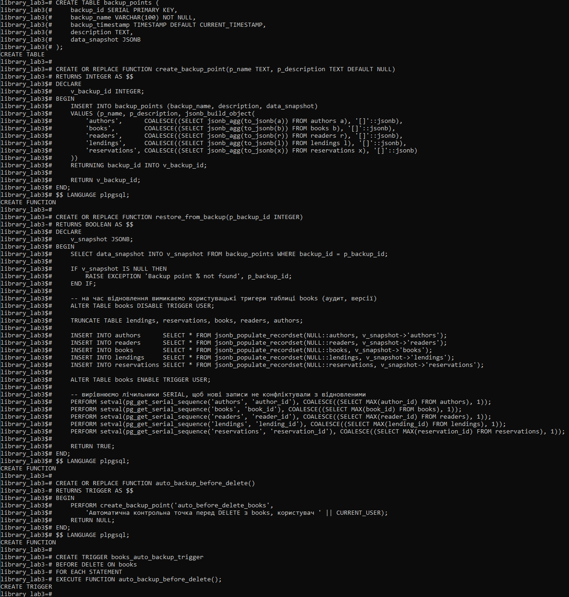

**Ручна контрольна точка.** Створено точку й перевірено її вміст: у знімку 8 книг і 3 видачі. Стан перед «аварією»: 3 видачі, 0 заблокованих читачів.

```sql
SELECT create_backup_point('Before major update', 'Backup before system upgrade') AS bid \gset

SELECT backup_id, backup_name, backup_timestamp,
       jsonb_array_length(data_snapshot->'books') AS books_in_snapshot,
       jsonb_array_length(data_snapshot->'lendings') AS lendings_in_snapshot
FROM backup_points;

SELECT (SELECT COUNT(*) FROM lendings) AS lendings,
       (SELECT COUNT(*) FROM readers WHERE status = 'Blocked') AS blocked_readers;
```


**Імітація аварії:** `DELETE` і `UPDATE` без `WHERE`:

```sql
DELETE FROM lendings;
UPDATE readers SET status = 'Blocked';

SELECT (SELECT COUNT(*) FROM lendings) AS lendings,
       (SELECT COUNT(*) FROM readers WHERE status = 'Blocked') AS blocked_readers;
```

Видалено 3 видачі (`DELETE 3`), заблоковано всіх 4 читачів (`UPDATE 4`): у таблиці 0 видач і 4 заблоковані.


**Відновлення:**

```sql
SELECT restore_from_backup(:bid);

SELECT (SELECT COUNT(*) FROM lendings) AS lendings,
       (SELECT COUNT(*) FROM readers WHERE status = 'Blocked') AS blocked_readers;
```

Функція повернула `t`, у таблицях знову 3 видачі й 0 заблокованих читачів, як до аварії.


**Автоматична контрольна точка.** Тригер сам створює точку перед будь-яким `DELETE` з `books`:

```sql
INSERT INTO books (isbn, title, author_id, publication_year, genre, total_copies, available_copies)
VALUES ('978-966-03-8888-8', 'Тимчасова книга', 2, 2024, 'Тест', 1, 1);

DELETE FROM books WHERE isbn = '978-966-03-8888-8';

SELECT backup_id, backup_name, description,
       to_char(backup_timestamp, 'YYYY-MM-DD HH24:MI:SS') AS created
FROM backup_points ORDER BY backup_id;
```

У `backup_points` з'явилась друга точка `auto_before_delete_books` (2026-10-18 15:18:46), створена без втручання користувача.


**Контрольна точка за розкладом** (відкладена операція `CREATE_BACKUP`):

```sql
INSERT INTO scheduled_operations (operation_type, target_table, operation_data, scheduled_for)
VALUES ('CREATE_BACKUP', 'backup_points', jsonb_build_object('name', 'scheduled_checkpoint'), CURRENT_TIMESTAMP);

SELECT execute_scheduled_operations();

SELECT backup_id, backup_name, description FROM backup_points ORDER BY backup_id;
```

Функція виконала одну операцію, у `backup_points` тепер три точки, остання `scheduled_checkpoint`.


#### Крок 6. Інтерфейс перегляду та відкату змін

Створено представлення `books_change_history` з людиночитною історією змін книг, функцію-звіт `get_changes_report` і функцію `rollback_book_changes`, яка скасовує зміни книг, зроблені після заданого моменту, за даними `audit_log`.

```sql
CREATE VIEW books_change_history AS
SELECT
    a.log_id,
    a.operation,
    a.record_id AS book_id,
    COALESCE(a.new_data->>'title', a.old_data->>'title') AS title,
    CASE
        WHEN a.operation = 'INSERT' THEN 'Додано нову книгу'
        WHEN a.operation = 'UPDATE' THEN
            'Оновлено: ' ||
            CASE
                WHEN (a.old_data->>'available_copies') <> (a.new_data->>'available_copies')
                THEN 'Доступні примірники: ' || (a.old_data->>'available_copies') || ' → ' || (a.new_data->>'available_copies')
                ELSE 'Інші поля'
            END
        WHEN a.operation = 'DELETE' THEN 'Видалено книгу'
    END AS change_description,
    a.changed_at,
    a.changed_by
FROM audit_log a
WHERE a.table_name = 'books';

GRANT SELECT ON books_change_history TO librarian_read;

CREATE OR REPLACE FUNCTION get_changes_report(
    p_start_date TIMESTAMP,
    p_end_date TIMESTAMP DEFAULT CURRENT_TIMESTAMP
)
RETURNS TABLE (
    change_date DATE,
    total_changes BIGINT,
    inserts BIGINT,
    updates BIGINT,
    deletes BIGINT
) AS $$
BEGIN
    RETURN QUERY
    SELECT DATE(al.changed_at),
           COUNT(*),
           COUNT(*) FILTER (WHERE al.operation = 'INSERT'),
           COUNT(*) FILTER (WHERE al.operation = 'UPDATE'),
           COUNT(*) FILTER (WHERE al.operation = 'DELETE')
    FROM audit_log al
    WHERE al.changed_at BETWEEN p_start_date AND p_end_date
    GROUP BY DATE(al.changed_at)
    ORDER BY DATE(al.changed_at) DESC;
END;
$$ LANGUAGE plpgsql;

CREATE OR REPLACE FUNCTION rollback_book_changes(p_since TIMESTAMP)
RETURNS INTEGER AS $$
DECLARE
    r RECORD;
    v_max_log INTEGER;
    v_count INTEGER := 0;
BEGIN
    SELECT COALESCE(MAX(log_id), 0) INTO v_max_log FROM audit_log;

    FOR r IN
        SELECT * FROM audit_log
        WHERE table_name = 'books' AND changed_at >= p_since AND log_id <= v_max_log
        ORDER BY log_id DESC
    LOOP
        IF r.operation = 'INSERT' THEN
            DELETE FROM books WHERE book_id = r.record_id;
        ELSIF r.operation = 'UPDATE' THEN
            UPDATE books b
            SET isbn = o.isbn, title = o.title, author_id = o.author_id,
                publication_year = o.publication_year, genre = o.genre,
                total_copies = o.total_copies, available_copies = o.available_copies
            FROM jsonb_populate_record(NULL::books, r.old_data) o
            WHERE b.book_id = r.record_id;
        ELSIF r.operation = 'DELETE' THEN
            INSERT INTO books SELECT * FROM jsonb_populate_record(NULL::books, r.old_data);
        END IF;
        v_count := v_count + 1;
    END LOOP;

    RETURN v_count;
END;
$$ LANGUAGE plpgsql;
```

Перегляд історії та звіт за останні 30 днів:

```sql
SELECT log_id, operation, book_id, title, change_description, changed_by
FROM books_change_history
ORDER BY log_id DESC
LIMIT 10;

SELECT * FROM get_changes_report(CURRENT_DATE - INTERVAL '30 days');
```

Представлення показує для кожної зміни тип операції, назву книги, зрозумілий опис (наприклад, «Доступні примірники: 4 → 5») і виконавця (серед записів є зміна від `librarian2`). Звіт за 2026-10-18 містить 11 змін: 3 вставки, 6 оновлень і 2 видалення.


**Відкат змін за період.** Запам'ятовано момент часу `t0`, після нього зроблено дві «помилкові» зміни (зменшено `available_copies` книги 3 з 7 до 5 і додано непотрібну книгу 16), після чого їх відкочено:

```sql
SELECT CURRENT_TIMESTAMP::timestamp AS t0 \gset
SELECT pg_sleep(1);

SELECT book_id, title, available_copies FROM books WHERE book_id = 3;

UPDATE books SET available_copies = available_copies - 2 WHERE book_id = 3;

INSERT INTO books (isbn, title, author_id, publication_year, genre, total_copies, available_copies)
VALUES ('978-966-03-6666-6', 'Помилкова книга', 1, 2024, 'Тест', 2, 2);

SELECT log_id, operation, book_id, title, change_description
FROM books_change_history
WHERE changed_at >= :'t0'::timestamp
ORDER BY log_id;

SELECT rollback_book_changes(:'t0'::timestamp) AS reverted_operations;

SELECT book_id, title, available_copies FROM books WHERE book_id = 3;
SELECT COUNT(*) AS wrong_book FROM books WHERE isbn = '978-966-03-6666-6';
```

Історія після `t0` містить два записи: `UPDATE` книги 3 («Доступні примірники: 7 → 5») та `INSERT` книги 16. Функція відкотила 2 операції (`reverted_operations = 2`): у книги 3 знову 7 примірників.


Книги «Помилкова книга» більше немає (`wrong_book = 0`).


#### Додатково: рівні ізоляції транзакцій

Показано роботу рівня `REPEATABLE READ` (відповідь на контрольне запитання 10). T1 відкриває транзакцію й двічі читає книгу 3, T2 між цими читаннями змінює значення:

```sql
-- T1
BEGIN ISOLATION LEVEL REPEATABLE READ;
SELECT available_copies FROM books WHERE book_id = 3;

-- T2
UPDATE books SET available_copies = available_copies - 1 WHERE book_id = 3 RETURNING available_copies;

-- T1
SELECT available_copies FROM books WHERE book_id = 3;
COMMIT;
SELECT available_copies FROM books WHERE book_id = 3;
```

T2 змінив значення з 7 на 6 і зафіксував його.


T1 до кінця транзакції бачив старе значення 7 (нечитабельне повторне читання не виникає), а після `COMMIT` побачив нове значення 6.


#### Підсумковий огляд об'єктів бази

```sql
\dt
\dv
\df
```

У базі 9 таблиць (`audit_log`, `authors`, `backup_points`, `books`, `books_versions`, `lendings`, `readers`, `reservations`, `scheduled_operations`), одне представлення (`books_change_history`) і 10 функцій: три тригерні (`auto_backup_before_delete`, `create_book_version`, `log_books_changes`) та сім функцій бізнес-логіки, керування контрольними точками, відкладеними операціями й історією змін.


## Особливості виконання

Окремі відхилення від «ідеального» сценарію, які видно на скріншотах:

1. **Крок 1.3:** блок `UPDATE books SET available_copies = available_copies - 1 ...` виконано двічі (скріншоти `6.png` і `7.png`), тому «Кобзар» має на один примірник менше, ніж за методичкою. Усі наступні значення (5 після видачі, 6 після повернення тощо) відповідають цьому, а не початковим 8.
2. **Крок 2.6 (блокування) і «Рівні ізоляції»:** перші спроби було виконано в одному вікні `psql`, тому очікування не відтворилося; їхні скриншоти до звіту не включено. У звіті наведено повторне виконання у двох окремих вікнах (T1 і T2), яке робилось 21–22 жовтня, тому числа примірників «Кобзаря» на скриншотах блокування (9 → 10 → 9) відрізняються від попередніх кроків.
3. **Крок 3.3:** сценарій успішного продовження (`75.png`) виконано після сценаріїв відмови (`38.png`) і для іншого читача (3 замість 2), бо в читача 2 на той момент уже була прострочена видача.
4. **Пропуски в нумерації** (наприклад, `book_id` 7 і `lending_id` 2 пропущено після відкотів): послідовності `SERIAL` не відкочуються разом із транзакціями, тому невдалі вставки «з'їдають» номери. Це штатна поведінка PostgreSQL.
5. **Відмінності від методички.** У ролі `librarian_write` додано права на `audit_log` і `books_versions`; у `get_changes_report` сортування зроблено за виразом, а не за іменем вихідної колонки, щоб уникнути неоднозначності зі змінними PL/pgSQL; у представленні `books_change_history` навколо оператора `->>` поставлено дужки (інакше через однаковий пріоритет `||` і `->>` запит не виконується); відновлення охоплює всі таблиці, а не лише `authors`; додано автоматичну контрольну точку, відкат змін за період і демонстрацію всіх типів зовнішніх ключів.

## Контрольні запитання

**1. У чому полягає різниця між операторами INSERT, UPDATE та DELETE? Які обмеження необхідно враховувати при їх використанні?**

`INSERT` додає нові рядки, `UPDATE` змінює значення в існуючих рядках, `DELETE` видаляє рядки. Усі три перевіряються обмеженнями цілісності. При `INSERT` діють `NOT NULL`, `UNIQUE`, `CHECK` і зовнішні ключі: вставка книги з наявним ISBN завершилась помилкою `books_isbn_key` (крок 2.3). `UPDATE` також перевіряє `CHECK`: зменшення `available_copies` на 5 при 4 доступних порушило `books_available_copies_check` (крок 1.5). `DELETE` обмежується зовнішніми ключами: видалити автора, у якого є книги, не вдалося через `ON DELETE RESTRICT` (кроки 1.5 і 2.4), а видалення книги каскадно прибрало її бронювання через `ON DELETE CASCADE`.

**2. Чому використання умови WHERE є критично важливим в операціях UPDATE та DELETE? Які наслідки можуть бути від її пропуску?**

Без `WHERE` операція зачіпає всі рядки таблиці. У лабораторній це показано на аварії: `DELETE FROM lendings;` без умови видалив усі 3 видачі, а `UPDATE readers SET status = 'Blocked';` заблокував усіх 4 читачів (крок 3.5). Тому перед зміною виконується `SELECT` з тією самою умовою, а після неї `RETURNING` або повторний `SELECT`: наприклад, `UPDATE ... WHERE genre = 'Поезія'` зачепив один рядок, а без `WHERE` було б змінено всі 5 книг (крок 1.3). Відновити дані після такої помилки без резервної копії чи контрольної точки неможливо, тому ми й робили `restore_from_backup`.

**3. Що таке транзакція та які властивості ACID вона забезпечує? Поясніть кожну властивість на конкретному прикладі.**

Транзакція — група операцій, що виконується як єдине ціле. Атомарність (Atomicity): повернення книги об'єднує чотири зміни (закрити видачу, збільшити `available_copies`, знайти бронь, позначити її виконаною) і або виконується повністю, або не виконується зовсім; у кроці 1.5 `INSERT` видачі скасувався разом із помилковим `UPDATE`. Узгодженість (Consistency): після транзакції дані завжди задовольняють обмеження (`available_copies` не може бути від'ємним чи більшим за `total_copies`). Ізольованість (Isolation): у кроці 2.6 рядок, заблокований T1, був недоступний T2 до `COMMIT`, а на рівні `REPEATABLE READ` T1 бачив стабільне значення 7, хоч T2 уже змінив його на 6. Довговічність (Durability): після `COMMIT` зміни записуються в журнал транзакцій і зберігаються навіть після збою чи перезапуску сервера.

**4. Яка різниця між командами COMMIT та ROLLBACK? У яких ситуаціях використовується кожна з них?**

`COMMIT` фіксує всі зміни транзакції, `ROLLBACK` скасовує їх. `COMMIT` застосовано після успішної видачі книги (крок 1.4) та повернення (крок 2.2). `ROLLBACK` застосовано після помилок: видалення автора з книгами (крок 1.5, сценарій А) та порушення `CHECK` (сценарій Б). Після помилки транзакція переходить у стан «перервана» (промпт `=!#`), і єдиний вихід — `ROLLBACK`: зміни, виконані до помилки (вставка видачі), теж зникають.

**5. Що таке точки збереження SAVEPOINT і як вони дозволяють керувати транзакціями більш гнучко порівняно з простим ROLLBACK?**

`SAVEPOINT` — іменована позначка всередині транзакції, до якої можна відкотитися командою `ROLLBACK TO SAVEPOINT`, не скасовуючи всю транзакцію. У кроці 2.3 додано автора і книгу «Земля», поставлено точку `after_first_book`; друга вставка з дублікатом ISBN завершилась помилкою, але відкат лише до цієї точки зберіг автора й першу книгу. Після цього додано коректну «Царівну» і зроблено `COMMIT`. Простий `ROLLBACK` скасував би все, зокрема автора й першу книгу.

**6. Які типи обмежень цілісності ви знаєте? Як кожен з них допомагає підтримувати коректність даних у базі?**

- `PRIMARY KEY` унікально ідентифікує запис (`book_id`).
- `FOREIGN KEY` гарантує, що посилання ведуть на існуючі записи (`books.author_id` → `authors`) і керує поведінкою при видаленні й оновленні.
- `UNIQUE` забороняє дублікати (`isbn`, `email`, `library_card_number`).
- `CHECK` перевіряє умови на значення (`available_copies >= 0`, `available_copies <= total_copies`, допустимі статуси).
- `NOT NULL` забороняє порожні значення (імена, ISBN).
- `DEFAULT` задає значення за замовчуванням (`status = 'Active'`).

У роботі кожне обмеження спрацювало на реальній помилці: дублікат ISBN, від'ємна кількість примірників, видалення автора з книгами.

**7. Що таке каскадні операції та які варіанти їх поведінки існують при видаленні або оновленні батьківських записів?**

Це автоматичні дії над дочірніми записами при зміні або видаленні батьківського. Варіанти: `CASCADE` (дочірні записи видаляються чи змінюються разом з батьківським), `SET NULL` (в дочірніх записах ключ стає `NULL`), `SET DEFAULT` (ключ отримує значення за замовчуванням), `RESTRICT` / `NO ACTION` (операція забороняється, якщо є дочірні записи). У кроці 2.4 показано кожен варіант: `ON DELETE CASCADE` (видалення книги прибрало її бронювання), `RESTRICT` (автор з книгами не видалився), `ON UPDATE CASCADE` (зміна ключа видавця 10 → 11 оновила видання), `SET NULL` (видалення видавця 20 дало `NULL` у виданні) і `SET DEFAULT` (видалення категорії 2 повернуло `category_id = 1`).

**8. Яку роль відіграють тригери в забезпеченні цілісності даних та автоматизації операцій? Наведіть приклади їх практичного застосування.**

Тригер автоматично виконує функцію при `INSERT`, `UPDATE` або `DELETE`, незалежно від того, який застосунок чи користувач змінює дані. У роботі застосовано три тригери на таблиці `books`: `books_audit_trigger` записує кожну зміну в `audit_log` (старий і новий стан, час, користувач); `book_versioning_trigger` створює нову версію запису; `books_auto_backup_trigger` перед кожним `DELETE` створює контрольну точку. Інші приклади: автоматичне оновлення поля `updated_at`, перевірка складних бізнес-правил, підтримка денормалізованих підсумків. Недоліки: тригери виконуються неявно, додають навантаження, їх складніше налагоджувати.

**9. Чому необхідно використовувати блокування записів при паралельному доступі? Які проблеми можуть виникнути без них?**

Без блокувань дві транзакції можуть одночасно прочитати те саме значення й записати результат, загубивши зміни одна одної («втрачене оновлення»). Наприклад, якби два бібліотекарі одночасно прочитали `available_copies = 9` і кожен зменшив його на 1, у базі лишилось би 8 замість 7. `SELECT ... FOR UPDATE` змушує T2 чекати: у кроці 2.6 T2 «завис» (у `pg_stat_activity` стан `Lock / transactionid`) і після `COMMIT` у T1 побачив актуальне значення 10, змінив його на 9, і жодне оновлення не втрачено. `FOR UPDATE NOWAIT` дозволяє не чекати, а одразу отримати помилку. Сама собою блокування може призвести до очікувань і взаємних блокувань (deadlock), тому транзакції мають бути короткими.

**10. Як рівні ізоляції транзакцій впливають на можливі аномалії при паралельному виконанні операцій? Який рівень слід обирати для різних сценаріїв?**

| Рівень | Брудне читання | Неповторюване читання | Фантомне читання |
|---|---|---|---|
| READ UNCOMMITTED (у PostgreSQL працює як READ COMMITTED) | ні | можливе | можливе |
| READ COMMITTED (типовий) | ні | можливе | можливе |
| REPEATABLE READ | ні | ні | ні (у PostgreSQL) |
| SERIALIZABLE | ні | ні | ні |

У кроці «Рівні ізоляції» на `REPEATABLE READ` T1 двічі прочитав значення 7, хоч між читаннями T2 змінив його на 6 і зафіксував; нове значення T1 побачив лише в новій транзакції. На `READ COMMITTED` друге читання повернуло б 6. Вибір рівня: `READ COMMITTED` підходить для більшості простих операцій; `REPEATABLE READ` потрібен для звітів і аналітики, де в межах однієї транзакції дані мають бути узгодженими; `SERIALIZABLE` потрібен для критичних фінансових операцій, коли треба гарантувати результат, еквівалентний послідовному виконанню (за готовності повторювати транзакції при помилці серіалізації).

## Висновки

У результаті виконання лабораторної роботи здобуто практичні навички роботи з операціями модифікації даних у реляційних базах даних.

1. Створено повнофункціональну базу даних для системи управління бібліотекою з обмеженнями цілісності (`PRIMARY KEY`, `FOREIGN KEY`, `UNIQUE`, `CHECK`, `NOT NULL`).
2. Опановано безпечні операції `INSERT`, `UPDATE` та `DELETE` з обов'язковою умовою `WHERE`, попередньою перевіркою через `SELECT` і використанням `RETURNING`.
3. Вивчено транзакції та властивості ACID, продемонстровано `BEGIN`, `COMMIT` і `ROLLBACK` (порушення зовнішнього ключа та `CHECK`).
4. Реалізовано складну транзакцію з кількома операціями над різними таблицями та частковий відкат за допомогою `SAVEPOINT`.
5. Впроваджено каскадні операції: `CASCADE`, `RESTRICT`, `ON UPDATE CASCADE`, `SET NULL`, `SET DEFAULT`.
6. Створено тригер аудиту, що автоматично веде історію змін таблиці `books`.
7. Продемонстровано блокування рядків (`FOR UPDATE`, `NOWAIT`) і рівень ізоляції `REPEATABLE READ` при паралельному доступі.
8. Розроблено систему версіонування записів з отриманням історичних станів на довільну дату.
9. Реалізовано відкладені операції з автоматичним виконанням (`\watch`) і обробкою помилок.
10. Створено збережену функцію `extend_lending`, систему ролей з різними правами, контрольні точки з відновленням даних, а також представлення й функції для перегляду та відкату змін за період.

**Обмеження реалізації:** автоматичне виконання відкладених операцій реалізовано циклом у `psql` (`\watch`), а не планувальником (`pg_cron` у базовому образі не встановлено); відновлення з контрольної точки не відновлює таблиці `audit_log` і `books_versions`.

**Самооцінка:** 5.

## Посилання на проєкт

Репозиторій з повним кодом SQL скриптів: `https://github.com/dmutrokondratyk2008/db_labs`

Файли проєкту:

- `sql/01-create-structure.sql`: створення структури БД
- `sql/02-insert-data.sql`: початкові дані
- `sql/03-basic-operations.sql`: базові операції модифікації
- `sql/04-transactions.sql`: транзакції, `ROLLBACK`, `SAVEPOINT`
- `sql/05-advanced-features.sql`: нові таблиці, каскади, тригер аудиту, блокування
- `sql/06-creative-extensions.sql`: версіонування, відкладені операції, бізнес-логіка, ролі, відновлення, історія змін
- `screenshots/lab03/`: скріншоти виконання

## Додаток А. Скріншоти виконання

Усі скриншоти збережено в `screenshots/lab03/` (`1.png`–`80.png`). Номери збігаються з порядком виконання; прогалини в нумерації відповідають невдалим і дублюючим спробам, які до звіту не включено. Кожен скриншот вбудовано у відповідний розділ.

| Файл | Розділ і зміст |
|---|---|
| `1.png` | Підготовка середовища: підключення `psql` до `library_lab3` |
| `2.png` | Рівень 1, крок 1: створення таблиць |
| `3.png` | Рівень 1, крок 1: `\dt` і `\d books` |
| `4.png` | Рівень 1, крок 2: вставка даних |
| `5.png` | Рівень 1, крок 2: перевірка даних |
| `6.png` | Рівень 1, крок 3: безпечний `UPDATE` (8 → 7) |
| `7.png` | Рівень 1, крок 3: повторне виконання (7 → 6) |
| `8.png` | Рівень 1, крок 3: `UPDATE ... RETURNING` |
| `9.png` | Рівень 1, крок 4: транзакція видачі книги |
| `10.png` | Рівень 1, крок 5: помилка зовнішнього ключа |
| `11.png` | Рівень 1, крок 5: транзакція перервана |
| `12.png` | Рівень 1, крок 5: `ROLLBACK`, автор на місці |
| `13.png` | Рівень 1, крок 5: порушення `CHECK` |
| `14.png` | Рівень 1, крок 5: результат відкату |
| `15.png` | Рівень 1, крок 6: перевірка перед видаленням |
| `16.png` | Рівень 1, крок 6: тестовий читач |
| `17.png` | Рівень 1, крок 6: безпечне видалення |
| `18.png` | Рівень 2, крок 1: таблиці `reservations` і `audit_log` |
| `19.png` | Рівень 2, крок 2: створення бронювання |
| `20.png` | Рівень 2, крок 2: транзакція повернення книги |
| `21.png` | Рівень 2, крок 2: перевірка результату |
| `22.png` | Рівень 2, крок 3: початок транзакції з `SAVEPOINT` |
| `23.png` | Рівень 2, крок 3: помилка дубліката ISBN |
| `24.png` | Рівень 2, крок 3: відкат до `SAVEPOINT` і результат |
| `25.png` | Рівень 2, крок 4: тестові дані для каскаду |
| `26.png` | Рівень 2, крок 4: каскадне видалення |
| `27.png` | Рівень 2, крок 4: `RESTRICT` |
| `28.png` | Рівень 2, крок 4: `ON UPDATE CASCADE`, `SET NULL`, `SET DEFAULT` |
| `29.png` | Рівень 2, крок 4: видалення демонстраційних таблиць |
| `30.png` | Рівень 2, крок 5: тригер аудиту |
| `34.png` | Рівень 3, крок 1: історичний стан книги |
| `35.png` | Рівень 3, крок 2: операції в очікуванні |
| `36.png` | Рівень 3, крок 2: автоматичне виконання через `\watch` |
| `37.png` | Рівень 3, крок 2: результати відкладених операцій |
| `38.png` | Рівень 3, крок 3: відмови `extend_lending` |
| `39.png` | Рівень 3, крок 4: ролі та права |
| `40.png` | Рівень 3, крок 4: перевірка `librarian1` |
| `41.png` | Рівень 3, крок 4: перевірка `librarian2` |
| `42.png` | Рівень 3, крок 4: `admin1` і аудит за користувачами |
| `43.png` | Рівень 3, крок 5: таблиця, функції й тригер контрольних точок |
| `44.png` | Рівень 3, крок 5: ручна контрольна точка |
| `45.png` | Рівень 3, крок 5: імітація аварії |
| `46.png` | Рівень 3, крок 5: відновлення з контрольної точки |
| `47.png` | Рівень 3, крок 5: автоматична контрольна точка |
| `48.png` | Рівень 3, крок 5: контрольна точка за розкладом |
| `49.png` | Рівень 3, крок 6: історія змін і звіт |
| `52.png` | Рівень 3, крок 6: відкат змін за період |
| `56.png` | Підсумковий огляд: `\df` |
| `60.png` | Рівень 2, крок 6: `NOWAIT` і очікування в T2 |
| `66.png` | Додатково: `REPEATABLE READ`, T1 |
| `67.png` | Додатково: `REPEATABLE READ`, T2 |
| `69.png` | Рівень 2, крок 6: T1 блокує рядок |
| `70.png` | Рівень 2, крок 6: сесії в `pg_stat_activity`, `COMMIT` у T1 |
| `71.png` | Рівень 2, крок 6: T2 розблоковано |
| `72.png` | Рівень 2, крок 6: оновлення в T2 |
| `73.png` | Рівень 3, крок 1: історія версій книги |
| `74.png` | Рівень 3, крок 1: тригери таблиці `books` |
| `75.png` | Рівень 3, крок 3: успішне продовження |
| `76.png` | Рівень 3, крок 3: код `extend_lending` |
| `77.png` | Підсумковий огляд: `\dt` |
| `78.png` | Рівень 3, крок 6: перевірка після відкату |
| `79.png` | Підсумковий огляд: `\dv` |
| `80.png` | Рівень 3, крок 3: підсумковий стан таблиці `lendings` |

## Додаток Б. Повний код функцій та тригерів

```sql
-- log_books_changes
CREATE OR REPLACE FUNCTION log_books_changes()
RETURNS TRIGGER AS $$
BEGIN
    IF TG_OP = 'INSERT' THEN
        INSERT INTO audit_log (table_name, operation, record_id, new_data)
        VALUES ('books', 'INSERT', NEW.book_id, row_to_json(NEW)::jsonb);
    ELSIF TG_OP = 'UPDATE' THEN
        INSERT INTO audit_log (table_name, operation, record_id, old_data, new_data)
        VALUES ('books', 'UPDATE', NEW.book_id, row_to_json(OLD)::jsonb, row_to_json(NEW)::jsonb);
    ELSIF TG_OP = 'DELETE' THEN
        INSERT INTO audit_log (table_name, operation, record_id, old_data)
        VALUES ('books', 'DELETE', OLD.book_id, row_to_json(OLD)::jsonb);
    END IF;
    RETURN NULL;
END;
$$ LANGUAGE plpgsql;

-- create_book_version
CREATE OR REPLACE FUNCTION create_book_version()
RETURNS TRIGGER AS $$
DECLARE
    v_version_number INTEGER;
BEGIN
    UPDATE books_versions
    SET valid_to = CURRENT_TIMESTAMP
    WHERE book_id = NEW.book_id AND valid_to IS NULL;

    SELECT COALESCE(MAX(version_number), 0) + 1
    INTO v_version_number
    FROM books_versions
    WHERE book_id = NEW.book_id;

    INSERT INTO books_versions (book_id, version_number, data)
    VALUES (NEW.book_id, v_version_number, row_to_json(NEW)::jsonb);

    RETURN NEW;
END;
$$ LANGUAGE plpgsql;

-- get_book_version
CREATE OR REPLACE FUNCTION get_book_version(p_book_id INTEGER, p_date TIMESTAMP)
RETURNS JSONB AS $$
BEGIN
    RETURN (
        SELECT data
        FROM books_versions
        WHERE book_id = p_book_id
            AND valid_from <= p_date
            AND (valid_to IS NULL OR valid_to > p_date)
        LIMIT 1
    );
END;
$$ LANGUAGE plpgsql;

-- execute_scheduled_operations
CREATE OR REPLACE FUNCTION execute_scheduled_operations()
RETURNS INTEGER AS $$
DECLARE
    v_operation RECORD;
    v_count INTEGER := 0;
BEGIN
    FOR v_operation IN
        SELECT * FROM scheduled_operations
        WHERE status = 'Pending' AND scheduled_for <= CURRENT_TIMESTAMP
        ORDER BY operation_id
    LOOP
        BEGIN
            CASE v_operation.operation_type
                WHEN 'UPDATE_BOOK_STATUS' THEN
                    UPDATE books
                    SET available_copies = (v_operation.operation_data->>'available_copies')::INTEGER
                    WHERE book_id = (v_operation.operation_data->>'book_id')::INTEGER;

                WHEN 'EXPIRE_RESERVATION' THEN
                    UPDATE reservations
                    SET status = 'Expired'
                    WHERE reservation_id = (v_operation.operation_data->>'reservation_id')::INTEGER;

                WHEN 'BLOCK_READER' THEN
                    UPDATE readers
                    SET status = 'Blocked'
                    WHERE reader_id = (v_operation.operation_data->>'reader_id')::INTEGER;

                WHEN 'CREATE_BACKUP' THEN
                    PERFORM create_backup_point(
                        COALESCE(v_operation.operation_data->>'name', 'scheduled_checkpoint'),
                        'Створено відкладеною операцією');
            END CASE;

            UPDATE scheduled_operations
            SET status = 'Executed', executed_at = CURRENT_TIMESTAMP
            WHERE operation_id = v_operation.operation_id;

            v_count := v_count + 1;
        EXCEPTION WHEN OTHERS THEN
            UPDATE scheduled_operations
            SET status = 'Failed',
                executed_at = CURRENT_TIMESTAMP,
                error_message = SQLERRM
            WHERE operation_id = v_operation.operation_id;
        END;
    END LOOP;

    RETURN v_count;
END;
$$ LANGUAGE plpgsql;

-- extend_lending
CREATE OR REPLACE FUNCTION extend_lending(
    p_lending_id INTEGER,
    p_days INTEGER DEFAULT 7
)
RETURNS TABLE (
    success BOOLEAN,
    message TEXT,
    new_due_date DATE
) AS $$
DECLARE
    v_reader_status VARCHAR(20);
    v_overdue_count INTEGER;
    v_current_due_date DATE;
    v_reader_id INTEGER;
BEGIN
    SELECT r.status, l.due_date, l.reader_id
    INTO v_reader_status, v_current_due_date, v_reader_id
    FROM lendings l
    JOIN readers r ON l.reader_id = r.reader_id
    WHERE l.lending_id = p_lending_id AND l.return_date IS NULL;

    IF NOT FOUND THEN
        RETURN QUERY SELECT FALSE, 'Видача не знайдена або книга вже повернена'::TEXT, NULL::DATE;
        RETURN;
    END IF;

    IF v_reader_status = 'Blocked' THEN
        RETURN QUERY SELECT FALSE, 'Читач заблокований'::TEXT, NULL::DATE;
        RETURN;
    END IF;

    SELECT COUNT(*)
    INTO v_overdue_count
    FROM lendings
    WHERE reader_id = v_reader_id
        AND return_date IS NULL
        AND due_date < CURRENT_DATE;

    IF v_overdue_count > 0 THEN
        RETURN QUERY SELECT FALSE, 'У читача є прострочені книги'::TEXT, NULL::DATE;
        RETURN;
    END IF;

    UPDATE lendings
    SET due_date = due_date + p_days
    WHERE lending_id = p_lending_id;

    RETURN QUERY SELECT TRUE, 'Термін продовжено'::TEXT, (v_current_due_date + p_days)::DATE;
END;
$$ LANGUAGE plpgsql;

-- create_backup_point
CREATE OR REPLACE FUNCTION create_backup_point(p_name TEXT, p_description TEXT DEFAULT NULL)
RETURNS INTEGER AS $$
DECLARE
    v_backup_id INTEGER;
BEGIN
    INSERT INTO backup_points (backup_name, description, data_snapshot)
    VALUES (p_name, p_description, jsonb_build_object(
        'authors',      COALESCE((SELECT jsonb_agg(to_jsonb(a)) FROM authors a), '[]'::jsonb),
        'books',        COALESCE((SELECT jsonb_agg(to_jsonb(b)) FROM books b), '[]'::jsonb),
        'readers',      COALESCE((SELECT jsonb_agg(to_jsonb(r)) FROM readers r), '[]'::jsonb),
        'lendings',     COALESCE((SELECT jsonb_agg(to_jsonb(l)) FROM lendings l), '[]'::jsonb),
        'reservations', COALESCE((SELECT jsonb_agg(to_jsonb(x)) FROM reservations x), '[]'::jsonb)
    ))
    RETURNING backup_id INTO v_backup_id;

    RETURN v_backup_id;
END;
$$ LANGUAGE plpgsql;

-- restore_from_backup
CREATE OR REPLACE FUNCTION restore_from_backup(p_backup_id INTEGER)
RETURNS BOOLEAN AS $$
DECLARE
    v_snapshot JSONB;
BEGIN
    SELECT data_snapshot INTO v_snapshot FROM backup_points WHERE backup_id = p_backup_id;

    IF v_snapshot IS NULL THEN
        RAISE EXCEPTION 'Backup point % not found', p_backup_id;
    END IF;

    -- на час відновлення вимикаємо користувацькі тригери таблиці books (аудит, версії)
    ALTER TABLE books DISABLE TRIGGER USER;

    TRUNCATE TABLE lendings, reservations, books, readers, authors;

    INSERT INTO authors      SELECT * FROM jsonb_populate_recordset(NULL::authors, v_snapshot->'authors');
    INSERT INTO readers      SELECT * FROM jsonb_populate_recordset(NULL::readers, v_snapshot->'readers');
    INSERT INTO books        SELECT * FROM jsonb_populate_recordset(NULL::books, v_snapshot->'books');
    INSERT INTO lendings     SELECT * FROM jsonb_populate_recordset(NULL::lendings, v_snapshot->'lendings');
    INSERT INTO reservations SELECT * FROM jsonb_populate_recordset(NULL::reservations, v_snapshot->'reservations');

    ALTER TABLE books ENABLE TRIGGER USER;

    -- вирівнюємо лічильники SERIAL, щоб нові записи не конфліктували з відновленими
    PERFORM setval(pg_get_serial_sequence('authors', 'author_id'), COALESCE((SELECT MAX(author_id) FROM authors), 1));
    PERFORM setval(pg_get_serial_sequence('books', 'book_id'), COALESCE((SELECT MAX(book_id) FROM books), 1));
    PERFORM setval(pg_get_serial_sequence('readers', 'reader_id'), COALESCE((SELECT MAX(reader_id) FROM readers), 1));
    PERFORM setval(pg_get_serial_sequence('lendings', 'lending_id'), COALESCE((SELECT MAX(lending_id) FROM lendings), 1));
    PERFORM setval(pg_get_serial_sequence('reservations', 'reservation_id'), COALESCE((SELECT MAX(reservation_id) FROM reservations), 1));

    RETURN TRUE;
END;
$$ LANGUAGE plpgsql;

-- auto_backup_before_delete
CREATE OR REPLACE FUNCTION auto_backup_before_delete()
RETURNS TRIGGER AS $$
BEGIN
    PERFORM create_backup_point('auto_before_delete_books',
        'Автоматична контрольна точка перед DELETE з books, користувач ' || CURRENT_USER);
    RETURN NULL;
END;
$$ LANGUAGE plpgsql;

-- get_changes_report
CREATE OR REPLACE FUNCTION get_changes_report(
    p_start_date TIMESTAMP,
    p_end_date TIMESTAMP DEFAULT CURRENT_TIMESTAMP
)
RETURNS TABLE (
    change_date DATE,
    total_changes BIGINT,
    inserts BIGINT,
    updates BIGINT,
    deletes BIGINT
) AS $$
BEGIN
    RETURN QUERY
    SELECT DATE(al.changed_at),
           COUNT(*),
           COUNT(*) FILTER (WHERE al.operation = 'INSERT'),
           COUNT(*) FILTER (WHERE al.operation = 'UPDATE'),
           COUNT(*) FILTER (WHERE al.operation = 'DELETE')
    FROM audit_log al
    WHERE al.changed_at BETWEEN p_start_date AND p_end_date
    GROUP BY DATE(al.changed_at)
    ORDER BY DATE(al.changed_at) DESC;
END;
$$ LANGUAGE plpgsql;

-- rollback_book_changes
CREATE OR REPLACE FUNCTION rollback_book_changes(p_since TIMESTAMP)
RETURNS INTEGER AS $$
DECLARE
    r RECORD;
    v_max_log INTEGER;
    v_count INTEGER := 0;
BEGIN
    SELECT COALESCE(MAX(log_id), 0) INTO v_max_log FROM audit_log;

    FOR r IN
        SELECT * FROM audit_log
        WHERE table_name = 'books' AND changed_at >= p_since AND log_id <= v_max_log
        ORDER BY log_id DESC
    LOOP
        IF r.operation = 'INSERT' THEN
            DELETE FROM books WHERE book_id = r.record_id;
        ELSIF r.operation = 'UPDATE' THEN
            UPDATE books b
            SET isbn = o.isbn, title = o.title, author_id = o.author_id,
                publication_year = o.publication_year, genre = o.genre,
                total_copies = o.total_copies, available_copies = o.available_copies
            FROM jsonb_populate_record(NULL::books, r.old_data) o
            WHERE b.book_id = r.record_id;
        ELSIF r.operation = 'DELETE' THEN
            INSERT INTO books SELECT * FROM jsonb_populate_record(NULL::books, r.old_data);
        END IF;
        v_count := v_count + 1;
    END LOOP;

    RETURN v_count;
END;
$$ LANGUAGE plpgsql;

-- books_audit_trigger
CREATE TRIGGER books_audit_trigger
AFTER INSERT OR UPDATE OR DELETE ON books
FOR EACH ROW
EXECUTE FUNCTION log_books_changes();

-- book_versioning_trigger
CREATE TRIGGER book_versioning_trigger
AFTER INSERT OR UPDATE ON books
FOR EACH ROW
EXECUTE FUNCTION create_book_version();

-- books_auto_backup_trigger
CREATE TRIGGER books_auto_backup_trigger
BEFORE DELETE ON books
FOR EACH STATEMENT
EXECUTE FUNCTION auto_backup_before_delete();
```
