# Звіт з лабораторної роботи 4. Розробка реляційної бази даних з простою інтеграцією

**Виконав:** Кондратюк Дмитро  
**Група:** ІПЗ-32  
**Варіант (предметна область):** Компанія з пригону авто зі США  
**Рівень виконання:** 3 (відмінно)

## Мета роботи

Здобути практичні навички повного циклу розробки реляційної бази даних від аналізу предметної області до створення функціонального застосунку з веб-інтерфейсом, що включає проєктування нормалізованої структури, реалізацію в PostgreSQL та інтеграцію з програмним додатком.

## Виконання роботи

### Підготовка середовища

Роботу виконано 8 листопада 2026 року на Windows 11. Використано:

- Docker Desktop 29.9.2 з контейнером `postgres:17-alpine` (PostgreSQL 17.11);
- Python 3.13.17, бібліотеки `psycopg2-binary`, `Flask 3.1`, `reportlab`, `openpyxl`, `matplotlib`;
- клієнт `psql` усередині контейнера.

База даних розгортається файлом [`docker-compose.yml`](docker-compose.yml):

```yaml
services:
  postgres:
    image: postgres:17-alpine
    container_name: car_import_db
    environment:
      POSTGRES_DB: car_import
      POSTGRES_USER: postgres
      POSTGRES_PASSWORD: password
      # українська локаль ICU: коректні lower()/ILIKE і сортування кирилиці
      POSTGRES_INITDB_ARGS: "--encoding=UTF8 --locale-provider=icu --icu-locale=uk-UA --locale=C.UTF-8"
      TZ: Europe/Kyiv
      PGTZ: Europe/Kyiv
    ports:
      - "5432:5432"
    volumes:
      - postgres_data:/var/lib/postgresql/data
      - ./database:/docker-entrypoint-initdb.d:ro
      - ./demo:/demo:ro
      - ./backups:/backups
    restart: unless-stopped
    healthcheck:
      test: ["CMD-SHELL", "pg_isready -U postgres -d car_import"]
```

Відмінності від прикладу з методички:

- локаль ICU `uk-UA`: у стандартному образі Alpine немає системних локалей, і без неї `lower()` та `ILIKE` не працюють з кирилицею;
- каталог `demo/` зі сценаріями демонстрації, змонтований у `/demo`;
- каталог `backups/` для резервних копій;
- `healthcheck`;
- pgAdmin винесено в профіль `tools`, тому він не запускається за замовчуванням.

Під час першого запуску контейнер виконав усі скрипти з `database/` в алфавітному порядку:

```bash
docker compose up -d
docker compose ps
docker compose logs postgres
```

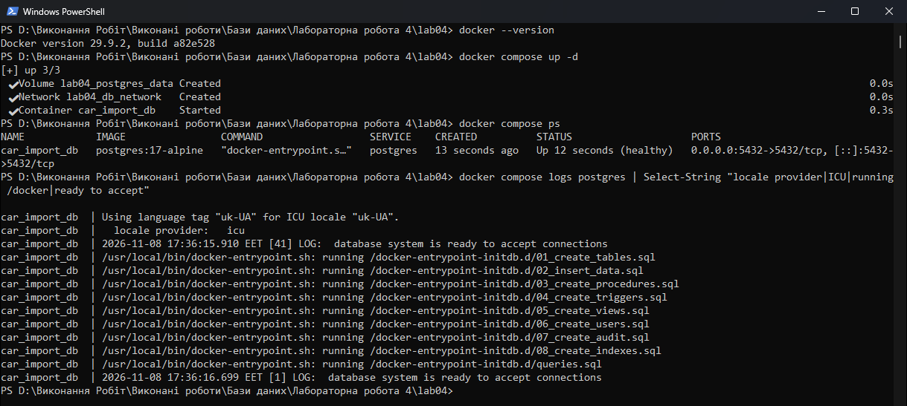

Підключення до бази: `docker exec -it car_import_db psql -U postgres -d car_import`. Демонстраційні сценарії запускались з ключем `-a`, тому в кожному скриншоті видно і текст запиту, і результат.

### Рівень 1. База даних і консольний застосунок

#### Крок 1. Аналіз предметної області

Компанія купує вживані авто на американських аукціонах (Copart, IAAI, Manheim) під замовлення клієнтів з України, доставляє їх морем у європейський порт, розмитнює і передає клієнту. Бізнес-процес одного замовлення:

1. Клієнт звертається до менеджера з запитом (бажане авто, бюджет, місто доставки) і вносить завдаток. Статус `new` (нове).
2. Менеджер купує лот на аукціоні. Авто реєструється в базі і прив'язується до замовлення: `bought` (куплено).
3. Авто відвантажується в контейнер перевізника: `in_transit` (в дорозі), потім прибуває в порт: `in_port` (у порту).
4. Розраховуються митні платежі (мито, акциз, ПДВ): `customs` (розмитнення). Після завершення оформлення авто передається клієнту: `delivered` (доставлено).
5. До купівлі замовлення можна скасувати: `cancelled` (скасовано).

Протягом замовлення клієнт платить частинами (завдаток, авто, доставка, митні платежі, послуги), а компанія може додати послуги: ремонт, сертифікацію, реєстрацію, доставку автовозом.

**Функціональні вимоги:**

- облік клієнтів, менеджерів, аукціонних майданчиків, перевізників і послуг;
- реєстрація купленого авто з VIN і даними лота;
- контроль статусу замовлення з дозволеними переходами та історією змін;
- облік доставки, митних платежів, послуг і платежів;
- розрахунок кошторису, боргу або авансу клієнта;
- звіти: ефективність менеджерів, авто в дорозі, фінанси, аналітика.

**Основні сутності:** клієнт, менеджер, аукціонний майданчик, перевізник, послуга, авто, замовлення, доставка, митна декларація, послуга в замовленні, платіж. Для рівнів 2-3 додано історію статусів, користувачів і журнал операцій.

#### Крок 2. Концептуальна модель

ER-діаграма містить 11 основних сутностей і 3 службові. Її джерело в нотації Mermaid збережено у [`docs/conceptual_model.mmd`](docs/conceptual_model.mmd).

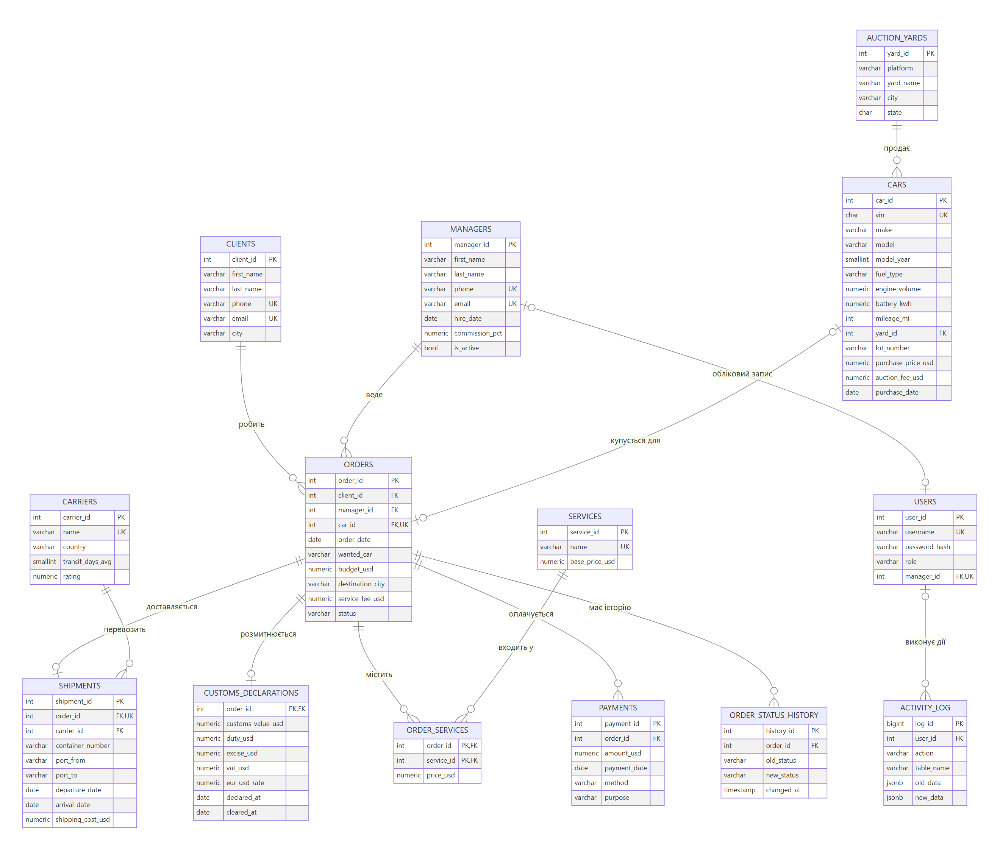

Типи зв'язків і кардинальність:

- **1 : N:** клієнт — замовлення, менеджер — замовлення, майданчик — авто, перевізник — доставка, замовлення — платежі. Зовнішній ключ розміщено на стороні «багато».
- **1 : 0..1:**
  - замовлення — авто: авто з'являється лише після купівлі, `orders.car_id UNIQUE`;
  - замовлення — доставка: `shipments.order_id UNIQUE`;
  - замовлення — митна декларація: `order_id` є і первинним, і зовнішнім ключем.
- **M : N:** замовлення — послуги, через таблицю зв'язку `order_services` з власним атрибутом `price_usd` (ціна конкретної послуги в конкретному замовленні).

#### Крок 3. Логічна схема

Повний опис таблиць, ключів і перевірки 3НФ наведено в [`docs/logical_schema.md`](docs/logical_schema.md). Коротко:

| Таблиця | PK | FK | Призначення |
|---|---|---|---|
| clients | client_id | — | клієнти |
| managers | manager_id | — | менеджери |
| auction_yards | yard_id | — | майданчики аукціонів у США |
| carriers | carrier_id | — | морські перевізники |
| services | service_id | — | додаткові послуги |
| cars | car_id | yard_id | куплені авто |
| orders | order_id | client_id, manager_id, car_id | замовлення |
| shipments | shipment_id | order_id, carrier_id | морська доставка |
| customs_declarations | order_id | order_id | митне оформлення |
| order_services | (order_id, service_id) | order_id, service_id | послуги в замовленні |
| payments | payment_id | order_id | платежі |

**Перевірка нормальних форм:**

- **1НФ:** усі значення атомарні. Послуги не зберігаються списком у полі замовлення, а винесені в `order_services`.
- **2НФ:** складений ключ є лише в `order_services`, і `price_usd` залежить від усієї пари ключів.
- **3НФ:** немає транзитивних залежностей.
  - Місто і штат аукціону зберігаються в `auction_yards`, а не в `cars`.
  - Дані клієнта зберігаються в `clients`, а не в `orders`.
  - Похідні суми (повна вартість, сплачено, борг) не зберігаються, а обчислюються представленням `v_order_finance`.
  - Очікувана дата прибуття обчислюється в `v_shipments_in_transit` з `transit_days_avg` перевізника.

#### Крок 4. Реалізація в PostgreSQL

Структуру створює скрипт [`database/01_create_tables.sql`](database/01_create_tables.sql). Найважливіші фрагменти:

```sql
CREATE TABLE cars (
    car_id              SERIAL PRIMARY KEY,
    vin                 CHAR(17)      NOT NULL UNIQUE
                        CHECK (vin ~ '^[A-HJ-NPR-Z0-9]{17}$'),
    make                VARCHAR(40)   NOT NULL,
    model               VARCHAR(40)   NOT NULL,
    model_year          SMALLINT      NOT NULL CHECK (model_year BETWEEN 1990 AND 2100),
    fuel_type           VARCHAR(10)   NOT NULL
                        CHECK (fuel_type IN ('petrol', 'diesel', 'hybrid', 'electric')),
    engine_volume       NUMERIC(3,1)  CHECK (engine_volume > 0 AND engine_volume <= 8.0),
    battery_kwh         NUMERIC(5,1)  CHECK (battery_kwh > 0),
    mileage_mi          INTEGER       NOT NULL CHECK (mileage_mi >= 0),
    damage              VARCHAR(100),
    yard_id             INTEGER       NOT NULL
                        REFERENCES auction_yards(yard_id) ON DELETE RESTRICT,
    lot_number          VARCHAR(12)   NOT NULL,
    purchase_price_usd  NUMERIC(10,2) NOT NULL CHECK (purchase_price_usd > 0),
    auction_fee_usd     NUMERIC(8,2)  NOT NULL DEFAULT 0 CHECK (auction_fee_usd >= 0),
    purchase_date       DATE          NOT NULL,
    UNIQUE (yard_id, lot_number),
    -- для електромобіля задається ємність батареї, для інших авто: об'єм двигуна
    CHECK ((fuel_type = 'electric' AND battery_kwh IS NOT NULL AND engine_volume IS NULL)
        OR (fuel_type <> 'electric' AND engine_volume IS NOT NULL AND battery_kwh IS NULL))
);

CREATE TABLE orders (
    order_id          SERIAL PRIMARY KEY,
    client_id         INTEGER       NOT NULL REFERENCES clients(client_id)   ON DELETE RESTRICT,
    manager_id        INTEGER       NOT NULL REFERENCES managers(manager_id) ON DELETE RESTRICT,
    car_id            INTEGER       UNIQUE   REFERENCES cars(car_id)         ON DELETE SET NULL,
    order_date        DATE          NOT NULL DEFAULT CURRENT_DATE,
    wanted_car        VARCHAR(100)  NOT NULL,
    budget_usd        NUMERIC(10,2) NOT NULL CHECK (budget_usd > 0),
    destination_city  VARCHAR(50)   NOT NULL,
    service_fee_usd   NUMERIC(8,2)  NOT NULL DEFAULT 600 CHECK (service_fee_usd >= 0),
    status            VARCHAR(20)   NOT NULL DEFAULT 'new'
                      CHECK (status IN ('new', 'bought', 'in_transit', 'in_port',
                                        'customs', 'delivered', 'cancelled')),
    created_at        TIMESTAMP     NOT NULL DEFAULT CURRENT_TIMESTAMP,
    updated_at        TIMESTAMP     NOT NULL DEFAULT CURRENT_TIMESTAMP,
    -- після купівлі в замовленні обов'язково має бути авто
    CHECK (status IN ('new', 'cancelled') OR car_id IS NOT NULL)
);

CREATE TABLE shipments (
    shipment_id        SERIAL PRIMARY KEY,
    order_id           INTEGER      NOT NULL UNIQUE REFERENCES orders(order_id)     ON DELETE CASCADE,
    carrier_id         INTEGER      NOT NULL        REFERENCES carriers(carrier_id) ON DELETE RESTRICT,
    container_number   VARCHAR(11)  NOT NULL CHECK (container_number ~ '^[A-Z]{4}[0-9]{7}$'),
    port_from          VARCHAR(50)  NOT NULL,
    port_to            VARCHAR(30)  NOT NULL
                       CHECK (port_to IN ('Одеса', 'Клайпеда', 'Гдиня', 'Бремергафен', 'Констанца')),
    departure_date     DATE,
    arrival_date       DATE,
    shipping_cost_usd  NUMERIC(8,2) NOT NULL CHECK (shipping_cost_usd > 0),
    CHECK (arrival_date IS NULL OR (departure_date IS NOT NULL AND arrival_date > departure_date))
);
```

Вибір типів даних:

- гроші — `NUMERIC(10,2)`, без похибок округлення, як у `FLOAT`;
- VIN — `CHAR(17)` з регулярним виразом за стандартом (17 символів, без літер I, O, Q);
- номер контейнера — за форматом ISO 6346;
- пробіг — у милях, як в американських лотах.

Індекси на всіх зовнішніх ключах і на полі `status` створюються в цьому ж скрипті.

Перелік таблиць і кількість записів (у кожній основній таблиці від 10 записів):

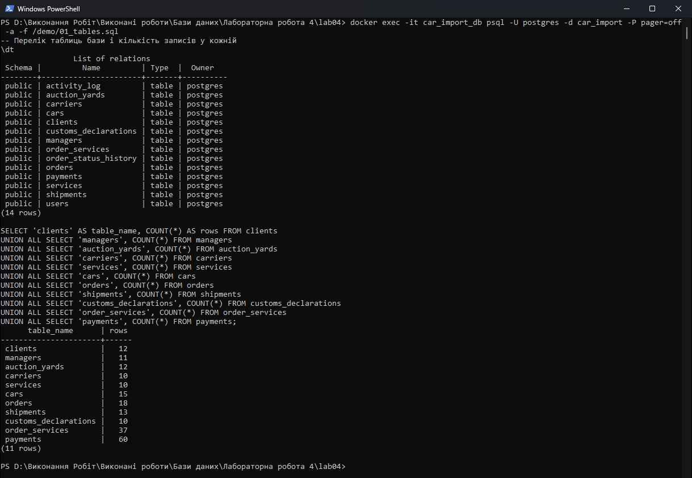

Структура таблиці `orders`, команда `\d orders`. Видно:

- первинний ключ, унікальний `car_id`, чотири перевірки `CHECK`;
- три зовнішні ключі з різною поведінкою (`RESTRICT`, `SET NULL`);
- таблиці, що посилаються на `orders` (з `CASCADE` і `RESTRICT`);
- індекси й тригери (створені на рівнях 2-3).

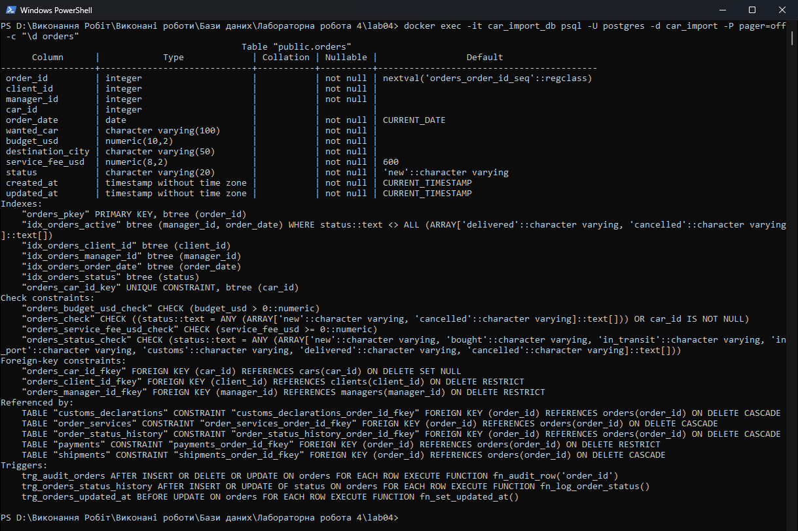

#### Крок 5. Перевірка обмежень цілісності

Сценарій [`demo/02_constraints.sql`](demo/02_constraints.sql) виконує вісім некоректних операцій. Кожну з них відхилило відповідне обмеження:

| № | Операція | Обмеження |
|---|---|---|
| 1 | телефон `0671234567` | `clients_phone_check` |
| 2 | VIN з літерою O і довжиною 16 | `cars_vin_check` |
| 3 | повторний VIN | `cars_vin_key` (UNIQUE) |
| 4 | електромобіль з об'ємом двигуна | `cars_check` |
| 5 | замовлення неіснуючого клієнта 999 | `orders_client_id_fkey` |
| 6 | статус «куплено» без авто | `orders_check` |
| 7 | видалення клієнта із замовленнями | `orders_client_id_fkey` (RESTRICT) |
| 8 | прибуття раніше за відправлення | `shipments_check` |

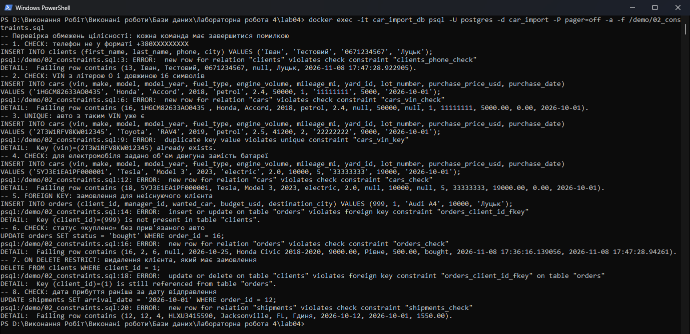

#### Крок 6. Тестові дані

Скрипт [`database/02_insert_data.sql`](database/02_insert_data.sql) містить:

| Таблиця | Записів | Що містить |
|---|---|---|
| clients | 12 | клієнти |
| managers | 11 | менеджери, зокрема один звільнений (`is_active = false`) |
| auction_yards | 12 | майданчики трьох платформ |
| carriers | 10 | перевізники |
| services | 10 | послуги |
| cars | 15 | авто: бензин, дизель, гібрид, два електромобілі |
| orders | 18 | замовлення в усіх статусах, зокрема два нові й одне скасоване |
| shipments | 13 | доставки: 11 прибули, 2 у морі |
| customs_declarations | 10 | митні декларації, 7 з них розмитнені |
| order_services | 37 | послуги в замовленнях |
| payments | 60 | платежі |

Митні декларації та платежі не вводяться вручну. Вони обчислюються запитами `INSERT ... SELECT` з даних авто й доставки за тією самою формулою, що й у функції `calculate_customs`, тому суми узгоджені між собою. Платежі відповідають етапам замовлення: завдаток, авто, доставка, мито, послуги. Замовлення 7 навмисно лишено з неоплаченими послугами як приклад заборгованості.

#### Крок 7. SQL-запити

Запити зібрано у [`database/queries.sql`](database/queries.sql) і запущено зі сценаріїв `demo/03-05`.

**Запит 1 (фільтрація і сортування):** авто 2019 року і новіші, дешевші за 10 000 $.

```sql
SELECT vin, make, model, model_year, mileage_mi, purchase_price_usd
FROM cars
WHERE model_year >= 2019 AND purchase_price_usd < 10000
ORDER BY purchase_price_usd;
```

**Запит 2 (JOIN):** активні замовлення з клієнтом, менеджером і авто. Використано `LEFT JOIN cars`, бо в нових замовленнях авто ще немає.

```sql
SELECT o.order_id, cl.last_name || ' ' || cl.first_name AS client, m.last_name AS manager,
       c.make || ' ' || c.model AS car, o.status
FROM orders o
JOIN clients cl  ON cl.client_id = o.client_id
JOIN managers m  ON m.manager_id = o.manager_id
LEFT JOIN cars c ON c.car_id = o.car_id
WHERE o.status NOT IN ('delivered', 'cancelled')
ORDER BY o.order_date;
```

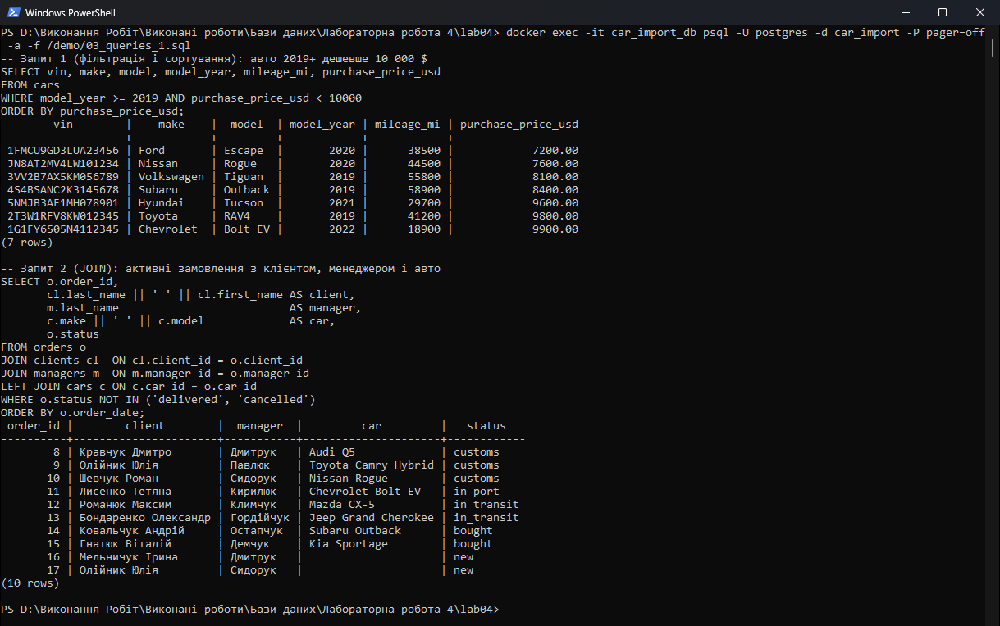

**Запит 3 (агрегація):** статистика покупок за марками з `HAVING COUNT(*) >= 2`. На момент виконання лише Toyota мала два авто (RAV4 і Camry Hybrid, середня ціна 10 100 $), а решта марок — по одному. Пізніше у вебзастосунку куплено Toyota Highlander, тому на графіку марок (скриншот 35) у Toyota вже три авто.

**Запит 4 (скалярний підзапит):** авто, куплені дорожче за середню ціну, з різницею від середнього.

**Запит 5 (підзапит з IN):** постійні клієнти з кількома замовленнями (Бондаренко, Гнатюк, Ковальчук, Мельничук, Олійник).

```sql
SELECT client_id, last_name, first_name, city
FROM clients
WHERE client_id IN (SELECT client_id FROM orders WHERE status <> 'cancelled'
                    GROUP BY client_id HAVING COUNT(*) > 1)
ORDER BY last_name;
```

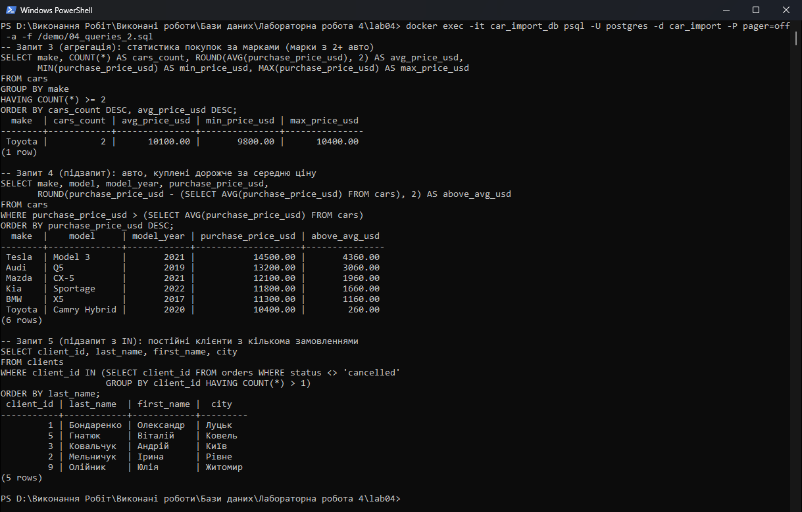

**Запит 6 (чотири JOIN):** повний маршрут авто: аукціон, перевізник, порти, днів у морі. Для двох авто, що ще в дорозі, `arrival_date` і `days_at_sea` порожні.

**Запит 7 (корельований підзапит):** найдорожче авто на кожній платформі: Copart — Tesla Model 3, IAAI — Audi Q5, Manheim — Mazda CX-5.

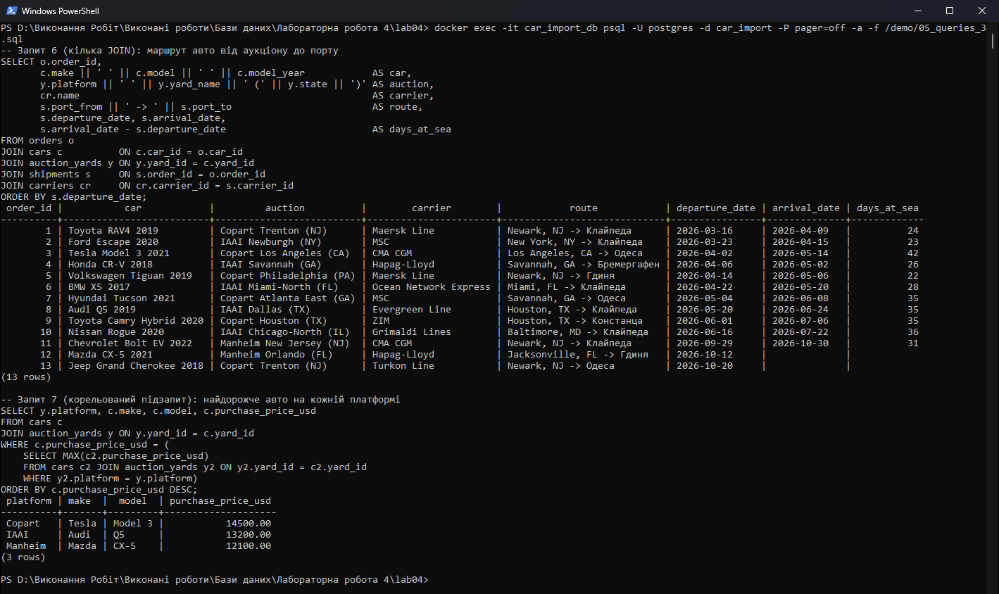

#### Крок 8. Консольний застосунок

Застосунок у каталозі [`console_app/`](console_app/) складається з двох файлів:

- [`database.py`](console_app/database.py) — клас `DatabaseConnection`: підключення через `psycopg2`, `commit`/`rollback` на кожен запит, зрозумілі повідомлення про помилки PostgreSQL;
- [`main.py`](console_app/main.py) — меню й операції CRUD.

Усі запити параметризовані (`%s`), введення перевіряється до запиту (формат телефону, email, числа).

```python
def add_client(db):
    ...
    result = db.execute("""
        INSERT INTO clients (first_name, last_name, phone, email, city)
        VALUES (%s, %s, %s, %s, %s) RETURNING client_id
    """, (first, last, phone, email or None, city))
    if result:
        print(f"Клієнта додано з ID: {result[1][0][0]}")
    else:
        print(f"Помилка додавання: {db.last_error}")
```

**Підключення і Read:** меню та список клієнтів з кількістю замовлень.

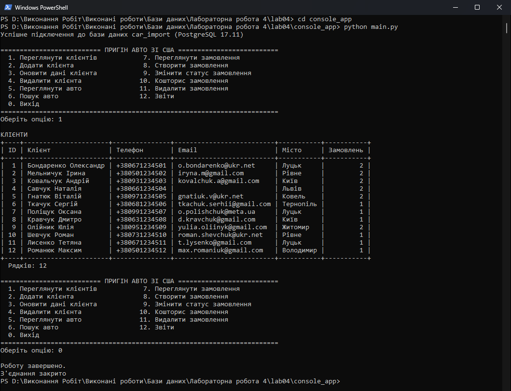

**Create:** додавання клієнта. Невірний телефон і email відхиляються ще до звернення до бази, після виправлення клієнт отримав ID 14.

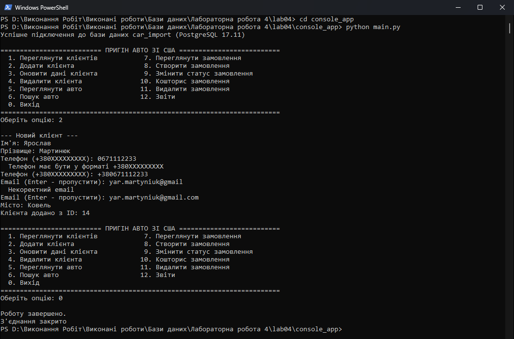

**Update:** зміна міста клієнта 14. Порожнє введення залишає поточне значення.

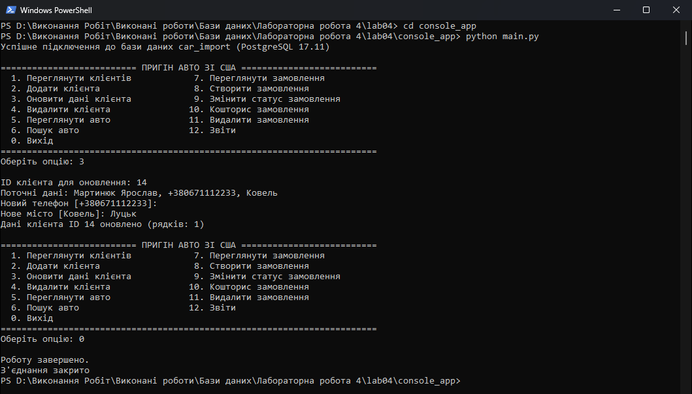

**Delete:** видалити клієнта 1 не вдалося через зовнішній ключ `orders_client_id_fkey`, а клієнта 14 без замовлень видалено після підтвердження.

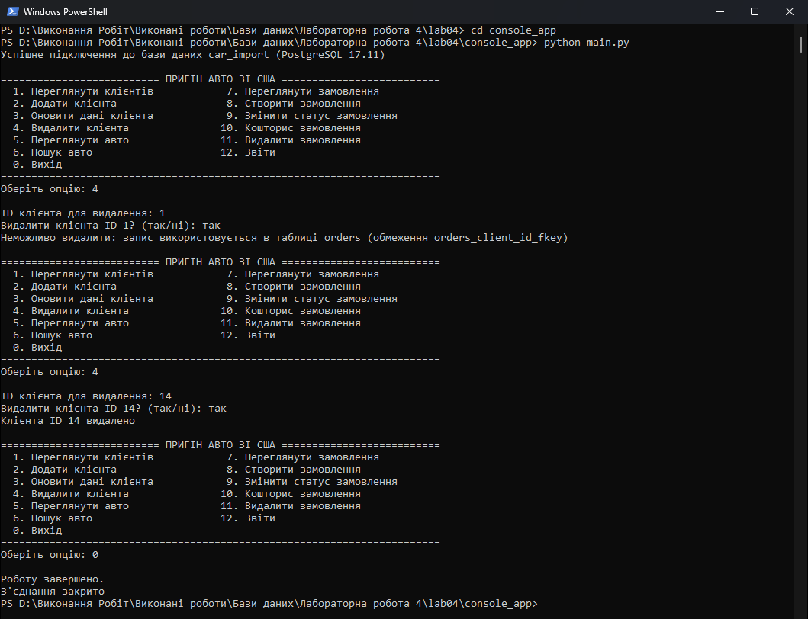

Перегляд авто і пошук за частиною назви (`ILIKE`):

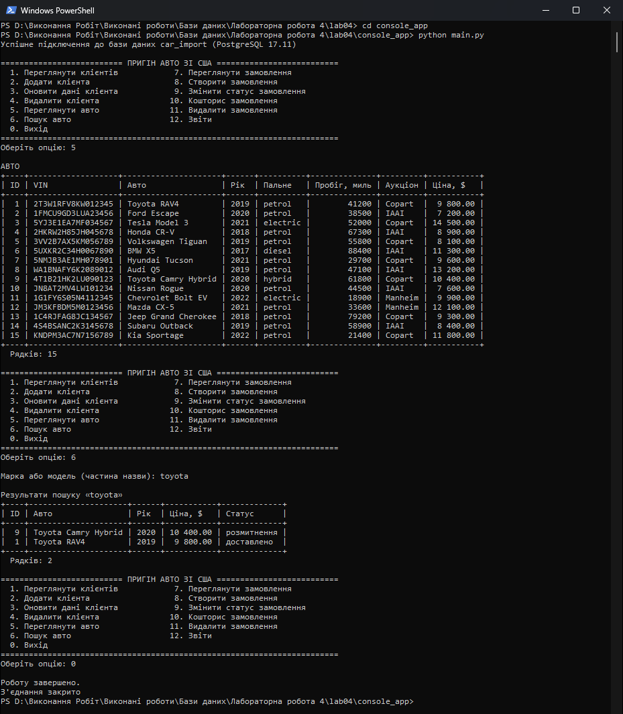

Перегляд замовлень через представлення `v_order_details`:

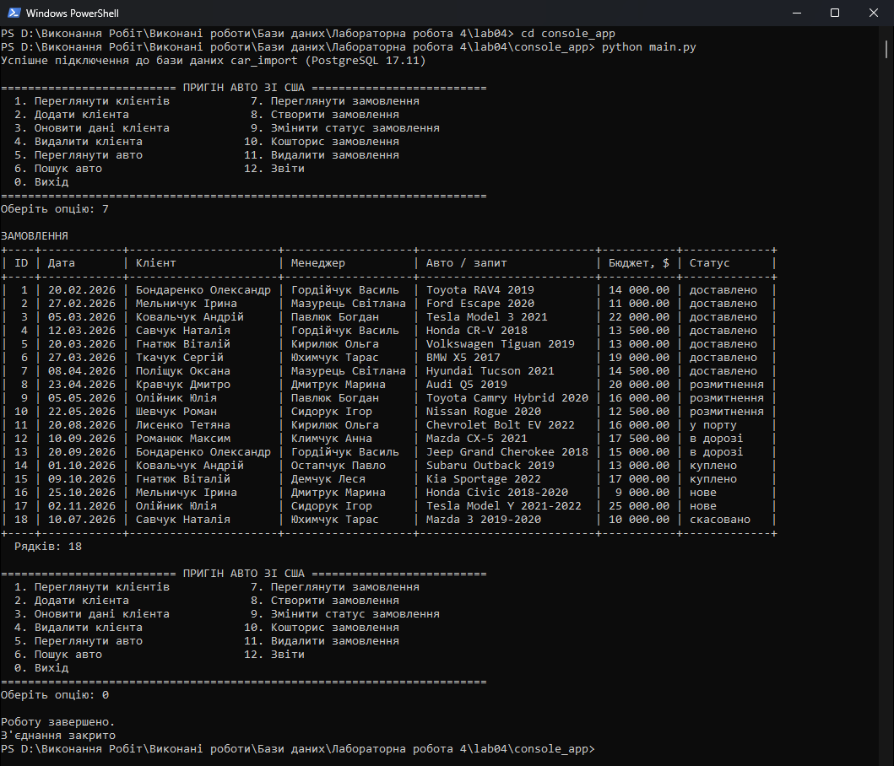

Створення замовлення 20 і спроба одразу перевести його в статус `in_transit`. Функція `change_order_status` відхилила недопустимий перехід.

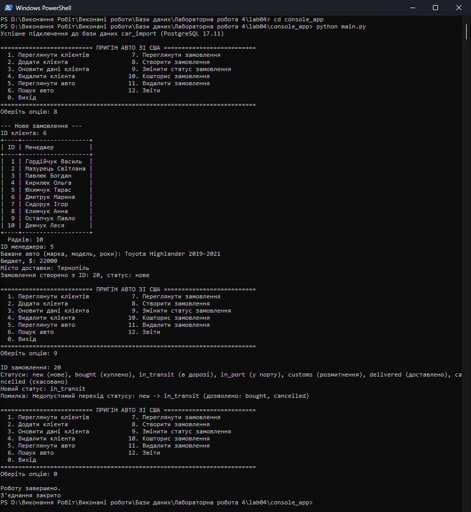

Кошторис замовлення 7 (функція `get_order_cost`) і звіт про борги та аванси (представлення `v_order_finance`):

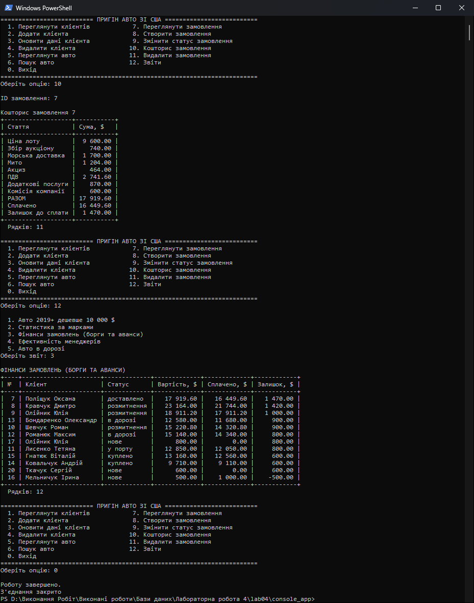

### Рівень 2. Процедури, тригери, представлення, вебзастосунок

#### Крок 1. Збережені процедури

У [`database/03_create_procedures.sql`](database/03_create_procedures.sql) створено чотири функції та одну процедуру (`CALL`):

| Назва | Що робить | Обробка помилок |
|---|---|---|
| `register_car_purchase(...)` | блокує замовлення (`FOR UPDATE`), додає авто, прив'язує його і ставить статус `bought` | неіснуюче замовлення, не той статус, неіснуючий майданчик; `NOTICE`, якщо ціна перевищує бюджет; `EXCEPTION WHEN unique_violation / check_violation` |
| `calculate_customs(order_id, eur_usd)` | рахує мито 10 %, акциз і ПДВ 20 %, записує декларацію (`ON CONFLICT DO UPDATE`), ставить статус `customs` | замовлення не в порту, немає дати прибуття, некоректний курс |
| `change_order_status(order_id, status)` | перевіряє допустимий перехід і передумови (доставка, прибуття, декларація, розмитнення) | `RAISE EXCEPTION` з переліком дозволених статусів |
| `cancel_order(order_id, reason)` — процедура | скасовує нове або куплене замовлення; причина потрапляє в історію через `set_config('app.status_comment', ...)` | коротка причина, авто вже відправлене |
| `get_order_cost(order_id)` | кошторис: ціна лоту, збір, доставка, мито, акциз, ПДВ, послуги, комісія, разом, сплачено, залишок | неіснуюче замовлення |

Фрагмент розрахунку акцизу (спрощена українська формула для легкових авто):

```sql
v_value := v_car.purchase_price_usd + v_car.auction_fee_usd + v_shipping;
v_age   := GREATEST(1, LEAST(15, EXTRACT(YEAR FROM v_arrival)::INT - v_car.model_year - 1));

IF v_car.fuel_type = 'electric' THEN
    v_excise := v_car.battery_kwh * 1;               -- 1 EUR за 1 кВт*год
ELSIF v_car.fuel_type = 'diesel' THEN
    v_rate   := CASE WHEN v_car.engine_volume <= 3.5 THEN 75 ELSE 150 END;
    v_excise := v_rate * v_car.engine_volume * v_age;
ELSE
    v_rate   := CASE WHEN v_car.engine_volume <= 3.0 THEN 50 ELSE 100 END;
    v_excise := v_rate * v_car.engine_volume * v_age;
END IF;

v_excise := ROUND(v_excise * p_eur_usd, 2);
v_duty   := ROUND(v_value * 0.10, 2);
v_vat    := ROUND((v_value + v_duty + v_excise) * 0.20, 2);
```

**register_car_purchase.** Для замовлення 16 (Honda Civic) зареєстровано авто з `car_id` 19:

- VIN і марку введено малими літерами, а тригер нормалізував їх до `2HGFC2F59JH512345` і `Honda`;
- ціна зі збором (9 240 $) перевищує бюджет 9 000 $, тому функція видала `NOTICE`, але купівлю дозволила;
- повторна купівля для того самого замовлення відхилена (статус уже `bought`);
- спроба купити авто з наявним VIN перехоплена блоком `EXCEPTION WHEN unique_violation`.

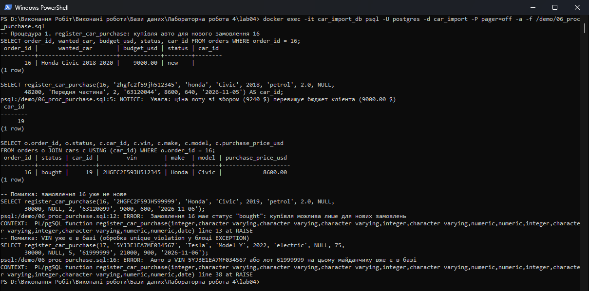

**calculate_customs і get_order_cost.** Для електромобіля Chevrolet Bolt EV (замовлення 11):

- митна вартість 12 050 $;
- мито 1 205 $;
- акциз 65 кВт·год × 1 EUR × 1,16 = 75,40 $;
- ПДВ 2 666,08 $;
- разом 3 946,48 $.

Статус змінився з `in_port` на `customs`. Кошторис: повна вартість 16 796,48 $, сплачено 12 050 $, залишок 4 746,48 $. Для замовлення 13, яке ще в морі, функція повернула помилку.

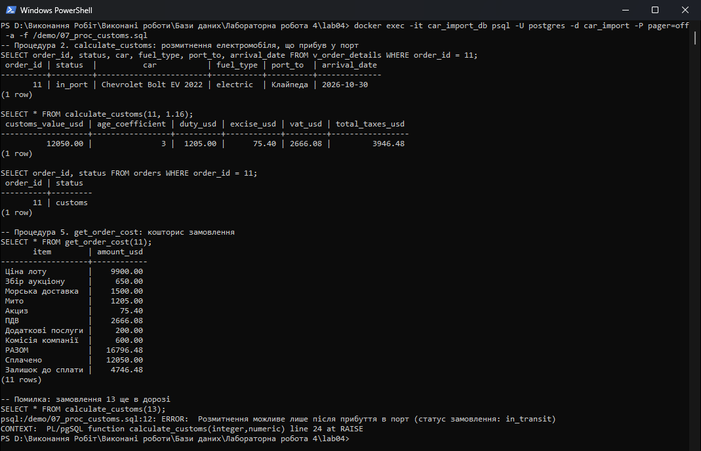

**change_order_status і cancel_order:**

- перехід `bought → delivered` відхилено, з підказкою, що дозволено лише `in_transit` або `cancelled`;
- видачу авто 8 до завершення розмитнення заборонено, а після встановлення `cleared_at` перехід `customs → delivered` пройшов;
- `CALL cancel_order(17, ...)` скасував нове замовлення, і причина записалась у коментар історії;
- скасувати замовлення 12, яке вже в дорозі, не вдалося.

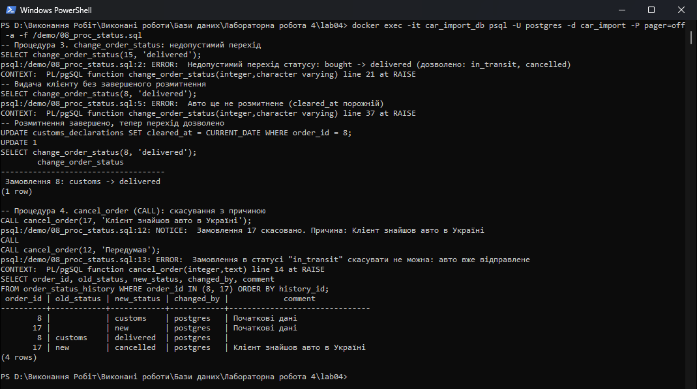

#### Крок 2. Тригери

У [`database/04_create_triggers.sql`](database/04_create_triggers.sql) створено п'ять тригерів:

| Тригер | Подія | Призначення |
|---|---|---|
| `trg_orders_status_history` | AFTER INSERT / UPDATE OF status ON orders | запис у `order_status_history` (старий і новий статус, хто, коментар) |
| `trg_orders_updated_at` | BEFORE UPDATE ON orders | автоматичне оновлення `updated_at` |
| `trg_shipments_sync_status` | AFTER INSERT / UPDATE OF departure_date, arrival_date ON shipments | вказано відправлення → `in_transit`, прибуття → `in_port`; заборона доставки для нового або скасованого замовлення |
| `trg_cars_validate` | BEFORE INSERT / UPDATE ON cars | VIN у верхній регістр, марка `INITCAP`, рік випуску не в майбутньому, дата купівлі не раніше року випуску |
| `trg_payments_check` | BEFORE INSERT / UPDATE ON payments | заборона платежів за скасоване замовлення; до купівлі приймається лише завдаток |

```sql
CREATE OR REPLACE FUNCTION fn_sync_order_with_shipment()
RETURNS TRIGGER AS $$
DECLARE
    v_status VARCHAR;
BEGIN
    SELECT status INTO v_status FROM orders WHERE order_id = NEW.order_id;
    IF v_status IN ('new', 'cancelled') THEN
        RAISE EXCEPTION 'Неможливо оформити доставку для замовлення в статусі "%"', v_status;
    END IF;
    IF NEW.arrival_date IS NOT NULL AND v_status IN ('bought', 'in_transit') THEN
        UPDATE orders SET status = 'in_port' WHERE order_id = NEW.order_id;
    ELSIF NEW.departure_date IS NOT NULL AND v_status = 'bought' THEN
        UPDATE orders SET status = 'in_transit' WHERE order_id = NEW.order_id;
    END IF;
    RETURN NEW;
END;
$$ LANGUAGE plpgsql;
```

Перевірка всіх тригерів:

- вставка доставки для замовлення 14 автоматично перевела його в `in_transit` і оновила `updated_at`;
- дата прибуття для замовлення 12 перевела його в `in_port`, і обидві зміни записались в історію;
- марка `'  mazda '` збереглась як `Mazda`, а рік 2031 відхилено;
- платіж за скасоване замовлення 18 і оплату авто для нового замовлення 20 заблоковано.

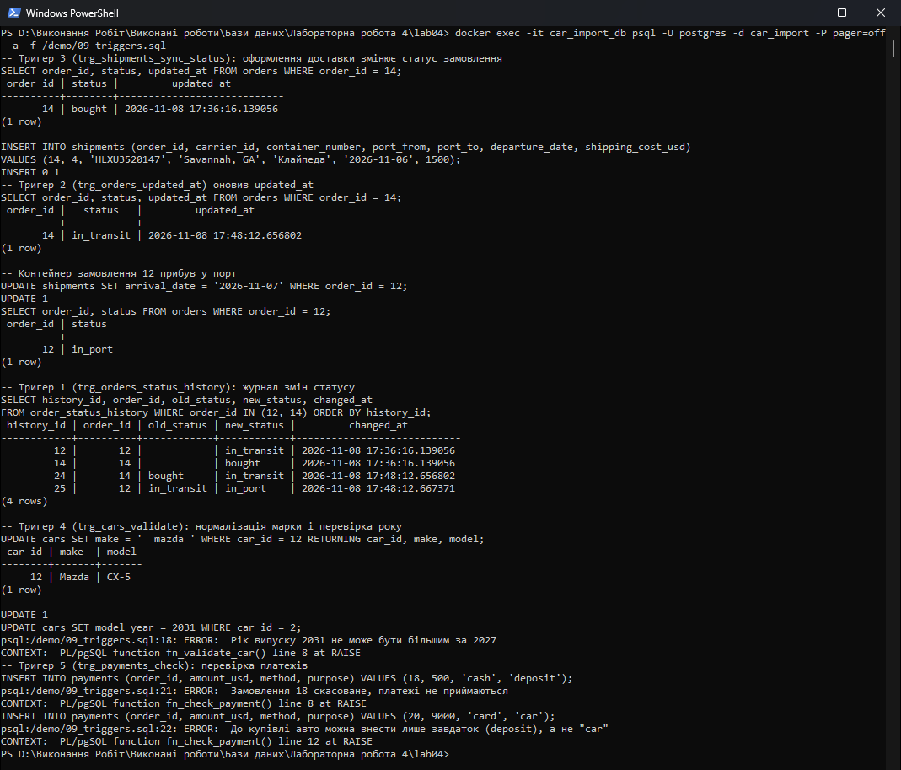

#### Крок 3. Представлення

У [`database/05_create_views.sql`](database/05_create_views.sql) створено чотири представлення:

- `v_order_details` — замовлення з клієнтом, менеджером, авто, аукціоном і портом;
- `v_order_finance` — складові вартості, повна вартість, сплачено, залишок. Суми послуг і платежів агрегуються в CTE до з'єднання, щоб не було множення рядків;
- `v_manager_performance` — кількість замовлень, дохід від комісій, бонус менеджера;
- `v_shipments_in_transit` — авто в морі, очікувана дата прибуття і кількість днів у дорозі.

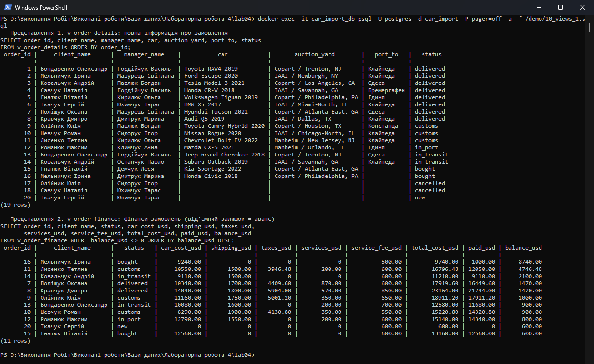

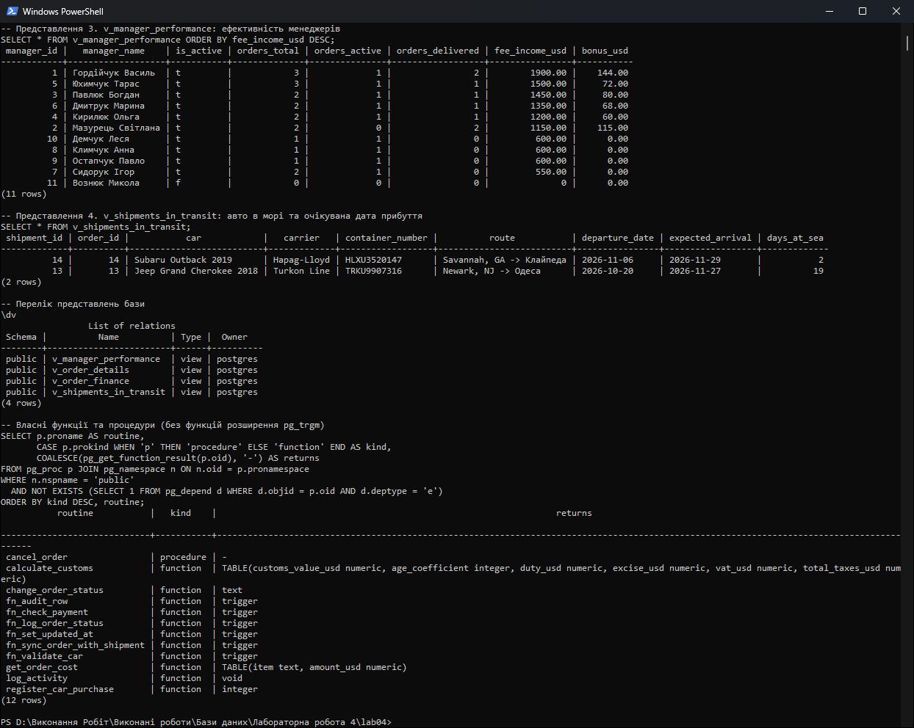

Представлення використовуються і в консольному, і у вебзастосунку, тож логіка розрахунку вартості існує в одному місці.

#### Крок 4. Аналітичні запити

П'ять аналітичних запитів з агрегацією і віконними функціями (сценарії `demo/12-13`):

1. Помісячна динаміка: кількість купівель і витрати на авто, надходження від клієнтів, накопичувальна сума `SUM() OVER (ORDER BY ...)`. Використано `FULL JOIN` двох CTE, бо є місяці лише з платежами.
2. Перевізники: кількість доставок, середній час і вартість, рейтинг швидкості `RANK()`. Найшвидший — Maersk Line (23 дні в середньому).
3. Структура вартості доставлених авто:
   - авто — 55,5 %;
   - митні платежі — 24,9 %;
   - доставка — 8,3 %;
   - послуги — 7,8 %;
   - комісія компанії — 3,4 %;
   - середня повна вартість — 19 975 $.
4. Топ-10 клієнтів за сумою платежів з часткою в загальних надходженнях `SUM(SUM()) OVER ()` і місцем `DENSE_RANK()`.
5. Середні митні платежі за типом пального і віком авто. Найдорожче розмитнення має дизельний BMW X5 2017 року (6 924,80 $): у нього великий об'єм двигуна і коефіцієнт віку.

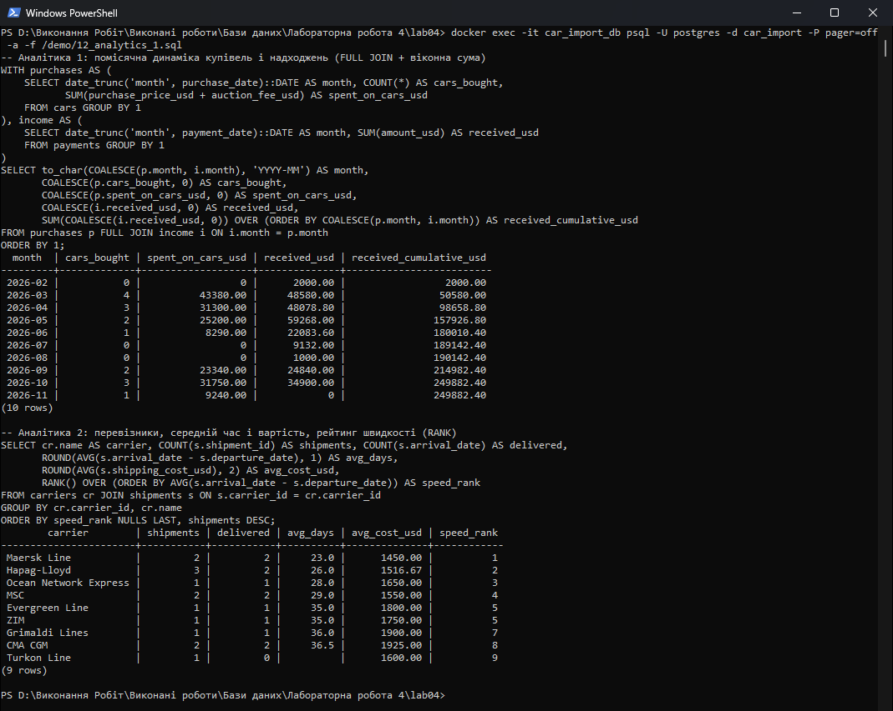

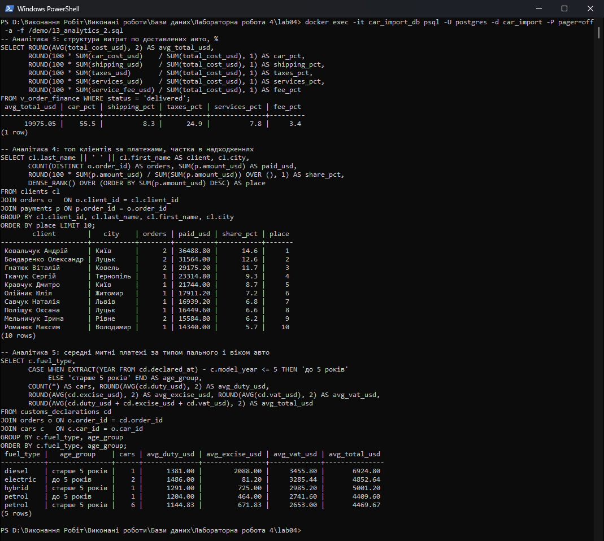

#### Крок 5. Вебзастосунок на Flask

Структура [`web_app/`](web_app/):

| Файл | Призначення |
|---|---|
| `app.py` | маршрути: клієнти, авто, замовлення, звіти, аналітика, адміністрування |
| `database.py` | пул з'єднань `ThreadedConnectionPool`, транзакція з передачею користувача в тригери аудиту |
| `validators.py` | серверна валідація всіх форм і JSON |
| `auth.py` | реєстрація, вхід, вихід, декоратори `login_required` і `role_required` |
| `api.py`, `reports.py`, `charts.py`, `backup.py` | рівень 3 |
| `templates/` | 19 шаблонів Jinja2 (`base.html`, макроси полів форми, сортування і пагінації) |
| `static/` | `style.css`, `validate.js` |

Запуск: `cd web_app && python app.py`, далі `http://localhost:5000`.

**CRUD у вебінтерфейсі:**

| Операція | Клієнти | Замовлення | Авто |
|---|---|---|---|
| Create | форма | форма; купівля авто через `register_car_purchase` | через купівлю в картці замовлення |
| Read | список з пошуком | список, картка | список з фільтрами |
| Update | редагування | редагування, статус, доставка, послуги, платежі, розмитнення | редагування |
| Delete | адміністратор | адміністратор | адміністратор |

**Серверна валідація:** кожне поле перевіряється у `validators.py`, а помилки показуються під полем. Окремо обробляються порушення унікальності («Клієнт з таким телефоном уже існує»). Перевірку зроблено з вимкненим JavaScript: сервер відхилив порожнє ім'я, некоректний email і порожнє місто.

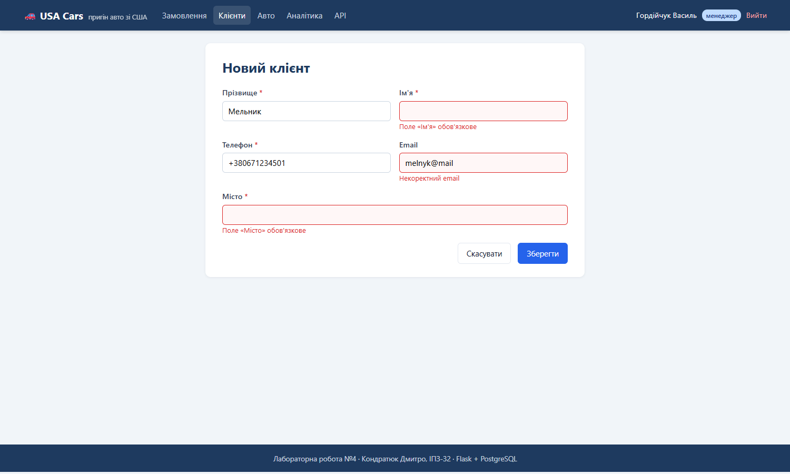

Після виправлення менеджер Гордійчук додав клієнта (ID 15):

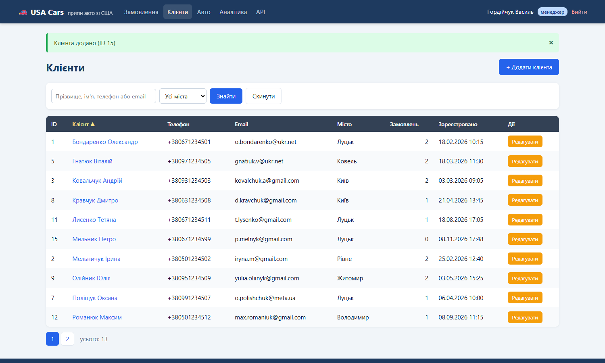

Головна сторінка після входу адміністратора: показники, авто в морі, останні зміни статусів.

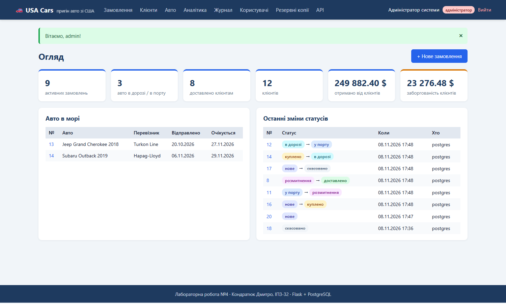

Список замовлень з вартістю і залишком. Борг виділено червоним, аванс — зеленим.

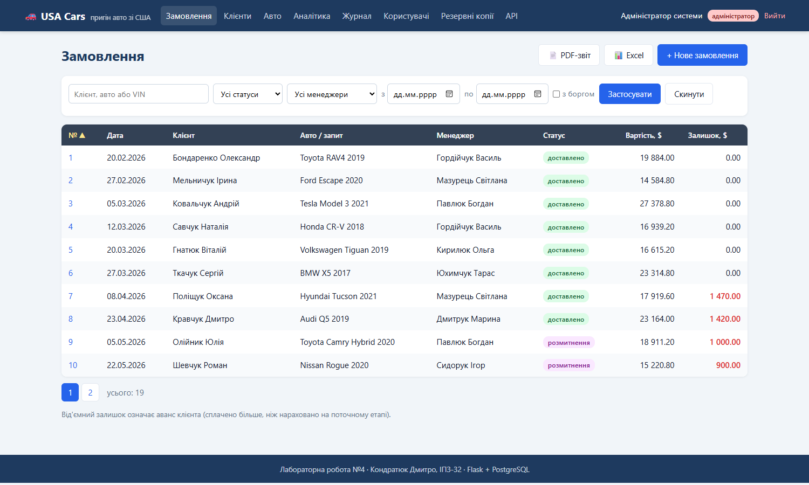

Картка замовлення 11:

- кошторис з `get_order_cost`;
- митна декларація;
- форми керування статусом, послугами і платежами;
- історія статусів.

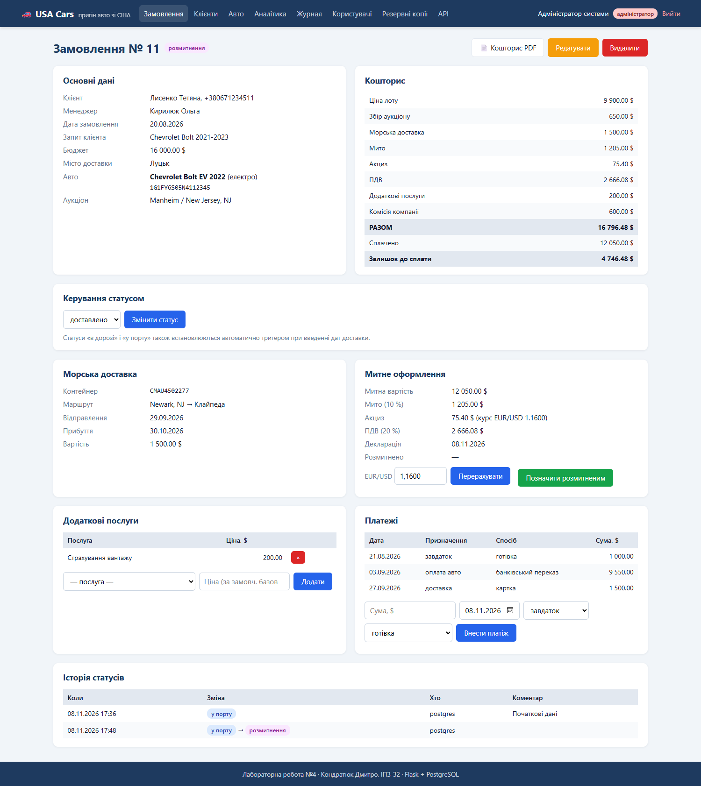

Нове замовлення 20 (створене в консольному застосунку) у вебінтерфейсі. У статусі `new` показується форма купівлі авто.

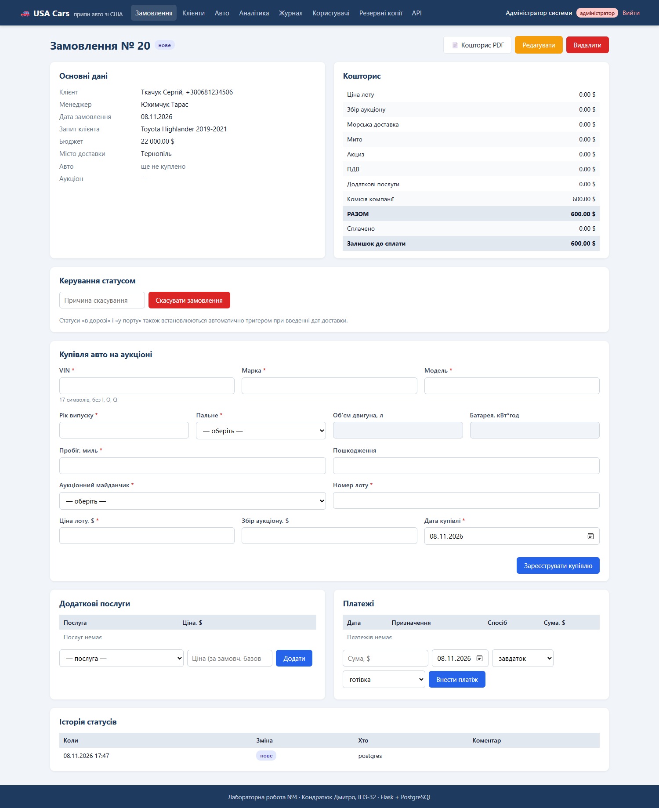

Після реєстрації купівлі Toyota Highlander 2019, внесення оплати й оформлення доставки тригер перевів замовлення в статус «в дорозі». Історія статусів показує обидва переходи.

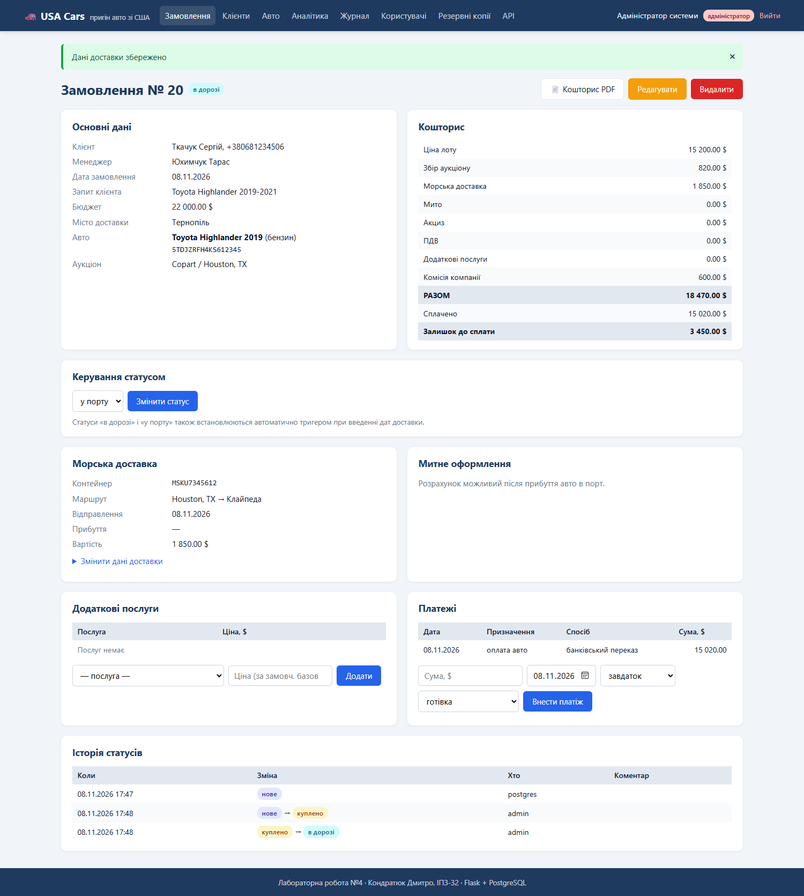

### Рівень 3. Творче розширення

#### Аутентифікація і ролі

Користувачі зберігаються в таблиці `users` ([`database/06_create_users.sql`](database/06_create_users.sql)). Паролі зберігаються як хеш PBKDF2-SHA256 (`werkzeug.security`). Сесія Flask підписується секретним ключем.

| Роль | Права |
|---|---|
| `admin` | усе, зокрема видалення, журнал операцій, керування користувачами, резервні копії |
| `manager` | створення і редагування клієнтів, авто, замовлень, платежів |
| `viewer` | лише перегляд, звіти й аналітика |

Новий користувач після реєстрації отримує роль `viewer`. Підвищити роль може лише адміністратор. Менеджери пов'язані з таблицею `managers`, тому на головній сторінці бачать свої активні замовлення.

```python
def role_required(*roles):
    def decorator(view):
        @wraps(view)
        def wrapped(*args, **kwargs):
            if g.user is None:
                return redirect(url_for("auth.login", next=request.path))
            if g.user["role"] not in roles:
                log_activity("ACCESS_DENIED", details=f"{request.method} {request.path}")
                abort(403)
            return view(*args, **kwargs)
        return wrapped
    return decorator
```

Сторінка входу з помилкою невірного пароля (спроба записується в журнал як `LOGIN_FAILED`):

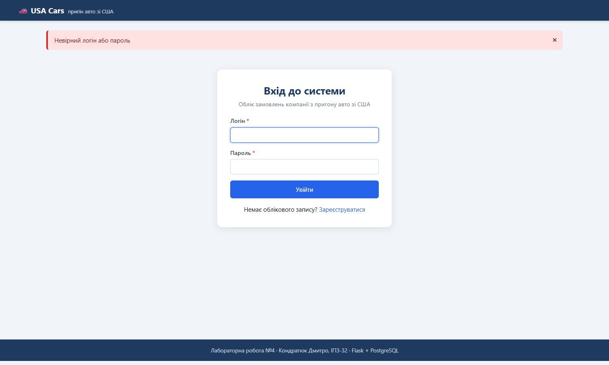

Роль «перегляд»: картка замовлення без кнопок редагування, а спроба відкрити форму нового клієнта повертає 403.

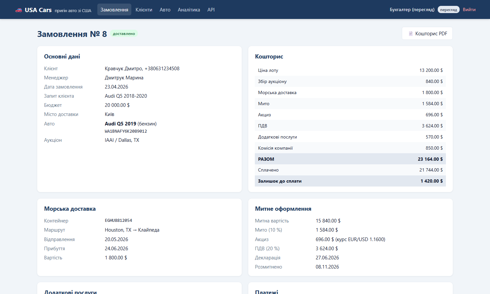

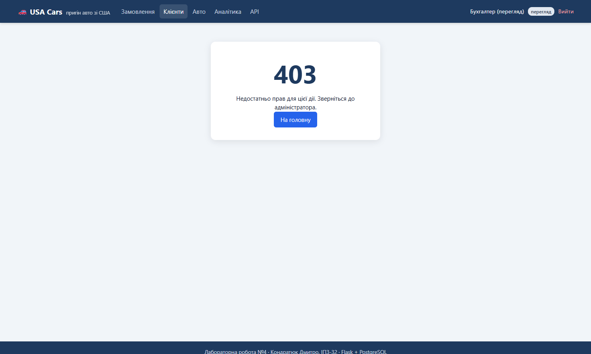

Реєстрація. Клієнтська перевірка відхилила логін з крапкою, короткий пароль і неоднакові паролі. Після виправлення користувача `o_kovalenko` зареєстровано.

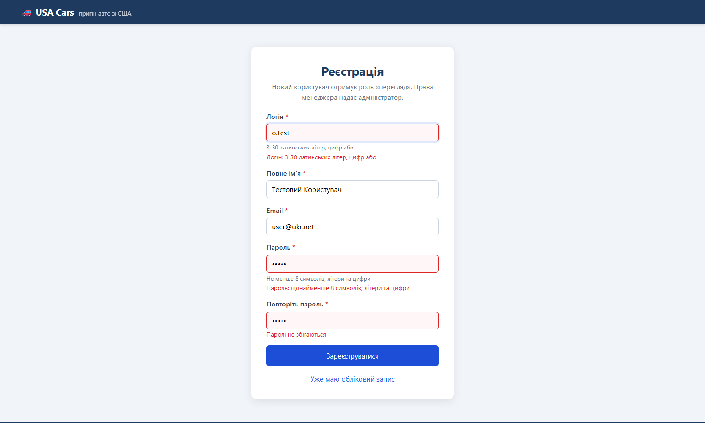

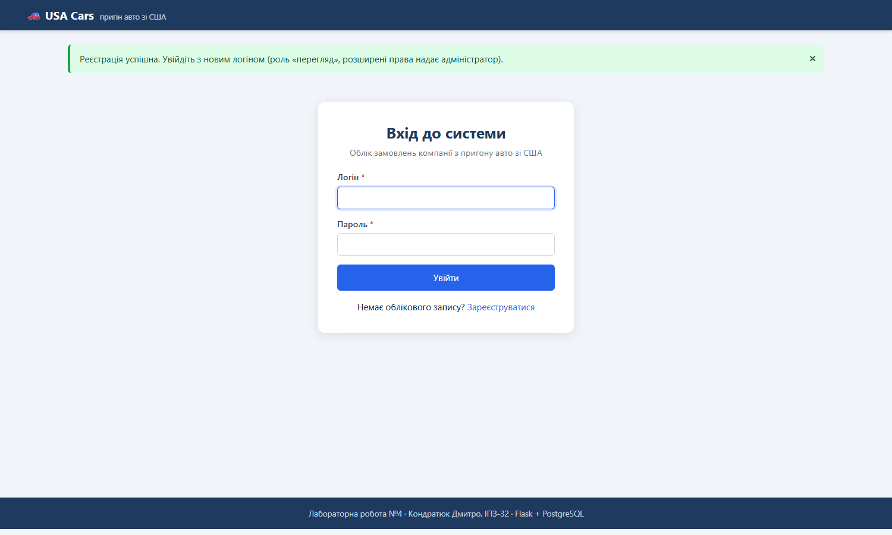

Адміністратор надав новому користувачу роль менеджера:

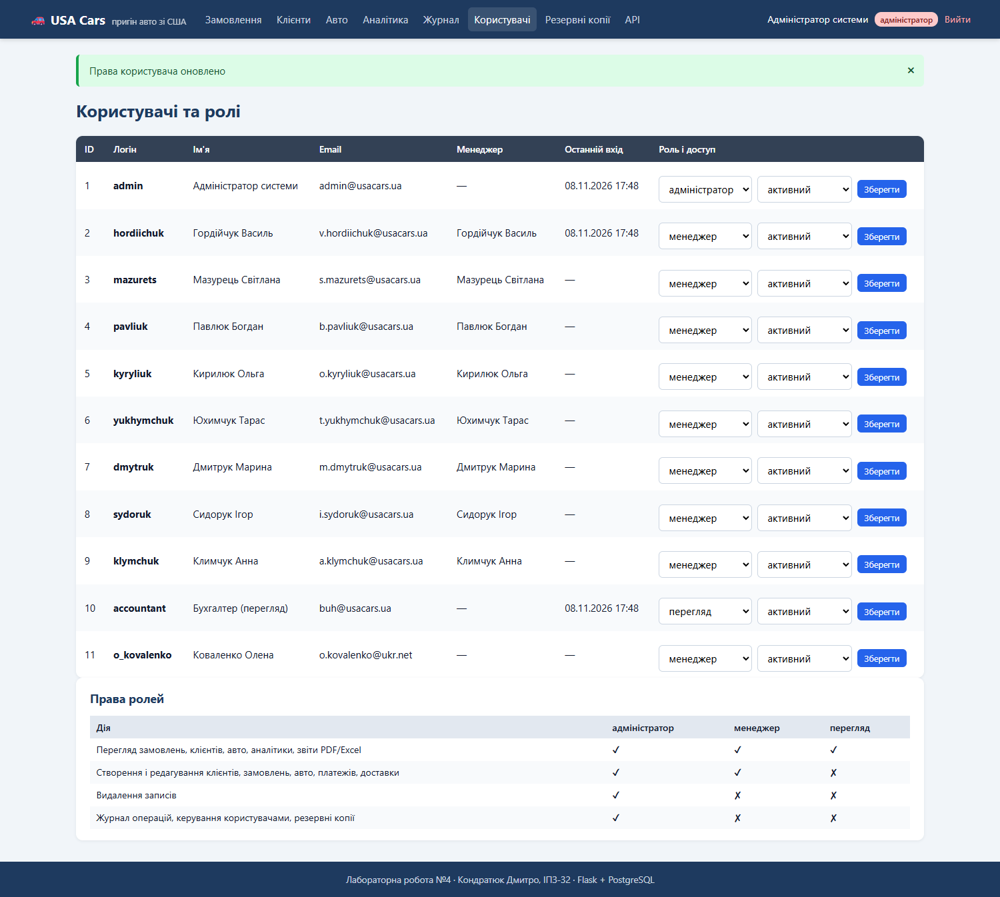

#### Журнал операцій

Журнал ([`database/07_create_audit.sql`](database/07_create_audit.sql)) поповнюється з двох джерел:

1. Універсальна тригерна функція `fn_audit_row()` на дев'яти таблицях записує кожен `INSERT`, `UPDATE`, `DELETE` зі старими і новими даними в JSONB. Хеш пароля в журнал не потрапляє.
2. Застосунок викликає `log_activity()` для дій, що не змінюють таблиці: `LOGIN`, `LOGOUT`, `LOGIN_FAILED`, `REGISTER`, `ACCESS_DENIED`, `REPORT_PDF`, `REPORT_EXCEL`, `BACKUP`, `API_CREATE`.

Щоб тригер знав користувача вебзастосунку (а не лише `postgres`), застосунок на початку кожної транзакції передає його в змінні сесії:

```python
cur.execute(
    "SELECT set_config('app.user_id', %s, true), set_config('app.username', %s, true)",
    (str(user["user_id"]) if user else "", username),
)
```

Сторінка журналу з фільтрами за користувачем, дією і таблицею. Для `UPDATE` показано лише змінені поля, наприклад `status: bought → in_transit`.

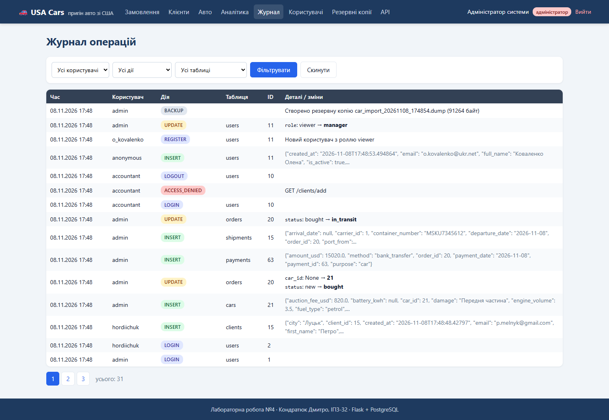

Той самий журнал у SQL. Видно операції кожного користувача: вебзастосунок (`admin`, `hordiichuk`, `accountant`), API (`api`), консоль і psql (`postgres`).

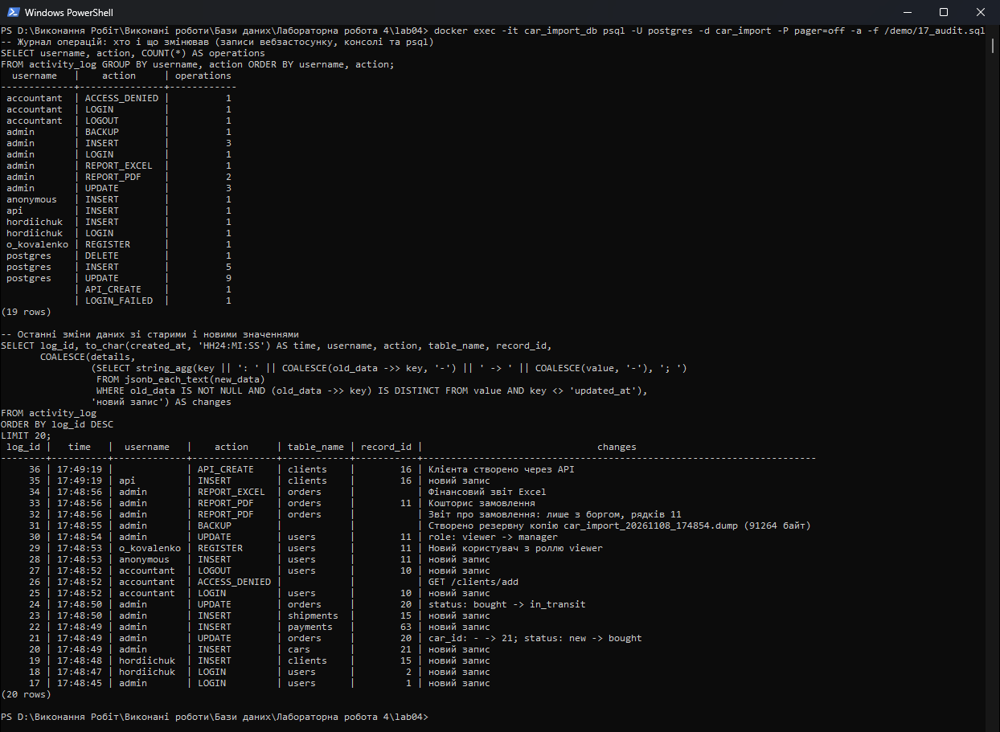

#### Звіти PDF і Excel

Модуль [`reports.py`](web_app/reports.py) формує три звіти:

| Звіт | Формат | Вміст |
|---|---|---|
| Звіт про замовлення | PDF (`reportlab`) | ті самі фільтри, що й у списку замовлень, з підсумковим рядком |
| Кошторис замовлення | PDF | дані клієнта, авто, складові вартості, платежі |
| Фінансовий звіт | Excel (`openpyxl`) | три аркуші: замовлення, платежі, менеджери; з форматом чисел, автофільтром і закріпленим заголовком |

Для кирилиці в PDF використано шрифт DejaVu Sans, що постачається разом з matplotlib, тому звіт не залежить від шрифтів Windows. Скриншоти 36-38 — це PDF і перший аркуш xlsx, експортовані в зображення.

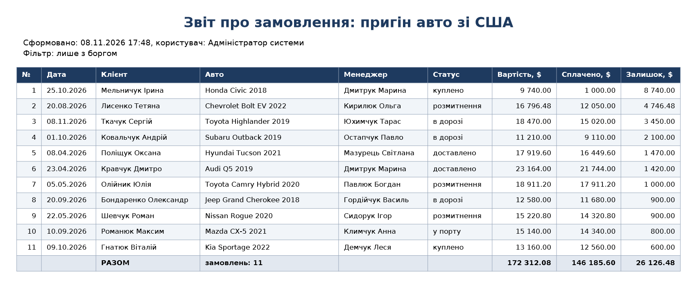

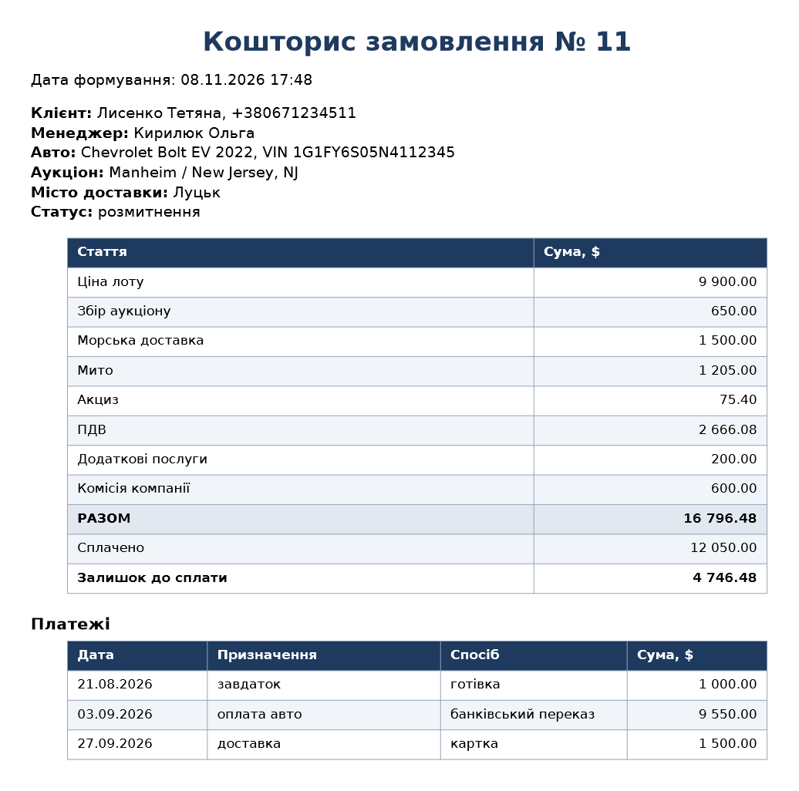

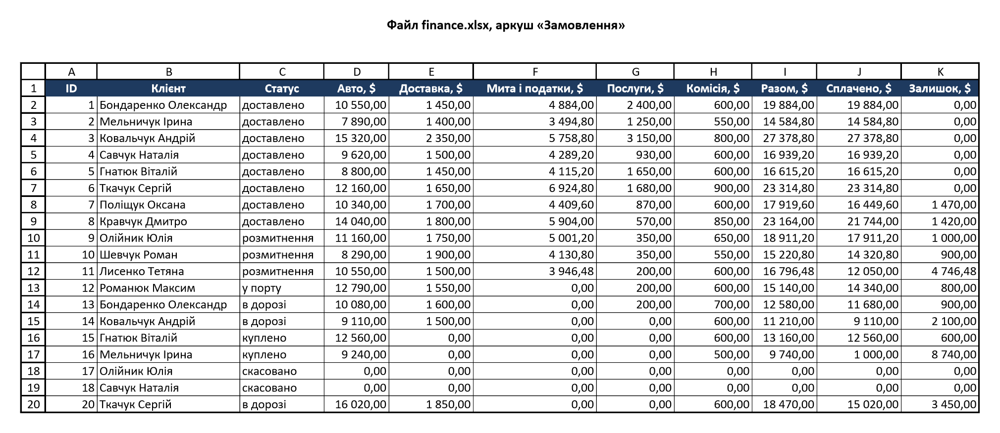

#### Пошук, фільтрація і сортування

Список замовлень має:

- пошук за клієнтом, авто або VIN (`ILIKE`);
- фільтри за статусом, менеджером, періодом і «лише з боргом»;
- сортування за будь-яким стовпцем (стрілка в заголовку);
- пагінацію.

Стовпці сортування беруться лише з білого списку, тому параметр `sort` не можна використати для SQL-ін'єкції:

```python
def sort_clause(allowed, default):
    sort = request.args.get("sort", default)
    direction = "DESC" if request.args.get("dir") == "desc" else "ASC"
    if sort not in allowed:
        sort = default
    return f"{allowed[sort]} {direction} NULLS LAST", sort, direction.lower()
```

Замовлення з 01.04.2026 з боргом, від найбільшого залишку:

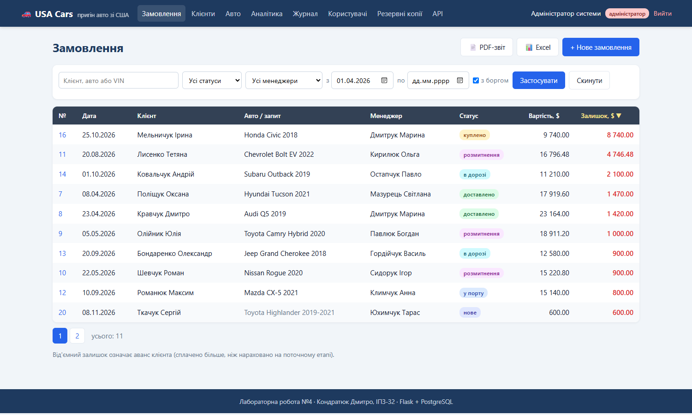

Авто з фільтром за назвою і роком, від найдорожчого:

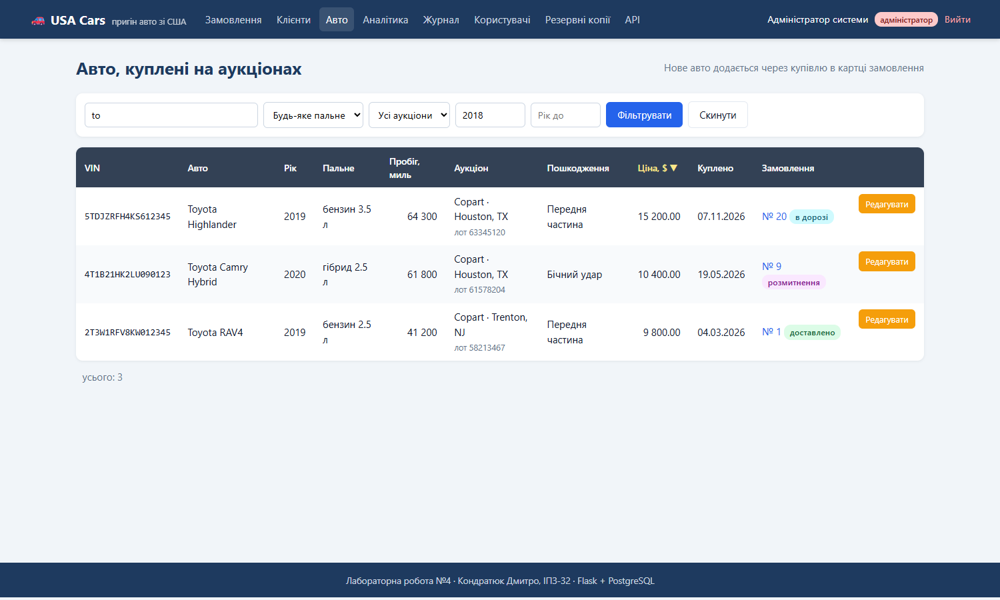

#### Візуалізація даних

Сторінка «Аналітика» ([`charts.py`](web_app/charts.py)) показує чотири графіки matplotlib, вбудовані як PNG у base64:

- замовлення за статусами;
- помісячна динаміка купівель і надходжень;
- структура вартості доставлених авто;
- середня ціна за марками.

Під графіками — таблиці аналітичних запитів рівня 2.

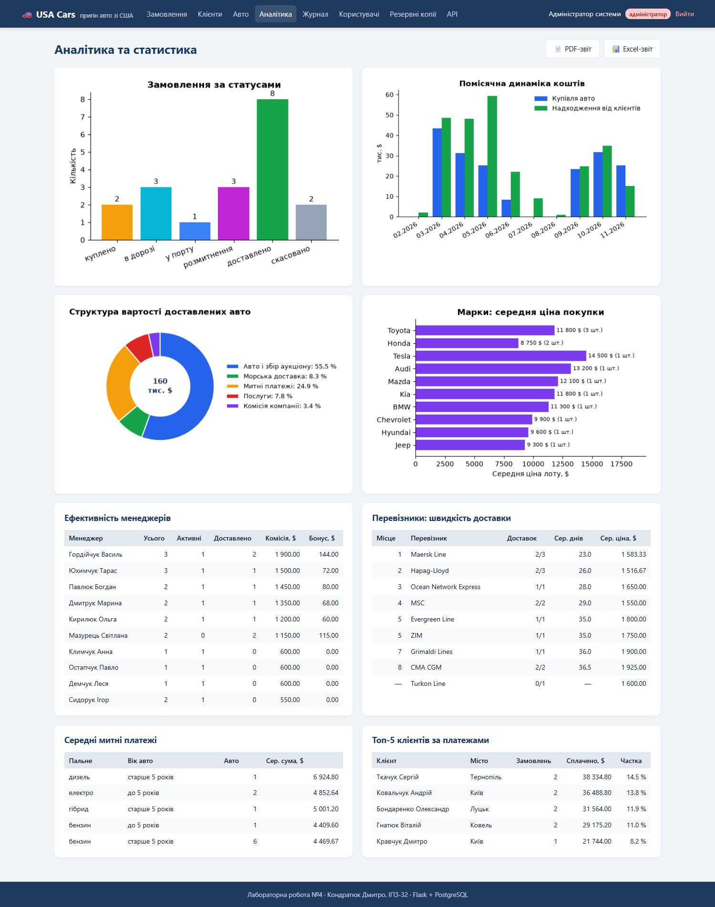

#### REST API

[`api.py`](web_app/api.py) надає JSON API з ключем у заголовку `X-API-Key`:

| Метод | Шлях | Опис |
|---|---|---|
| GET | `/api/orders?status=` | замовлення з фінансами |
| GET | `/api/orders/<id>` | замовлення, кошторис, історія статусів |
| PATCH | `/api/orders/<id>/status` | зміна статусу через `change_order_status` |
| GET | `/api/cars?make=` | авто з пошуком |
| POST | `/api/clients` | створення клієнта з тією самою серверною валідацією |
| GET | `/api/stats` | зведена статистика |

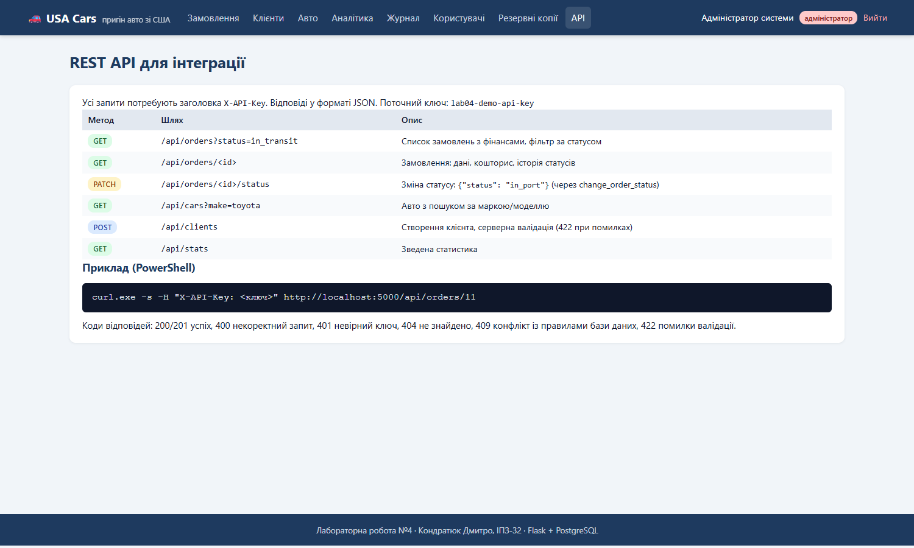

GET-запити `curl.exe`: замовлення 11 з кошторисом і історією, зведена статистика.

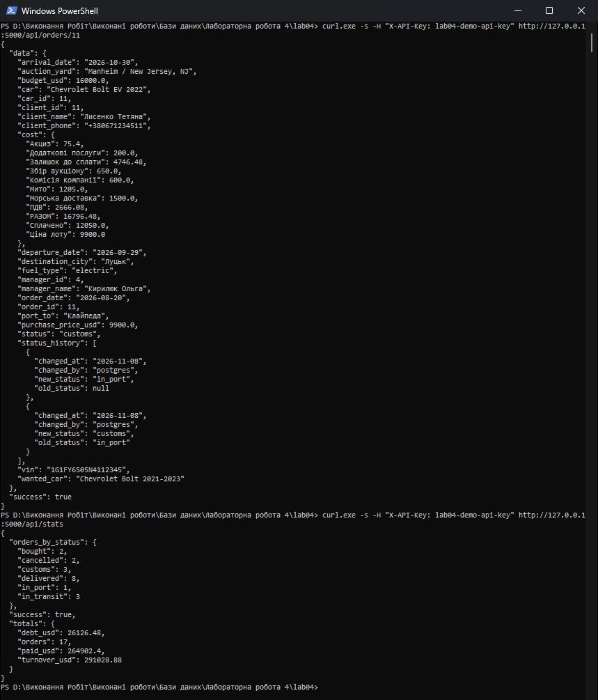

Коди відповідей:

| Код | Запит |
|---|---|
| 401 | без ключа |
| 201 | створення клієнта (ID 16) |
| 422 | помилки валідації |
| 409 | недопустимий перехід статусу; повідомлення бази передається клієнту API |

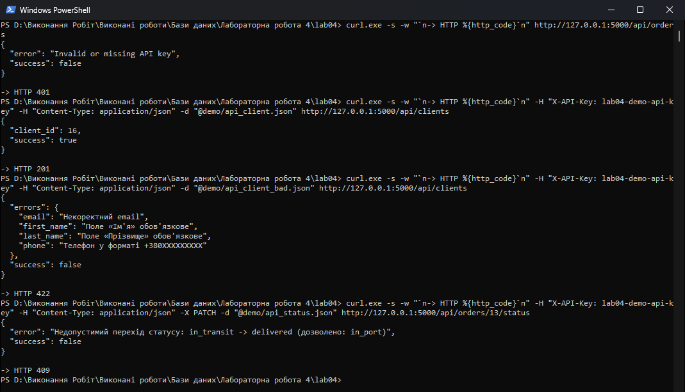

#### Резервне копіювання

Сторінка «Резервні копії» доступна лише адміністратору. Вона запускає `pg_dump -Fc` у контейнері і зберігає файл у змонтований каталог `backups/`, звідки його можна завантажити.

```python
cmd = ["docker", "exec", config.DOCKER_CONTAINER, "pg_dump", "-U", config.DB["user"],
       "-d", config.DB["dbname"], "-Fc", "-f", f"{config.BACKUP_DIR_IN_CONTAINER}/{name}"]
result = subprocess.run(cmd, capture_output=True, text=True, timeout=120)
```

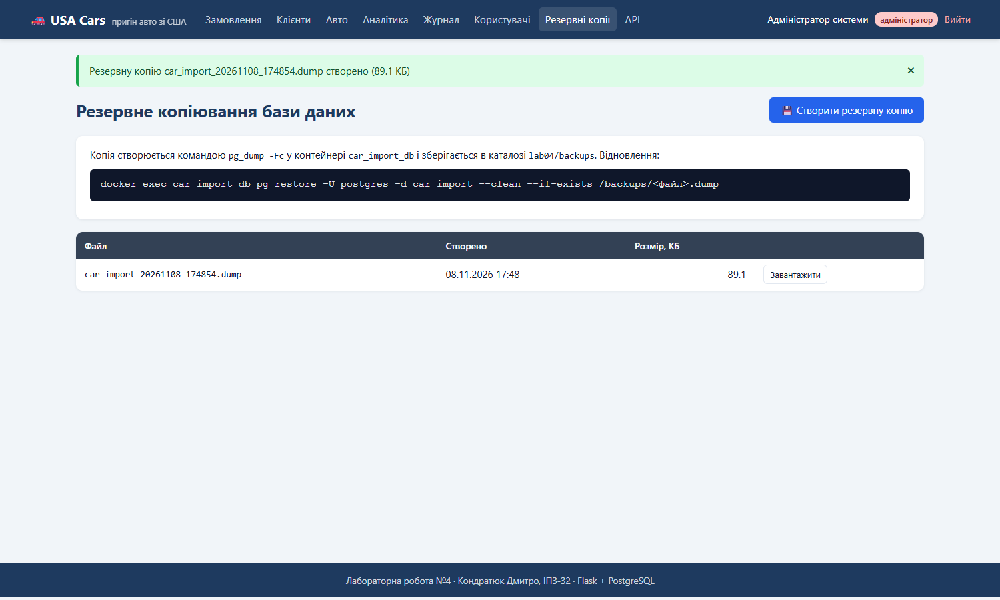

Перевірка відновлення: копію розгорнуто в нову базу `car_import_restore` командою `pg_restore`, а кількість записів порівняно з робочою базою.

- Кількість замовлень (19) і платежів (61) збігається.
- Клієнтів у робочій базі на одного більше: клієнта 16 створено через API вже після резервної копії.
- Записів журналу більше на 6: формування трьох звітів, дві дії через API та запис про саму резервну копію.
- Замовлення 20 у відновленій базі має статус `in_transit`, тобто копія містить зміни, зроблені у вебзастосунку.

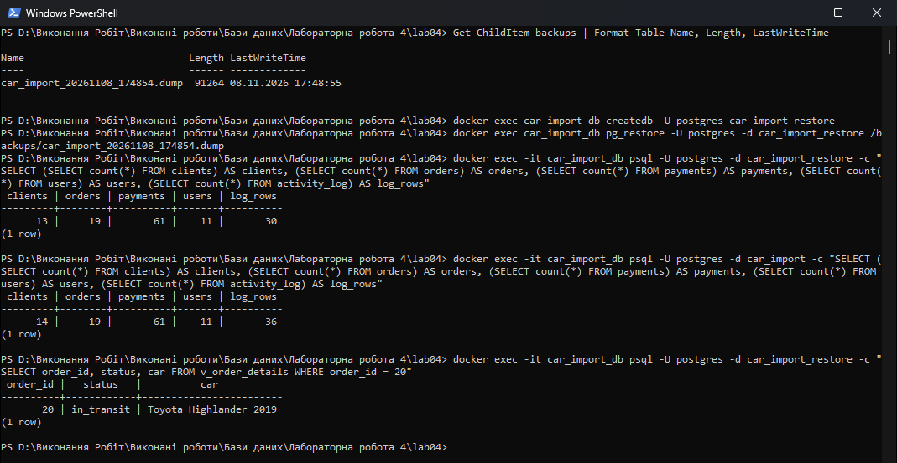

#### Клієнтська валідація (JavaScript)

[`static/validate.js`](web_app/static/validate.js) перевіряє форми з атрибутом `data-validate` до відправки на сервер:

- обов'язкові поля, `min` і `max`;
- власні правила: телефон, email, VIN, номер контейнера, логін, складність пароля, збіг паролів, дата не в майбутньому, порядок дат.

Помилка показується під полем, а поле підсвічується. VIN і номер контейнера автоматично переводяться у верхній регістр. Поля «об'єм двигуна» і «ємність батареї» вмикаються залежно від типу пального. Серверна перевірка від цього не залежить (скриншот 30).


#### Індекси та продуктивність

Окрім індексів на зовнішніх ключах, [`database/08_create_indexes.sql`](database/08_create_indexes.sql) створює:

- GIN-індекси `pg_trgm` для пошуку за підрядком (`ILIKE '%...%'`) у марці та моделі авто і в імені клієнта;
- складений індекс `cars (make, model_year)`;
- частковий індекс активних замовлень `orders (manager_id, order_date) WHERE status NOT IN ('delivered', 'cancelled')`;
- індекси за датами для звітів і для журналу операцій.

На реальних таблицях планувальник обирає послідовне сканування, бо вони дуже малі. Тому використання триграмного індексу показано з `enable_seqscan = off`:


Щоб оцінити ефект індексів, згенеровано таблицю `perf_cars` на 200 000 рядків.

| Запит | Без індексу | З індексом | Індекс |
|---|---|---|---|
| `ILIKE '%da model-77%'` | 59,2 мс (Parallel Seq Scan) | 11,0 мс (Bitmap Index Scan) | GIN trgm, 5,4 МБ |
| активні замовлення менеджера з дати | 11,8 мс (Parallel Seq Scan) | 0,62 мс (Bitmap Index Scan) | частковий B-tree, 816 КБ |


Частковий індекс у 17 разів менший за таблицю (816 КБ проти 14 МБ), бо містить лише рядки активних замовлень. Індекси не безкоштовні: GIN-індекс будувався 478 мс і займає більше третини розміру таблиці, а кожен `INSERT` чи `UPDATE` має його оновлювати. Тому індекси створено лише під реальні запити застосунку.

## Особливості виконання

1. **Пропуски в нумерації.** У кроці 5 рівня 1 некоректні вставки «з'їли» значення послідовностей `SERIAL`, які не відкочуються разом з транзакцією. Через це:
   - клієнт, доданий у консолі, отримав ID 14 замість 13;
   - замовлення з консолі отримало номер 20 замість 19;
   - авто для замовлень 16 і 20 отримали `car_id` 19 і 21.
2. **Консольний застосунок.** Для скриншотів 8-15 введення подавалось з файлів `demo/console/*.txt` (`Get-Content файл | python main.py`), щоб сценарій був відтворюваним. Функція `ask()` повторює введене значення, коли дані надходять не з клавіатури, тому скриншот виглядає як звичайний діалог. У скриншоті 15 кілька верхніх рядків меню не вмістилися у вікно консолі.
3. **Скриншоти звітів.** 36-38 — це не вікно програми, а PDF і перший аркуш xlsx, експортовані в PNG.
4. **Записи без користувача в журналі.** Порожнє ім'я в записах `API_CREATE` і `LOGIN_FAILED`: `log_activity()` визначає ім'я через `user_id`, а запити API і невдалий вхід виконуються без користувача (самі зміни даних через API записані тригером з іменем `api`). Запис `anonymous` відповідає реєстрації нового користувача, коли вхід ще не виконано.
5. **Розрахунок митних платежів спрощено.** Ставки акцизу і коефіцієнт віку відповідають українським правилам для легкових авто, але пільги для електромобілів і ПДВ на мито для них не враховуються. Курс EUR/USD задається параметром (за замовчуванням 1,16).
6. **Відмінності від методички:**
   - замість `SET created_at` у тригері оновлюється окреме поле `updated_at`, щоб дата створення не змінювалась;
   - логування реалізовано тригером на рівні бази, тому зміни з psql і консолі також потрапляють у журнал;
   - паролі хешуються, хоча в методичці пароль адміністратора збережено відкритим текстом;
   - додано Excel-звіт, кошторис PDF і відновлення з резервної копії.

## Контрольні запитання

**1. Які етапи включає процес розробки бази даних та яке призначення кожного етапу?**

Розробка складається з трьох етапів.

- **Аналіз і концептуальне проєктування.** Опис предметної області, бізнес-процесів і вимог, ER-модель незалежно від СУБД. У роботі це опис процесу «запит → купівля → доставка → розмитнення → видача» та ER-діаграма з 11 основними сутностями.
- **Логічне проєктування.** Перетворення моделі в таблиці з ключами і нормалізація до 3НФ ([`docs/logical_schema.md`](docs/logical_schema.md)).
- **Фізичне проєктування.** Реалізація в конкретній СУБД: типи PostgreSQL, обмеження, індекси, процедури, тригери (скрипти `01-08`).

Після цього йдуть наповнення тестовими даними, запити та інтеграція із застосунком.

**2. У чому полягає різниця між концептуальною, логічною та фізичною моделями даних?**

- **Концептуальна модель** описує сутності, атрибути і зв'язки без прив'язки до СУБД. «Замовлення містить послуги» — це зв'язок M:N.
- **Логічна модель** — це реляційні таблиці з первинними і зовнішніми ключами. M:N стає таблицею `order_services` зі складеним ключем.
- **Фізична модель** — реалізація в конкретній СУБД: `SERIAL`, `NUMERIC(10,2)`, `CHAR(17)` з регулярним виразом, GIN-індекс `pg_trgm`, параметри локалі ICU.

**3. Що таке нормалізація бази даних і чому вона важлива? Опишіть вимоги третьої нормальної форми.**

Нормалізація — це розбиття даних на таблиці так, щоб кожен факт зберігався один раз. Вона усуває надмірність і аномалії вставки, оновлення та видалення.

**3НФ** вимагає 2НФ (атомарні значення і повна залежність від ключа) і відсутності транзитивних залежностей: неключовий атрибут залежить лише від ключа. Наприклад, місто і штат аукціону залежать від майданчика, а не від авто. Тому вони зберігаються в `auction_yards`, а `cars` містить лише `yard_id`. Якщо майданчик переїде, змінити треба один рядок. Борг клієнта теж не зберігається в `orders`, а обчислюється з платежів у `v_order_finance`, тому він не може розійтися з фактичними платежами.

**4. Які типи обмежень цілісності існують у реляційних базах даних та для чого вони використовуються?**

- `PRIMARY KEY` — унікальна ідентифікація рядка;
- `FOREIGN KEY` — посилальна цілісність і поведінка при видаленні (`RESTRICT`, `CASCADE`, `SET NULL`);
- `UNIQUE` — немає дублікатів (VIN, телефон, `orders.car_id` для зв'язку 1:1);
- `NOT NULL` — обов'язкові поля;
- `CHECK` — допустимі значення та бізнес-правила (формат VIN і телефону, статус зі списку, «електромобіль ⇒ батарея», прибуття пізніше за відправлення);
- `DEFAULT` — значення за замовчуванням.

Складніші правила, що стосуються кількох таблиць (платіж лише для нескасованого замовлення), реалізовано тригерами. У кроці 5 рівня 1 кожне обмеження спрацювало на конкретній помилці.

**5. Чим відрізняється первинний ключ від зовнішнього ключа? Наведіть приклади їх використання.**

| | Первинний ключ | Зовнішній ключ |
|---|---|---|
| Призначення | ідентифікує рядок у власній таблиці | посилається на первинний ключ іншої таблиці |
| Унікальність | унікальний | може повторюватися |
| `NULL` | не допускається | допускається, якщо стовпець не `NOT NULL` |
| Приклад | `orders.order_id` | `orders.client_id → clients.client_id` (у клієнта багато замовлень) |

В окремих випадках ключ є одночасно первинним і зовнішнім: `customs_declarations.order_id` реалізує зв'язок 1:1 із замовленням.

**6. Які типи зв'язків можуть існувати між таблицями в реляційній базі даних? Як вони реалізуються?**

- **1:1** — зовнішній ключ з `UNIQUE` або спільний первинний ключ: замовлення — доставка (`shipments.order_id UNIQUE`), замовлення — декларація (PK = FK).
- **1:N** — зовнішній ключ на стороні «багато»: клієнт — замовлення, замовлення — платежі.
- **M:N** — окрема таблиця зв'язку з двома зовнішніми ключами: `order_services (order_id, service_id)` з власним атрибутом `price_usd`.

**7. Що таке збережена процедура і які переваги вона надає порівняно зі звичайними SQL-запитами?**

Це іменований блок коду, що зберігається і виконується на сервері. У PostgreSQL це функції (`SELECT f()`) і процедури (`CALL p()`, можуть керувати транзакцією).

Переваги:

- бізнес-логіка зберігається в одному місці: `change_order_status` однаково перевіряє переходи для консолі, вебзастосунку й API (скриншоти 14, 18, 48);
- менше обмінів з сервером: `register_car_purchase` виконує кілька кроків за один виклик;
- атомарність і блокування (`FOR UPDATE`);
- обробка помилок (`EXCEPTION WHEN unique_violation`);
- права доступу можна видавати на процедуру, а не на таблиці.

Недоліки: логіку складніше тестувати і версіонувати, вона прив'язана до конкретної СУБД.

**8. Для чого використовуються тригери в базах даних? Наведіть приклади практичного застосування.**

Тригер автоматично виконує функцію при `INSERT`, `UPDATE` або `DELETE`, незалежно від того, хто змінює дані. У роботі тригери використано для:

- історії статусів (`trg_orders_status_history`);
- автоматичного `updated_at`;
- синхронізації статусу з доставкою: дата прибуття → `in_port`;
- нормалізації та перевірки даних авто;
- заборони некоректних платежів;
- аудиту всіх змін у дев'яти таблицях (`fn_audit_row`).

Недоліки: тригери виконуються неявно, сповільнюють запис, і через ланцюжки тригерів важко відстежити наслідки змін.

**9. Яка різниця між операторами JOIN у SQL? Коли використовується кожен з них?**

- `INNER JOIN` — лише рядки зі збігом в обох таблицях. Запит 6 виводить лише замовлення, що мають доставку.
- `LEFT JOIN` — усі рядки лівої таблиці, навіть без збігу. Запит 2 і `v_order_details` показують нові замовлення, у яких ще немає авто, а `v_manager_performance` — менеджера без замовлень.
- `RIGHT JOIN` — дзеркальний до `LEFT`.
- `FULL JOIN` — усі рядки обох таблиць. В аналітиці 1 об'єднано місяці купівель і місяці платежів, яких може не бути в іншому наборі.
- `CROSS JOIN` — декартів добуток.

**10. Що таке представлення (VIEW) і в яких ситуаціях доцільно його використовувати?**

VIEW — це збережений іменований запит, що використовується як таблиця. Доцільно:

- щоб приховати складні з'єднання (`v_order_details` з'єднує шість таблиць);
- щоб тримати обчислення в одному місці (`v_order_finance` використовують консоль, вебзастосунок, API, PDF і Excel);
- щоб обмежити доступ до стовпців;
- щоб зберегти 3НФ, не зберігаючи похідних даних.

Звичайне представлення не зберігає дані, тому завжди актуальне. Для важких звітів можна використати `MATERIALIZED VIEW`.

**11. Як забезпечується захист від SQL-ін'єкцій при розробці застосунків, що працюють з базами даних?**

- **Параметризовані запити.** Значення передаються окремо від тексту SQL (`cur.execute("... WHERE client_id = %s", (client_id,))`), і драйвер psycopg2 сам екранує їх.
- **Білий список для частин запиту, які не можна параметризувати.** Назва стовпця сортування береться лише з дозволеного словника (`sort_clause`).
- **Перевірка введення** (`validators.py`).
- **Мінімальні права користувача бази.**

Конкатенація введення користувача з текстом SQL у роботі не використовується.

**12. Які переваги та недоліки має використання ORM порівняно з прямим написанням SQL-запитів?**

| | ORM (SQLAlchemy) | Прямий SQL |
|---|---|---|
| Переваги | менше рутинного коду, робота з об'єктами, незалежність від СУБД, міграції схеми, захист від ін'єкцій за замовчуванням | повний контроль над запитом, можливості PostgreSQL (віконні функції, `FILTER`, `ON CONFLICT`, `pg_trgm`, процедури) |
| Недоліки | неефективні згенеровані запити (проблема N+1), складність аналітичних запитів, ще один рівень абстракції | більше коду, ризик помилок без параметризації |

У роботі використано прямий SQL через psycopg2, бо значна частина логіки — це процедури, тригери і аналітичні запити.

**13. Яким чином індекси покращують продуктивність бази даних? Чи завжди варто створювати індекси?**

Індекс — це додаткова впорядкована структура (B-tree, GIN тощо), що дозволяє знайти потрібні рядки без перегляду всієї таблиці. На 200 000 рядків пошук `ILIKE` прискорився з 59,2 до 11,0 мс завдяки GIN-індексу `pg_trgm`, а вибірка активних замовлень — з 11,8 до 0,62 мс завдяки частковому індексу.

Індекси не завжди виправдані:

- вони займають місце (GIN — 5,4 МБ на таблицю 14 МБ);
- сповільнюють `INSERT` і `UPDATE`;
- на малих таблицях планувальник їх не використовує (на реальних таблицях лабораторної обирається seq scan).

Тому індекси створюють під конкретні часті запити і зовнішні ключі.

**14. Що таке транзакція в контексті баз даних і які властивості ACID вона має забезпечувати?**

Транзакція — це група операцій, що виконується як одне ціле.

- **Атомарність:** `register_car_purchase` додає авто і змінює замовлення; при помилці (дублікат VIN) не залишається ні авто, ні зміненого статусу.
- **Узгодженість:** після транзакції виконуються всі обмеження (наприклад, `bought` завжди має `car_id`).
- **Ізольованість:** паралельні транзакції не бачать незафіксованих змін одна одної, а `FOR UPDATE` у процедурах не дає двом менеджерам одночасно змінити одне замовлення.
- **Довговічність:** після `COMMIT` дані записані в WAL і переживають збій.

У застосунках кожна дія виконується в окремій транзакції з `commit` або `rollback`.

**15. Які кроки необхідно виконати для оптимізації продуктивності SQL-запитів?**

1. Знайти повільні запити.
2. Проаналізувати план `EXPLAIN ANALYZE`: seq scan, кількість рядків, час (скриншоти 51-52).
3. Створити індекси під умови `WHERE`, `JOIN` і `ORDER BY`, зокрема часткові та триграмні.
4. Вибирати лише потрібні стовпці і рядки, обмежувати вивід (`LIMIT` і пагінація у вебзастосунку).
5. Агрегувати до з'єднання, щоб не множити рядки (CTE у `v_order_finance`).
6. Оновлювати статистику (`ANALYZE`).
7. Використовувати пул з'єднань (`ThreadedConnectionPool`).
8. За потреби — матеріалізовані представлення і денормалізацію.

**16. Які переваги надає використання Docker для розгортання бази даних у проєкті?**

- **Однакове середовище** на будь-якому комп'ютері: PostgreSQL 17 запускається однією командою без встановлення в Windows.
- **Ізоляція** від системи.
- **Автоматична ініціалізація** зі скриптів `database/`: після `docker compose down -v && docker compose up -d` база повністю відтворюється з чистого стану, що й зроблено перед остаточним прогоном.
- **Керування версіями** через тег образу (`postgres:17-alpine`).
- **Простий доступ до утиліт** (`pg_dump`, `pg_restore`) через `docker exec`.
- **Повне видалення без залишків.**

**17. Як налаштувати підключення до PostgreSQL, що працює в Docker контейнері?**

1. Прокинути порт у `docker-compose.yml` (`"5432:5432"`).
2. Задати змінні `POSTGRES_DB`, `POSTGRES_USER`, `POSTGRES_PASSWORD`.
3. Підключатися з хоста до `localhost:5432` з цими даними.

У Python:

```python
psycopg2.connect(host="localhost", port=5432, dbname="car_import",
                 user="postgres", password="password")
```

Параметри застосунків можна перевизначити змінними середовища (`DB_HOST`, `DB_PORT` тощо). Якщо застосунок теж працює в контейнері тієї самої мережі compose, як хост вказується ім'я сервісу (`postgres`). Консольний клієнт можна запускати всередині контейнера: `docker exec -it car_import_db psql -U postgres -d car_import`.

## Висновки

У результаті виконання лабораторної роботи пройдено повний цикл розробки бази даних і застосунків для компанії з пригону авто зі США.

1. Проаналізовано предметну область і бізнес-процес замовлення. Побудовано ER-діаграму з 11 основними сутностями і зв'язками 1:1, 1:N, M:N.
2. Розроблено логічну схему в 3НФ: дані майданчиків, клієнтів і послуг не дублюються, а похідні суми обчислюються в представленнях.
3. Реалізовано базу в PostgreSQL 17 (Docker) з повним набором обмежень цілісності (`PRIMARY KEY`, `FOREIGN KEY` з `RESTRICT`, `CASCADE` і `SET NULL`, `UNIQUE`, `NOT NULL`, `CHECK` з регулярними виразами). Кожне обмеження перевірено на некоректних даних.
4. Підготовлено реалістичні тестові дані: від 10 до 60 записів у таблицях. Митні платежі та платежі клієнтів обчислено з тих самих формул, що й у процедурах.
5. Написано 7 SQL-запитів рівня 1 (фільтрація, JOIN, агрегація, підзапити, корельований підзапит) і 5 аналітичних запитів з віконними функціями.
6. Створено консольний застосунок на Python з усіма операціями CRUD, перевіркою введення і параметризованими запитами.
7. Реалізовано 4 функції та процедуру з обробкою помилок, 5 тригерів і 4 представлення, які спільно використовують усі застосунки.
8. Створено вебзастосунок на Flask з CRUD для клієнтів, авто й замовлень, серверною і клієнтською валідацією.
9. Додано аутентифікацію з трьома ролями, журнал усіх операцій на рівні бази, звіти PDF і Excel, пошук з фільтрами і сортуванням, графіки, REST API з ключем, резервне копіювання з перевіркою відновлення.
10. Створено індекси, зокрема триграмні та часткові. На 200 000 рядків вони прискорили запити в 5-19 разів.

**Труднощі:**

- локаль ICU для кирилиці в образі Alpine;
- пропуски в `SERIAL` після помилкових вставок;
- кодування та BOM під час передачі даних між PowerShell і Python.

Усі ці проблеми описано в розділі «Особливості виконання».

**Самооцінка:** 5.

## Посилання на проєкт

Репозиторій: `https://github.com/dmutrokondratyk2008/db_labs`

Файли проєкту (`lab04/`):

- `docker-compose.yml`: конфігурація PostgreSQL 17;
- `docs/conceptual_model.png`, `docs/conceptual_model.mmd`: ER-діаграма;
- `docs/logical_schema.md`: логічна схема;
- `database/01_create_tables.sql` ... `08_create_indexes.sql`: структура, дані, процедури, тригери, представлення, користувачі, аудит, індекси;
- `database/queries.sql`: SQL-запити рівнів 1-2;
- `demo/`: сценарії демонстрації для скриншотів (SQL, вхідні дані консольного застосунку, JSON для API);
- `console_app/`: консольний застосунок;
- `web_app/`: вебзастосунок Flask;
- `screenshots/lab04/`: скриншоти виконання (`1.png`-`53.png`).

## Додаток А. Скріншоти виконання

| Файл | Розділ і зміст |
|---|---|
| `1.png` | Підготовка середовища: `docker compose up`, ініціалізація скриптами |
| `2.png` | Р1, крок 4: таблиці бази і кількість записів |
| `3.png` | Р1, крок 4: структура `orders` (`\d orders`) |
| `4.png` | Р1, крок 5: порушення обмежень цілісності |
| `5.png` | Р1, крок 7: запити 1-2 |
| `6.png` | Р1, крок 7: запити 3-5 |
| `7.png` | Р1, крок 7: запити 6-7 |
| `8.png` | Р1, крок 8: консоль, список клієнтів |
| `9.png` | Р1, крок 8: консоль, додавання клієнта (Create) |
| `10.png` | Р1, крок 8: консоль, оновлення клієнта (Update) |
| `11.png` | Р1, крок 8: консоль, видалення клієнта (Delete) |
| `12.png` | Р1, крок 8: консоль, авто і пошук |
| `13.png` | Р1, крок 8: консоль, замовлення |
| `14.png` | Р1, крок 8: консоль, створення замовлення і зміна статусу |
| `15.png` | Р1, крок 8: консоль, кошторис і звіт |
| `16.png` | Р2, крок 1: `register_car_purchase` |
| `17.png` | Р2, крок 1: `calculate_customs`, `get_order_cost` |
| `18.png` | Р2, крок 1: `change_order_status`, `cancel_order` |
| `19.png` | Р2, крок 2: тригери |
| `20.png` | Р2, крок 3: `v_order_details`, `v_order_finance` |
| `21.png` | Р2, крок 3: `v_manager_performance`, `v_shipments_in_transit`, список об'єктів |
| `22.png` | Р2, крок 4: аналітика 1-2 |
| `23.png` | Р2, крок 4: аналітика 3-5 |
| `24.png` | Р3: сторінка входу, помилка пароля |
| `25.png` | Р2, крок 5: головна сторінка |
| `26.png` | Р2, крок 5: список замовлень |
| `27.png` | Р3: фільтр і сортування замовлень |
| `28.png` | Р2, крок 5: картка замовлення 11 |
| `29.png` | Р3: клієнтська валідація (JavaScript) |
| `30.png` | Р2, крок 5: серверна валідація |
| `31.png` | Р2, крок 5: клієнта додано менеджером |
| `32.png` | Р2, крок 5: замовлення 20 до купівлі |
| `33.png` | Р2, крок 5: купівля, оплата і доставка замовлення 20 |
| `34.png` | Р3: фільтр авто |
| `35.png` | Р3: аналітика і графіки |
| `36.png` | Р3: PDF-звіт про замовлення |
| `37.png` | Р3: PDF-кошторис замовлення 11 |
| `38.png` | Р3: Excel-звіт |
| `39.png` | Р3: роль «перегляд», картка без кнопок |
| `40.png` | Р3: 403 для ролі «перегляд» |
| `41.png` | Р3: реєстрація, помилки валідації |
| `42.png` | Р3: реєстрація, успіх |
| `43.png` | Р3: користувачі та ролі |
| `44.png` | Р3: створення резервної копії |
| `45.png` | Р3: журнал операцій у вебзастосунку |
| `46.png` | Р3: документація API |
| `47.png` | Р3: API, GET-запити |
| `48.png` | Р3: API, POST, PATCH і помилки |
| `49.png` | Р3: журнал операцій у SQL |
| `50.png` | Р3: індекси бази |
| `51.png` | Р3: ефект триграмного індексу |
| `52.png` | Р3: ефект часткового індексу |
| `53.png` | Р3: відновлення з резервної копії |
