# Звіт з лабораторної роботи 5. Керування БД, оптимізація продуктивності та автоматизація

**Виконав:** Кондратюк Дмитро  
**Група:** ІПЗ-32  
**Варіант (предметна область):** Компанія з пригону авто зі США (база `car_import` з ЛР4)  
**Рівень виконання:** 3 (відмінно)

## Мета роботи

Навчитися аналізувати та оптимізувати продуктивність баз даних через створення індексів та аналіз планів виконання запитів, опанувати механізми автоматизації за допомогою тригерів та представлень, освоїти базові операції адміністрування СУБД, включаючи керування правами доступу та резервне копіювання.

## Виконання роботи

### Підготовка середовища

Роботу виконано 16 листопада 2026 року на Windows 11. Використано:

- Docker Desktop 29.9.2 з контейнером `car_import_db` з ЛР4 (`postgres:17-alpine`, PostgreSQL 17.11);
- клієнт `psql` і утиліти `pg_dump`, `pg_restore`, `vacuumdb`, `pgbench` усередині контейнера;
- Windows PowerShell 5.1 для запуску команд і скриптів автоматизації.

Робота продовжує ЛР4: використано ту саму базу `car_import` з 14 таблицями, процедурами, тригерами і представленнями. Перед початком у базі було 14 клієнтів, 17 авто, 19 замовлень і 61 платіж.

Усі SQL-скрипти лежать у каталозі [`sql/`](sql/). На початку роботи їх скопійовано в контейнер командою `docker cp .\sql car_import_db:/lab05`, а далі кожен скрипт виконувався так:

```bash
docker exec -it car_import_db psql -U postgres -d car_import -P pager=off -f /lab05/<скрипт>.sql
```

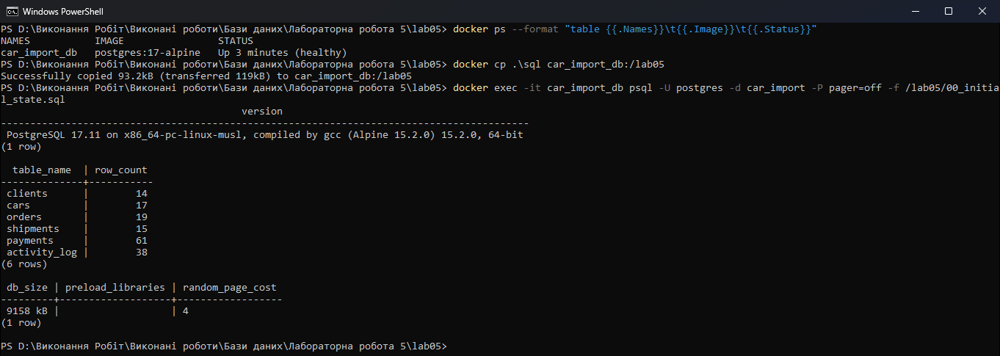

Для пошуку найповільніших запитів (рівень 3) потрібне розширення `pg_stat_statements`. Його бібліотека завантажується лише під час старту сервера, тому параметри змінено через `ALTER SYSTEM` (зберігаються в `postgresql.auto.conf` у томі даних) і контейнер перезапущено:

```sql
ALTER SYSTEM SET shared_preload_libraries = 'pg_stat_statements';
ALTER SYSTEM SET pg_stat_statements.track = 'all';  -- враховувати й запити всередині функцій
ALTER SYSTEM SET track_io_timing = on;              -- час читання з диска в EXPLAIN і статистиці
```

```bash
docker restart car_import_db
```

```sql
CREATE EXTENSION pg_stat_statements;
```

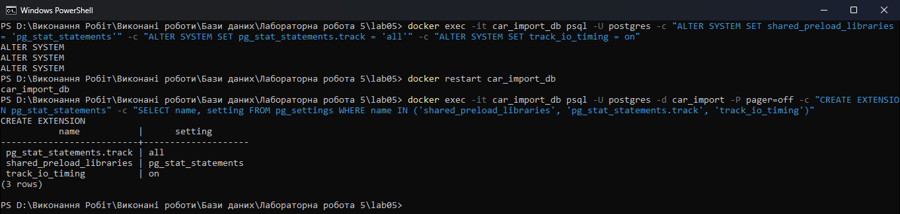

### Рівень 1. Аналіз продуктивності, індекси, представлення, тригер, права

#### Крок 1. Наповнення бази тестовими даними

На 19 замовленнях оптимізатор завжди обирає послідовне сканування, і ефекту від індексів не видно. Тому скрипт [`01_generate_data.sql`](sql/01_generate_data.sql) наповнює реальні таблиці ЛР4 узгодженими тестовими даними:

- 50 000 клієнтів, зареєстрованих за останні 3 роки;
- 150 000 авто 24 моделей, куплених на 12 майданчиках аукціонів;
- 180 000 замовлень: 150 000 на згенеровані авто і 30 000 без авто. Статус замовлення з авто залежить від давності купівлі: до 15 днів `bought`, до 45 `in_transit`, до 55 `in_port`, до 65 `customs`, старші `delivered`. Замовлення без авто мають статус `new` (8 000) або `cancelled` (22 000);
- 148 205 морських доставок і 142 697 митних декларацій;
- 598 902 платежі: завдаток, оплата авто, доставки й митниці (разом з 61 платежем ЛР4 у таблиці 598 963 рядки).

Згенеровані записи впізнаються за VIN `GEN...` та email `@gen.example.com`. Під час масового завантаження задано `session_replication_role = replica`, тобто тригери вимкнено. Інакше тригер аудиту ЛР4 записав би в `activity_log` понад мільйон рядків, а тригери перевірки виконали б зайві запити до кожного рядка. Дані згенеровано відповідно до всіх обмежень `CHECK`, а `setseed` робить генерацію відтворюваною.

```sql
-- =====================================================================
-- Лабораторна робота 5. 01_generate_data.sql
-- Наповнення бази car_import (ЛР4) великим обсягом тестових даних:
-- 50 000 клієнтів, 150 000 авто, 180 000 замовлень, доставки, митниця, платежі.
-- Згенеровані записи впізнаються за VIN 'GEN...' і email '@gen.example.com'.
-- =====================================================================
\timing on
SELECT setseed(0.2026);

-- Під час масового завантаження тригери аудиту ЛР4 вимкнено: інакше кожен
-- рядок записувався б у activity_log (сотні тисяч зайвих записів)
SET session_replication_role = replica;

-- ---------------------------------------------------------------------
-- 1. Клієнти: 50 000, дата реєстрації за останні 3 роки
-- ---------------------------------------------------------------------
INSERT INTO clients (first_name, last_name, phone, email, city, created_at)
SELECT (ARRAY['Олександр','Андрій','Сергій','Дмитро','Максим','Іван','Богдан','Тарас','Юрій','Віктор',
              'Олена','Ірина','Наталія','Оксана','Юлія','Тетяна','Марія','Анна','Світлана','Катерина'])[1 + floor(random() * 20)::int],
       (ARRAY['Бондаренко','Мельничук','Ковальчук','Савчук','Гнатюк','Ткачук','Поліщук','Кравчук','Олійник','Шевчук',
              'Лисенко','Романюк','Мороз','Бойко','Коваленко','Марчук','Остапчук','Петрук','Семенюк','Федорук'])[1 + floor(random() * 20)::int],
       '+38098' || lpad(g::text, 7, '0'),
       'client' || g || '@gen.example.com',
       (ARRAY['Луцьк','Луцьк','Луцьк','Ковель','Володимир','Рівне','Рівне','Львів','Львів','Київ',
              'Київ','Київ','Житомир','Тернопіль','Хмельницький','Вінниця','Одеса','Дніпро','Харків','Ужгород'])[1 + floor(random() * 20)::int],
       TIMESTAMP '2023-11-16 08:00' + random() * (TIMESTAMP '2026-11-15 20:00' - TIMESTAMP '2023-11-16 08:00')
FROM generate_series(1, 50000) AS g;

-- ---------------------------------------------------------------------
-- 2. Авто: 150 000, куплені на аукціонах за останні 3 роки
-- ---------------------------------------------------------------------
INSERT INTO cars (vin, make, model, model_year, fuel_type, engine_volume, battery_kwh,
                  mileage_mi, damage, yard_id, lot_number, purchase_price_usd, auction_fee_usd, purchase_date)
SELECT 'GEN' || lpad(g::text, 14, '0'),
       split_part(m.spec, '|', 1),
       split_part(m.spec, '|', 2),
       2012 + floor(random() * (EXTRACT(YEAR FROM d.pdate) - 2011))::int,
       split_part(m.spec, '|', 3),
       CASE WHEN split_part(m.spec, '|', 3) <> 'electric' THEN split_part(m.spec, '|', 4)::numeric END,
       CASE WHEN split_part(m.spec, '|', 3) =  'electric' THEN split_part(m.spec, '|', 4)::numeric END,
       5000 + floor(random() * 140000)::int,
       (ARRAY['Front End','Rear End','Side','Hail','Water/Flood','Minor Dent','Mechanical',NULL])[1 + floor(random() * 8)::int],
       1 + floor(random() * 12)::int,
       'G' || g,
       round((3000 + random() * 27000)::numeric, -1),
       round((400 + random() * 1100)::numeric, 0),
       d.pdate
FROM generate_series(1, 150000) AS g
CROSS JOIN LATERAL (
    SELECT (ARRAY['Toyota|Camry|hybrid|2.5','Toyota|RAV4|petrol|2.5','Honda|Accord|petrol|1.5','Honda|CR-V|petrol|1.5',
                  'Ford|Escape|petrol|1.5','Ford|Fusion|hybrid|2.0','Chevrolet|Malibu|petrol|1.5','Nissan|Rogue|petrol|2.5',
                  'Hyundai|Tucson|petrol|2.0','Kia|Sportage|petrol|2.4','Volkswagen|Jetta|petrol|1.4','Volkswagen|Passat|diesel|2.0',
                  'Audi|Q5|petrol|2.0','BMW|X3|petrol|2.0','BMW|530e|hybrid|2.0','Mercedes-Benz|GLC|petrol|2.0',
                  'Jeep|Cherokee|petrol|2.4','Mazda|CX-5|petrol|2.5','Subaru|Outback|petrol|2.5','Tesla|Model 3|electric|75',
                  'Tesla|Model Y|electric|75','Nissan|Leaf|electric|40','Chevrolet|Bolt|electric|66','Ford|Mustang Mach-E|electric|88'])
           [1 + floor(random() * 24)::int] AS spec
    WHERE g > 0
) AS m
CROSS JOIN LATERAL (
    SELECT DATE '2023-11-16' + floor(random() * (DATE '2026-11-15' - DATE '2023-11-16'))::int AS pdate
    WHERE g > 0
) AS d;
```

Повний текст скрипту: [`sql/01_generate_data.sql`](sql/01_generate_data.sql). Генерація зайняла близько 10 секунд, розмір бази зріс з 9 МБ до 230 МБ:

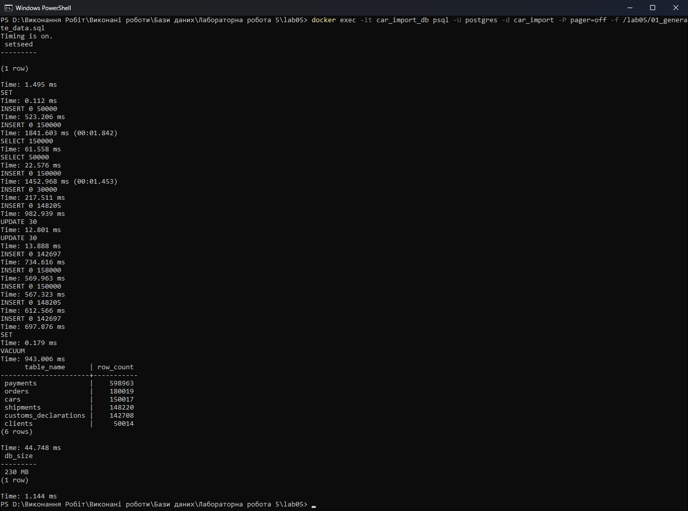

#### Крок 2. Аналіз продуктивності трьох запитів

Обрано три типові для компанії запити, які використовують `JOIN`, агрегацію, віконну функцію та сортування.

**Запит 1.** Нові клієнти за 30 днів, кількість їхніх замовлень і сума платежів:

```sql
EXPLAIN (ANALYZE, BUFFERS)
SELECT c.client_id,
       c.last_name || ' ' || c.first_name AS client,
       c.city,
       c.created_at::date                 AS registered,
       COUNT(DISTINCT o.order_id)         AS orders,
       COALESCE(SUM(p.amount_usd), 0)     AS paid_usd
FROM clients c
LEFT JOIN orders   o ON o.client_id = c.client_id
LEFT JOIN payments p ON p.order_id  = o.order_id
WHERE c.created_at >= CURRENT_DATE - 30
GROUP BY c.client_id
ORDER BY paid_usd DESC, c.client_id;
```

**Запит 2.** Авто, що прибули в порт Одеса за жовтень, з контейнером, перевізником і клієнтом:

```sql
EXPLAIN (ANALYZE, BUFFERS)
SELECT s.arrival_date,
       s.container_number,
       cr.name                              AS carrier,
       c.vin,
       c.make || ' ' || c.model             AS car,
       cl.last_name || ' ' || cl.first_name AS client,
       o.status
FROM shipments s
JOIN orders   o  ON o.order_id    = s.order_id
JOIN cars     c  ON c.car_id      = o.car_id
JOIN carriers cr ON cr.carrier_id = s.carrier_id
JOIN clients  cl ON cl.client_id  = o.client_id
WHERE s.port_to = 'Одеса'
  AND s.arrival_date BETWEEN DATE '2026-10-01' AND DATE '2026-10-31'
ORDER BY s.arrival_date, s.container_number;
```

**Запит 3.** Закупівлі на аукціонах за III квартал за марками, з часткою кожної марки:

```sql
EXPLAIN (ANALYZE, BUFFERS)
SELECT make,
       COUNT(*)                                                AS cars,
       SUM(purchase_price_usd + auction_fee_usd)               AS total_usd,
       ROUND(AVG(purchase_price_usd), 2)                       AS avg_price_usd,
       ROUND(100.0 * SUM(purchase_price_usd + auction_fee_usd)
             / SUM(SUM(purchase_price_usd + auction_fee_usd)) OVER (), 2) AS share_pct
FROM cars
WHERE purchase_date BETWEEN DATE '2026-07-01' AND DATE '2026-09-30'
GROUP BY make
ORDER BY total_usd DESC;
```

На початку кожного файлу запит один раз виконується з виводом у `/dev/null`, щоб прогріти кеш. Тому `EXPLAIN` показує роботу з даними в пам'яті, а не перше читання з диска.

Щоб порівнювати етапи оптимізації не за одним запуском, створено інструмент [`02_perf_tools.sql`](sql/02_perf_tools.sql). Він складається з таблиці запитів `perf_queries`, таблиці результатів `perf_results` і функції `perf_measure(stage, runs)`. Функція виконує кожен запит через `EXPLAIN (ANALYZE, BUFFERS, FORMAT JSON)` 5 разів після прогрівання, зберігає середній і мінімальний час, кількість прочитаних буферів, а з JSON-плану витягує всі вузли сканування.

```sql
-- Вимірювання: перший запуск прогріває кеш і не враховується
CREATE OR REPLACE FUNCTION perf_measure(p_stage VARCHAR, p_runs INTEGER DEFAULT 5)
RETURNS TABLE (query_id SMALLINT, title VARCHAR, avg_ms NUMERIC, min_ms NUMERIC, buffers BIGINT, scans TEXT)
LANGUAGE plpgsql AS $$
DECLARE
    q       RECORD;
    v_plan  JSONB;
    v_times NUMERIC[];
    v_buf   BIGINT;
    v_scans TEXT;
BEGIN
    FOR q IN SELECT * FROM perf_queries ORDER BY perf_queries.query_id LOOP
        EXECUTE 'EXPLAIN (ANALYZE, BUFFERS, FORMAT JSON) ' || q.sql_text INTO v_plan;
        v_times := '{}';
        FOR i IN 1..p_runs LOOP
            EXECUTE 'EXPLAIN (ANALYZE, BUFFERS, FORMAT JSON) ' || q.sql_text INTO v_plan;
            v_times := v_times || (v_plan -> 0 ->> 'Execution Time')::NUMERIC;
        END LOOP;

        v_buf := (v_plan -> 0 -> 'Plan' ->> 'Shared Hit Blocks')::BIGINT
               + (v_plan -> 0 -> 'Plan' ->> 'Shared Read Blocks')::BIGINT;

        -- усі вузли сканування плану: тип + таблиця або індекс
        SELECT string_agg(DISTINCT n ->> 'Node Type' || ' ' ||
                          COALESCE(n ->> 'Index Name', n ->> 'Relation Name'), ', ')
        INTO v_scans
        FROM jsonb_path_query(v_plan, 'strict $.**') AS n
        WHERE jsonb_typeof(n) = 'object' AND n ->> 'Node Type' LIKE '%Scan'
          AND n ->> 'Node Type' <> 'Bitmap Heap Scan';

        INSERT INTO perf_results (stage, query_id, runs, avg_ms, min_ms, buffers, scans)
        VALUES (p_stage, q.query_id, p_runs,
                (SELECT AVG(t) FROM unnest(v_times) t), (SELECT MIN(t) FROM unnest(v_times) t),
                v_buf, v_scans);
    END LOOP;

    RETURN QUERY
    SELECT r.query_id, pq.title, r.avg_ms, r.min_ms, r.buffers, r.scans
    FROM perf_results r JOIN perf_queries pq ON pq.query_id = r.query_id
    WHERE r.stage = p_stage
    ORDER BY r.query_id;
END;
$$;
```

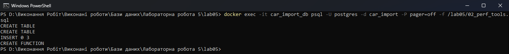

**План запиту 1 до оптимізації:**

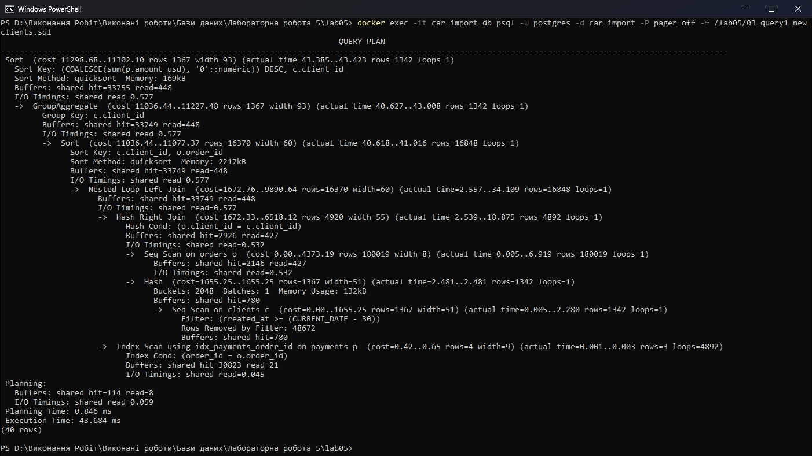

- `Seq Scan on clients` читає всі 50 014 клієнтів, щоб відібрати 1 342 (`Rows Removed by Filter: 48672`);
- `Seq Scan on orders` повністю читає 180 019 замовлень для `Hash Right Join`;
- `Index Scan using idx_payments_order_id` виконується 4 892 рази (`loops=4892`) і читає 30 823 буфери. Для кожного платежу читається рядок таблиці заради одного стовпця `amount_usd`;
- сортування 16 848 рядків для `COUNT(DISTINCT)` і `GROUP BY`.

Разом 34 203 буфери, час 43,7 мс.

**План запиту 2 до оптимізації:**

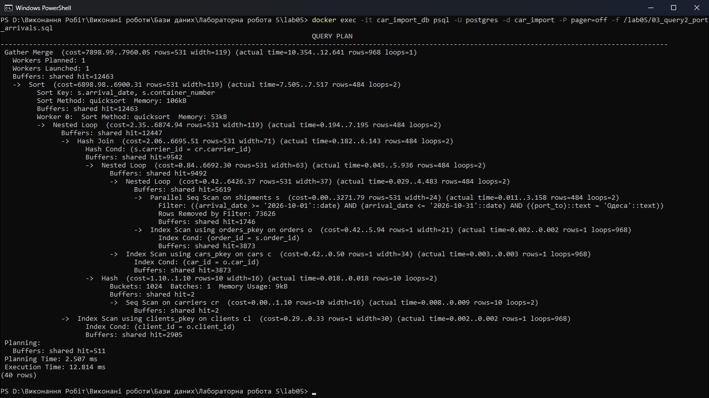

`Parallel Seq Scan on shipments` переглядає всі 148 тис. доставок двома процесами (`loops=2`, по 73 626 відкинутих рядків на кожен), щоб знайти 968. Решта з'єднань використовує первинні ключі. Час 12,8 мс.

(Перший запуск цього файлу показав 17,9 мс, але план не вмістився у вікно через рядки `I/O Timings`. На скриншоті наведено повторний запуск у більшому вікні, коли дані вже були в кеші.)

**План запиту 3 до оптимізації:**

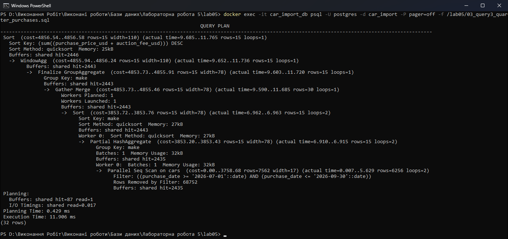

`Parallel Seq Scan on cars` читає всі 150 тис. авто (2 435 сторінок), щоб відібрати 12 512 авто за квартал. Час 11,9 мс.

**Результати вимірювання до оптимізації** (`perf_measure('before')`, середнє з 5 запусків):

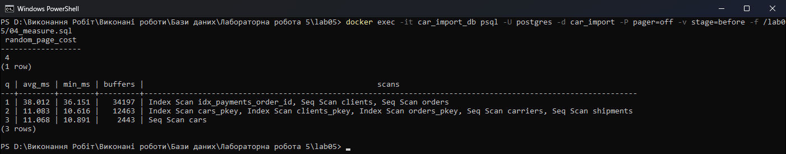

| Запит | Середній час | Буферів | Сканування |
|---|---|---|---|
| 1 | 38,0 мс | 34 197 | `Seq Scan clients`, `Seq Scan orders`, `Index Scan idx_payments_order_id` |
| 2 | 11,1 мс | 12 463 | `Seq Scan shipments` + індекси первинних ключів |
| 3 | 11,1 мс | 2 443 | `Seq Scan cars` |

#### Крок 3. Індекси для оптимізації

За результатами аналізу індекси створено на стовпцях, за якими виконується фільтрація і які зараз читаються послідовним скануванням:

```sql
-- =====================================================================
-- 03_create_indexes.sql: три індекси під повільні запити 1-3
-- =====================================================================
\timing on

-- Запит 1: фільтр clients.created_at >= ... (нові клієнти за період)
CREATE INDEX idx_clients_created_at ON clients (created_at);

-- Запит 2: рівність по port_to + діапазон по arrival_date.
-- Порядок стовпців: спочатку стовпець з умовою рівності, потім діапазон,
-- тоді рядки одного порту за місяць лежать в індексі поруч і вже відсортовані
CREATE INDEX idx_shipments_port_arrival ON shipments (port_to, arrival_date);

-- Запит 3: діапазон дат купівлі. INCLUDE додає в листки індексу стовпці,
-- які потрібні запиту, тому можливий Index Only Scan без читання таблиці
CREATE INDEX idx_cars_purchase_date ON cars (purchase_date)
    INCLUDE (make, purchase_price_usd, auction_fee_usd);
```

Обґрунтування:

| Індекс | Запит | Чому саме такий |
|---|---|---|
| `idx_clients_created_at` | 1 | фільтр `created_at >= CURRENT_DATE - 30` відбирає менше 3 % клієнтів |
| `idx_shipments_port_arrival` | 2 | складений: спочатку стовпець з рівністю (`port_to`), потім з діапазоном (`arrival_date`), тому потрібні рядки лежать в індексі поруч і вже впорядковані за датою |
| `idx_cars_purchase_date` + `INCLUDE` | 3 | у листках індексу є всі стовпці запиту (`make`, ціна, збір), тому можливий `Index Only Scan` без читання таблиці |

Індекси на зовнішніх ключах (`orders.client_id`, `payments.order_id` тощо) вже були створені в ЛР4, бо PostgreSQL не створює їх автоматично.

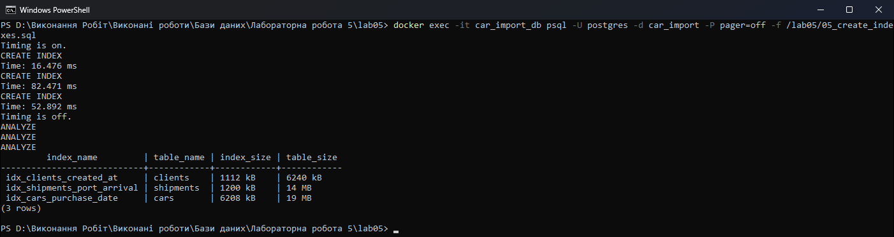

**Плани після створення індексів:**

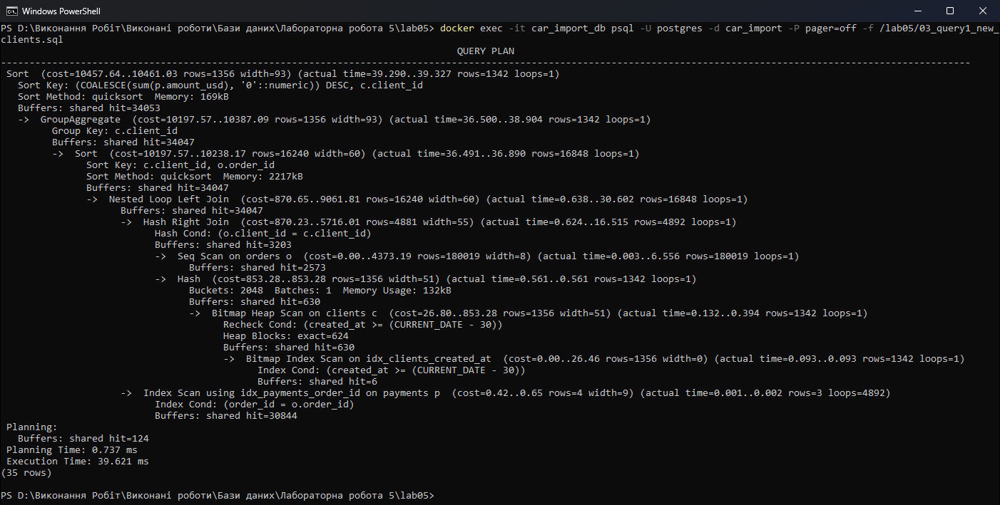

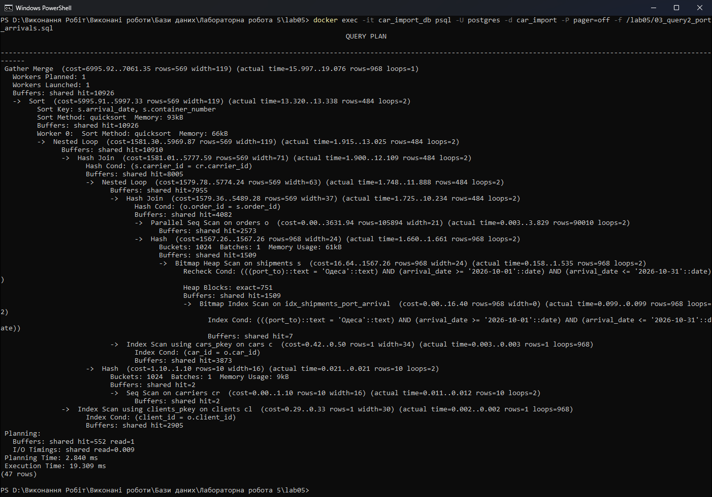

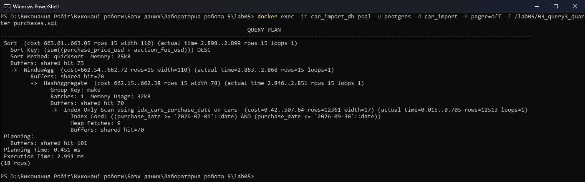

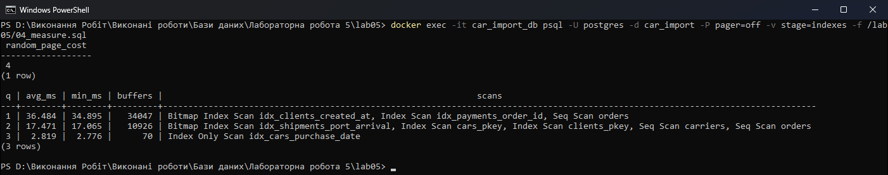

Результат виявився неоднозначним:

- **Запит 3** прискорився в 3,9 раза: `Index Only Scan using idx_cars_purchase_date`, 70 буферів замість 2 443, `Heap Fetches: 9`;
- **Запит 1** майже не змінився (38,0 → 36,5 мс). Клієнтів тепер шукає `Bitmap Index Scan`, але це займало лише 2,3 мс з 43. Основний час, як і раніше, йде на `Seq Scan on orders` і 4 892 звернення до `payments`;
- **Запит 2** навіть **сповільнився** (11,1 → 17,5 мс). Індекс використано (`Bitmap Index Scan on idx_shipments_port_arrival`), але далі планувальник обрав `Hash Join` з повним `Parallel Seq Scan on orders` замість 968 звернень за первинним ключем.

Причина в параметрі `random_page_cost = 4`. Він розрахований на HDD, де випадкове читання сторінки в 4 рази дорожче за послідовне. Тому планувальник вважає тисячі звернень за індексом дорожчими за одне послідовне читання таблиці. База займає 230 МБ, працює на SSD і майже повністю лежить у кеші (кеш-попадання 99,9 %), тому для неї ця оцінка завищена.

**Налаштування планувальника і покривний індекс** ([`06_tuning.sql`](sql/06_tuning.sql)):

```sql
-- =====================================================================
-- 06_tuning.sql: налаштування планувальника і покривний індекс
-- =====================================================================

-- 1. random_page_cost = 4 (за замовчуванням) розрахований на HDD, де випадкове
--    читання в 4 рази дорожче за послідовне. База (229 МБ) працює на SSD
--    і майже повністю в кеші, тому планувальник переоцінює Index Scan.
ALTER DATABASE :"DBNAME" SET random_page_cost = 1.1;
SET random_page_cost = 1.1;   -- для поточного сеансу

-- 2. У запиті 1 найдорожча частина - 4 892 звернення до payments по order_id,
--    кожне читає рядок таблиці заради amount_usd. Покривний індекс з INCLUDE
--    дає Index Only Scan. Він повністю замінює старий idx_payments_order_id,
--    тому старий індекс видаляємо: зайвий індекс лише сповільнює INSERT.
CREATE INDEX idx_payments_order_amount ON payments (order_id) INCLUDE (amount_usd);
DROP INDEX idx_payments_order_id;
VACUUM ANALYZE payments;

SELECT pg_size_pretty(pg_relation_size('idx_payments_order_amount')) AS covering_index_size;
```

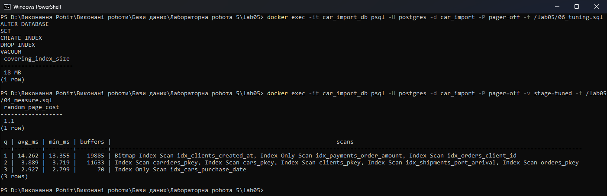

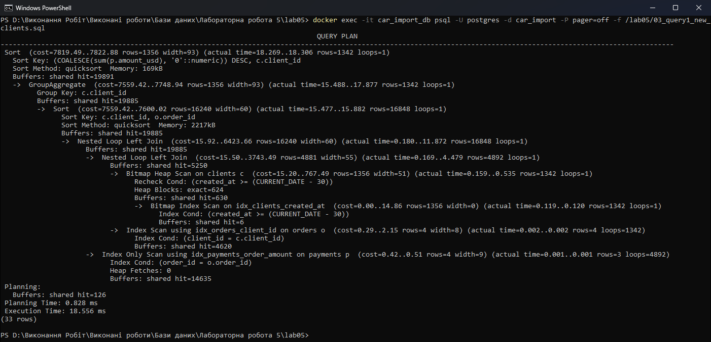

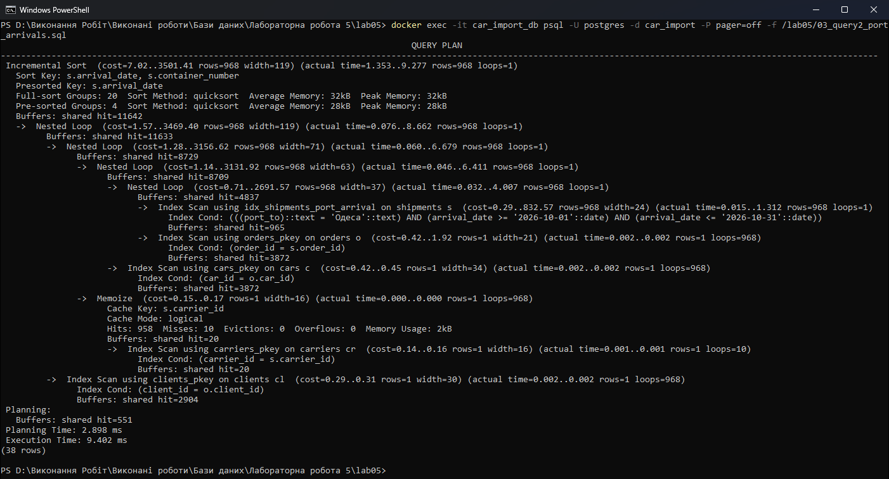

Після налаштування:

- у запиті 1 замовлення шукаються через `idx_orders_client_id` (1 342 звернення), а платежі через `Index Only Scan using idx_payments_order_amount` з `Heap Fetches: 0`;
- у запиті 2 планувальник починає з `Index Scan using idx_shipments_port_arrival`, а решту таблиць з'єднує через `Nested Loop` за первинними ключами. Рядки виходять з індексу вже впорядкованими за датою, тому замість повного сортування використано `Incremental Sort`, а для перевізників `Memoize` (958 попадань у кеш з 968).

**Порівняння етапів оптимізації** ([`06_compare.sql`](sql/06_compare.sql)):

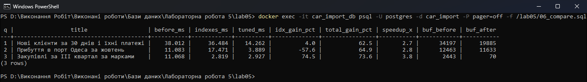

| Запит | До оптимізації | Лише індекси | Індекси + налаштування | Покращення | Прискорення | Буферів до → після |
|---|---|---|---|---|---|---|
| 1. Нові клієнти | 38,0 мс | 36,5 мс (−4 %) | 14,3 мс | **62,5 %** | 2,7× | 34 197 → 19 885 |
| 2. Прибуття в порт | 11,1 мс | 17,5 мс (+58 %) | 3,9 мс | **64,9 %** | 2,8× | 12 463 → 11 633 |
| 3. Закупівлі за квартал | 11,1 мс | 2,8 мс (−75 %) | 2,9 мс | **73,6 %** | 3,8× | 2 443 → 70 |

Відсоток покращення обчислено як `(час_до − час_після) / час_до × 100 %` за середнім із 5 запусків. Поодинокі запуски `EXPLAIN ANALYZE` на скриншотах дають близькі значення (43,7 → 18,6 мс, 12,8 → 9,4 мс, 11,9 → 3,0 мс), але менш точні: перший запуск у новому сеансі додатково заповнює кеш каталогу.

Висновок: індекс сам по собі не гарантує прискорення. Його треба перевіряти через `EXPLAIN ANALYZE`, а параметри вартості планувальника мають відповідати реальному обладнанню.

#### Крок 4. Представлення

Створено два представлення для запитів, які менеджери виконують найчастіше:

```sql
-- =====================================================================
-- 07_views.sql: два представлення для часто використовуваних запитів
-- =====================================================================

-- 1. Активні замовлення (ще не видані і не скасовані): робочий список менеджера
CREATE VIEW v_active_orders AS
SELECT o.order_id,
       o.order_date,
       o.status,
       o.manager_id,
       m.last_name || ' ' || m.first_name                AS manager,
       cl.last_name || ' ' || cl.first_name              AS client,
       cl.city,
       c.make || ' ' || c.model || ' ' || c.model_year   AS car,
       o.budget_usd,
       CURRENT_DATE - o.order_date                       AS days_in_work
FROM orders o
JOIN clients  cl ON cl.client_id = o.client_id
JOIN managers m  ON m.manager_id = o.manager_id
LEFT JOIN cars c ON c.car_id     = o.car_id
WHERE o.status NOT IN ('delivered', 'cancelled');

-- 2. Статистика клієнта: замовлення за статусами, сплачено, останнє замовлення.
--    Платежі підсумовуються через LATERAL для кожного замовлення окремо,
--    тому рядки не множаться, а для одного клієнта читаються лише його платежі
CREATE VIEW v_client_statistics AS
SELECT cl.client_id,
       cl.last_name || ' ' || cl.first_name                                          AS client,
       cl.city,
       COUNT(o.order_id)                                                             AS orders_total,
       COUNT(o.order_id) FILTER (WHERE o.status = 'delivered')                       AS delivered,
       COUNT(o.order_id) FILTER (WHERE o.status NOT IN ('delivered', 'cancelled'))   AS active,
       COALESCE(SUM(p.paid_usd), 0)                                                  AS paid_usd,
       MAX(o.order_date)                                                             AS last_order_date
FROM clients cl
LEFT JOIN orders o ON o.client_id = cl.client_id
LEFT JOIN LATERAL (
    SELECT SUM(amount_usd) AS paid_usd FROM payments WHERE payments.order_id = o.order_id
) p ON TRUE
GROUP BY cl.client_id;
```

- `v_active_orders` дає робочий список менеджера: усі незавершені замовлення з клієнтом, менеджером, авто і кількістю днів у роботі;
- `v_client_statistics` дає картку клієнта зі статистикою. Платежі підсумовуються через `LATERAL`, а не через `JOIN payments`. Інакше кожне замовлення повторилося б стільки разів, скільки в нього платежів, і `COUNT` став би неправильним. Крім того, для одного клієнта читаються лише його платежі через покривний індекс.

```sql
-- Перевірка роботи представлень
\timing on
SELECT order_id, order_date, status, manager, client, car, days_in_work
FROM v_active_orders
WHERE manager_id = 1
ORDER BY days_in_work DESC
LIMIT 6;

SELECT status, COUNT(*) AS orders, ROUND(AVG(days_in_work)) AS avg_days
FROM v_active_orders
GROUP BY status
ORDER BY avg_days;

SELECT * FROM v_client_statistics WHERE client_id IN (1, 3, 11);

SELECT client_id, client, city, orders_total, delivered, paid_usd, last_order_date
FROM v_client_statistics
WHERE city = 'Луцьк'
ORDER BY paid_usd DESC
LIMIT 5;
\timing off
```

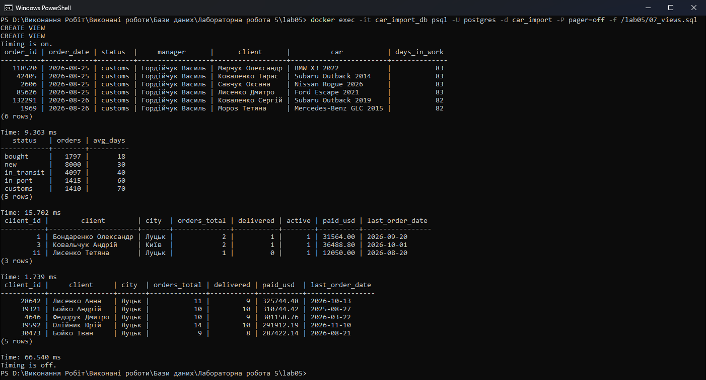

Картка трьох клієнтів обчислюється за 1,7 мс. Рейтинг клієнтів міста потребує агрегування всіх замовлень міста і займає 66 мс. Саме такі запити далі винесено в матеріалізоване представлення (рівень 3).

#### Крок 5. Тригер логування операцій

Створено таблицю `audit_log`. Її структуру одразу розраховано на рівень 2: тип операції, таблиця, ідентифікатор запису, старі й нові значення в `JSONB`, змінені поля, користувач СУБД і користувач вебзастосунку, адреса, ідентифікатор транзакції, глибина вкладеності тригерів і час. Тригер рівня 1 логує вставку та оновлення клієнтів:

```sql
-- =====================================================================
-- 08_audit_trigger.sql: таблиця audit_log і тригер логування INSERT/UPDATE
-- (рівень 1). Структура таблиці одразу розрахована на рівень 2.
-- =====================================================================

CREATE TABLE audit_log (
    log_id            BIGSERIAL    PRIMARY KEY,
    table_name        VARCHAR(50)  NOT NULL,
    operation         VARCHAR(10)  NOT NULL CHECK (operation IN ('INSERT', 'UPDATE', 'DELETE')),
    record_id         INTEGER,
    old_values        JSONB,
    new_values        JSONB,
    changed_fields    TEXT[],                                      -- лише для UPDATE
    changed_by        VARCHAR(100) NOT NULL DEFAULT SESSION_USER,  -- користувач СУБД
    app_user          VARCHAR(30),                                 -- користувач вебзастосунку ЛР4
    client_addr       INET         DEFAULT inet_client_addr(),
    application_name  TEXT         DEFAULT current_setting('application_name'),
    txid              BIGINT       NOT NULL DEFAULT txid_current(),
    trigger_depth     SMALLINT,
    changed_at        TIMESTAMPTZ  NOT NULL DEFAULT clock_timestamp()
);

CREATE INDEX idx_audit_log_record     ON audit_log (table_name, record_id);
CREATE INDEX idx_audit_log_changed_at ON audit_log (changed_at DESC);

-- Тригерна функція для таблиці clients: логує вставку та оновлення
CREATE OR REPLACE FUNCTION fn_log_client_changes()
RETURNS TRIGGER AS $$
BEGIN
    IF TG_OP = 'INSERT' THEN
        INSERT INTO audit_log (table_name, operation, record_id, new_values)
        VALUES (TG_TABLE_NAME, TG_OP, NEW.client_id, to_jsonb(NEW));
    ELSIF TG_OP = 'UPDATE' THEN
        INSERT INTO audit_log (table_name, operation, record_id, old_values, new_values)
        VALUES (TG_TABLE_NAME, TG_OP, NEW.client_id, to_jsonb(OLD), to_jsonb(NEW));
    END IF;
    RETURN NULL;   -- для AFTER-тригера значення ігнорується
END;
$$ LANGUAGE plpgsql;

CREATE TRIGGER trg_clients_log
AFTER INSERT OR UPDATE ON clients
FOR EACH ROW
EXECUTE FUNCTION fn_log_client_changes();

-- Перевірка
INSERT INTO clients (first_name, last_name, phone, email, city)
VALUES ('Віра', 'Лабенко', '+380631115005', 'vira.labenko@ukr.net', 'Луцьк')
RETURNING client_id, last_name, city;

UPDATE clients SET city = 'Ковель', phone = '+380631115006'
WHERE email = 'vira.labenko@ukr.net';

SELECT log_id, operation, table_name, record_id,
       old_values ->> 'city'  AS old_city,  new_values ->> 'city'  AS new_city,
       old_values ->> 'phone' AS old_phone, new_values ->> 'phone' AS new_phone,
       changed_by, to_char(changed_at, 'YYYY-MM-DD HH24:MI:SS') AS changed_at
FROM audit_log
ORDER BY log_id;

SELECT jsonb_pretty(new_values) AS new_values FROM audit_log WHERE log_id = 2;
```

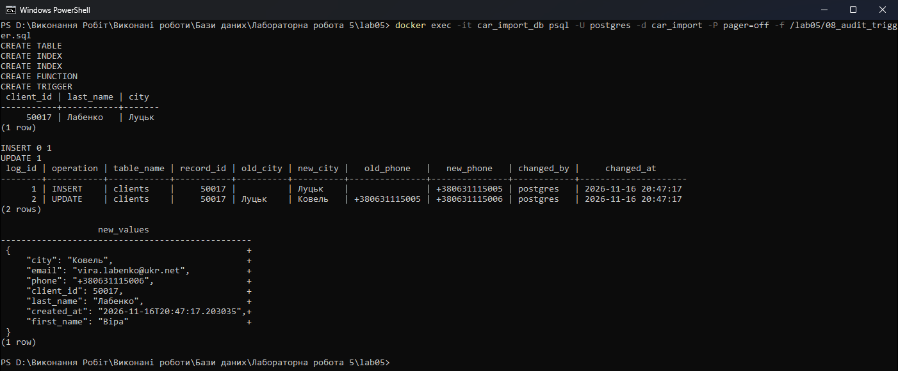

Після вставки і зміни міста та телефону в журналі з'явилися два записи. Запис `UPDATE` містить старі (`Луцьк`, `+380631115005`) і нові (`Ковель`, `+380631115006`) значення, а `new_values` зберігає повний рядок у JSON.

#### Крок 6. Користувач з обмеженими правами

Користувач `report_viewer` (аналітик) може лише читати довідники, авто й доставки, частину стовпців клієнтів і замовлень та два представлення. Телефони, email, бюджети, платежі й журнали йому недоступні. Право `CONNECT` на базу за замовчуванням має `PUBLIC`, тобто будь-яка роль кластера, тому його відкликано і видано лише потрібним ролям.

```sql
-- =====================================================================
-- 09_report_viewer.sql: користувач з обмеженими правами (рівень 1)
-- report_viewer - аналітик: лише читання авто, доставок, частини стовпців
-- клієнтів і замовлень та двох представлень. Платежі, телефони, email,
-- бюджети клієнтів і журнали йому недоступні.
-- =====================================================================

CREATE ROLE report_viewer WITH LOGIN PASSWORD 'Viewer#Lab5-2026'
    CONNECTION LIMIT 3 VALID UNTIL '2027-07-01';

-- За замовчуванням право CONNECT має PUBLIC (усі ролі): забираємо його
REVOKE CONNECT ON DATABASE :"DBNAME" FROM PUBLIC;
GRANT  CONNECT ON DATABASE :"DBNAME" TO report_viewer;
GRANT  USAGE   ON SCHEMA public TO report_viewer;

-- Таблиці повністю
GRANT SELECT ON cars, auction_yards, carriers, services, shipments TO report_viewer;
-- Таблиці частково: права на рівні стовпців
GRANT SELECT (client_id, first_name, last_name, city, created_at) ON clients TO report_viewer;
GRANT SELECT (order_id, client_id, manager_id, car_id, order_date, status, destination_city)
    ON orders TO report_viewer;
-- Представлення
GRANT SELECT ON v_active_orders, v_client_statistics TO report_viewer;

-- Підсумок прав
SELECT table_name, string_agg(DISTINCT privilege_type, ', ') AS privileges
FROM information_schema.role_table_grants
WHERE grantee = 'report_viewer'
GROUP BY table_name
UNION ALL
SELECT table_name || ' (стовпці)', string_agg(column_name, ', ' ORDER BY column_name)
FROM information_schema.column_privileges
WHERE grantee = 'report_viewer' AND table_name IN ('clients', 'orders')
GROUP BY table_name
ORDER BY 1;
```

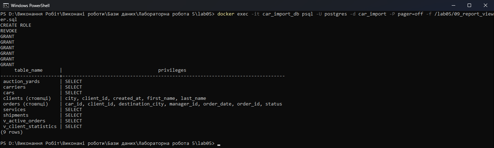

Перевірка під `report_viewer` (підключення через TCP з паролем, `-h localhost`):

```sql
-- 09_report_viewer_test.sql: виконується під користувачем report_viewer
SELECT current_user, session_user, current_database();

-- Дозволено
SELECT client_id, last_name, first_name, city FROM clients ORDER BY client_id LIMIT 3;
SELECT order_id, status, order_date FROM orders WHERE order_id = 1;
SELECT order_id, status, client, days_in_work FROM v_active_orders ORDER BY days_in_work DESC LIMIT 3;

-- Заборонено
SELECT phone FROM clients LIMIT 1;
SELECT * FROM orders LIMIT 1;
SELECT COUNT(*) FROM payments;
SELECT COUNT(*) FROM audit_log;
INSERT INTO cars (vin) VALUES ('1HGCM82633A004352');
UPDATE shipments SET arrival_date = CURRENT_DATE WHERE shipment_id = 1;
DELETE FROM orders WHERE order_id = 1;
CREATE TABLE my_table (id INT);
```

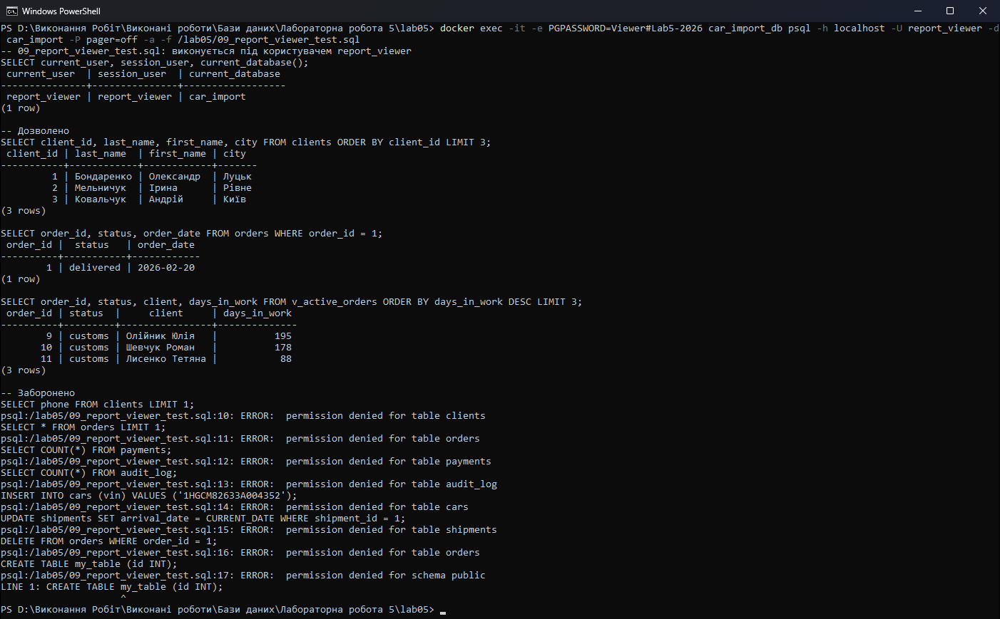

Дозволені запити виконуються. `SELECT phone` і `SELECT *` відхиляються, бо права надано лише на окремі стовпці. Також заборонено доступ до `payments` і `audit_log`, будь-які `INSERT`, `UPDATE`, `DELETE` і створення таблиць у схемі `public`.

### Рівень 2. Розширена функціональність

#### Крок 1. Представлення з оновленням через правила (RULES)

Представлення `v_order_contacts` поєднує `orders`, `clients` і `managers`, тому PostgreSQL не може оновлювати його автоматично. Правила визначають, що відбувається при зміні даних через представлення:

- `UPDATE` змінює контакти клієнта в `clients` і місто доставки в `orders` (правило з двох команд);
- `DELETE` виконує «м'яке» видалення: замовлення скасовується, але лише якщо авто ще не відправлене (`new` або `bought`);
- `INSERT` явно заборонено (`DO INSTEAD NOTHING`).

```sql
-- =====================================================================
-- 10_rules_view.sql: складне представлення з оновленням через RULES
-- v_order_contacts поєднує три таблиці (orders, clients, managers), тому
-- PostgreSQL не може оновлювати його автоматично.
-- =====================================================================

CREATE VIEW v_order_contacts AS
SELECT o.order_id,
       o.status,
       o.order_date,
       o.destination_city,
       o.client_id,
       cl.last_name || ' ' || cl.first_name AS client,
       cl.phone,
       cl.email,
       m.last_name || ' ' || m.first_name   AS manager
FROM orders o
JOIN clients  cl ON cl.client_id = o.client_id
JOIN managers m  ON m.manager_id = o.manager_id;

-- Без правил оновлення неможливе
UPDATE v_order_contacts SET phone = '+380631115007' WHERE order_id = 12;

-- Правило UPDATE: контакти змінюються в clients, місто доставки в orders.
-- Інші стовпці (статус, менеджер, ПІБ) через представлення не змінюються.
CREATE RULE r_order_contacts_update AS
ON UPDATE TO v_order_contacts
DO INSTEAD (
    UPDATE clients
       SET phone = NEW.phone,
           email = NEW.email
     WHERE client_id = OLD.client_id;
    UPDATE orders
       SET destination_city = NEW.destination_city
     WHERE order_id = OLD.order_id;
);

-- Правило DELETE: "м'яке" видалення - замовлення не видаляється, а скасовується,
-- і лише якщо авто ще не відправлене (статус new або bought)
CREATE RULE r_order_contacts_delete AS
ON DELETE TO v_order_contacts
DO INSTEAD
    UPDATE orders
       SET status = 'cancelled'
     WHERE order_id = OLD.order_id
       AND status IN ('new', 'bought');

-- Вставка через представлення не має сенсу: забороняємо явно
CREATE RULE r_order_contacts_insert AS
ON INSERT TO v_order_contacts
DO INSTEAD NOTHING;

-- Перевірка
SELECT order_id, status, destination_city, client, phone, email
FROM v_order_contacts WHERE order_id IN (12, 15);

UPDATE v_order_contacts
   SET phone = '+380631115007', email = 'm.romaniuk@ukr.net', destination_city = 'Ковель'
 WHERE order_id = 12;

DELETE FROM v_order_contacts WHERE order_id IN (12, 15);

INSERT INTO v_order_contacts (order_id, client) VALUES (999999, 'Тест');

SELECT order_id, status, destination_city, client, phone, email
FROM v_order_contacts WHERE order_id IN (12, 15);

-- Зміни потрапили в базові таблиці
SELECT client_id, phone, email FROM clients WHERE client_id = (SELECT client_id FROM orders WHERE order_id = 12);
SELECT order_id, status, destination_city FROM orders WHERE order_id IN (12, 15);

SELECT rulename,
       CASE ev_type WHEN '1' THEN 'SELECT' WHEN '2' THEN 'UPDATE'
                    WHEN '3' THEN 'INSERT' WHEN '4' THEN 'DELETE' END AS event,
       is_instead
FROM pg_rewrite
WHERE ev_class = 'v_order_contacts'::regclass
ORDER BY ev_type;
```

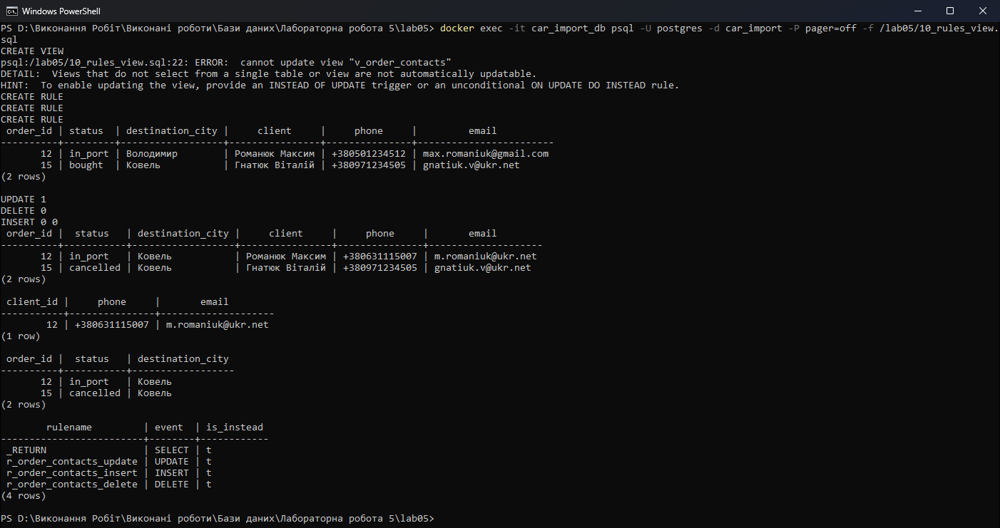

Результат:

- до створення правил `UPDATE` завершився помилкою `cannot update view` з підказкою створити правило або тригер `INSTEAD OF`;
- після створення правил телефон і email клієнта змінилися в `clients`, а місто доставки в `orders`;
- `DELETE` для двох замовлень скасував лише замовлення 15 (`bought`), а замовлення 12 (`in_port`, авто вже в порту) не змінилося;
- `INSERT` через представлення нічого не вставив (`INSERT 0 0`).

`psql` показує `DELETE 0`, хоча одне замовлення скасовано. Для `DO INSTEAD` правил СУБД повертає лічильник лише для команди того самого типу, що й вихідна. Правило замінило `DELETE` на `UPDATE`, тому видалених рядків 0.

У документації PostgreSQL для нових проєктів рекомендовано використовувати тригери `INSTEAD OF`. Правила застосовано тут, бо цього вимагає завдання.

#### Крок 2. Тригер валідації даних

`BEFORE`-тригер `trg_orders_validate` нормалізує дані замовлення і відхиляє некоректні значення, які не можна перевірити простим `CHECK`, бо для цього потрібні запити до інших таблиць:

1. Прибирає зайві пробіли в моделі авто й місті та робить першу літеру міста великою. `INITCAP` не підходить, бо в назві «Кам'янець-Подільський» зробив би велику літеру після апострофа.
2. Перевіряє, що місто написане українськими літерами.
3. Перевіряє, що бюджет у межах від 1 000 до 500 000 $.
4. Не дозволяє призначити замовлення звільненому менеджеру (`managers.is_active`).
5. Не дозволяє дату замовлення в майбутньому.
6. Не дозволяє клієнту мати більше трьох необроблених (`new`) замовлень, що захищає від дублікатів заявок.

Кожна помилка має власний код SQLSTATE і підказку `HINT`, тому застосунок може обробити їх програмно.

```sql
-- =====================================================================
-- 11_validation_trigger.sql: BEFORE-тригер валідації замовлень
-- Тригер нормалізує дані і відхиляє некоректні значення, яких не можна
-- описати простим CHECK (потрібні запити до інших таблиць).
-- =====================================================================

CREATE OR REPLACE FUNCTION fn_validate_order()
RETURNS TRIGGER AS $$
DECLARE
    v_manager_active BOOLEAN;
    v_new_orders     INTEGER;
BEGIN
    -- 1. Нормалізація: зайві пробіли, велика перша літера міста
    NEW.wanted_car := btrim(regexp_replace(NEW.wanted_car, '\s+', ' ', 'g'));
    IF TG_OP = 'INSERT' OR NEW.destination_city IS DISTINCT FROM OLD.destination_city THEN
        NEW.destination_city := btrim(regexp_replace(NEW.destination_city, '\s+', ' ', 'g'));
        NEW.destination_city := upper(left(NEW.destination_city, 1)) || substr(NEW.destination_city, 2);

        IF NEW.destination_city !~ '^[А-ЩЬЮЯҐЄІЇ][А-ЩЬЮЯҐЄІЇа-щьюяґєії''ʼ -]+$' THEN
            RAISE EXCEPTION 'Некоректне місто доставки: "%"', NEW.destination_city
                USING ERRCODE = 'invalid_parameter_value',
                      HINT = 'Назва міста українською: літери, пробіл, дефіс, апостроф';
        END IF;
    END IF;

    -- 2. Бюджет у розумних межах
    IF TG_OP = 'INSERT' OR NEW.budget_usd IS DISTINCT FROM OLD.budget_usd THEN
        IF NEW.budget_usd NOT BETWEEN 1000 AND 500000 THEN
            RAISE EXCEPTION 'Бюджет % $ поза допустимими межами', NEW.budget_usd
                USING ERRCODE = 'numeric_value_out_of_range',
                      HINT = 'Допустимий бюджет: від 1 000 до 500 000 $';
        END IF;
    END IF;

    -- 3. Замовлення можна призначити лише працюючому менеджеру
    IF TG_OP = 'INSERT' OR NEW.manager_id IS DISTINCT FROM OLD.manager_id THEN
        SELECT is_active INTO v_manager_active FROM managers WHERE manager_id = NEW.manager_id;
        IF v_manager_active IS FALSE THEN
            RAISE EXCEPTION 'Менеджер % не працює в компанії', NEW.manager_id
                USING ERRCODE = 'check_violation',
                      HINT = 'Оберіть активного менеджера (managers.is_active = TRUE)';
        END IF;
    END IF;

    IF TG_OP = 'INSERT' THEN
        -- 4. Дата замовлення не в майбутньому
        IF NEW.order_date > CURRENT_DATE THEN
            RAISE EXCEPTION 'Дата замовлення % у майбутньому', NEW.order_date
                USING ERRCODE = 'invalid_datetime_format';
        END IF;

        -- 5. Захист від дублікатів: не більше трьох необроблених замовлень у клієнта
        SELECT COUNT(*) INTO v_new_orders
        FROM orders WHERE client_id = NEW.client_id AND status = 'new';
        IF v_new_orders >= 3 THEN
            RAISE EXCEPTION 'У клієнта % вже % нових замовлення', NEW.client_id, v_new_orders
                USING ERRCODE = 'unique_violation',
                      HINT = 'Спочатку обробіть або скасуйте наявні замовлення';
        END IF;
    END IF;

    RETURN NEW;
END;
$$ LANGUAGE plpgsql;

CREATE TRIGGER trg_orders_validate
BEFORE INSERT OR UPDATE ON orders
FOR EACH ROW
EXECUTE FUNCTION fn_validate_order();

-- Коректне замовлення: місто й модель нормалізуються
INSERT INTO orders (client_id, manager_id, wanted_car, budget_usd, destination_city)
SELECT client_id, 2, '  Toyota   RAV4  2021 ', 25000, '  луцьк '
FROM clients WHERE email = 'vira.labenko@ukr.net'
RETURNING order_id, client_id, wanted_car, destination_city, status;

-- Некоректні значення відхиляються
INSERT INTO orders (client_id, manager_id, wanted_car, budget_usd, destination_city)
VALUES (1, 2, 'Honda CR-V', 25000, 'Lutsk-2');

INSERT INTO orders (client_id, manager_id, wanted_car, budget_usd, destination_city)
VALUES (1, 2, 'Honda CR-V', 500, 'Луцьк');

INSERT INTO orders (client_id, manager_id, wanted_car, budget_usd, destination_city)
VALUES (1, 11, 'Honda CR-V', 25000, 'Луцьк');

UPDATE orders SET destination_city = 'Kyiv' WHERE order_id = 1;
```

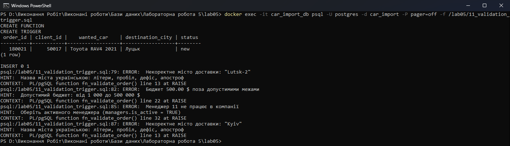

Коректне замовлення з містом `'  луцьк '` і моделлю `'  Toyota   RAV4  2021 '` збережено як `Луцьк` і `Toyota RAV4 2021`. Латинська назва міста, бюджет 500 $ і звільнений менеджер 11 відхилені з поясненням. Тригер спрацьовує і на `UPDATE`: змінити місто існуючого замовлення на `Kyiv` теж не вдалося.

**Обробка помилок у застосунку.** Щоб показати коректну обробку помилок, виконано пакетне завантаження шести заявок. Кожна вставка виконується у власному блоці `BEGIN ... EXCEPTION`, тому помилка в одній заявці не зупиняє обробку інших. Код, текст і підказка помилки зберігаються через `GET STACKED DIAGNOSTICS`:

```sql
-- =====================================================================
-- 11_validation_errors.sql: обробка помилок валідації в застосунку
-- Пакетне завантаження заявок: некоректні заявки не зупиняють обробку,
-- кожна помилка перехоплюється, а її код, текст і підказка зберігаються.
-- =====================================================================

CREATE TEMP TABLE import_errors (
    row_no    INTEGER,
    sqlstate  TEXT,
    message   TEXT,
    hint      TEXT
);

DO $$
DECLARE
    r        RECORD;
    v_client INTEGER := (SELECT client_id FROM clients WHERE email = 'vira.labenko@ukr.net');
    v_ok     INTEGER := 0;
    v_state  TEXT;
    v_msg    TEXT;
    v_hint   TEXT;
BEGIN
    FOR r IN
        SELECT * FROM (VALUES
            (1, 3,  'Kia Sportage',      22000,  'рівне'),
            (2, 4,  'BMW X3',            41000,  'Kyiv'),
            (3, 11, 'Ford Escape',       18000,  'Ковель'),
            (4, 5,  'Tesla Model Y',     900000, 'Львів'),
            (5, 6,  'Mazda CX-5',        24000,  'Володимир'),
            (6, 7,  'Honda Accord',      19000,  'Луцьк')
        ) AS t(row_no, manager_id, car, budget, city)
    LOOP
        BEGIN
            INSERT INTO orders (client_id, manager_id, wanted_car, budget_usd, destination_city)
            VALUES (v_client, r.manager_id, r.car, r.budget, r.city);
            v_ok := v_ok + 1;
        EXCEPTION WHEN OTHERS THEN
            GET STACKED DIAGNOSTICS v_state = RETURNED_SQLSTATE,
                                    v_msg   = MESSAGE_TEXT,
                                    v_hint  = PG_EXCEPTION_HINT;
            INSERT INTO import_errors VALUES (r.row_no, v_state, v_msg, v_hint);
        END;
    END LOOP;
    RAISE NOTICE 'Прийнято заявок: %, відхилено: %', v_ok, (SELECT COUNT(*) FROM import_errors);
END;
$$;

SELECT * FROM import_errors ORDER BY row_no;

SELECT order_id, manager_id, wanted_car, budget_usd, destination_city, status
FROM orders
WHERE client_id = (SELECT client_id FROM clients WHERE email = 'vira.labenko@ukr.net')
ORDER BY order_id;
```

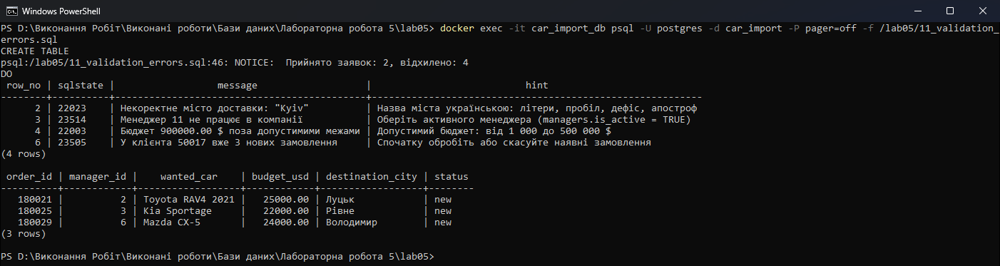

Прийнято 2 заявки з 6. Відхилені мають різні коди: `22023` (некоректне місто), `23514` (звільнений менеджер), `22003` (бюджет), `23505` (у клієнта вже 3 нових замовлення, бо дві попередні заявки пакета пройшли).

#### Крок 3. Система логування змін audit_log

Тригер рівня 1 замінено універсальною функцією `fn_audit_changes()`, яку підключено до п'яти основних таблиць. Назва ключового стовпця передається аргументом тригера (`TG_ARGV[0]`). Функція:

- записує `INSERT`, `UPDATE` і `DELETE`, для `UPDATE` зберігає старі й нові значення та список змінених стовпців;
- не логує `UPDATE` без фактичних змін. Службове поле `updated_at` при цьому не враховується, бо його змінює тригер ЛР4 при кожному оновленні;
- зберігає `SESSION_USER` (хто підключився до СУБД), логін користувача вебзастосунку ЛР4 з налаштування `app.username`, адресу клієнта, назву програми, номер транзакції та глибину вкладеності тригерів;
- має атрибут `SECURITY DEFINER`, тому записує в журнал навіть тоді, коли користувач не має прав на `audit_log` (рівень 3). Через це використано саме `SESSION_USER`: `CURRENT_USER` усередині такої функції дорівнює власнику функції.

```sql
-- =====================================================================
-- 12_audit_full.sql: повноцінна система логування змін (рівень 2)
-- Одна універсальна тригерна функція для всіх основних таблиць.
-- TG_ARGV[0] - назва стовпця з ідентифікатором запису.
-- =====================================================================

-- Тригер рівня 1 замінюється універсальним, інакше зміни clients
-- записувалися б двічі
DROP TRIGGER trg_clients_log ON clients;
DROP FUNCTION fn_log_client_changes();

CREATE OR REPLACE FUNCTION fn_audit_changes()
RETURNS TRIGGER
LANGUAGE plpgsql
SECURITY DEFINER                 -- запис у журнал навіть для ролей без прав на audit_log
SET search_path = public, pg_temp
AS $$
DECLARE
    v_old     JSONB;
    v_new     JSONB;
    v_changed TEXT[];
BEGIN
    IF TG_OP IN ('UPDATE', 'DELETE') THEN v_old := to_jsonb(OLD); END IF;
    IF TG_OP IN ('INSERT', 'UPDATE') THEN v_new := to_jsonb(NEW); END IF;

    IF TG_OP = 'UPDATE' THEN
        -- список стовпців, значення яких реально змінилося;
        -- службове updated_at (його оновлює тригер ЛР4) не враховується
        SELECT array_agg(n.key ORDER BY n.key) INTO v_changed
        FROM jsonb_each(v_new) AS n
        WHERE n.value IS DISTINCT FROM v_old -> n.key
          AND n.key <> 'updated_at';

        IF v_changed IS NULL THEN       -- UPDATE без змін не логуємо
            RETURN NULL;
        END IF;
    END IF;

    INSERT INTO audit_log (table_name, operation, record_id, old_values, new_values,
                           changed_fields, changed_by, app_user, trigger_depth)
    VALUES (TG_TABLE_NAME, TG_OP,
            (COALESCE(v_new, v_old) ->> TG_ARGV[0])::INTEGER,
            v_old, v_new, v_changed,
            SESSION_USER,                                   -- хто підключився до СУБД
            NULLIF(current_setting('app.username', TRUE), ''),
            pg_trigger_depth());
    RETURN NULL;
END;
$$;

CREATE TRIGGER trg_audit_log_clients   AFTER INSERT OR UPDATE OR DELETE ON clients
    FOR EACH ROW EXECUTE FUNCTION fn_audit_changes('client_id');
CREATE TRIGGER trg_audit_log_orders    AFTER INSERT OR UPDATE OR DELETE ON orders
    FOR EACH ROW EXECUTE FUNCTION fn_audit_changes('order_id');
CREATE TRIGGER trg_audit_log_payments  AFTER INSERT OR UPDATE OR DELETE ON payments
    FOR EACH ROW EXECUTE FUNCTION fn_audit_changes('payment_id');
CREATE TRIGGER trg_audit_log_cars      AFTER INSERT OR UPDATE OR DELETE ON cars
    FOR EACH ROW EXECUTE FUNCTION fn_audit_changes('car_id');
CREATE TRIGGER trg_audit_log_shipments AFTER INSERT OR UPDATE OR DELETE ON shipments
    FOR EACH ROW EXECUTE FUNCTION fn_audit_changes('shipment_id');

-- Зручний перегляд: для UPDATE лише змінені поля у вигляді "старе -> нове"
CREATE VIEW v_audit_changes AS
SELECT a.log_id,
       to_char(a.changed_at, 'YYYY-MM-DD HH24:MI:SS') AS changed_at,
       a.changed_by,
       a.app_user,
       a.trigger_depth,
       a.operation,
       a.table_name,
       a.record_id,
       CASE a.operation
           WHEN 'UPDATE' THEN (SELECT string_agg(f || ': ' || COALESCE(a.old_values ->> f, 'NULL')
                                                 || ' -> ' || COALESCE(a.new_values ->> f, 'NULL'), '; ')
                               FROM unnest(a.changed_fields) AS f)
           WHEN 'INSERT' THEN 'новий запис'
           ELSE 'видалено запис'
       END AS changes
FROM audit_log a;
```

Перевірка всіх типів операцій:

```sql
-- Перевірка всіх типів операцій
SELECT COALESCE(MAX(log_id), 0) AS last_log FROM audit_log \gset
\set order_id '(SELECT MIN(order_id) FROM orders WHERE client_id = (SELECT client_id FROM clients WHERE email = ''vira.labenko@ukr.net''))'

INSERT INTO payments (order_id, amount_usd, method, purpose)
VALUES (:order_id, 1000, 'card', 'deposit');

-- зміна через сеанс вебзастосунку ЛР4: застосунок передає логін у app.username
BEGIN;
SELECT set_config('app.username', 'mazurets', TRUE);
UPDATE orders SET budget_usd = 27000, wanted_car = 'Toyota RAV4 2022' WHERE order_id = :order_id;
COMMIT;

UPDATE orders SET budget_usd = 27000 WHERE order_id = :order_id;    -- без змін: не логується

UPDATE payments SET method = 'bank_transfer'
WHERE order_id = :order_id AND purpose = 'deposit';

DELETE FROM payments WHERE order_id = :order_id AND purpose = 'deposit';

SELECT log_id, changed_by, app_user, operation, table_name, record_id, changes
FROM v_audit_changes
WHERE log_id > :last_log
ORDER BY log_id;

-- Повні старі та нові значення для UPDATE
SELECT log_id, changed_fields, old_values ->> 'budget_usd' AS old_budget,
       new_values ->> 'budget_usd' AS new_budget, txid, application_name
FROM audit_log
WHERE table_name = 'orders' AND operation = 'UPDATE'
ORDER BY log_id DESC LIMIT 1;

SELECT table_name, operation, COUNT(*) AS records
FROM audit_log
GROUP BY table_name, operation
ORDER BY table_name, operation;
```

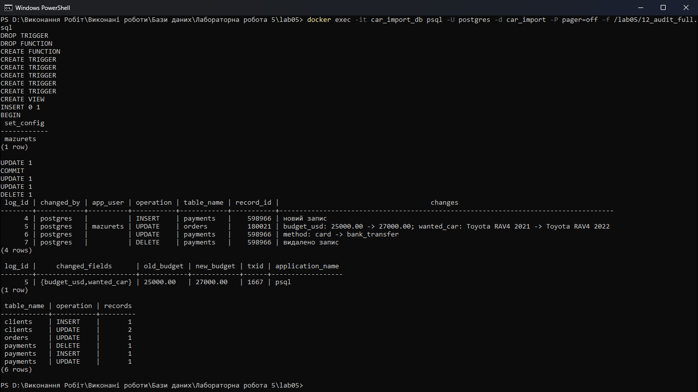

У журналі є вставка, оновлення і видалення платежу та оновлення замовлення. Для оновлення замовлення видно користувача вебзастосунку `mazurets` і зміни у вигляді «старе → нове» лише по двох змінених стовпцях. Повторний `UPDATE` з тими самими значеннями в журнал не потрапив: в `orders` один запис `UPDATE`, хоча оновлень було два.

#### Крок 4. Часткові індекси

**Черга нових замовлень.** Менеджер бере в роботу найстаріші нові заявки. Нових замовлень 8 003 з 180 тис. (4,4 %).

```sql
-- =====================================================================
-- 13_partial_indexes.sql: часткові індекси для запитів з умовою WHERE
-- =====================================================================

-- ---------------------------------------------------------------------
-- 1. Черга нових замовлень: менеджер бере в роботу найстаріші заявки.
--    Нових замовлень близько 4 % від усіх.
-- ---------------------------------------------------------------------
SELECT status, COUNT(*), ROUND(100.0 * COUNT(*) / SUM(COUNT(*)) OVER (), 1) AS pct
FROM orders GROUP BY status ORDER BY 2 DESC;

\set q_queue 'SELECT order_id, order_date, client_id, wanted_car FROM orders WHERE status = ''new'' ORDER BY order_date, order_id LIMIT 20'

-- а) без спеціального індексу (є лише idx_orders_status з ЛР4)
EXPLAIN (ANALYZE, COSTS OFF) :q_queue;

-- б) повний складений індекс (для порівняння)
CREATE INDEX idx_orders_status_date_full ON orders (status, order_date, order_id);
EXPLAIN (ANALYZE, COSTS OFF) :q_queue;

-- в) частковий індекс: лише рядки зі status = 'new'
DROP INDEX idx_orders_status_date_full;
CREATE INDEX idx_orders_new_queue ON orders (order_date, order_id) WHERE status = 'new';
EXPLAIN (ANALYZE, COSTS OFF) :q_queue;
```

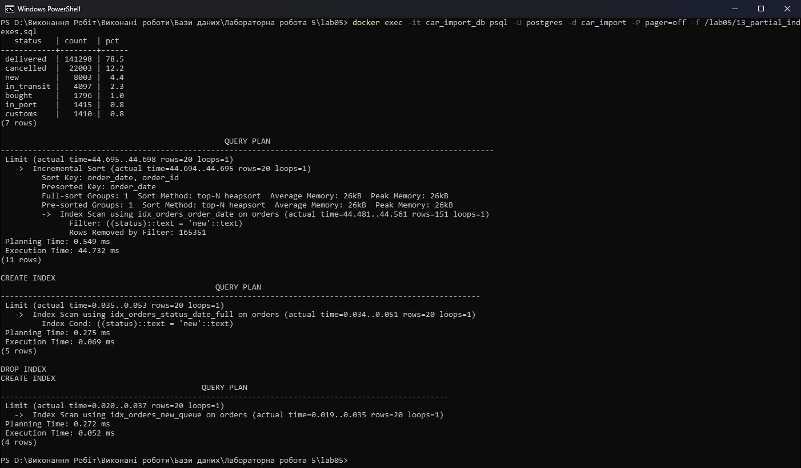

**Контейнери в дорозі.** Умова `arrival_date IS NULL` (4 097 рядків, 2,8 %) використовується в представленні `v_shipments_in_transit` з ЛР4.

```sql
-- =====================================================================
-- 13_partial_indexes_2.sql: другий частковий індекс і аналіз ефективності
-- ---------------------------------------------------------------------
-- 2. Контейнери в дорозі (arrival_date IS NULL): з цією умовою працює
--    представлення v_shipments_in_transit з ЛР4. Таких рядків близько 3 %.
-- =====================================================================

\set q_transit 'SELECT shipment_id, order_id, container_number, departure_date FROM shipments WHERE arrival_date IS NULL ORDER BY departure_date LIMIT 10'

EXPLAIN (ANALYZE, COSTS OFF) :q_transit;

CREATE INDEX idx_shipments_in_transit ON shipments (departure_date) WHERE arrival_date IS NULL;

EXPLAIN (ANALYZE, COSTS OFF) :q_transit;

-- Запит з іншою умовою частковий індекс використати не може
EXPLAIN (COSTS OFF)
SELECT shipment_id FROM shipments WHERE arrival_date = DATE '2026-10-15' ORDER BY departure_date;

-- Порівняння розмірів: частковий індекс проти повного аналога
CREATE INDEX tmp_full_shipments ON shipments (departure_date);
CREATE INDEX tmp_full_orders    ON orders (order_date, order_id);

SELECT i.relname                              AS index_name,
       CASE WHEN x.indpred IS NULL THEN 'повний' ELSE 'частковий' END AS kind,
       pg_get_expr(x.indpred, x.indrelid)     AS condition,
       c.reltuples::bigint                    AS entries,
       pg_size_pretty(pg_relation_size(i.oid)) AS size
FROM pg_index x
JOIN pg_class i ON i.oid = x.indexrelid
JOIN pg_class c ON c.oid = x.indexrelid
WHERE i.relname IN ('idx_orders_new_queue', 'tmp_full_orders',
                    'idx_shipments_in_transit', 'tmp_full_shipments')
ORDER BY x.indrelid, kind;

DROP INDEX tmp_full_shipments;
DROP INDEX tmp_full_orders;
```

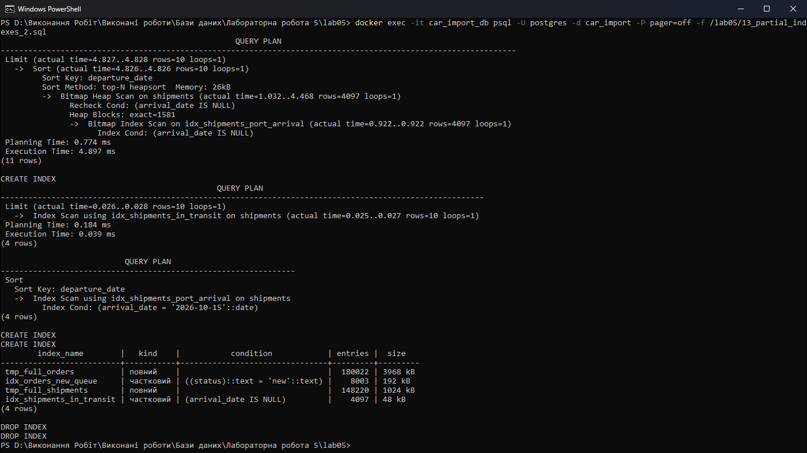

Аналіз ефективності:

| Запит | Без індексу | Повний індекс | Частковий індекс | Розмір повного | Розмір часткового |
|---|---|---|---|---|---|
| 20 найстаріших нових замовлень | 44,7 мс (`Index Scan idx_orders_order_date`, відкинуто 165 351 рядок) | 0,069 мс | **0,052 мс** | 3 968 kB | **192 kB** |
| 10 контейнерів у дорозі | 4,9 мс (`Bitmap Heap Scan` + сортування 4 097 рядків) | — | **0,039 мс** | 1 024 kB | **48 kB** |

- Частковий індекс у 20 разів менший за повний аналог, бо містить лише рядки, що задовольняють умову.
- Рядки в ньому вже впорядковані за датою, тому `LIMIT` зупиняє `Index Scan` після 20 рядків без сортування.
- Умова запиту не потрапляє в `Index Cond`: план просто сканує індекс, бо всі його рядки вже задовольняють `WHERE`.
- Частковий індекс використовується лише тоді, коли умова запиту з нього випливає. Запит з `arrival_date = '2026-10-15'` пішов через інший індекс.
- Рядки, що не задовольняють умову (141 тис. доставлених і 22 тис. скасованих замовлень), до індексу не потрапляють, тому його дешевше підтримувати і він повністю вміщується в кеш.
- Умова індексу може містити лише незмінні (`IMMUTABLE`) вирази, тому «замовлення за останні 30 днів» (`CURRENT_DATE`) так проіндексувати не можна.

#### Крок 5. Резервне копіювання та відновлення

Створено три копії:

- повна копія у форматі `custom` зі стисненням `-Z 9`, яка дозволяє вибіркове і паралельне відновлення;
- схема бази без даних у форматі SQL;
- ролі кластера (`pg_dumpall --roles-only`). `pg_dump` копіює лише одну базу, а ролі глобальні.

```bash
docker exec car_import_db pg_dump -U postgres -d car_import -F c -Z 9 -f /tmp/car_import_lab05.dump
docker exec car_import_db pg_dump -U postgres -d car_import --schema-only -f /tmp/car_import_schema.sql
docker exec car_import_db pg_dumpall -U postgres --roles-only -f /tmp/roles.sql
docker cp car_import_db:/tmp/car_import_lab05.dump backups\
```

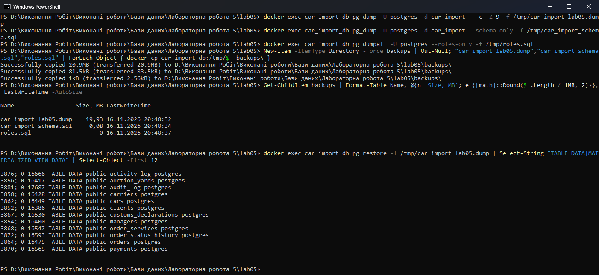

Копія займає 19,9 МБ при розмірі бази 233 МБ. Індекси в копію не потрапляють (лише команди їх створення), а дані добре стискаються. `pg_restore -l` показує вміст архіву.

Відновлення виконано в нову базу в 4 паралельні потоки. Щоб перевірити, що дані відновлено повністю, скрипт [`14_checksums.sql`](sql/14_checksums.sql) рахує кількість рядків і md5 від усіх рядків трьох найбільших таблиць, упорядкованих за ключем, а також кількість об'єктів бази:

```bash
docker exec car_import_db createdb -U postgres car_import_lab5_restore
docker exec car_import_db pg_restore -U postgres -d car_import_lab5_restore -j 4 --exit-on-error /tmp/car_import_lab05.dump
```

```sql
-- =====================================================================
-- 14_checksums.sql: контроль відновлення з резервної копії.
-- Виконується в оригінальній і відновленій базі; результати мають збігтися.
-- Контрольна сума таблиці - md5 від усіх рядків, упорядкованих за ключем.
-- =====================================================================
SELECT current_database()                                  AS database,
       (SELECT COUNT(*) FROM clients)                      AS clients,
       (SELECT COUNT(*) FROM orders)                       AS orders,
       (SELECT COUNT(*) FROM payments)                     AS payments,
       (SELECT COUNT(*) FROM audit_log)                    AS audit_log,
       (SELECT left(md5(string_agg(t::text, '|' ORDER BY client_id)), 10)  FROM clients t)  AS clients_md5,
       (SELECT left(md5(string_agg(t::text, '|' ORDER BY order_id)), 10)   FROM orders t)   AS orders_md5,
       (SELECT left(md5(string_agg(t::text, '|' ORDER BY payment_id)), 10) FROM payments t) AS payments_md5;

SELECT current_database() AS database,
       (SELECT COUNT(*) FROM pg_tables   WHERE schemaname = 'public') AS tables,
       (SELECT COUNT(*) FROM pg_views    WHERE schemaname = 'public') AS views,
       (SELECT COUNT(*) FROM pg_indexes  WHERE schemaname = 'public') AS indexes,
       (SELECT COUNT(*) FROM pg_trigger t JOIN pg_class c ON c.oid = t.tgrelid
         JOIN pg_namespace n ON n.oid = c.relnamespace
         WHERE n.nspname = 'public' AND NOT t.tgisinternal)            AS triggers,
       (SELECT COUNT(*) FROM pg_rules    WHERE schemaname = 'public') AS rules,
       (SELECT COUNT(*) FROM pg_proc p JOIN pg_namespace n ON n.oid = p.pronamespace
         WHERE n.nspname = 'public')                                  AS functions,
       pg_size_pretty(pg_database_size(current_database()))           AS size;
```

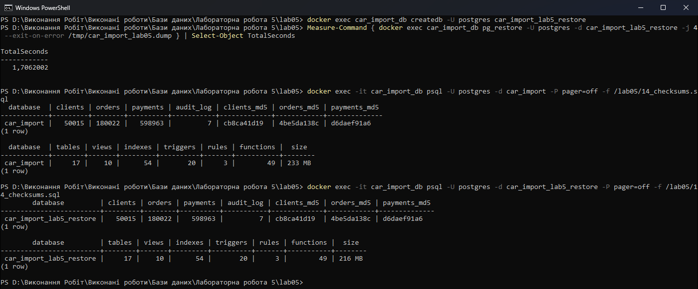

Відновлення зайняло 1,7 с. Кількість рядків, контрольні суми `clients`, `orders` і `payments`, кількість таблиць, представлень, індексів, тригерів, правил і функцій збігаються. Відновлена база менша (216 МБ проти 233 МБ), бо в ній немає мертвих рядків і порожнього місця в індексах після масових змін.

### Рівень 3. Творче розширення

#### Крок 1. Матеріалізоване представлення з автоматичним оновленням

`mv_monthly_revenue` зберігає місячну виручку компанії за призначенням платежів. Для `REFRESH ... CONCURRENTLY`, який не блокує читання під час оновлення, потрібен унікальний індекс.

Для автоматичного оновлення можна було б просто оновлювати представлення після кожного оператора (`FOR EACH STATEMENT`), як у методичці. Але тоді транзакція з трьома `INSERT` оновила б його тричі. Тому використано **відкладений тригер обмеження** (`DEFERRABLE INITIALLY DEFERRED`): він спрацьовує в момент `COMMIT`. Номер транзакції, для якої представлення вже оновлено, зберігається в налаштуванні сеансу `lab5.mv_revenue_txid`, тому представлення оновлюється один раз на транзакцію незалежно від кількості змінених рядків. Тривалість кожного оновлення записується в `mv_refresh_log`.

```sql
-- =====================================================================
-- 15_materialized_view.sql: матеріалізоване представлення з агрегатами
-- і автоматичним оновленням через тригери (рівень 3)
-- =====================================================================

-- Щомісячна виручка компанії за призначенням платежів
CREATE MATERIALIZED VIEW mv_monthly_revenue AS
SELECT date_trunc('month', p.payment_date)::date                 AS month,
       COUNT(*)                                                  AS payments,
       COUNT(DISTINCT p.order_id)                                AS orders,
       SUM(p.amount_usd)                                         AS revenue_usd,
       SUM(p.amount_usd) FILTER (WHERE p.purpose = 'car')        AS cars_usd,
       SUM(p.amount_usd) FILTER (WHERE p.purpose = 'shipping')   AS shipping_usd,
       SUM(p.amount_usd) FILTER (WHERE p.purpose = 'customs')    AS customs_usd,
       SUM(p.amount_usd) FILTER (WHERE p.purpose IN ('deposit', 'services')) AS other_usd,
       ROUND(AVG(p.amount_usd), 2)                               AS avg_payment_usd
FROM payments p
GROUP BY 1;

-- Унікальний індекс обов'язковий для REFRESH ... CONCURRENTLY
CREATE UNIQUE INDEX ux_mv_monthly_revenue_month ON mv_monthly_revenue (month);

-- Порівняння швидкості: агрегування 600 тис. платежів проти готового результату
\timing on
SELECT month, payments, revenue_usd FROM (
    SELECT date_trunc('month', payment_date)::date AS month, COUNT(*) AS payments,
           SUM(amount_usd) AS revenue_usd
    FROM payments GROUP BY 1) t
WHERE month >= DATE '2026-08-01' ORDER BY month;

SELECT month, payments, revenue_usd FROM mv_monthly_revenue
WHERE month >= DATE '2026-08-01' ORDER BY month;
\timing off

-- ---------------------------------------------------------------------
-- Автоматичне оновлення.
-- Оновлення після кожного рядка надто дороге, а після кожного оператора
-- повторюється, якщо в транзакції кілька операторів. Тому використано
-- відкладений тригер обмеження (DEFERRABLE INITIALLY DEFERRED): він
-- спрацьовує під час COMMIT, а прапорець у налаштуваннях транзакції
-- гарантує одне оновлення на транзакцію.
-- ---------------------------------------------------------------------
CREATE TABLE mv_refresh_log (
    refresh_id    SERIAL PRIMARY KEY,
    view_name     TEXT        NOT NULL,
    txid          BIGINT      NOT NULL,
    duration_ms   NUMERIC(10,2) NOT NULL,
    refreshed_at  TIMESTAMPTZ NOT NULL DEFAULT clock_timestamp()
);

CREATE OR REPLACE FUNCTION fn_refresh_monthly_revenue()
RETURNS TRIGGER
LANGUAGE plpgsql
SECURITY DEFINER
SET search_path = public, pg_temp
AS $$
DECLARE
    v_start TIMESTAMPTZ := clock_timestamp();
BEGIN
    IF current_setting('lab5.mv_revenue_txid', TRUE) IS DISTINCT FROM txid_current()::TEXT THEN
        PERFORM set_config('lab5.mv_revenue_txid', txid_current()::TEXT, TRUE);
        REFRESH MATERIALIZED VIEW CONCURRENTLY mv_monthly_revenue;
        INSERT INTO mv_refresh_log (view_name, txid, duration_ms)
        VALUES ('mv_monthly_revenue', txid_current(),
                EXTRACT(EPOCH FROM clock_timestamp() - v_start) * 1000);
    END IF;
    RETURN NULL;
END;
$$;

CREATE CONSTRAINT TRIGGER trg_payments_refresh_mv
AFTER INSERT OR UPDATE OR DELETE ON payments
DEFERRABLE INITIALLY DEFERRED
FOR EACH ROW
EXECUTE FUNCTION fn_refresh_monthly_revenue();

-- Перевірка: три платежі в одній транзакції -> одне оновлення
SELECT month, payments, revenue_usd, other_usd FROM mv_monthly_revenue WHERE month = date_trunc('month', CURRENT_DATE)::date;

BEGIN;
INSERT INTO payments (order_id, amount_usd, method, purpose)
SELECT order_id, 1000, 'card', 'deposit' FROM orders
WHERE status = 'new' ORDER BY order_id DESC LIMIT 3;
SELECT month, payments, revenue_usd FROM mv_monthly_revenue WHERE month = date_trunc('month', CURRENT_DATE)::date;
COMMIT;

SELECT month, payments, revenue_usd, other_usd FROM mv_monthly_revenue WHERE month = date_trunc('month', CURRENT_DATE)::date;

-- Видалення теж оновлює представлення
DELETE FROM payments WHERE payment_id = (SELECT MAX(payment_id) FROM payments);
SELECT month, payments, revenue_usd FROM mv_monthly_revenue WHERE month = date_trunc('month', CURRENT_DATE)::date;

SELECT refresh_id, view_name, txid, duration_ms, to_char(refreshed_at, 'HH24:MI:SS') AS at
FROM mv_refresh_log ORDER BY refresh_id;
```

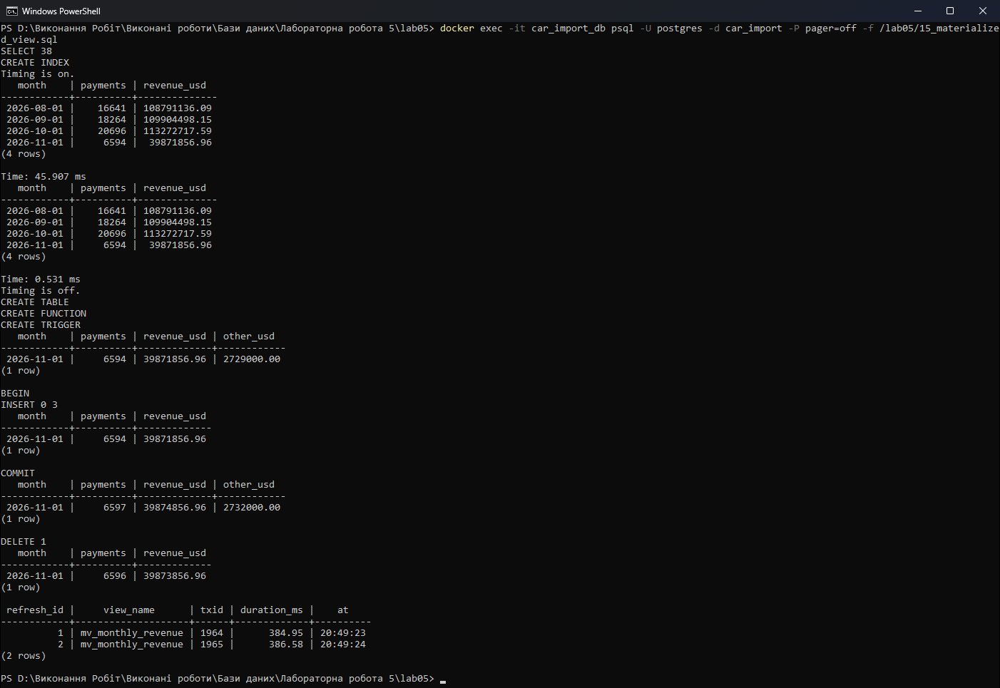

Результат:

- агрегування 600 тис. платежів займає 45,9 мс, читання готового результату 0,53 мс (у 86 разів швидше);
- три платежі в одній транзакції: до `COMMIT` представлення ще показує 6 594 платежі, після `COMMIT` 6 597. У журналі одне оновлення для транзакції 1964;
- видалення платежу теж оновлює представлення (6 596).

Ціна: одне оновлення займає близько 385 мс, і стільки ж додається до кожної транзакції, що змінює платежі. Для бази з частими платежами краще оновлювати представлення за розкладом. Процедура обслуговування (крок 4) теж оновлює всі матеріалізовані представлення.

#### Крок 2. Каскадні тригери для бізнес-логіки

Реалізовано ланцюжок тригерів, у якому одна вставка платежу послідовно змінює ще три таблиці:

```
payments --(1)--> orders.paid_usd --(2)--> clients.total_paid_usd
     --(3)--> clients.loyalty_level --(4)--> client_notifications
```

1. `trg_payments_cascade` після `INSERT`, `UPDATE` або `DELETE` платежу змінює суму оплат замовлення на різницю, без повного перерахунку.
2. `trg_orders_cascade` при зміні `paid_usd` змінює загальну суму оплат клієнта.
3. `trg_clients_loyalty` (`BEFORE`) перераховує рівень лояльності: від 50 000 $ `silver`, від 150 000 $ `gold`.
4. `trg_clients_notify` при зміні рівня створює повідомлення клієнту.

Окремий тригер `trg_orders_check_delivery` реалізує бізнес-правило: авто не можна видати клієнту (`status = 'delivered'`), доки замовлення не оплачене повністю. Залишок береться з представлення `v_order_finance` ЛР4.

```sql
-- =====================================================================
-- 16_cascade_triggers.sql: каскадні тригери бізнес-логіки (рівень 3)
--
--   payments --(1)--> orders.paid_usd --(2)--> clients.total_paid_usd
--        --(3)--> clients.loyalty_level --(4)--> client_notifications
--
--   + правило: авто видається клієнту (status = 'delivered') лише після
--     повної оплати замовлення
-- =====================================================================

-- Нові поля і таблиця повідомлень
ALTER TABLE orders  ADD COLUMN paid_usd NUMERIC(12,2) NOT NULL DEFAULT 0;
ALTER TABLE clients ADD COLUMN total_paid_usd NUMERIC(14,2) NOT NULL DEFAULT 0,
                    ADD COLUMN loyalty_level  VARCHAR(10)   NOT NULL DEFAULT 'standard'
                        CHECK (loyalty_level IN ('standard', 'silver', 'gold'));

CREATE TABLE client_notifications (
    notification_id  SERIAL PRIMARY KEY,
    client_id        INTEGER NOT NULL REFERENCES clients(client_id) ON DELETE CASCADE,
    message          TEXT    NOT NULL,
    created_at       TIMESTAMPTZ NOT NULL DEFAULT clock_timestamp()
);

-- Рівень лояльності за сумою всіх оплат клієнта
CREATE OR REPLACE FUNCTION loyalty_level_for(p_total NUMERIC)
RETURNS VARCHAR LANGUAGE sql IMMUTABLE AS $$
    SELECT CASE WHEN p_total >= 150000 THEN 'gold'
                WHEN p_total >=  50000 THEN 'silver'
                ELSE 'standard' END;
$$;

-- Початкове заповнення нових полів (тригери вимкнено, щоб не було каскаду
-- і записів у журнали для 180 тис. рядків)
SET session_replication_role = replica;
UPDATE orders o SET paid_usd = p.total
FROM (SELECT order_id, SUM(amount_usd) AS total FROM payments GROUP BY order_id) p
WHERE p.order_id = o.order_id;
UPDATE clients c SET total_paid_usd = x.total, loyalty_level = loyalty_level_for(x.total)
FROM (SELECT client_id, SUM(paid_usd) AS total FROM orders GROUP BY client_id) x
WHERE x.client_id = c.client_id;
SET session_replication_role = origin;
VACUUM ANALYZE orders;
VACUUM ANALYZE clients;

-- (1) payments -> orders: сума оплат замовлення змінюється на різницю
CREATE OR REPLACE FUNCTION fn_cascade_payment_to_order()
RETURNS TRIGGER LANGUAGE plpgsql SECURITY DEFINER SET search_path = public, pg_temp AS $$
BEGIN
    IF TG_OP IN ('UPDATE', 'DELETE') THEN
        UPDATE orders SET paid_usd = paid_usd - OLD.amount_usd WHERE order_id = OLD.order_id;
    END IF;
    IF TG_OP IN ('INSERT', 'UPDATE') THEN
        UPDATE orders SET paid_usd = paid_usd + NEW.amount_usd WHERE order_id = NEW.order_id;
    END IF;
    RETURN NULL;
END;
$$;

CREATE TRIGGER trg_payments_cascade
AFTER INSERT OR DELETE OR UPDATE OF amount_usd, order_id ON payments
FOR EACH ROW EXECUTE FUNCTION fn_cascade_payment_to_order();

-- (2) orders -> clients: загальна сума оплат клієнта
CREATE OR REPLACE FUNCTION fn_cascade_order_to_client()
RETURNS TRIGGER LANGUAGE plpgsql SECURITY DEFINER SET search_path = public, pg_temp AS $$
BEGIN
    UPDATE clients
       SET total_paid_usd = total_paid_usd + (NEW.paid_usd - OLD.paid_usd)
     WHERE client_id = NEW.client_id;
    RETURN NULL;
END;
$$;

CREATE TRIGGER trg_orders_cascade
AFTER UPDATE OF paid_usd ON orders
FOR EACH ROW
WHEN (NEW.paid_usd IS DISTINCT FROM OLD.paid_usd)
EXECUTE FUNCTION fn_cascade_order_to_client();

-- (3) clients: перерахунок рівня лояльності перед збереженням
CREATE OR REPLACE FUNCTION fn_client_loyalty()
RETURNS TRIGGER LANGUAGE plpgsql AS $$
BEGIN
    NEW.loyalty_level := loyalty_level_for(NEW.total_paid_usd);
    RETURN NEW;
END;
$$;

CREATE TRIGGER trg_clients_loyalty
BEFORE UPDATE OF total_paid_usd ON clients
FOR EACH ROW EXECUTE FUNCTION fn_client_loyalty();

-- (4) clients -> client_notifications: повідомлення про новий рівень
CREATE OR REPLACE FUNCTION fn_client_notify_level()
RETURNS TRIGGER LANGUAGE plpgsql SECURITY DEFINER SET search_path = public, pg_temp AS $$
BEGIN
    INSERT INTO client_notifications (client_id, message)
    VALUES (NEW.client_id,
            format('%s %s, ваш рівень змінено: %s -> %s. Сума оплат: %s $',
                   NEW.first_name, NEW.last_name, OLD.loyalty_level, NEW.loyalty_level,
                   NEW.total_paid_usd));
    RETURN NULL;
END;
$$;

-- Увага: тригер UPDATE OF loyalty_level тут не спрацював би, бо стовпець
-- змінює BEFORE-тригер, а не список SET оператора UPDATE
CREATE TRIGGER trg_clients_notify
AFTER UPDATE OF total_paid_usd ON clients
FOR EACH ROW
WHEN (NEW.loyalty_level IS DISTINCT FROM OLD.loyalty_level)
EXECUTE FUNCTION fn_client_notify_level();

-- Бізнес-правило: видача авто лише після повної оплати
CREATE OR REPLACE FUNCTION fn_check_delivery_paid()
RETURNS TRIGGER LANGUAGE plpgsql AS $$
DECLARE
    v_balance NUMERIC;
BEGIN
    SELECT balance_usd INTO v_balance FROM v_order_finance WHERE order_id = NEW.order_id;
    IF v_balance > 0 THEN
        RAISE EXCEPTION 'Замовлення % не можна видати: заборгованість % $', NEW.order_id, v_balance
            USING ERRCODE = 'check_violation',
                  HINT = 'Спочатку клієнт має сплатити повну вартість';
    END IF;
    RETURN NEW;
END;
$$;

CREATE TRIGGER trg_orders_check_delivery
BEFORE UPDATE OF status ON orders
FOR EACH ROW
WHEN (NEW.status = 'delivered' AND OLD.status IS DISTINCT FROM 'delivered')
EXECUTE FUNCTION fn_check_delivery_paid();

SELECT loyalty_level, COUNT(*) AS clients, MIN(total_paid_usd), MAX(total_paid_usd)
FROM clients GROUP BY loyalty_level ORDER BY 3;
```

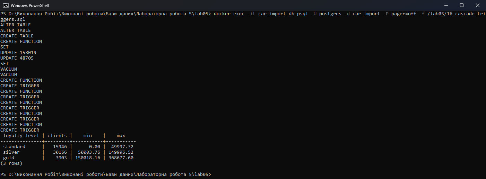

Нові поля для наявних 180 тис. замовлень і 50 тис. клієнтів заповнено одним `UPDATE` з вимкненими тригерами. Інакше кожен рядок запустив би каскад і записи в журнали.

**Перевірка каскаду.** Скрипт сам знаходить замовлення на розмитненні, після оплати якого клієнт переходить з `silver` на `gold`:

```sql
-- =====================================================================
-- 16_cascade_test.sql: перевірка каскаду на реальному замовленні.
-- Обирається замовлення на розмитненні, після оплати якого клієнт
-- переходить з рівня silver на gold.
-- =====================================================================
SELECT o.order_id, o.client_id
FROM orders o
JOIN clients c         ON c.client_id = o.client_id
JOIN v_order_finance f ON f.order_id  = o.order_id
WHERE o.status = 'customs' AND c.loyalty_level = 'silver'
  AND c.total_paid_usd + f.balance_usd >= 150000
ORDER BY o.order_id
LIMIT 1 \gset

SELECT COALESCE(MAX(log_id), 0) AS last_log FROM audit_log \gset

-- Стан до оплати
SELECT o.order_id, o.status, o.paid_usd, f.total_cost_usd, f.balance_usd,
       c.client_id, c.total_paid_usd, c.loyalty_level
FROM orders o JOIN clients c USING (client_id) JOIN v_order_finance f USING (order_id)
WHERE o.order_id = :order_id;

-- Спроба видати авто з боргом
UPDATE orders SET status = 'delivered' WHERE order_id = :order_id;

-- Клієнт сплачує залишок: один INSERT запускає весь ланцюжок
INSERT INTO payments (order_id, amount_usd, method, purpose)
SELECT :order_id, balance_usd, 'bank_transfer', 'services'
FROM v_order_finance WHERE order_id = :order_id
RETURNING payment_id, order_id, amount_usd;

-- Стан після оплати
SELECT o.order_id, o.status, o.paid_usd, f.total_cost_usd, f.balance_usd,
       c.client_id, c.total_paid_usd, c.loyalty_level
FROM orders o JOIN clients c USING (client_id) JOIN v_order_finance f USING (order_id)
WHERE o.order_id = :order_id;

SELECT notification_id, client_id, message FROM client_notifications ORDER BY notification_id DESC LIMIT 1;

-- Ланцюжок у журналі: глибина вкладеності тригерів
SELECT log_id, trigger_depth AS depth, table_name, operation, record_id, changes
FROM v_audit_changes
WHERE log_id > :last_log
ORDER BY log_id;

-- Тепер видача дозволена
UPDATE orders SET status = 'delivered' WHERE order_id = :order_id;

-- Видалення платежу відкочує суми каскадом у зворотному напрямку
BEGIN;
DELETE FROM payments WHERE order_id = :order_id AND purpose = 'services';
SELECT o.paid_usd, c.total_paid_usd, c.loyalty_level
FROM orders o JOIN clients c USING (client_id) WHERE o.order_id = :order_id;
ROLLBACK;

-- Узгодженість агрегатів з первинними даними
SELECT (SELECT COUNT(*) FROM orders o
         WHERE o.paid_usd <> COALESCE((SELECT SUM(amount_usd) FROM payments p WHERE p.order_id = o.order_id), 0))
           AS orders_mismatch,
       (SELECT COUNT(*) FROM clients c
         WHERE c.total_paid_usd <> COALESCE((SELECT SUM(paid_usd) FROM orders o WHERE o.client_id = c.client_id), 0))
           AS clients_mismatch;
```

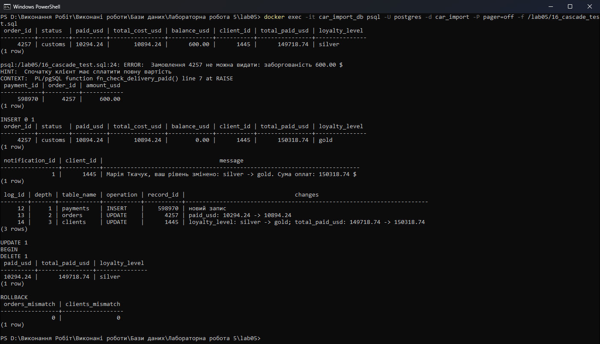

1. Видати авто за замовленням 4257 з боргом 600 $ не вдалося.
2. Клієнт сплатив залишок одним `INSERT` у `payments`. Каскад оновив `orders.paid_usd` (10 294,24 → 10 894,24), `clients.total_paid_usd` (149 718,74 → 150 318,74), рівень клієнта змінився з `silver` на `gold`, і з'явилося повідомлення «Марія Ткачук, ваш рівень змінено: silver -> gold».
3. У журналі `audit_log` видно весь ланцюжок з глибиною вкладеності тригерів: `payments` (1) → `orders` (2) → `clients` (3).
4. Після оплати видача авто пройшла (`UPDATE 1`).
5. Видалення платежу в транзакції відкотило суми в зворотному напрямку, і клієнт повернувся на рівень `silver`. Транзакцію відкочено.
6. Перевірка узгодженості показала 0 розбіжностей між сумами в `orders` і `clients` та фактичними платежами.

Під час розробки тригер повідомлення спочатку був оголошений як `AFTER UPDATE OF loyalty_level` і не спрацьовував. Тригер `UPDATE OF стовпець` реагує лише на стовпці, перелічені в `SET` оператора `UPDATE`, а `loyalty_level` змінює `BEFORE`-тригер. Тому тригер оголошено на `UPDATE OF total_paid_usd` з умовою `WHEN (NEW.loyalty_level IS DISTINCT FROM OLD.loyalty_level)`.

Функції каскаду мають атрибут `SECURITY DEFINER`. Модератор (крок 3) може змінювати лише свої замовлення, але суми мають оновлюватися при будь-якому платежі, тому каскад виконується з правами власника.

#### Крок 3. Ієрархія ролей з детальною системою прав

Створено три групові ролі (`NOLOGIN`). Кожна вища роль є членом нижчої і успадковує її права:

```
car_admin (адміністратор)
  └── car_moderator (модератор = менеджер компанії)
        └── car_reader (звичайний користувач)
```

Додатково до прав на таблиці використано:

- **права на рівні стовпців.** Звичайний користувач не бачить телефони, email, суми оплат і бюджети. Модератор змінює лише контактні дані клієнта, але не суми й рівень лояльності;
- **захист на рівні рядків (RLS) для `orders`.** Усі бачать усі замовлення, але модератор створює і змінює лише замовлення, де він менеджер. Менеджер визначається функцією `current_manager_id()` через таблицю `users` вебзастосунку ЛР4: логін ролі = логін у застосунку;
- **`ALTER DEFAULT PRIVILEGES`**, щоб права адміністратора поширювалися на таблиці, створені пізніше (наприклад, `maintenance_log`);
- **вбудовані ролі PostgreSQL 17** для адміністратора: `pg_maintain` (VACUUM, ANALYZE, REINDEX, REFRESH без прав власника), `pg_monitor` і `pg_stat_scan_tables` (статистика, `pgstattuple`);
- `ADMIN OPTION` для адміністратора на групові ролі. З PostgreSQL 16 атрибута `CREATEROLE` недостатньо, щоб видавати членство в ролях.

Користувачі: `hordiichuk` і `mazurets` (модератори, менеджери 1 і 2), `dba_kondratiuk` (адміністратор), `report_viewer` з рівня 1 переведено на роль `car_reader`, а його прямі права відкликано.

```sql
-- =====================================================================
-- 17_roles.sql: ієрархія ролей з детальною системою прав (рівень 3)
--
--   car_admin      (адміністратор)  - усе, журнали, керування ролями
--      └─ car_moderator (модератор = менеджер) - робота з клієнтами,
--            │                    замовленнями, платежами; змінює лише СВОЇ замовлення
--            └─ car_reader (звичайний користувач) - лише читання без
--                                 персональних і фінансових даних
-- Права успадковуються: кожна вища роль є членом нижчої.
-- =====================================================================

CREATE ROLE car_reader    NOLOGIN;
CREATE ROLE car_moderator NOLOGIN IN ROLE car_reader;
CREATE ROLE car_admin     NOLOGIN IN ROLE car_moderator;

-- ---------------- car_reader ----------------
GRANT CONNECT ON DATABASE :"DBNAME" TO car_reader;
GRANT USAGE   ON SCHEMA public TO car_reader;
GRANT SELECT  ON auction_yards, carriers, services, cars, shipments,
                 v_active_orders, v_client_statistics, v_shipments_in_transit,
                 mv_monthly_revenue
              TO car_reader;
GRANT SELECT (client_id, first_name, last_name, city, created_at, loyalty_level) ON clients TO car_reader;
GRANT SELECT (order_id, client_id, manager_id, car_id, order_date, status, destination_city)
    ON orders TO car_reader;

-- ---------------- car_moderator ----------------
GRANT SELECT ON clients, orders, payments, managers, customs_declarations, order_services,
                order_status_history, client_notifications, v_order_details, v_order_finance
             TO car_moderator;
GRANT INSERT ON clients, orders, cars, shipments, customs_declarations, order_services, payments
             TO car_moderator;
-- змінювати можна лише контактні дані клієнта, але не суми і рівень лояльності
GRANT UPDATE (first_name, last_name, phone, email, city) ON clients TO car_moderator;
GRANT UPDATE ON orders, cars, shipments, customs_declarations TO car_moderator;
GRANT DELETE ON order_services TO car_moderator;              -- платежі не видаляються
GRANT USAGE  ON ALL SEQUENCES IN SCHEMA public TO car_moderator;
-- тригери ЛР4 пишуть журнали з правами користувача: лише вставка, без читання
GRANT INSERT ON activity_log, order_status_history TO car_moderator;

-- ---------------- car_admin ----------------
GRANT ALL PRIVILEGES ON ALL TABLES    IN SCHEMA public TO car_admin;
GRANT ALL PRIVILEGES ON ALL SEQUENCES IN SCHEMA public TO car_admin;
-- таблиці, створені пізніше, теж отримають права
ALTER DEFAULT PRIVILEGES IN SCHEMA public GRANT ALL    ON TABLES TO car_admin;
ALTER DEFAULT PRIVILEGES IN SCHEMA public GRANT ALL    ON SEQUENCES TO car_admin;
ALTER DEFAULT PRIVILEGES IN SCHEMA public GRANT SELECT ON TABLES TO car_moderator;

-- ---------------- Захист на рівні рядків (RLS) для orders ----------------
-- Менеджер визначається через таблицю users вебзастосунку ЛР4 (username -> manager_id)
CREATE OR REPLACE FUNCTION current_manager_id()
RETURNS INTEGER LANGUAGE sql STABLE SECURITY DEFINER SET search_path = public AS $$
    SELECT manager_id FROM users WHERE username = SESSION_USER;
$$;

ALTER TABLE orders ENABLE ROW LEVEL SECURITY;

CREATE POLICY p_orders_read ON orders FOR SELECT TO car_reader USING (TRUE);
CREATE POLICY p_orders_moderator_insert ON orders FOR INSERT TO car_moderator
    WITH CHECK (manager_id = current_manager_id());
CREATE POLICY p_orders_moderator_update ON orders FOR UPDATE TO car_moderator
    USING (manager_id = current_manager_id())
    WITH CHECK (manager_id = current_manager_id());
CREATE POLICY p_orders_admin ON orders FOR ALL TO car_admin USING (TRUE) WITH CHECK (TRUE);

-- ---------------- Користувачі ----------------
CREATE ROLE hordiichuk     LOGIN PASSWORD 'Manager#Lab5-01' IN ROLE car_moderator;
CREATE ROLE mazurets       LOGIN PASSWORD 'Manager#Lab5-02' IN ROLE car_moderator;
CREATE ROLE dba_kondratiuk LOGIN PASSWORD 'Admin#Lab5-2026' CREATEROLE IN ROLE car_admin;
-- з PostgreSQL 16 атрибута CREATEROLE недостатньо: видавати групові ролі
-- можна лише з ADMIN OPTION на них
GRANT car_reader, car_moderator TO dba_kondratiuk WITH ADMIN OPTION;
-- вбудовані ролі PostgreSQL 17: обслуговування (VACUUM, ANALYZE, REINDEX,
-- REFRESH) і перегляд статистики без прав суперкористувача
GRANT pg_maintain, pg_monitor, pg_stat_scan_tables TO car_admin;

-- report_viewer з рівня 1 переводиться на групову роль: прямі права забираються
REVOKE ALL ON ALL TABLES IN SCHEMA public FROM report_viewer;
GRANT car_reader TO report_viewer;

-- Ієрархія ролей
SELECT r.rolname AS role,
       r.rolcanlogin AS login,
       r.rolcreaterole AS createrole,
       ARRAY(SELECT b.rolname FROM pg_auth_members m JOIN pg_roles b ON b.oid = m.roleid
             WHERE m.member = r.oid ORDER BY 1) AS member_of
FROM pg_roles r
WHERE r.rolname IN ('car_reader', 'car_moderator', 'car_admin',
                    'report_viewer', 'hordiichuk', 'mazurets', 'dba_kondratiuk')
ORDER BY r.rolcanlogin, r.rolname;
```

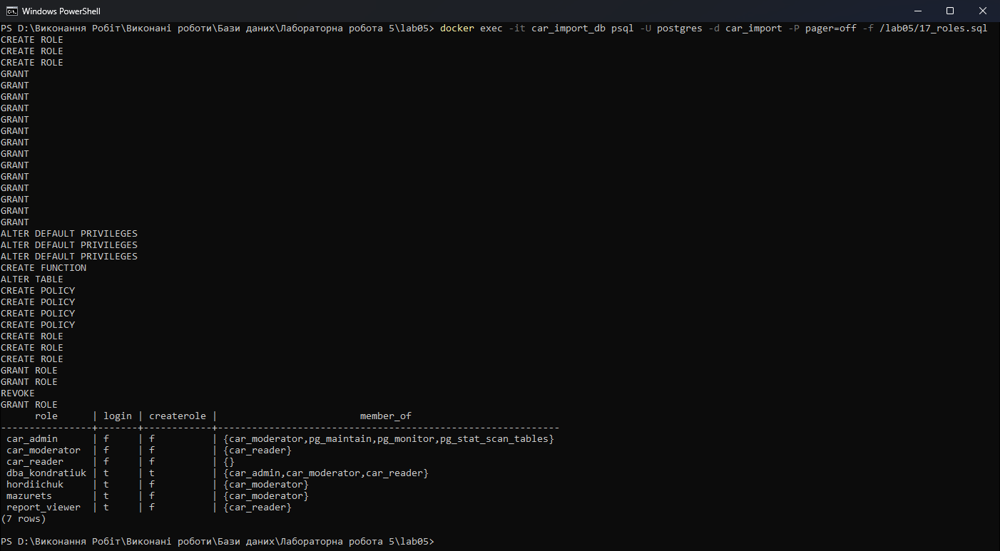

**Матриця прав** (обчислена функціями `has_table_privilege` і `has_any_column_privilege`, виведена через `\crosstabview`):

```sql
-- =====================================================================
-- 17_roles_matrix.sql: матриця прав ролей на таблиці
--   S - SELECT, I - INSERT, U - UPDATE, D - DELETE
--   s, u - право лише на частину стовпців; '-' - доступу немає
-- =====================================================================
SELECT t.table_name,
       r.role,
       CASE WHEN has_table_privilege(r.role, t.table_name, 'SELECT') THEN 'S'
            WHEN has_any_column_privilege(r.role, t.table_name, 'SELECT') THEN 's' ELSE '-' END ||
       CASE WHEN has_table_privilege(r.role, t.table_name, 'INSERT') THEN 'I' ELSE '-' END ||
       CASE WHEN has_table_privilege(r.role, t.table_name, 'UPDATE') THEN 'U'
            WHEN has_any_column_privilege(r.role, t.table_name, 'UPDATE') THEN 'u' ELSE '-' END ||
       CASE WHEN has_table_privilege(r.role, t.table_name, 'DELETE') THEN 'D' ELSE '-' END AS rights
FROM (VALUES ('clients'), ('orders'), ('payments'), ('cars'), ('shipments'), ('order_services'),
             ('managers'), ('audit_log'), ('activity_log'), ('users'), ('v_order_finance'),
             ('mv_monthly_revenue')) AS t(table_name)
CROSS JOIN (VALUES ('car_reader'), ('car_moderator'), ('car_admin')) AS r(role)
\crosstabview table_name role rights

-- Політики захисту на рівні рядків
SELECT policyname, cmd, roles, qual, with_check
FROM pg_policies WHERE tablename = 'orders' ORDER BY policyname;
```

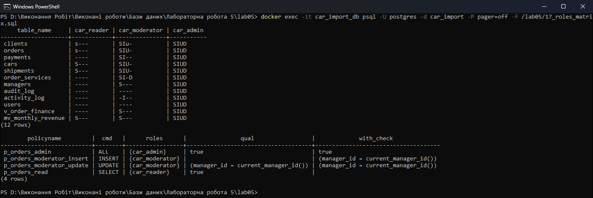

**Документація системи прав:**

| Об'єкт | `car_reader` (користувач) | `car_moderator` (менеджер) | `car_admin` (адміністратор) |
|---|---|---|---|
| `clients` | читання без телефону, email, сум | читання, вставка, зміна лише контактів | усі права |
| `orders` | читання без бюджету й оплат | читання всіх; вставка й зміна **лише своїх** (RLS) | усі права на всі рядки |
| `payments` | немає | читання, вставка (без зміни і видалення) | усі права |
| `cars`, `shipments`, `customs_declarations` | читання `cars`, `shipments` | читання, вставка, зміна | усі права |
| `order_services` | немає | читання, вставка, видалення | усі права |
| `managers`, `v_order_finance`, `v_order_details` | немає | читання | усі права |
| `audit_log`, `users` | немає | немає | усі права |
| `activity_log` (журнал ЛР4) | немає | лише вставка (його пишуть тригери ЛР4 з правами користувача) | усі права |
| `order_status_history` (історія статусів ЛР4) | немає | читання, вставка (вставку робить тригер ЛР4) | усі права |
| `client_notifications` | немає | читання | усі права |
| `v_active_orders`, `v_client_statistics`, `mv_monthly_revenue` | читання | читання | усі права |
| `maintain_database()` | немає | немає | виконання |
| Керування ролями | немає | немає | `CREATEROLE` + `ADMIN OPTION` на групові ролі |
| Конфігурація сервера (`ALTER SYSTEM`) | немає | немає | немає (лише суперкористувач `postgres`) |

**Перевірка модератора** `hordiichuk`:

```sql
-- 17_test_moderator.sql: перевірка прав модератора (виконується під hordiichuk)
SELECT session_user, current_manager_id() AS my_manager_id,
       pg_has_role('car_reader', 'MEMBER') AS is_reader;

-- Бачить усі замовлення (успадковано від car_reader)
SELECT manager_id, COUNT(*) AS orders FROM orders WHERE manager_id IN (1, 2) GROUP BY manager_id;

-- Своє замовлення змінює, чуже - ні (RLS відфільтровує рядок)
UPDATE orders SET wanted_car = 'Toyota Camry 2023'
WHERE order_id = (SELECT MIN(order_id) FROM orders WHERE manager_id = 1 AND status = 'new');
UPDATE orders SET wanted_car = 'Toyota Camry 2023'
WHERE order_id = (SELECT MIN(order_id) FROM orders WHERE manager_id = 2 AND status = 'new');

-- Створити замовлення від імені іншого менеджера не можна
INSERT INTO orders (client_id, manager_id, wanted_car, budget_usd, destination_city)
VALUES (1, 2, 'Kia Sportage', 20000, 'Луцьк');

-- Контакти клієнта змінює, суму оплат - ні
UPDATE clients SET city = 'Ковель' WHERE client_id = 1;
UPDATE clients SET total_paid_usd = 0 WHERE client_id = 1;

-- Платіж додає (з усім каскадом тригерів), видалити не може
INSERT INTO payments (order_id, amount_usd, method, purpose)
SELECT MIN(order_id), 500, 'cash', 'deposit' FROM orders WHERE manager_id = 1 AND status = 'new'
RETURNING payment_id, order_id, amount_usd;
DELETE FROM payments WHERE payment_id = 1;

-- Журнали аудиту й облікові записи недоступні
SELECT COUNT(*) FROM audit_log;
SELECT username, password_hash FROM users LIMIT 1;
```

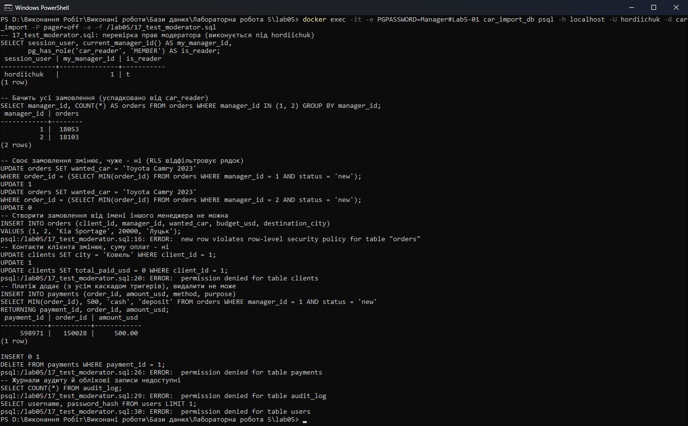

Модератор бачить замовлення обох менеджерів, але своє замовлення змінив (`UPDATE 1`), а чуже ні (`UPDATE 0`). RLS не видає помилку, а просто приховує рядок від `UPDATE`. Створити замовлення від імені іншого менеджера не вдалося (`violates row-level security policy`). Контакти клієнта змінено, суму оплат ні. Платіж додано разом з усім каскадом тригерів, видалити платіж і прочитати `audit_log` чи `users` не можна.

**Перевірка звичайного користувача** `report_viewer`:

```sql
-- 17_test_reader.sql: перевірка звичайного користувача (report_viewer, член car_reader)
SELECT session_user, pg_has_role('car_reader', 'MEMBER') AS is_reader,
       pg_has_role('car_moderator', 'MEMBER') AS is_moderator;
SELECT order_id, status, destination_city FROM orders ORDER BY order_id LIMIT 3;
SELECT month, revenue_usd FROM mv_monthly_revenue ORDER BY month DESC LIMIT 2;
SELECT client_id, last_name, loyalty_level FROM clients WHERE client_id = 1;
SELECT total_paid_usd FROM clients WHERE client_id = 1;
SELECT COUNT(*) FROM payments;
UPDATE cars SET mileage_mi = 0 WHERE car_id = 1;
```

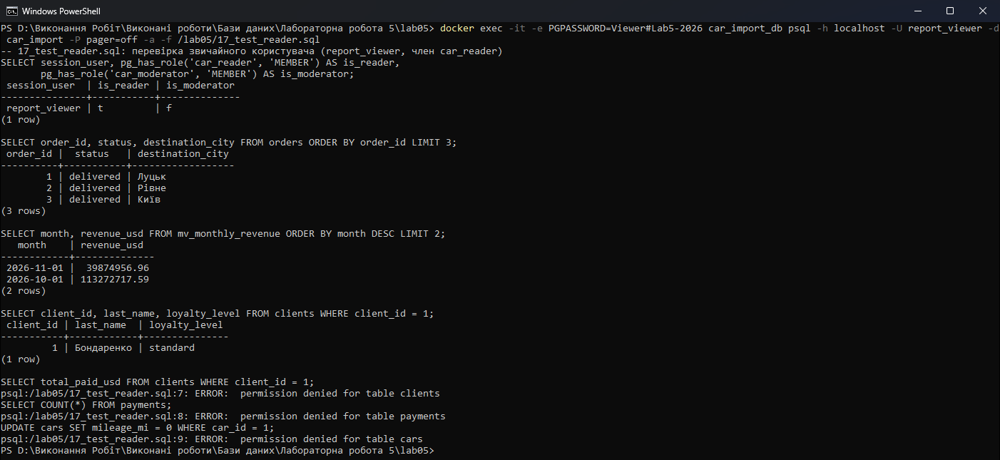

**Перевірка адміністратора** `dba_kondratiuk`:

```sql
-- 17_test_admin.sql: перевірка адміністратора (dba_kondratiuk, член car_admin)
SELECT session_user, pg_has_role('car_moderator', 'MEMBER') AS is_moderator,
       pg_has_role('car_reader', 'MEMBER') AS is_reader;
SELECT COUNT(*) AS audit_records FROM audit_log;
-- адміністратор змінює будь-яке замовлення (політика p_orders_admin)
UPDATE orders SET wanted_car = 'Toyota Camry 2023 (перевірено)'
WHERE order_id = (SELECT MIN(order_id) FROM orders WHERE manager_id = 2 AND status = 'new');
-- може керувати ролями (CREATEROLE)
CREATE ROLE temp_intern LOGIN PASSWORD 'Intern#2026' IN ROLE car_reader;
DROP ROLE temp_intern;
-- але не є суперкористувачем: змінювати конфігурацію сервера не може
ALTER SYSTEM SET work_mem = '64MB';
```

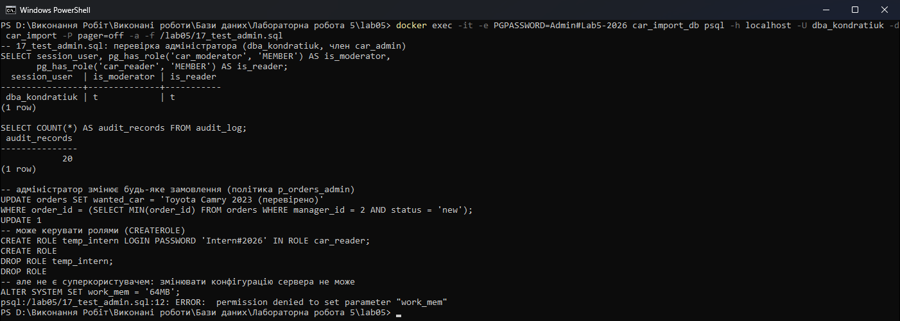

Адміністратор має права модератора і звичайного користувача через ієрархію, читає журнал аудиту, змінює чуже замовлення (політика `p_orders_admin`), створює і видаляє ролі. Але він не суперкористувач, тому змінити конфігурацію сервера не може.

#### Крок 4. Збережена процедура для автоматизованого обслуговування

Процедура `maintain_database()` не виконує все підряд, а аналізує стан бази і обслуговує лише те, що потребує уваги:

1. `ANALYZE` лише для таблиць, де з останнього аналізу змінилося понад 5 % рядків (`pg_stat_user_tables.n_mod_since_analyze`).
2. `REINDEX` лише для B-tree індексів, у яких щільність заповнення листкових сторінок нижча за 70 %. Щільність вимірюється функцією `pgstatindex` з розширення `pgstattuple`. Індекси менші за 1 МБ не перевіряються.
3. `REFRESH MATERIALIZED VIEW CONCURRENTLY` для всіх матеріалізованих представлень.
4. Кожна дія з тривалістю записується в `maintenance_log`, наприкінці додається підсумок.

Після кожної операції виконується `COMMIT`. Процедури, на відміну від функцій, це дозволяють, тому блокування таблиці знімається одразу, а не в кінці всього обслуговування. Порогові значення передаються параметрами. Виконувати процедуру може лише `car_admin`. `REINDEX` і `REFRESH` без прав власника таблиць адміністратору дозволяє вбудована роль `pg_maintain`.

`VACUUM` у процедурі виконати не можна, бо він не працює в блоці транзакції. Тому він винесений у PowerShell-скрипт [`maintenance.ps1`](maintenance.ps1) (утиліта `vacuumdb`).

```sql
-- =====================================================================
-- 18_maintenance_procedure.sql: збережена процедура автоматизованого
-- обслуговування бази (рівень 3)
--   1) ANALYZE лише тих таблиць, де з останнього аналізу змінилося
--      більше p_analyze_ratio рядків;
--   2) REINDEX лише тих B-tree індексів, у яких щільність листкових
--      сторінок (pgstattuple) нижча за p_min_density %;
--   3) оновлення матеріалізованих представлень;
--   4) журнал усіх дій у maintenance_log.
-- Після кожної операції виконується COMMIT, щоб не тримати блокування.
-- VACUUM у процедурі виконати не можна (не працює в блоці транзакції),
-- тому він запускається окремо утилітою vacuumdb (див. maintenance.ps1).
-- =====================================================================

CREATE EXTENSION IF NOT EXISTS pgstattuple;

CREATE TABLE maintenance_log (
    log_id       SERIAL PRIMARY KEY,
    run_id       INTEGER       NOT NULL,
    operation    VARCHAR(20)   NOT NULL,
    object_name  TEXT,
    details      TEXT,
    duration_ms  NUMERIC(10,2),
    executed_by  VARCHAR(100)  NOT NULL DEFAULT SESSION_USER,
    executed_at  TIMESTAMPTZ   NOT NULL DEFAULT clock_timestamp()
);

CREATE OR REPLACE PROCEDURE maintain_database(
    p_analyze_ratio NUMERIC DEFAULT 0.05,   -- частка змінених рядків для ANALYZE
    p_min_density   NUMERIC DEFAULT 70,     -- поріг щільності листків індексу, %
    p_min_index_mb  NUMERIC DEFAULT 1       -- менші індекси не перевіряються
)
LANGUAGE plpgsql
AS $$
DECLARE
    v_run      INTEGER;
    r          RECORD;
    v_start    TIMESTAMPTZ;
    v_density  NUMERIC;
    v_analyzed INTEGER := 0;
    v_checked  INTEGER := 0;
    v_rebuilt  INTEGER := 0;
    v_freed    BIGINT  := 0;
    v_total    TIMESTAMPTZ := clock_timestamp();
BEGIN
    SELECT COALESCE(MAX(run_id), 0) + 1 INTO v_run FROM maintenance_log;

    -- 1. Оновлення статистики планувальника
    FOR r IN
        SELECT relname, n_live_tup, n_mod_since_analyze,
               COALESCE(last_analyze, last_autoanalyze) AS analyzed_at
        FROM pg_stat_user_tables
        WHERE schemaname = 'public'
        ORDER BY relname
    LOOP
        IF r.analyzed_at IS NULL OR r.n_mod_since_analyze > GREATEST(r.n_live_tup, 1) * p_analyze_ratio THEN
            v_start := clock_timestamp();
            EXECUTE format('ANALYZE public.%I', r.relname);
            INSERT INTO maintenance_log (run_id, operation, object_name, details, duration_ms)
            VALUES (v_run, 'ANALYZE', r.relname,
                    format('змінено %s з %s рядків', r.n_mod_since_analyze, r.n_live_tup),
                    EXTRACT(EPOCH FROM clock_timestamp() - v_start) * 1000);
            v_analyzed := v_analyzed + 1;
            COMMIT;
        END IF;
    END LOOP;

    -- 2. Перебудова фрагментованих B-tree індексів
    FOR r IN
        SELECT c.oid::regclass AS index_name, pg_relation_size(c.oid) AS size_before
        FROM pg_index i
        JOIN pg_class c     ON c.oid = i.indexrelid
        JOIN pg_am am       ON am.oid = c.relam
        JOIN pg_namespace n ON n.oid = c.relnamespace
        WHERE n.nspname = 'public' AND am.amname = 'btree'
          AND pg_relation_size(c.oid) >= p_min_index_mb * 1024 * 1024
        ORDER BY pg_relation_size(c.oid) DESC
    LOOP
        v_checked := v_checked + 1;
        SELECT avg_leaf_density INTO v_density FROM pgstatindex(r.index_name);
        IF v_density < p_min_density THEN
            v_start := clock_timestamp();
            EXECUTE format('REINDEX INDEX %s', r.index_name);
            v_freed := v_freed + r.size_before - pg_relation_size(r.index_name);
            INSERT INTO maintenance_log (run_id, operation, object_name, details, duration_ms)
            VALUES (v_run, 'REINDEX', r.index_name::TEXT,
                    format('щільність %s%%, розмір %s -> %s', v_density,
                           pg_size_pretty(r.size_before), pg_size_pretty(pg_relation_size(r.index_name))),
                    EXTRACT(EPOCH FROM clock_timestamp() - v_start) * 1000);
            v_rebuilt := v_rebuilt + 1;
            COMMIT;
        END IF;
    END LOOP;

    -- 3. Матеріалізовані представлення
    FOR r IN SELECT matviewname FROM pg_matviews WHERE schemaname = 'public' LOOP
        v_start := clock_timestamp();
        EXECUTE format('REFRESH MATERIALIZED VIEW CONCURRENTLY public.%I', r.matviewname);
        INSERT INTO maintenance_log (run_id, operation, object_name, details, duration_ms)
        VALUES (v_run, 'REFRESH', r.matviewname, 'матеріалізоване представлення',
                EXTRACT(EPOCH FROM clock_timestamp() - v_start) * 1000);
        COMMIT;
    END LOOP;

    INSERT INTO maintenance_log (run_id, operation, details, duration_ms)
    VALUES (v_run, 'SUMMARY',
            format('ANALYZE: %s табл.; перевірено індексів: %s, перебудовано: %s, звільнено %s',
                   v_analyzed, v_checked, v_rebuilt, pg_size_pretty(v_freed)),
            EXTRACT(EPOCH FROM clock_timestamp() - v_total) * 1000);
    COMMIT;

    RAISE NOTICE 'Обслуговування № % завершено: ANALYZE % табл., REINDEX % з % індексів, звільнено %',
        v_run, v_analyzed, v_rebuilt, v_checked, pg_size_pretty(v_freed);
END;
$$;

-- Запускати процедуру може лише адміністратор
REVOKE EXECUTE ON PROCEDURE maintain_database(NUMERIC, NUMERIC, NUMERIC) FROM PUBLIC;
GRANT  EXECUTE ON PROCEDURE maintain_database(NUMERIC, NUMERIC, NUMERIC) TO car_admin;
```

Щоб процедурі було що робити, змодельовано наслідки масового виправлення даних: дату половини платежів переписано. На заповнених сторінках таблиці немає вільного місця, тому кожен такий `UPDATE` записує нову версію рядка на іншу сторінку і додає нові записи в усі індекси. Після `VACUUM` мертві записи видалено, але сторінки індексів лишилися напівпорожніми:

```sql
-- =====================================================================
-- 18_maintenance_test.sql: перевірка процедури обслуговування
-- Імітація масового виправлення даних: дата половини платежів
-- переписується, тому в індексах payments з'являються мертві записи.
-- (Тригери аудиту на час імітації вимкнено, щоб не роздувати журнали.)
-- =====================================================================
SET session_replication_role = replica;
UPDATE payments SET payment_date = payment_date WHERE payment_id % 2 = 0;
SET session_replication_role = origin;
VACUUM payments;      -- прибирає мертві записи, але порожні сторінки індексів лишаються

SELECT c.relname AS index_name, pg_size_pretty(pg_relation_size(c.oid)) AS size,
       s.avg_leaf_density AS leaf_density_pct, s.leaf_fragmentation AS fragmentation_pct
FROM pg_class c
CROSS JOIN LATERAL pgstatindex(c.oid::regclass) s
WHERE c.relname IN ('payments_pkey', 'idx_payments_order_amount', 'idx_payments_date', 'orders_pkey')
ORDER BY c.relname;
```

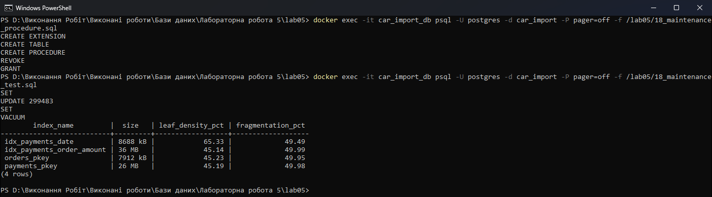

Щільність листків індексів `payments` впала до 45 % (`idx_payments_date` до 65 %), а їхній розмір подвоївся. Запуск процедури під адміністратором:

```sql
-- 18_maintenance_run.sql: запуск обслуговування адміністратором (dba_kondratiuk)
SELECT session_user;
\timing on
CALL maintain_database();
\timing off

SELECT log_id, operation, object_name, details, duration_ms
FROM maintenance_log
WHERE run_id = (SELECT MAX(run_id) FROM maintenance_log)
ORDER BY log_id;

SELECT c.relname AS index_name, pg_size_pretty(pg_relation_size(c.oid)) AS size,
       s.avg_leaf_density AS leaf_density_pct
FROM pg_class c
CROSS JOIN LATERAL pgstatindex(c.oid::regclass) s
WHERE c.relname IN ('payments_pkey', 'idx_payments_order_amount', 'idx_payments_date', 'orders_pkey')
ORDER BY c.relname;
```

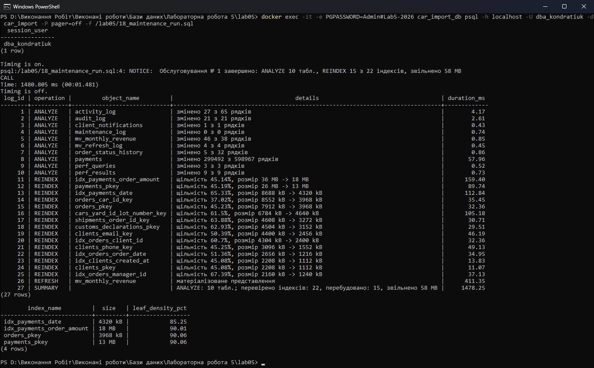

За 1,5 с процедура виконала `ANALYZE` 10 таблиць, де змінилося понад 5 % рядків (у `payments` 299 492 з 598 967), перевірила 22 індекси й перебудувала 15 з них, звільнивши 58 МБ. Окрім індексів `payments`, перебудовано індекси `orders` і `clients`: вони роздулися після початкового заповнення нових полів на кроці 2. Щільність листків після перебудови 85-90 %, індекс `idx_payments_order_amount` зменшився з 36 до 18 МБ.

Повне обслуговування запускається скриптом [`maintenance.ps1`](maintenance.ps1), який можна додати в Планувальник завдань Windows (команда наведена в коментарі скрипту):

```powershell
<#
  maintenance.ps1 - повне обслуговування бази car_import.

  1) VACUUM (ANALYZE) усіх таблиць утилітою vacuumdb: VACUUM не можна
     виконати всередині процедури, бо він не працює в блоці транзакції;
  2) процедура maintain_database(): ANALYZE змінених таблиць, REINDEX
     фрагментованих індексів, оновлення матеріалізованих представлень;
  3) результат останнього запуску з maintenance_log.

  Для запуску щонеділі о 03:00:
    Register-ScheduledTask -TaskName "car_import maintenance" `
      -Trigger (New-ScheduledTaskTrigger -Weekly -DaysOfWeek Sunday -At 03:00) `
      -Action (New-ScheduledTaskAction -Execute "powershell.exe" `
               -Argument "-File `"$PSScriptRoot\maintenance.ps1`"")
#>
param(
    [string]$Container = "car_import_db",
    [string]$Database  = "car_import"
)

$ErrorActionPreference = "Stop"
[Console]::OutputEncoding = [System.Text.Encoding]::UTF8

Write-Host "1. VACUUM (ANALYZE): vacuumdb, 4 паралельні процеси" -ForegroundColor Green
docker exec $Container vacuumdb -U postgres -d $Database --analyze --jobs 4

Write-Host "2. CALL maintain_database()" -ForegroundColor Green
docker exec $Container psql -U postgres -d $Database -c "CALL maintain_database();"

Write-Host "3. Журнал обслуговування" -ForegroundColor Green
docker exec $Container psql -U postgres -d $Database -P pager=off -c @"
SELECT operation, object_name, details, duration_ms
FROM maintenance_log
WHERE run_id = (SELECT MAX(run_id) FROM maintenance_log)
  AND operation IN ('REINDEX', 'REFRESH', 'SUMMARY')
ORDER BY log_id;
"@
```

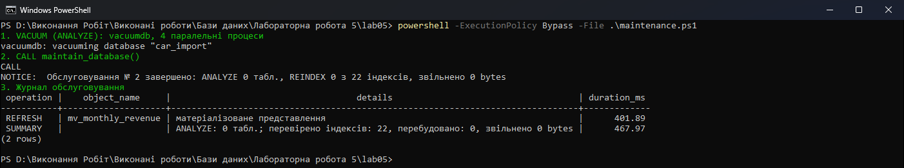

При повторному запуску одразу після обслуговування процедура нічого не перебудовує (`REINDEX 0 з 22`) і лише оновлює матеріалізоване представлення. Тобто вона не виконує зайвої роботи.

#### Крок 5. Скрипт автоматизованого моніторингу продуктивності

Моніторинг складається з двох файлів:

- [`sql/19_monitoring.sql`](sql/19_monitoring.sql) — 7 розділів звіту: загальний стан і кеш-попадання, таблиці (розмір, послідовні та індексні сканування, мертві рядки), найактивніші індекси, індекси без жодного сканування, найповільніші повторювані запити з `pg_stat_statements`, активні сеанси та блокування, попередження;
- [`monitor.ps1`](monitor.ps1) — запускає звіт у контейнері, виводить його з підсвіткою, зберігає в `reports/monitor_<дата_час>.txt` і рахує попередження. Параметри `-Count` та `-IntervalSec` дозволяють знімати звіти періодично.

```sql
-- =====================================================================
-- 19_monitoring.sql: моніторинг продуктивності бази car_import
-- Запускається скриптом monitor.ps1, звіт зберігається в reports/.
-- =====================================================================
\pset footer off

\echo '=== 1. Загальний стан бази ==='
SELECT datname                                                          AS database,
       pg_size_pretty(pg_database_size(datname))                        AS size,
       numbackends                                                      AS sessions,
       xact_commit                                                      AS commits,
       xact_rollback                                                    AS rollbacks,
       ROUND(100.0 * blks_hit / NULLIF(blks_hit + blks_read, 0), 2)     AS cache_hit_pct,
       deadlocks,
       temp_files,
       to_char(pg_postmaster_start_time(), 'YYYY-MM-DD HH24:MI')        AS server_started
FROM pg_stat_database
WHERE datname = current_database();

\echo '=== 2. Таблиці: розмір, способи читання, мертві рядки ==='
SELECT relname                                                          AS table_name,
       pg_size_pretty(pg_total_relation_size(relid))                    AS total_size,
       n_live_tup                                                       AS live_rows,
       n_dead_tup                                                       AS dead_rows,
       seq_scan,
       idx_scan,
       ROUND(100.0 * idx_scan / NULLIF(seq_scan + idx_scan, 0), 1)      AS idx_scan_pct,
       to_char(GREATEST(last_vacuum, last_autovacuum), 'MM-DD HH24:MI') AS vacuumed
FROM pg_stat_user_tables
ORDER BY pg_total_relation_size(relid) DESC
LIMIT 8;

\echo '=== 3. Використання індексів (найактивніші) ==='
SELECT relname                                     AS table_name,
       indexrelname                                AS index_name,
       idx_scan                                    AS scans,
       idx_tup_read                                AS tuples_read,
       idx_tup_fetch                               AS tuples_fetched,
       pg_size_pretty(pg_relation_size(indexrelid)) AS size
FROM pg_stat_user_indexes
ORDER BY idx_scan DESC
LIMIT 10;

\echo '=== 4. Індекси без жодного сканування (крім PK/UNIQUE) ==='
SELECT s.relname                                     AS table_name,
       s.indexrelname                                AS index_name,
       pg_size_pretty(pg_relation_size(s.indexrelid)) AS size
FROM pg_stat_user_indexes s
JOIN pg_index i ON i.indexrelid = s.indexrelid
WHERE s.idx_scan = 0 AND NOT i.indisunique
ORDER BY pg_relation_size(s.indexrelid) DESC;

\echo '=== 5. Найповільніші повторювані запити (pg_stat_statements, середній час) ==='
SELECT left(regexp_replace(query, '\s+', ' ', 'g'), 75)                 AS query,
       calls,
       ROUND(total_exec_time::numeric, 1)                               AS total_ms,
       ROUND(mean_exec_time::numeric, 2)                                AS mean_ms,
       ROUND(max_exec_time::numeric, 2)                                 AS max_ms,
       rows,
       ROUND(100.0 * shared_blks_hit / NULLIF(shared_blks_hit + shared_blks_read, 0), 1) AS hit_pct
FROM pg_stat_statements
WHERE dbid = (SELECT oid FROM pg_database WHERE datname = current_database())
  AND calls > 1
  AND query !~* '^\s*(EXPLAIN|VACUUM|ANALYZE|CREATE|ALTER|DROP|REINDEX|CALL|COPY|BEGIN|COMMIT|SET|SHOW|REFRESH)'
  AND query !~* 'pg_stat_|pg_catalog|pg_size_pretty'        -- без службових запитів моніторингу
ORDER BY mean_exec_time DESC
LIMIT 10;

\echo '=== 6. Активні сеанси та блокування ==='
SELECT pid, usename AS user_name, state, wait_event_type AS waits,
       pg_blocking_pids(pid) AS blocked_by,
       to_char(now() - query_start, 'MI:SS') AS duration,
       left(query, 45) AS query
FROM pg_stat_activity
WHERE datname = current_database() AND pid <> pg_backend_pid() AND backend_type = 'client backend';

\echo '=== 7. Попередження ==='
SELECT * FROM (
    SELECT 'УВАГА: кеш-попадання ' || ROUND(100.0 * blks_hit / NULLIF(blks_hit + blks_read, 0), 2)
           || '% (норма > 99%)' AS warning
    FROM pg_stat_database
    WHERE datname = current_database() AND 100.0 * blks_hit / NULLIF(blks_hit + blks_read, 0) < 99
    UNION ALL
    SELECT 'УВАГА: ' || relname || ' має ' || n_dead_tup || ' мертвих рядків ('
           || ROUND(100.0 * n_dead_tup / NULLIF(n_live_tup, 0), 1) || '%), потрібен VACUUM'
    FROM pg_stat_user_tables
    WHERE n_dead_tup > 1000 AND n_dead_tup > 0.1 * n_live_tup
    UNION ALL
    SELECT 'УВАГА: невикористаний індекс ' || s.indexrelname || ' ('
           || pg_size_pretty(pg_relation_size(s.indexrelid)) || ')'
    FROM pg_stat_user_indexes s JOIN pg_index i ON i.indexrelid = s.indexrelid
    WHERE s.idx_scan = 0 AND NOT i.indisunique AND pg_relation_size(s.indexrelid) > 1024 * 1024
    UNION ALL
    SELECT 'УВАГА: повільний запит (' || ROUND(mean_exec_time::numeric) || ' мс, викликів '
           || calls || '): ' || left(regexp_replace(query, '\s+', ' ', 'g'), 60)
    FROM pg_stat_statements
    WHERE dbid = (SELECT oid FROM pg_database WHERE datname = current_database())
      AND mean_exec_time > 50 AND calls > 1
      AND query !~* '^\s*(EXPLAIN|VACUUM|ANALYZE|CREATE|ALTER|DROP|REINDEX|CALL|COPY|REFRESH)'
    UNION ALL
    SELECT 'Сеанс ' || pid || ' заблоковано сеансом ' || (pg_blocking_pids(pid))[1]
    FROM pg_stat_activity WHERE cardinality(pg_blocking_pids(pid)) > 0
) w;
```

```powershell
<#
  monitor.ps1 - автоматизований моніторинг продуктивності бази car_import.

  Виконує sql/19_monitoring.sql у контейнері car_import_db, виводить звіт
  на екран, зберігає його у reports/monitor_<дата_час>.txt і підсвічує
  попередження.

  Приклади:
    .\monitor.ps1                          # один звіт
    .\monitor.ps1 -Count 12 -IntervalSec 300   # 12 звітів кожні 5 хвилин
  Для запуску за розкладом:
    Register-ScheduledTask -TaskName "car_import monitor" `
      -Trigger (New-ScheduledTaskTrigger -Daily -At 08:00) `
      -Action (New-ScheduledTaskAction -Execute "powershell.exe" `
               -Argument "-File `"$PSScriptRoot\monitor.ps1`"")
#>
param(
    [int]$Count = 1,
    [int]$IntervalSec = 60,
    [string]$Container = "car_import_db",
    [string]$Database = "car_import"
)

$ErrorActionPreference = "Stop"
[Console]::OutputEncoding = [System.Text.Encoding]::UTF8   # вивід psql у UTF-8

$reports = Join-Path $PSScriptRoot "reports"
New-Item -ItemType Directory -Force -Path $reports | Out-Null
docker cp "$PSScriptRoot\sql\19_monitoring.sql" "${Container}:/tmp/19_monitoring.sql" | Out-Null

for ($i = 1; $i -le $Count; $i++) {
    $stamp  = Get-Date -Format "yyyyMMdd_HHmmss"
    $file   = Join-Path $reports "monitor_$stamp.txt"
    $header = "Моніторинг $Database, $(Get-Date -Format 'yyyy-MM-dd HH:mm:ss'), звіт $i з $Count"

    $out = docker exec $Container psql -U postgres -d $Database -P pager=off -f /tmp/19_monitoring.sql
    @($header) + $out | Set-Content -Path $file -Encoding UTF8

    Write-Host $header -ForegroundColor Cyan
    foreach ($line in $out) {
        if ($line -match "УВАГА|заблоковано") { Write-Host $line -ForegroundColor Yellow }
        elseif ($line -like "===*")            { Write-Host $line -ForegroundColor Green }
        else                                   { Write-Host $line }
    }
    $warnings = @($out | Where-Object { $_ -match "УВАГА|заблоковано" }).Count
    Write-Host "Попереджень: $warnings. Звіт збережено: $file" -ForegroundColor Cyan

    if ($i -lt $Count) { Start-Sleep -Seconds $IntervalSec }
}
```

Щоб у статистиці були не лише разові запити лабораторної роботи, створено навантаження. Сценарій [`20_workload.sql`](sql/20_workload.sql) містить шість типових запитів вебзастосунку з випадковими параметрами і виконується утилітою `pgbench` 20 секунд у 4 сеанси:

```sql
-- =====================================================================
-- 20_workload.sql: сценарій навантаження для pgbench (типові запити
-- вебзастосунку). Запуск:
--   pgbench -U postgres -n -c 4 -j 2 -T 20 -f /lab05/20_workload.sql car_import
-- =====================================================================
\set cid random(1, 50000)
\set mid random(1, 10)
\set phone random(1000, 9999)

-- картка клієнта
SELECT * FROM v_client_statistics WHERE client_id = :cid;
-- робочий список менеджера
SELECT order_id, status, client, days_in_work FROM v_active_orders
WHERE manager_id = :mid ORDER BY days_in_work DESC LIMIT 20;
-- черга нових замовлень
SELECT order_id, order_date, client_id, wanted_car FROM orders
WHERE status = 'new' ORDER BY order_date, order_id LIMIT 20;
-- пошук клієнта за останніми цифрами телефону
SELECT client_id, last_name, first_name, phone FROM clients WHERE phone LIKE '%' || :phone;
-- виручка за місяцями
SELECT month, revenue_usd FROM mv_monthly_revenue ORDER BY month DESC LIMIT 12;
-- рейтинг клієнтів міста
SELECT client_id, client, paid_usd FROM v_client_statistics
WHERE city = 'Рівне' ORDER BY paid_usd DESC LIMIT 10;
```

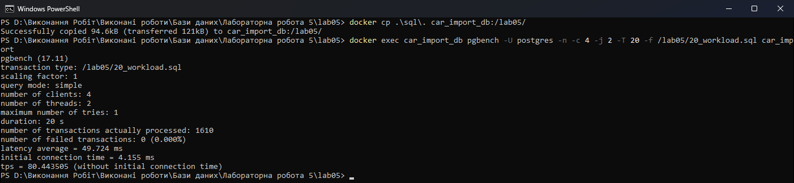

За 20 секунд оброблено 1 610 транзакцій (80 транзакцій на секунду, 49,7 мс на транзакцію з 6 запитів), помилок немає.

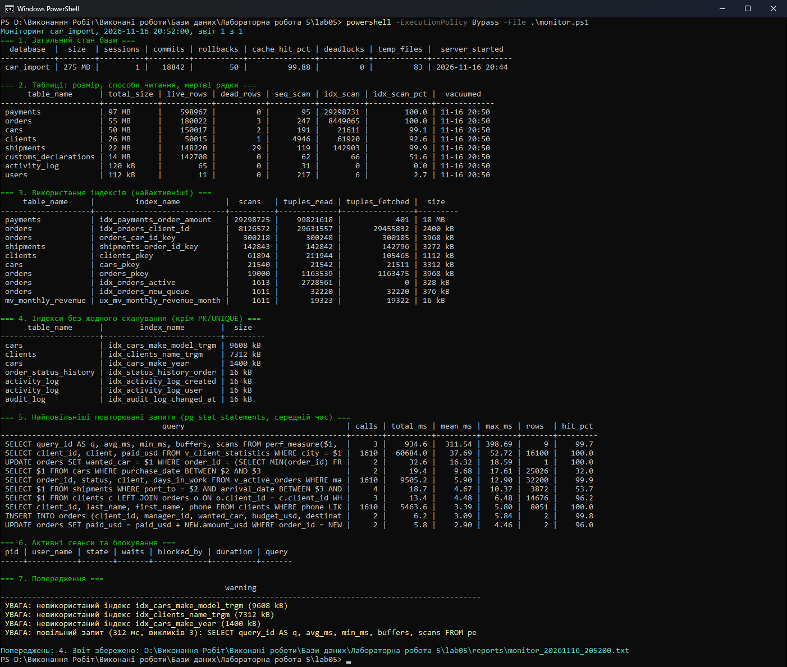

Що показав моніторинг:

- **кеш-попадання 99,88 %**: майже всі дані читаються з пам'яті;
- **індекси використовуються**: `idx_payments_order_amount` сканувався 29 млн разів, `tuples_fetched` для нього лише 401, тобто майже всі звернення є `Index Only Scan` без читання таблиці. Нові часткові індекси `idx_orders_new_queue` і `ux_mv_monthly_revenue_month` використано по 1 611 разів (запити з навантаження);
- **таблиця `clients` має 4 946 послідовних сканувань**. Це пошук за останніми цифрами телефону (`phone LIKE '%1234'`): шаблон, що починається з `%`, не може використати B-tree індекс. Рекомендація: GIN-індекс `pg_trgm` на `phone` або індекс за виразом `reverse(phone)`;
- **невикористані індекси** `idx_cars_make_model_trgm` (9,6 МБ), `idx_clients_name_trgm` (7,3 МБ) і `idx_cars_make_year`. Їх використовує пошук у вебзастосунку ЛР4, який у цьому сеансі не запускався, тому видаляти їх не можна. Це приклад того, що рішення про видалення індексу треба приймати за статистикою за тривалий період;
- **найповільніший повторюваний запит застосунку** — рейтинг клієнтів міста (37,7 мс у середньому, 1 610 викликів, найбільший загальний час 60,7 с). Його варто перенести в матеріалізоване представлення, як це зроблено з місячною виручкою;
- найповільнішим загалом є `perf_measure` (311 мс), але це інструмент вимірювання з кроку 2, який виконує 18 запитів за виклик.

Звіт збережено у файл [`reports/monitor_20261116_205200.txt`](reports/monitor_20261116_205200.txt).

## Особливості виконання

1. **Генерація даних з вимкненими тригерами.** Масові вставки й початкове заповнення нових полів виконано з `session_replication_role = replica`, щоб не запускати тригери аудиту, перевірки та каскаду для сотень тисяч рядків. Тому в `order_status_history` немає історії статусів для згенерованих замовлень. Наслідок цього підходу видно на кроці 4 рівня 3: після масових `UPDATE` індекси `orders` і `clients` роздулися, і процедура обслуговування їх перебудувала.
2. **Пропуски в номерах замовлень.** Відхилені тригером валідації вставки використали значення послідовності `orders_order_id_seq`, які не повертаються при відкаті. Тому прийняті замовлення мають номери 180021, 180025, 180029.
3. **Повторний скриншот запиту 2.** Перший план запиту 2 (17,9 мс) не вмістився у вікно через рядки `I/O Timings`, які додає `track_io_timing`. Скриншот `6.png` зроблено при повторному запуску в більшому вікні (12,8 мс, дані вже в кеші). Для порівняння етапів використано середнє з 5 запусків функцією `perf_measure`, а не поодинокі запуски.
4. **Індекс сповільнив запит 2.** Після створення `idx_shipments_port_arrival` запит 2 став повільнішим (11,1 → 17,5 мс), бо через `random_page_cost = 4` планувальник обрав `Hash Join` з повним скануванням `orders`. Прискорення досягнуто лише після встановлення `random_page_cost = 1.1` для бази (`ALTER DATABASE car_import SET ...`). Це налаштування лишилося в базі.
5. **Заміна індексу `idx_payments_order_id`.** Індекс з ЛР4 видалено, бо покривний `idx_payments_order_amount (order_id) INCLUDE (amount_usd)` повністю його замінює.
6. **Вплив на застосунки ЛР4.** Вебзастосунок і консольний застосунок ЛР4 підключаються як `postgres` (суперкористувач), тому RLS на них не діє. Але нові тригери діють і для них: місто доставки має бути українською, авто не можна видати з боргом, а кожна зміна платежу оновлює матеріалізоване представлення (близько 0,4 с на транзакцію).
7. **Команди для PowerShell-скриптів.** На комп'ютері не задано політику виконання PowerShell, тому діє політика за замовчуванням `Restricted`, яка забороняє запуск скриптів. Тому `maintenance.ps1` і `monitor.ps1` запускалися командою `powershell -ExecutionPolicy Bypass -File ...`, яка діє лише для одного запуску і не змінює системну політику.
8. **Відмінності від методички:**
   - замість окремих таблиць `users` / `orders` з методички використано реальну базу ЛР4;
   - матеріалізоване представлення оновлюється відкладеним тригером один раз на транзакцію, а не після кожного оператора;
   - процедура обслуговування перебудовує лише фрагментовані індекси і робить `COMMIT` після кожної операції;
   - ієрархія ролей доповнена правами на рівні стовпців, RLS і вбудованими ролями PostgreSQL 17;
   - відновлення перевірено контрольними сумами даних, а не лише кількістю рядків.
9. **Додаткові бази в контейнері.** Відновлена копія `car_import_lab5_restore` залишена в контейнері для перевірки. Її можна видалити командою `dropdb car_import_lab5_restore`.

## Контрольні запитання

**1. Поясніть різницю між EXPLAIN та EXPLAIN ANALYZE. Коли краще використовувати кожну з цих команд?**

`EXPLAIN` показує план, який обрав планувальник, з **оцінками**: вартість (`cost`), очікувана кількість рядків (`rows`) і їхня ширина (`width`). Сам запит не виконується, тому команда миттєва і безпечна.

`EXPLAIN ANALYZE` **виконує** запит і додає фактичні дані: час кожного вузла (`actual time`), реальну кількість рядків і повторів (`loops`), а з `BUFFERS` ще й кількість прочитаних сторінок. Порівняння `rows` з фактичною кількістю показує, де планувальник помиляється.

- `EXPLAIN` підходить для довгих запитів, запитів на продуктивній базі, а також `INSERT`, `UPDATE`, `DELETE`. У роботі так перевірено, що запит з іншою умовою не використовує частковий індекс.
- `EXPLAIN ANALYZE` потрібен, щоб знайти справжнє вузьке місце і перевірити ефект індексу. Тільки так стало видно, що в запиті 1 основний час іде не на пошук клієнтів, а на 4 892 звернення до `payments`. Зміни даних аналізують у транзакції з `ROLLBACK`.

**2. Які типи індексів підтримує PostgreSQL? Опишіть ситуації, коли доцільно використовувати кожен тип.**

- **B-tree** — за замовчуванням: рівність, діапазони, сортування, `LIKE 'abc%'`. У роботі всі індекси для запитів 1-3 і часткові індекси.
- **Hash** — лише рівність. Менший за B-tree для довгих ключів, але не підтримує діапазони і сортування.
- **GIN** — для значень з кількома елементами: масиви, `JSONB`, повнотекстовий пошук, триграми `pg_trgm` для `ILIKE '%...%'` (індекси `*_trgm` з ЛР4).
- **GiST** — геометрія, діапазони, найближчі сусіди, повнотекстовий пошук.
- **SP-GiST** — нерівномірні структури: IP-адреси, префіксні дерева.
- **BRIN** — дуже великі таблиці, де значення корелюють з фізичним порядком рядків, наприклад журнал з часом вставки. Займає кілобайти.

Окремо за способом побудови: **складені** (`shipments (port_to, arrival_date)`), **покривні** з `INCLUDE` (`cars ... INCLUDE (make, ...)`), **часткові** з `WHERE`, **за виразом** (`lower(email)`), **унікальні**.

**3. Що таке часткові індекси та в яких випадках їх використання дає найбільший виграш у продуктивності?**

Частковий індекс містить лише рядки, що задовольняють умову `WHERE` в його визначенні. Найбільший виграш він дає, коли:

- запити постійно звертаються до **невеликої частини** таблиці з фіксованою умовою: нові замовлення (4 %), контейнери в дорозі (3 %), активні записи, необроблені завдання;
- потрібно впорядкування цієї частини: `LIMIT` бере перші рядки з індексу без сортування (44,7 мс → 0,05 мс);
- таблиця часто змінюється: індекс оновлюється лише для рядків з умовою;
- потрібна унікальність лише серед частини рядків, наприклад `UNIQUE ... WHERE deleted_at IS NULL`.

У роботі частковий індекс у 20 разів менший за повний аналог (192 kB проти 3 968 kB). Умова індексу має складатися з незмінних виразів, а запит використовує індекс лише тоді, коли його умова логічно випливає з умови індексу.

**4. Яка різниця між звичайним представленням (VIEW) та матеріалізованим представленням (MATERIALIZED VIEW)? Наведіть приклади використання.**

- **VIEW** — це збережений запит. Дані не зберігаються, запит виконується при кожному зверненні, тому результат завжди актуальний. Застосування: спрощення складних запитів (`v_active_orders`), обмеження доступу до стовпців і рядків, оновлення через правила або тригери (`v_order_contacts`).
- **MATERIALIZED VIEW** зберігає результат на диску як таблицю, може мати індекси, але застаріває до `REFRESH`. Застосування: важкі агрегати, які читають часто, а змінюються рідко: звіти, дашборди, статистика. У роботі `mv_monthly_revenue` віддає результат за 0,53 мс замість 45,9 мс, але кожне оновлення коштує близько 385 мс.

`REFRESH ... CONCURRENTLY` не блокує читання, але потребує унікального індексу.

**5. Опишіть життєвий цикл тригера. Яка різниця між BEFORE, AFTER та INSTEAD OF тригерами?**

Тригер складається з тригерної функції (`RETURNS TRIGGER`) і самого тригера, який прив'язує функцію до таблиці, події (`INSERT`, `UPDATE [OF стовпці]`, `DELETE`, `TRUNCATE`), моменту і рівня (`FOR EACH ROW` або `STATEMENT`), з необов'язковою умовою `WHEN`. Для кожного рядка порядок такий:

1. `BEFORE ROW` тригери за алфавітом назв;
2. перевірка обмежень `NOT NULL`, `CHECK`, `UNIQUE` і запис рядка;
3. `AFTER ROW` тригери в кінці оператора, а відкладені (`DEFERRABLE INITIALLY DEFERRED`) під час `COMMIT`;
4. `AFTER STATEMENT` тригери.

Помилка в будь-якому тригері відкочує весь оператор.

- **BEFORE** виконується до запису і може змінити `NEW` (нормалізація в `fn_validate_order`) або відхилити рядок (`RAISE EXCEPTION` чи `RETURN NULL`).
- **AFTER** бачить уже збережений рядок. Підходить для журналів і змін в інших таблицях (`fn_audit_changes`, каскад).
- **INSTEAD OF** — лише для представлень. Замінює операцію власною логікою і є сучасною альтернативою правилам.

**6. Чому важливо обмежувати права доступу користувачів до бази даних? Які рівні гранулярності підтримує PostgreSQL?**

Принцип найменших привілеїв зменшує шкоду від помилок, зламаних облікових записів і застосунків з SQL-ін'єкціями. Він також захищає персональні дані (телефони, email) і фінансову інформацію та дозволяє розмежувати обов'язки.

Рівні в PostgreSQL:

- **кластер** — атрибути ролей `SUPERUSER`, `CREATEDB`, `CREATEROLE`, `LOGIN`, `CONNECTION LIMIT`, `VALID UNTIL`;
- **база** — `CONNECT`, `CREATE`, `TEMP`;
- **схема** — `USAGE`, `CREATE`;
- **таблиця, представлення, послідовність** — `SELECT`, `INSERT`, `UPDATE`, `DELETE`, `TRUNCATE`, `REFERENCES`, `TRIGGER`, а з PostgreSQL 17 ще `MAINTAIN`;
- **стовпець** — `SELECT`, `INSERT`, `UPDATE`, `REFERENCES` окремих стовпців;
- **рядок** — політики RLS;
- **функція** — `EXECUTE`, `SECURITY DEFINER`.

Також є групові ролі з успадкуванням, `ALTER DEFAULT PRIVILEGES` і вбудовані ролі (`pg_read_all_data`, `pg_monitor`, `pg_maintain`). У роботі використано всі рівні від бази до рядка.

**7. Поясніть різницю між логічним та фізичним резервним копіюванням. Які переваги та недоліки кожного підходу?**

- **Логічне** (`pg_dump`, `pg_dumpall`) зберігає SQL-команди або архів з описом об'єктів і даними.
  - Переваги: копіювання окремої бази, схеми чи таблиці; перенесення між версіями PostgreSQL і платформами; вибіркове і паралельне відновлення; невеликий стиснений файл (19,9 МБ для бази 233 МБ).
  - Недоліки: стан лише на момент початку копії, без відновлення на довільний момент; для великих баз копіювання і відновлення повільні, бо індекси будуються заново; ролі копіюються окремо.
- **Фізичне** (`pg_basebackup`, копія каталогу даних + WAL) копіює файли кластера.
  - Переваги: швидке для великих баз; разом з архівом WAL дає відновлення на довільний момент часу; основа реплікації; з PostgreSQL 17 підтримує інкрементальні копії.
  - Недоліки: лише весь кластер і та сама основна версія та платформа; розмір дорівнює розміру даних разом з роздуттям і індексами.

**8. Що таке каскадні тригери? Наведіть приклад ситуації, коли вони необхідні.**

Каскадні тригери — це ланцюжок, у якому зміна, зроблена одним тригером, запускає тригер іншої таблиці. Глибину вкладеності повертає `pg_trigger_depth()`. Вони потрібні, коли одна бізнес-подія має узгоджено змінити кілька таблиць незалежно від того, який застосунок цю подію виконав.

Приклад з роботи: вставка платежу оновлює суму оплат замовлення, потім суму оплат клієнта, потім рівень лояльності і створює повідомлення. В `audit_log` видно глибину 1 → 2 → 3. Інші приклади: при видачі товару зі складу зменшити залишок і створити заявку на поповнення; при закритті рахунку перерахувати баланс клієнта.

Ризики: нескінченна рекурсія (захист через `WHEN` і `pg_trigger_depth()`), складне налагодження, прихована вартість кожної операції. Тому кожен тригер має перевіряти, чи потрібна дія.

**9. Як індекси впливають на продуктивність операцій INSERT, UPDATE та DELETE? Чому надмірна індексація може бути шкідливою?**

- `INSERT` додає запис у **кожен** індекс таблиці.
- `UPDATE` у PostgreSQL створює нову версію рядка. Якщо змінено індексований стовпець або на сторінці немає місця (оновлення не HOT), нові записи з'являються в усіх індексах.
- `DELETE` лише позначає рядок, а записи в індексах прибирає `VACUUM`.

Надмірна індексація:

- сповільнює запис і збільшує обсяг WAL;
- займає диск і витісняє корисні дані з кешу;
- роздувається і потребує обслуговування. У роботі після оновлення половини платежів щільність індексів упала до 45 %, і `REINDEX` звільнив 58 МБ;
- ускладнює вибір плану.

Тому індекси створюються під конкретні запити і перевіряються через `EXPLAIN ANALYZE`, зайві видаляються (`idx_payments_order_id` замінено покривним індексом), а невикористані виявляються через `pg_stat_user_indexes` (розділ 4 моніторингу).

**10. Опишіть стратегію point-in-time recovery. Які компоненти PostgreSQL необхідні для її реалізації?**

PITR дозволяє відновити кластер на будь-який момент, наприклад за секунду до помилкового `DELETE`. Принцип: базова фізична копія + послідовне програвання журналу WAL до потрібного моменту.

Потрібні компоненти:

1. `wal_level = replica` або `logical`;
2. безперервне архівування WAL: `archive_mode = on` і `archive_command` (або `archive_library`), що копіює кожен заповнений сегмент WAL у надійне сховище;
3. базова копія `pg_basebackup`, зроблена після ввімкнення архівування;
4. при відновленні: розгорнути базову копію в порожній каталог даних, задати `restore_command` для отримання сегментів з архіву і ціль відновлення (`recovery_target_time`, `recovery_target_xid` або `recovery_target_name`, створену через `pg_create_restore_point()`), створити файл `recovery.signal` і запустити сервер;
5. після досягнення цілі сервер виконує дію `recovery_target_action` (`pause` для перевірки або `promote`) і продовжує роботу на новій часовій лінії.

Логічна копія `pg_dump` з цієї роботи для PITR не підходить. Вона відновлює стан лише на момент створення копії.

## Висновки

У результаті виконання лабораторної роботи на базі `car_import` з ЛР4, наповненій до 230 МБ (50 тис. клієнтів, 180 тис. замовлень, 600 тис. платежів), опановано аналіз і оптимізацію продуктивності, автоматизацію та адміністрування PostgreSQL.

1. Проаналізовано три складні запити через `EXPLAIN (ANALYZE, BUFFERS)` і створено інструмент `perf_measure`, який вимірює середній час, буфери й типи сканування з JSON-плану.
2. Створено три індекси: звичайний, складений і покривний з `INCLUDE`. Покривний індекс прискорив запит 3 у 3,9 раза. Для двох інших запитів самих індексів виявилося недостатньо, а запит 2 навіть сповільнився через параметр `random_page_cost`, розрахований на HDD. Після його налаштування і заміни індексу платежів покривним усі три запити прискорилися на 62-74 % (у 2,7-3,8 раза).
3. Створено представлення для робочого списку менеджера і статистики клієнта, а також складне представлення з трьох таблиць, яке оновлюється через правила `UPDATE`, `DELETE` (м'яке видалення) та `INSERT`.
4. Реалізовано тригер валідації з нормалізацією даних, власними кодами помилок і підказками. Показано обробку помилок у пакетному завантаженні через `GET STACKED DIAGNOSTICS`.
5. Розроблено систему аудиту `audit_log` для п'яти таблиць: усі типи операцій, змінені поля, старі й нові значення, користувач СУБД і користувач застосунку, номер транзакції, глибина тригерів. UPDATE без змін не логується.
6. Часткові індекси прискорили вибірку черги нових замовлень і контейнерів у дорозі в сотні разів і виявилися в 20 разів меншими за повні аналоги.
7. Виконано логічне резервне копіювання (дані, схема, ролі) і відновлення в нову базу. Збіг контрольних сум підтвердив повноту відновлення.
8. Створено матеріалізоване представлення з оновленням відкладеним тригером один раз на транзакцію, каскад з чотирьох тригерів з бізнес-правилом видачі авто, ієрархію з трьох ролей з правами на рівні стовпців і рядків (RLS), процедуру вибіркового обслуговування та скрипти обслуговування і моніторингу.

**Рекомендації щодо продуктивності бази:**

- для пошуку клієнта за частиною телефону створити триграмний GIN-індекс на `clients.phone` (зараз це 4 946 послідовних сканувань);
- рейтинг клієнтів міста (найбільший загальний час серед запитів застосунку) перенести в матеріалізоване представлення;
- матеріалізоване представлення виручки при зростанні кількості платежів оновлювати за розкладом, а не тригером;
- запускати `maintenance.ps1` щотижня і `monitor.ps1` щодня, а невикористані індекси видаляти лише за статистикою за кілька тижнів.

**Самооцінка:** 5 (виконано всі завдання рівнів 1-3).

## Посилання на проєкт

Репозиторій: `https://github.com/dmutrokondratyk2008/db_labs`

Файли проєкту (`lab05/`):

- `sql/00_initial_state.sql`: стан бази після ЛР4;
- `sql/01_generate_data.sql`: наповнення тестовими даними;
- `sql/02_perf_tools.sql` ... `06_compare.sql`: аналіз запитів, інструмент вимірювання, індекси, налаштування, порівняння етапів;
- `sql/07_views.sql`, `08_audit_trigger.sql`, `09_report_viewer*.sql`: представлення, тригер логування, користувач (рівень 1);
- `sql/10_rules_view.sql` ... `14_checksums.sql`: правила, валідація, аудит, часткові індекси, перевірка відновлення (рівень 2);
- `sql/15_materialized_view.sql` ... `20_workload.sql`: матеріалізоване представлення, каскадні тригери, ролі, обслуговування, моніторинг, навантаження (рівень 3);
- `maintenance.ps1`, `monitor.ps1`: скрипти обслуговування і моніторингу;
- `reports/`: збережений звіт моніторингу;
- `screenshots/lab05/`: скриншоти виконання (`1.png`-`42.png`).

Резервні копії (`backups/`) у репозиторій не додано через розмір і хеші паролів у `roles.sql`.

## Додаток А. Скріншоти виконання

| Файл | Розділ і зміст |
|---|---|
| `1.png` | Підготовка: стан бази після ЛР4, копіювання скриптів у контейнер |
| `2.png` | Підготовка: увімкнення `pg_stat_statements` |
| `3.png` | Р1, крок 1: генерація тестових даних |
| `4.png` | Р1, крок 2: інструмент вимірювання `perf_measure` |
| `5.png` | Р1, крок 2: план запиту 1 до оптимізації |
| `6.png` | Р1, крок 2: план запиту 2 до оптимізації |
| `7.png` | Р1, крок 2: план запиту 3 до оптимізації |
| `8.png` | Р1, крок 2: вимірювання до оптимізації |
| `9.png` | Р1, крок 3: створення трьох індексів |
| `10.png` | Р1, крок 3: план запиту 1 після індексу |
| `11.png` | Р1, крок 3: план запиту 2 після індексу |
| `12.png` | Р1, крок 3: план запиту 3 після індексу (`Index Only Scan`) |
| `13.png` | Р1, крок 3: вимірювання після індексів |
| `14.png` | Р1, крок 3: `random_page_cost`, покривний індекс, вимірювання |
| `15.png` | Р1, крок 3: план запиту 1 після налаштування |
| `16.png` | Р1, крок 3: план запиту 2 після налаштування |
| `17.png` | Р1, крок 3: порівняння етапів оптимізації |
| `18.png` | Р1, крок 4: представлення `v_active_orders`, `v_client_statistics` |
| `19.png` | Р1, крок 5: `audit_log` і тригер логування |
| `20.png` | Р1, крок 6: створення `report_viewer` |
| `21.png` | Р1, крок 6: перевірка прав `report_viewer` |
| `22.png` | Р2, крок 1: представлення з правилами |
| `23.png` | Р2, крок 2: тригер валідації |
| `24.png` | Р2, крок 2: пакетне завантаження з обробкою помилок |
| `25.png` | Р2, крок 3: система логування `audit_log` |
| `26.png` | Р2, крок 4: частковий індекс черги нових замовлень |
| `27.png` | Р2, крок 4: частковий індекс контейнерів у дорозі, розміри |
| `28.png` | Р2, крок 5: резервне копіювання |
| `29.png` | Р2, крок 5: відновлення і контрольні суми |
| `30.png` | Р3, крок 1: матеріалізоване представлення, автооновлення |
| `31.png` | Р3, крок 2: створення каскадних тригерів |
| `32.png` | Р3, крок 2: перевірка каскаду |
| `33.png` | Р3, крок 3: ролі та користувачі |
| `34.png` | Р3, крок 3: матриця прав і політики RLS |
| `35.png` | Р3, крок 3: перевірка модератора `hordiichuk` |
| `36.png` | Р3, крок 3: перевірка користувача `report_viewer` |
| `37.png` | Р3, крок 3: перевірка адміністратора `dba_kondratiuk` |
| `38.png` | Р3, крок 4: процедура обслуговування, роздуті індекси |
| `39.png` | Р3, крок 4: виконання процедури адміністратором |
| `40.png` | Р3, крок 4: скрипт `maintenance.ps1` |
| `41.png` | Р3, крок 5: навантаження `pgbench` |
| `42.png` | Р3, крок 5: звіт моніторингу `monitor.ps1` |
