# Звіт з лабораторної роботи 6. Робота з СУБД MongoDB та реалізація операцій

**Виконав:** Кондратюк Дмитро  
**Група:** ІПЗ-32  
**Варіант (предметна область):** Бібліотека (база `library` з методички: книги, автори, читачі)  
**Рівень виконання:** 3 (відмінно)

## Мета роботи

Освоїти принципи роботи з NoSQL документо-орієнтованою базою даних MongoDB, навчитися виконувати базові операції створення, читання, оновлення та видалення документів, опанувати механізми запитів та індексування, розвинути розуміння відмінностей між реляційним та документним підходами до зберігання даних.

## Виконання роботи

### Підготовка середовища

Роботу виконано 21 листопада 2026 року на Windows 11. Використано:

- MongoDB Community Server **9.0.8** (служба Windows `MongoDB`, порт 27017);
- MongoDB Shell `mongosh` 2.14.1;
- MongoDB Database Tools 100.20.1 (`mongodump`, `mongorestore`, `mongoexport`, `mongoimport`);
- MongoDB Compass 1.53.3;
- PostgreSQL 17.11 у контейнері `car_import_db` з ЛР4 (для порівняльного аналізу рівня 3);
- Windows PowerShell 5.1.

Усі скрипти `mongosh` лежать у каталозі [`scripts/`](scripts/) і виконувалися командою

```bash
mongosh --quiet --file .\scripts\<скрипт>.js
```

Спільні функції винесено в [`scripts/lib/`](scripts/lib/): `common.js` (компактний вивід документів, підсумок плану `explain`), `versioning.js` (версіонування), `uk_stemmer.js` (український стемер). Кожен скрипт підключає їх через `load(__dirname + '/lib/common.js')`. Результат кожної операції виводиться одним рядком на документ, а `ObjectId` скорочено до останніх 6 символів (`oid..802919`).

### Рівень 1. Встановлення, CRUD, індекси

#### Крок 1. Встановлення MongoDB і MongoDB Compass

Встановлено MongoDB Community Server для Windows з інсталятора `mongodb-windows-x86_64-9.0.8-signed.msi` (повне встановлення `ADDLOCAL=ALL`, сервер як служба Windows). Методичка описує версію 8.0 і дозволяє новішу; на момент виконання актуальною була 9.0.8. Контрольну суму SHA256 інсталятора звірено з маніфестом winget. Окремо встановлено MongoDB Shell, MongoDB Database Tools і MongoDB Compass.

Інсталятор створив конфігураційний файл `mongod.cfg`: дані в `C:\Program Files\MongoDB\Server\9.0\data`, журнал у `...\log\mongod.log`, сервер слухає лише `127.0.0.1:27017`. Служба запускається автоматично.

```powershell
mongod --version | Select-Object -First 1
mongosh --version
mongodump --version | Select-Object -First 1
Get-Service MongoDB
```

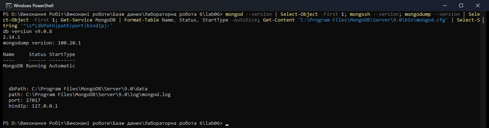

MongoDB Compass підключено до `mongodb://localhost:27017`. Знімок зроблено після виконання всіх кроків, тому в базі вже видно колекції і представлення наступних кроків:

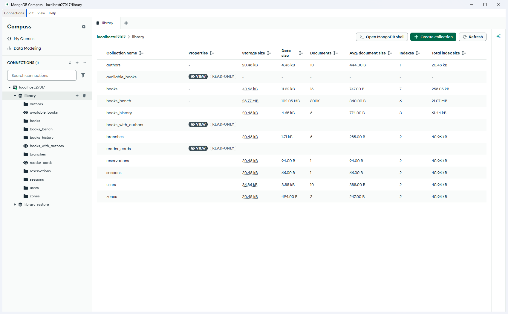

#### Крок 2. Створення бази `library` і колекцій

У MongoDB база створюється під час першого запису, тому скрипт [`01_create_db.js`](scripts/01_create_db.js) перемикається на неї через `db.getSiblingDB('library')` і створює три колекції. Колекція `books` одразу отримує базову валідацію `$jsonSchema` з методички. Валідацію рівня 3 додано пізніше (крок 1 рівня 3).

```javascript
db = db.getSiblingDB('library');
db.dropDatabase();                       // скрипт можна запускати повторно

db.createCollection('books', {
  validator: { $jsonSchema: {
    bsonType: 'object',
    required: ['title', 'author', 'publication_year'],
    properties: {
      title:            { bsonType: 'string' },
      author:           { bsonType: 'string' },
      publication_year: { bsonType: 'int', minimum: 1000 },
      pages:            { bsonType: 'int', minimum: 1 },
      genres:           { bsonType: 'array', items: { bsonType: 'string' } },
      available:        { bsonType: 'bool' }
    }
  } }
});
db.createCollection('authors');
db.createCollection('users');
```

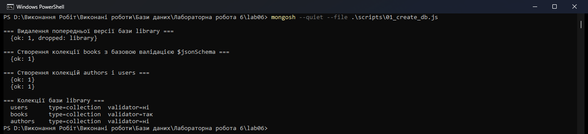

#### Крок 3. Наповнення колекцій (по 10 документів)

Скрипт [`02_seed.js`](scripts/02_seed.js) додає по 10 документів у кожну колекцію. Структури різні, як вимагає завдання:

| Колекція | Прості поля | Вкладені документи | Масиви |
|---|---|---|---|
| `authors` | `name`, `birth_year`, `death_year`, `nationality`, `biography` | `birthplace {city / village, region}` | `works`, `pseudonyms` (лише в Франка і Квітки-Основ'яненка), `real_name` лише в частини авторів |
| `books` | `title`, `author`, `publication_year`, `pages`, `isbn`, `available`, `description` | `publisher {name, city}` | `genres` (рядки), `ratings` (вкладені документи `{user, score, date}`, є лише в 4 книг) |
| `users` | `username`, `full_name`, `email`, `status`, `registration_date`, `phone` (не в усіх) | `address {city, street}`, `preferences {genres, notifications}` | `borrowed_books`, `fines` (масив вкладених документів) |

10 книг узято з методички, а 7 авторів доповнено до 10 (Іван Багряний, Ольга Кобилянська, Микола Хвильовий). Колекцію `users` теж доповнено до 10 читачів. Фрагмент:

```javascript
db.books.insertMany([
  { title: 'Тіні забутих предків', author: 'Михайло Коцюбинський', publication_year: 1911, pages: 96,
    isbn: '978-966-03-5214-3', genres: ['повість', 'романтизм', 'модернізм'], available: true,
    publisher: { name: 'Фоліо', city: 'Харків' },
    ratings: [ { user: 'ivan_petrov', score: 5, date: new Date('2026-09-28') },
               { user: 'olena_tkachuk', score: 4, date: new Date('2026-10-11') },
               { user: 'maria_kovalenko', score: 5, date: new Date('2026-10-30') } ],
    description: 'Поетична повість про кохання в Карпатах' },
  // ...
]);
db.users.insertMany([
  { username: 'dmytro_bondar', full_name: 'Дмитро Бондар', email: 'dmytro.bondar@example.com',
    registration_date: new Date('2024-01-28'), status: 'suspended',
    address: { city: 'Луцьк', street: 'вул. Ковельська, 5' },
    borrowed_books: ['Захар Беркут', 'Каменярі'],
    fines: [ { amount: 50, reason: 'прострочення', paid: false } ] },
  // ...
]);
```

Цілі числа в `mongosh` зберігаються як BSON `Int32`, тому вони проходять перевірку `bsonType: 'int'`.

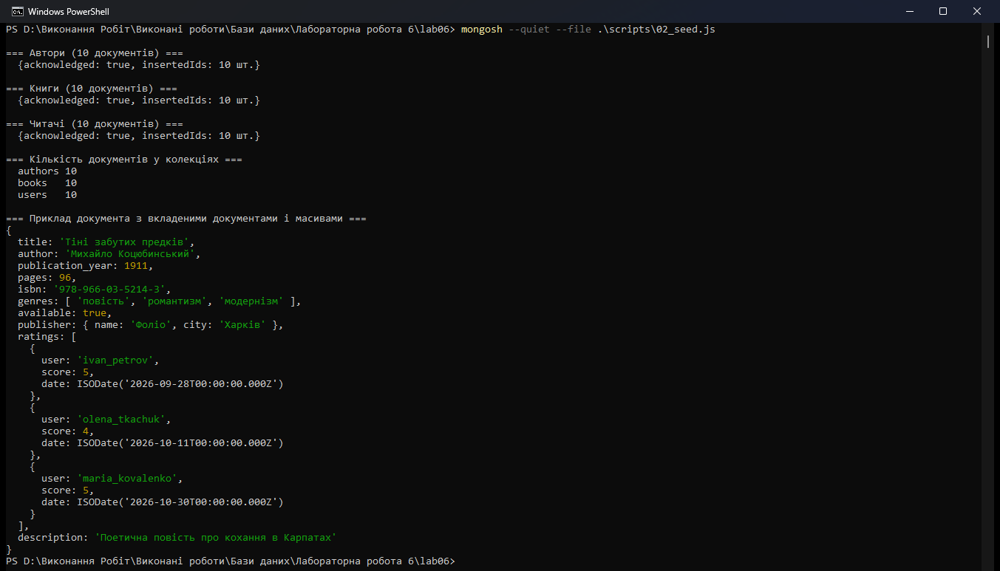

Документи в Compass (видно вкладений документ `publisher`, масиви `genres`, `ratings` і поля, додані на наступних кроках):

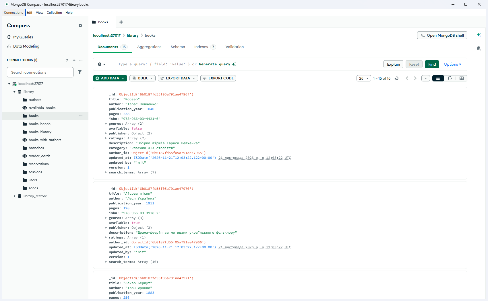

#### Крок 4. Базові CRUD-операції

Скрипт [`03_crud.js`](scripts/03_crud.js) виконує всі групи операцій.

**Create.** `insertOne` додає «Тигролови» Івана Багряного, `insertMany` додає «Землю» Кобилянської і «Я (Романтика)» Хвильового. У колекції стало 13 книг.

**Read** з різними умовами:

```javascript
db.books.find({ author: 'Іван Франко' }, { _id: 0, title: 1, publication_year: 1, available: 1 });   // рівність + проєкція
db.books.find({ pages: { $gt: 100, $lte: 300 } }).sort({ pages: 1 });                               // порівняння
db.books.find({ available: { $ne: true } });                                                       // $ne
db.users.find({ 'address.city': { $in: ['Рівне', 'Ковель'] } });                                   // $in, вкладене поле
db.books.find({ $or: [ { author: 'Тарас Шевченко' }, { genres: 'романтизм' } ] });                 // $or
db.books.find({ $and: [ { publication_year: { $gte: 1900 } }, { available: true } ] });             // $and
db.books.find({ 'publisher.city': 'Львів' });                                                      // поле вкладеного документа
db.books.find({ genres: 'поезія' });                                                               // елемент масиву
db.books.find({ ratings: { $elemMatch: { user: 'ivan_petrov', score: 5 } } });                     // $elemMatch
db.books.findOne({ title: 'Кобзар' });
db.books.find({}).sort({ publication_year: -1 }).limit(3);
db.books.countDocuments({ genres: 'роман' });
```

**Update:** `$set` (Кобзар став недоступним), `$push` (нова оцінка «Лісовій пісні»), `updateMany` (6 книг до 1900 року отримали категорію «класика XIX століття»), `$inc` (лічильник видач, двічі, тому `borrowed_count: 2`), `$addToSet` (повторне додавання «Землі» дало `modifiedCount: 0`, бо дублікатів не буває), `$pull` і `$unset`.

`replaceOne` показано на читачі `oleksandr_sydorov`: новий документ не містить `address`, тому це поле зникло. Так видно різницю між заміною документа і `updateOne`.

**Delete.** Щоб не втратити основні дані, спочатку додано три тимчасові книги з `temp: true`. Потім `deleteOne` видалив «Застарілий довідник», а `deleteMany({ temp: true, available: false })` видалив ще дві. Так само додано і видалено читача `old_user`.

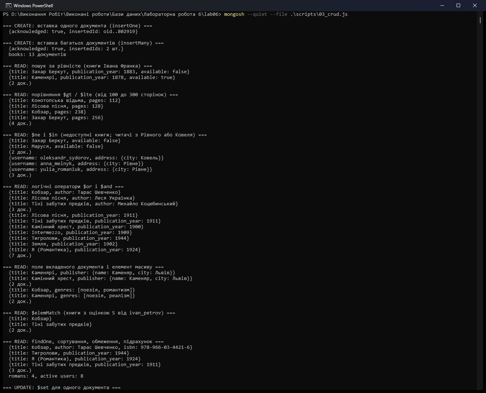

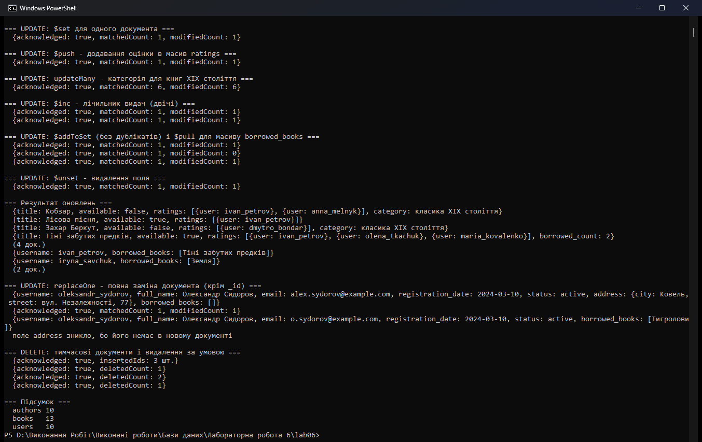

#### Крок 5. Три різні індекси

Скрипт [`04_indexes.js`](scripts/04_indexes.js) створює три індекси різних типів на колекції `books`:

```javascript
db.books.createIndex({ title: 1 });                                        // простий
db.books.createIndex({ author: 1, publication_year: -1 });                 // складений
db.books.createIndex({ isbn: 1 }, { unique: true, name: 'isbn_unique' });  // унікальний
```

До створення індексів пошук за автором виконується як `COLLSCAN` (переглянуто всі 13 документів). Після створення:

- `find({ author })` і `find({ author }).sort({ publication_year: -1 })` використовують складений індекс `author_1_publication_year_-1`, і окреме сортування не потрібне;
- `find({ title })` використовує `title_1`;
- `find({ isbn })` використовує `EXPRESS_IXSCAN(isbn_unique)`, тобто прискорений шлях MongoDB 8.0+ для точного пошуку за унікальним індексом;
- спроба додати книгу з ISBN «Кобзаря» відхилена з помилкою `E11000 duplicate key`.

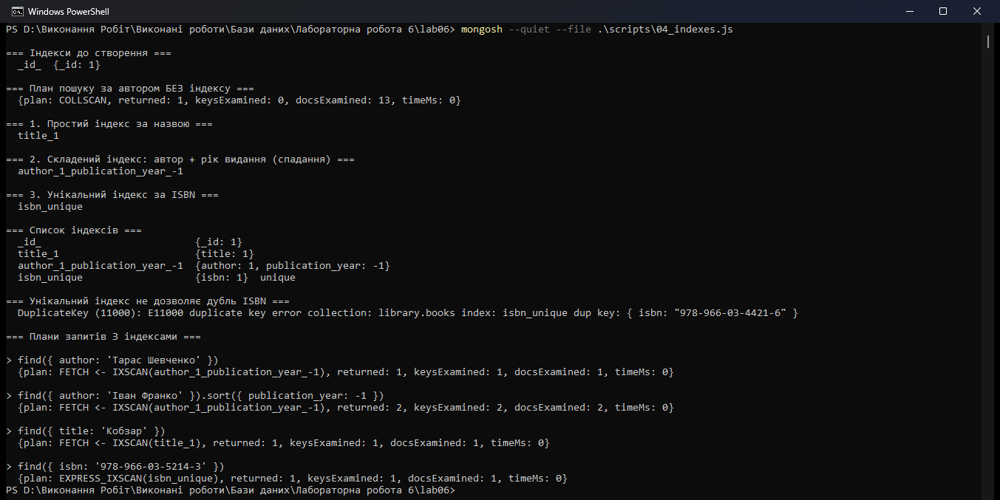

#### Крок 6. Порівняння швидкості запитів з індексами і без них

На 13 документах повне сканування теж займає 0 мс, тому різниці не видно. Тому скрипт [`05_bench_data.js`](scripts/05_bench_data.js) створює тестову колекцію `books_bench` з 300 000 документів зі структурою `books`: 10 000 авторів, 15 жанрів (1-3 на книгу), видавництва з вкладеним документом, рейтинг. Генератор псевдовипадкових чисел mulberry32 з фіксованим початковим значенням робить дані відтворюваними. Генерація зайняла 9,5 с, розмір даних 97,3 МБ.

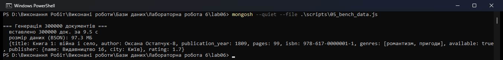

Скрипт [`06_index_benchmark.js`](scripts/06_index_benchmark.js) видаляє всі індекси, крім `_id`, вимірює три запити, створює індекси і вимірює знову. Для кожного запиту показано план, кількість переглянутих ключів і документів, `executionTimeMillis` з `explain('executionStats')` і середній час 5 повторів після прогріву кешу.

```javascript
const queries = [
  { name: 'Q1 автор = ...',      run: () => c.find({ author: 'Тарас Шевчук-7' }) },
  { name: 'Q2 isbn = ...',       run: () => c.find({ isbn: '978-617-0150000-0' }) },
  { name: 'Q3 рік>=2020, сорт.', run: () => c.find({ publication_year: { $gte: 2020 } })
                                              .sort({ publication_year: -1, pages: -1 }).limit(20) }
];
// ... measure('без індексів'), потім:
c.createIndex({ author: 1 });
c.createIndex({ isbn: 1 }, { unique: true });
c.createIndex({ publication_year: -1, pages: -1 });
// ... measure('з індексами')
```

| Запит | План без індексу | План з індексом | Документів переглянуто | Час, мс | Прискорення |
|---|---|---|---|---|---|
| Q1 автор = ... | `COLLSCAN` | `FETCH <- IXSCAN(author_1)` | 300 000 → 27 | 59,8 → 0,8 | ×75 |
| Q2 isbn = ... | `COLLSCAN` | `EXPRESS_IXSCAN(isbn_1)` | 300 000 → 1 | 66,0 → 0,4 | ×165 |
| Q3 рік ≥ 2020, сортування, 20 шт. | `SORT <- COLLSCAN` | `LIMIT <- FETCH <- IXSCAN` | 300 000 → 20 | 66,2 → 0,8 | ×83 |

Індекси прискорили запити в 75-165 разів: замість читання всієї колекції сервер переглядає рівно стільки ключів, скільки документів повертає. Запит Q3 до того ж не сортує дані в пам'яті (`SORT` зник з плану), бо індекс уже впорядкований. Ціна індексів: 0,3-0,4 с на створення кожного і 9,2 МБ місця.

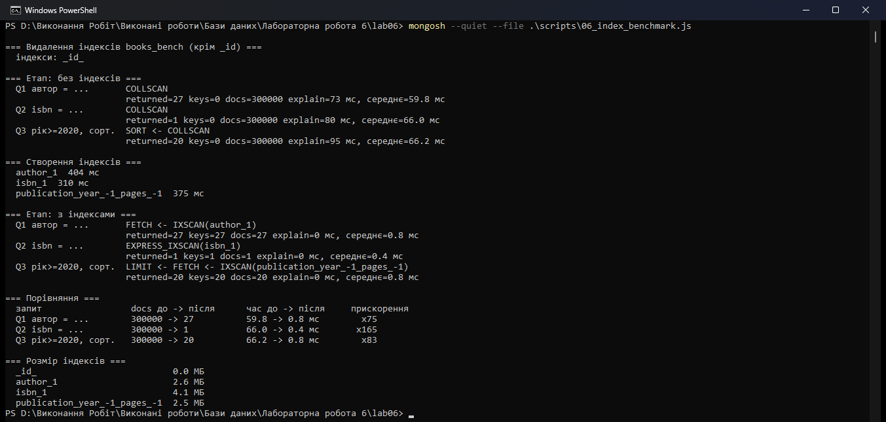

### Рівень 2. Складні запити, агрегація, складені й текстові індекси, $lookup, представлення

#### Крок 1. Складні запити з `$and`, `$or`, `$in`, `$regex`

Скрипт [`07_complex_queries.js`](scripts/07_complex_queries.js):

```javascript
// доступні повісті АБО романи, видані після 1900 року
db.books.find({ $and: [ { available: true },
                        { $or: [ { genres: 'повість' }, { genres: 'роман' } ] },
                        { publication_year: { $gt: 1900 } } ] });
// старі (<1840) АБО великі (>=300 с.)
db.books.find({ $or: [ { publication_year: { $lt: 1840 } }, { pages: { $gte: 300 } } ] });
// видавництва Харкова, крім жанрів "повість" і "новела"
db.books.find({ 'publisher.city': { $in: ['Харків'] }, genres: { $nin: ['повість', 'новела'] } });
// $regex: на початку назви "К"; "кохан" в описі без урахування регістру; вулиця на В або Ш
db.books.find({ title: { $regex: '^К' } });
db.books.find({ description: { $regex: /кохан/i } });
db.users.find({ 'address.street': { $regex: /^вул\. [ВШ]/ } });
// $all, $size, $exists, $not
db.books.find({ genres: { $all: ['повість', 'романтизм'] } });
db.books.find({ genres: { $size: 3 } });
db.authors.find({ pseudonyms: { $exists: true } });
db.books.find({ ratings: { $exists: true }, 'ratings.score': { $not: { $gte: 5 } } });
// активні читачі з Луцька з книгами на руках АБО читачі з неоплаченими штрафами
db.users.find({ $or: [
  { $and: [ { status: 'active' }, { 'address.city': 'Луцьк' }, { 'borrowed_books.0': { $exists: true } } ] },
  { fines: { $elemMatch: { paid: false } } } ] });
```

Умова `'borrowed_books.0': { $exists: true }` означає «масив має хоча б один елемент». Останній запит повернув 4 активних читачів з Луцька, а також `dmytro_bondar` і `bohdan_kravchuk`, у яких є неоплачені штрафи.

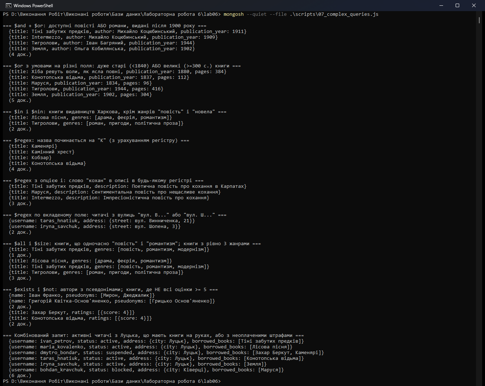

#### Крок 2. Агрегаційні запити (pipeline)

Скрипт [`08_aggregation.js`](scripts/08_aggregation.js) містить 9 pipeline:

```javascript
// 1. Кількість книг за жанрами
db.books.aggregate([ { $unwind: '$genres' },
                     { $group: { _id: '$genres', count: { $sum: 1 } } },
                     { $sort: { count: -1, _id: 1 } } ]);
// 2. Середня кількість сторінок за автором
db.books.aggregate([ { $group: { _id: '$author', total_books: { $sum: 1 }, avg_pages: { $avg: '$pages' },
                                 first_year: { $min: '$publication_year' } } },
                     { $project: { total_books: 1, first_year: 1, avg_pages: { $round: ['$avg_pages', 1] } } },
                     { $sort: { avg_pages: -1 } } ]);
// 5. Середня оцінка з масиву вкладених документів
db.books.aggregate([ { $unwind: '$ratings' },
                     { $group: { _id: '$title', votes: { $sum: 1 }, avg_score: { $avg: '$ratings.score' } } },
                     { $sort: { avg_score: -1, votes: -1 } } ]);
// 7. Розподіл за обсягом
db.books.aggregate([ { $bucket: { groupBy: '$pages', boundaries: [0, 100, 200, 300, 1000], default: 'інше',
                                  output: { count: { $sum: 1 }, titles: { $push: '$title' } } } } ]);
// 8. Кілька групувань одним проходом
db.users.aggregate([ { $facet: {
  by_status: [ { $group: { _id: '$status', n: { $sum: 1 } } } ],
  by_city:   [ { $group: { _id: '$address.city', n: { $sum: 1 } } } ],
  unpaid_fines: [ { $unwind: '$fines' }, { $match: { 'fines.paid': false } },
                  { $group: { _id: null, total: { $sum: '$fines.amount' }, users: { $addToSet: '$username' } } } ] } } ]);
```

Також є статистика за століттями (`$project` з `$ceil` і `$addToSet`), топ-5 читачів за `$size` масиву, групування за містом видавництва з `$cond` і агрегація 300 000 документів `books_bench` (жанри доступних книг із середнім рейтингом, 319 мс).

Висновки з результатів:

- найпоширеніші жанри фонду: повість, реалізм, роман (по 4 книги);
- найбільший середній обсяг має Іван Багряний (416 с.), найменший Хвильовий (40 с.);
- XIX століття: 7 книг 5 авторів, XX століття: 6 книг 5 авторів;
- найвища середня оцінка в «Кобзаря» (5 з 2 голосів); неоплачені штрафи становлять 170 грн у двох читачів.

У `$facet` група `by_city` містить `_id: null`. Це читач `oleksandr_sydorov`, у якого `replaceOne` на кроці 4 прибрав `address`.

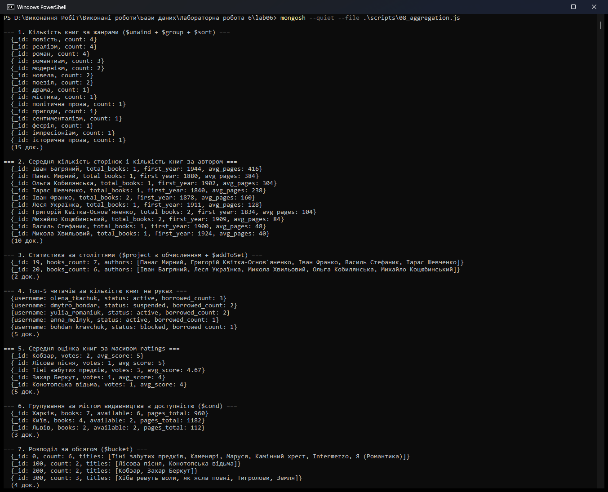

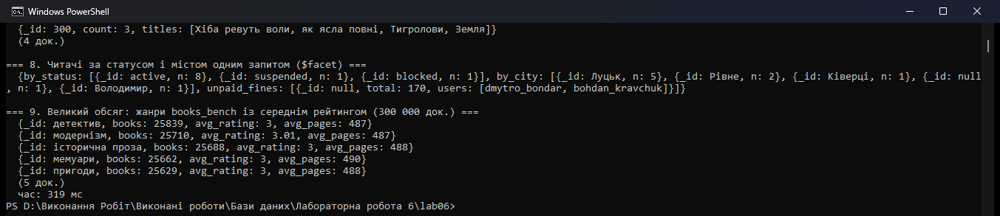

#### Крок 3. Складені (compound) індекси

Скрипт [`09_compound_indexes.js`](scripts/09_compound_indexes.js) оптимізує два складні запити до `books_bench`. Порядок полів обрано за правилом **ESR** (Equality → Sort → Range): спочатку поля з рівністю, потім поле сортування, в кінці діапазон.

```javascript
// Q1: доступні детективи після 2000 року, 10 найкращих за рейтингом
c.find({ genres: 'детектив', available: true, publication_year: { $gte: 2000 } }).sort({ rating: -1 }).limit(10);
c.createIndex({ genres: 1, available: 1, rating: -1, publication_year: 1 }, { name: 'genres_available_rating_year' });

// Q2: книги львівських видавництв 2010-2015 рр. за роком
c.find({ 'publisher.city': 'Львів', publication_year: { $gte: 2010, $lte: 2015 } }).sort({ publication_year: -1 }).limit(50);
c.createIndex({ 'publisher.city': 1, publication_year: -1 }, { name: 'city_year' });
```

| Запит | До | Після |
|---|---|---|
| Q1 | `SORT <- FETCH <- IXSCAN(publication_year...)`: 35 749 ключів і документів, сортування в пам'яті, 60,4 мс | `LIMIT <- FETCH <- IXSCAN(genres_available_rating_year)`: 11 ключів, 10 документів, 0,8 мс |
| Q2 | 344 ключі і документи, 1,8 мс | 50 ключів і документів, 1,6 мс |

Для Q1 прискорення в 75 разів. Оскільки `rating` стоїть одразу після полів рівності, документи вже впорядковані в індексі, і сервер зупиняється на десятому відповідному. Для Q2 виграш у часі малий, бо й без нього запит переглядав лише 344 документи. Але кількість переглянутих ключів зменшилась у 7 разів.

Додатково показано:

- **префікс** складеного індексу: запит лише за `genres` теж використовує `genres_available_rating_year`;
- **покривний запит** (covered query): проєкція лише полів індексу `city_year` дає `docsExamined: 0`, тобто документи взагалі не читаються;
- складений індекс `{ available: 1, genres: 1, publication_year: -1 }` на колекції `books` для каталогу доступних книг за жанром.

Поле `genres` є масивом, тому індекс `genres_available_rating_year` **multikey**: на кожен елемент масиву створюється окремий ключ.

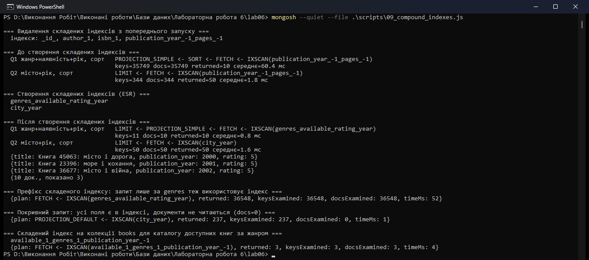

#### Крок 4. Текстовий пошук з індексом `text`

Української мови серед мов текстових індексів MongoDB немає. Тому, як рекомендує методичка, задано `default_language: 'none'`: текст лише розбивається на слова, без стемінгу і стоп-слів. Назва має вагу 5, опис 1 ([`10_text_search.js`](scripts/10_text_search.js)):

```javascript
db.books.createIndex({ title: 'text', description: 'text' },
                     { name: 'books_text', default_language: 'none', weights: { title: 5, description: 1 } });

db.books.find({ $text: { $search: 'кохання Карпатах' } });                     // будь-яке зі слів
db.books.find({ $text: { $search: 'повість кохання' } }, { score: { $meta: 'textScore' } })
        .sort({ score: { $meta: 'textScore' } });                               // релевантність
db.books.find({ $text: { $search: '"життя селян"' } });                         // точна фраза
db.books.find({ $text: { $search: 'кохання -Карпатах' } });                     // виключення слова
```

Пошук не враховує регістр («КОБЗАР» знаходить «Кобзар»). Його можна використати і в pipeline (`$match` з `$text` + `$group` за автором із середнім `textScore`). План запиту: `TEXT_MATCH <- FETCH <- IXSCAN(books_text)`.

Обмеження без стемінгу видно на прикладах: «Карпатах» знаходить 1 документ, а «Карпати» 0. Так само «селян» знаходить 2, а «селяни» і «повісті» по 0. Це обмеження розв'язано на рівні 3.

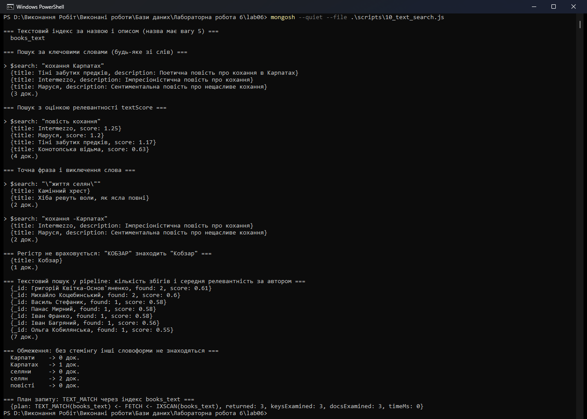

Усі індекси колекції `books` після виконання роботи в Compass. Тут текстовий індекс уже замінено на `books_text_uk` з рівня 3:

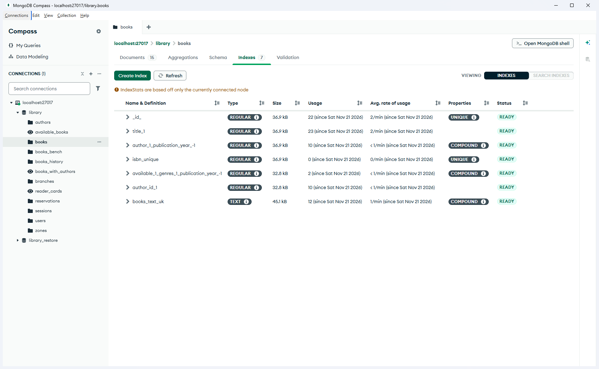

#### Крок 5. Об'єднання колекцій оператором `$lookup`

Скрипт [`11_lookup_views.js`](scripts/11_lookup_views.js) спочатку додає в книги посилання `author_id` (оновлено 13 книг) і індекс на нього. Далі виконано три види об'єднання.

```javascript
// 1. books -> authors за author_id (аналог LEFT JOIN) і вік автора на момент видання
db.books.aggregate([
  { $lookup: { from: 'authors', localField: 'author_id', foreignField: '_id', as: 'author_details' } },
  { $unwind: '$author_details' },
  { $project: { _id: 0, title: 1, publication_year: 1, 'author_details.name': 1, 'author_details.birth_year': 1,
                age_at_publication: { $subtract: ['$publication_year', '$author_details.birth_year'] } } },
  { $sort: { age_at_publication: 1 } } ]);

// 2. $lookup з pipeline: автори і кількість їхніх книг у фонді, у т.ч. доступних зараз
db.authors.aggregate([
  { $lookup: { from: 'books', let: { aid: '$_id' },
               pipeline: [ { $match: { $expr: { $eq: ['$author_id', '$$aid'] } } } ], as: 'books' } },
  { $project: { _id: 0, name: 1, books_in_library: { $size: '$books' },
                available_now: { $size: { $filter: { input: '$books', cond: '$$this.available' } } } } } ]);

// 3. $lookup за масивом borrowed_books + вкладений $lookup до authors (два рівні)
db.users.aggregate([
  { $match: { 'borrowed_books.1': { $exists: true } } },
  { $lookup: { from: 'books', localField: 'borrowed_books', foreignField: 'title', as: 'loans',
               pipeline: [ { $lookup: { from: 'authors', localField: 'author_id', foreignField: '_id', as: 'a' } },
                           { $project: { _id: 0, title: 1, author: { $first: '$a.name' } } } ] } } ]);
```

Наймолодшим на момент видання був Франко («Каменярі», 22 роки). У Тараса Шевченка 0 доступних книг, бо «Кобзар» видано читачу на кроці 4.

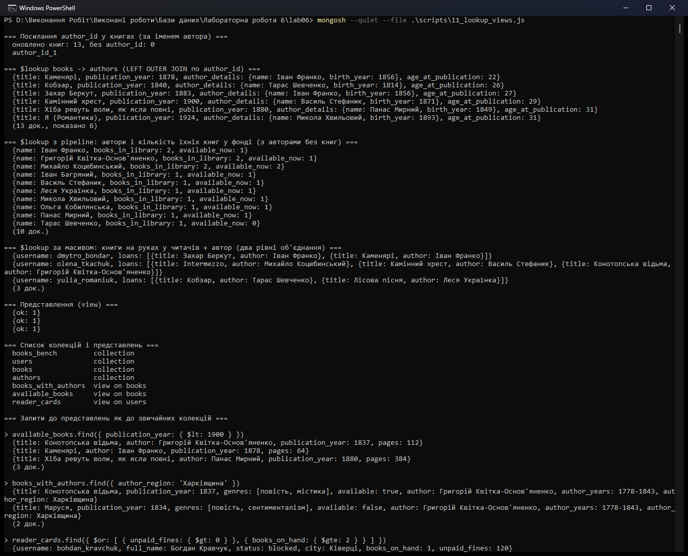

#### Крок 6. Представлення (view)

Створено три представлення для часто використовуваних запитів:

```javascript
db.createView('available_books', 'books', [            // каталог доступних книг
  { $match: { available: true } },
  { $project: { _id: 0, title: 1, author: 1, publication_year: 1, pages: 1 } } ]);

db.createView('books_with_authors', 'books', [         // книги з даними автора (JOIN)
  { $lookup: { from: 'authors', localField: 'author_id', foreignField: '_id', as: 'a' } },
  { $unwind: '$a' },
  { $project: { _id: 0, title: 1, publication_year: 1, available: 1, genres: 1, author: '$a.name',
                author_years: { $concat: [ { $toString: '$a.birth_year' }, '-', { $toString: '$a.death_year' } ] },
                author_region: { $ifNull: ['$a.birthplace.region', '-'] } } } ]);

db.createView('reader_cards', 'users', [               // картка читача
  { $project: { _id: 0, username: 1, full_name: 1, status: 1, city: '$address.city',
                books_on_hand: { $size: '$borrowed_books' },
                unpaid_fines: { $sum: { $map: { input: { $ifNull: ['$fines', []] }, as: 'f',
                                                in: { $cond: ['$$f.paid', 0, '$$f.amount'] } } } } } } ]);
```

До представлень звертаються як до звичайних колекцій: `available_books.find({ publication_year: { $lt: 1900 } })`, `books_with_authors.find({ author_region: 'Харківщина' })`, `reader_cards.find({ $or: [ { unpaid_fines: { $gt: 0 } }, { books_on_hand: { $gte: 2 } } ] })`. Представлення не зберігають даних: pipeline виконується під час кожного запиту. Тому вони доступні лише для читання, і спроба `insertOne` дає помилку «is a view, not a collection».

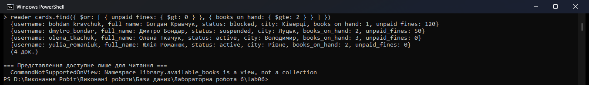

### Рівень 3. Творче розширення

#### Крок 1. Валідація схеми JSON Schema

Скрипт [`12_validation.js`](scripts/12_validation.js) змінює валідатори колекцій командою `collMod` з `validationLevel: 'strict'` і `validationAction: 'error'`:

- **books**: обов'язкові `title`, `author`, `publication_year`, `available`; довжина назви 1-200; рік 1000-2100; сторінки 1-10000; шаблон ISBN; `genres` непорожній масив **унікальних** рядків (`uniqueItems`); схема вкладеного `publisher` і елементів масиву `ratings` (оцінка `int` від 1 до 5, дата типу `date`);
- **authors**: `$jsonSchema` поєднано з `$expr` через `$and`. JSON Schema описує кожне поле окремо і не вміє порівнювати два поля, тому правило «рік смерті не раніше року народження» записано виразом `$expr`;
- **users**: шаблони `username` і `email`, `status` з переліку `enum`, не більше 5 книг на руках (`maxItems`), схема штрафів.

```javascript
db.runCommand({
  collMod: 'authors',
  validator: { $and: [
    { $jsonSchema: { bsonType: 'object', required: ['name', 'birth_year', 'nationality'],
                     properties: { name: { bsonType: 'string', minLength: 3 },
                                   birth_year: { bsonType: 'int', minimum: 900, maximum: 2026 },
                                   death_year: { bsonType: ['int', 'null'] } /* ... */ } } },
    { $expr: { $or: [ { $eq: [ { $ifNull: ['$death_year', null] }, null ] },
                      { $gte: ['$death_year', '$birth_year'] } ] } } ] },
  validationLevel: 'strict'
});
```

Перед перевіркою скрипт рахує наявні документи, що порушують нові схеми, запитом `countDocuments({ $nor: [validator] })`: таких 0 у всіх колекціях. Далі 9 некоректних вставок і одне некоректне оновлення відхилено з кодом 121 (`DocumentValidationFailure`). Функція `why()` розбирає `errInfo.details` і показує поле та причину:

| Спроба | Причина відхилення |
|---|---|
| рік 3000 | `publication_year: comparison failed` |
| немає `available` | відсутні `available` |
| ISBN `12345` | `isbn: regular expression did not match` |
| рік і доступність рядками | `type did not match` для обох полів |
| оцінка 7 у `ratings` | `ratings.score: comparison failed` |
| жанри повторюються | `genres: found a duplicate item` |
| `death_year < birth_year` | правило `$expr` не виконано |
| `Bad User`, `not-an-email`, `vip` | три порушення: шаблони `username`, `email` і `enum` для `status` |
| 6 книг на руках | `borrowed_books: array did not match specified length` |
| `updateOne` зі `pages: -5` | `pages: comparison failed`, тобто оновлення теж перевіряються |

Коректна книга «Сад Гетсиманський» пройшла валідацію.

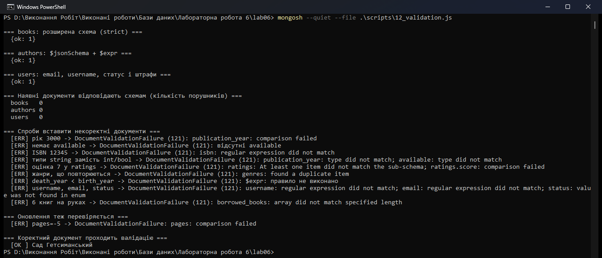

Схема `books` у Compass (вкладка Validation, Action: Error, Level: Strict):

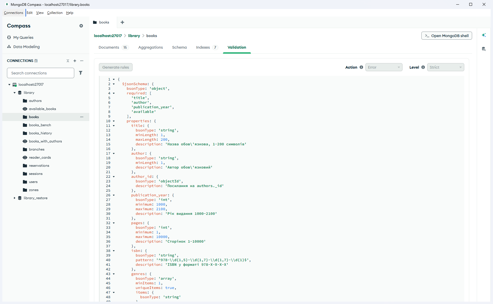

#### Крок 2. Геопросторові і TTL-індекси

Критерій оцінювання дозволяє геопросторові **або** TTL-індекси. Виконано обидва ([`13_geo_ttl.js`](scripts/13_geo_ttl.js)).

**Геопросторові запити.** Колекція `branches` містить 6 філій бібліотеки в Луцьку і Ківерцях з координатами GeoJSON (`[довгота, широта]`). Двом читачам додано поле `location`. Для обох колекцій створено індекс `2dsphere`, а для зон обслуговування (`zones`, полігони) окремий.

```javascript
db.branches.createIndex({ location: '2dsphere' });
const me = db.users.findOne({ username: 'ivan_petrov' }).location;

db.branches.find({ location: { $near: { $geometry: me, $maxDistance: 2000 } } });          // у радіусі 2 км, від найближчої
db.branches.aggregate([ { $geoNear: { near: me, distanceField: 'dist_m', spherical: true,
                                      query: { services: 'дитяча зала' } } } ]);            // відстань у км + фільтр
db.branches.find({ location: { $geoWithin: { $centerSphere: [[25.3254, 50.7472], 5 / 6378.1] } } }); // 5 км від центру
db.branches.find({ location: { $geoWithin: { $geometry: center } } });                    // у полігоні
db.zones.find({ area: { $geoIntersects: { $geometry: point } } });                          // якій зоні належить точка
```

Найближча до читача `ivan_petrov` філія з дитячою залою знаходиться в Гнідаві (1,71 км). У радіусі 5 км від центру міста 5 філій з 6, бо Ківерці лежать далі. Запит `$near` виконується через індекс (`GEO_NEAR_2DSPHERE`).

**TTL-індекси.** Сесії читачів живуть 60 с після `created_at` (`expireAfterSeconds: 60`). Бронювання видаляються в момент `expire_at` (`expireAfterSeconds: 0`, тобто кожен документ має власний час видалення). Фоновий процес TTL запускається раз на 60 с. Через 50 с після вставки дві старі сесії і прострочене бронювання видалено, а сесія і бронювання з майбутнім часом залишилися.

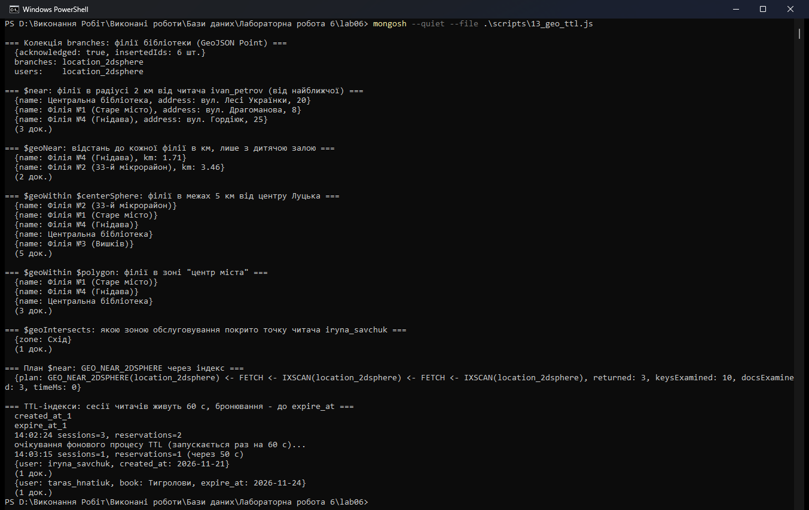

#### Крок 3. Система версіонування документів

MongoDB не має вбудованої історії змін, тому її реалізовано за шаблоном **Document Versioning** у [`lib/versioning.js`](scripts/lib/versioning.js):

- кожна книга має поля `version`, `updated_at`, `updated_by`;
- колекція `books_history` перед кожною зміною зберігає **повний знімок** попередньої версії (`snapshot`) і перелік змінених полів зі старими і новими значеннями (`changes`), а також хто, коли і чому змінив;
- **оптимістичне блокування** працює на двох рівнях. `updateOne` виконується лише за умови `{ _id, version: <прочитана версія> }`. Крім того, унікальний індекс `(book_id, version)` в історії не дозволить двом клієнтам зберегти зміну тієї самої версії;
- відкат до старої версії записується як **нова** версія, тому історія ніколи не втрачається;
- видалення зберігає останній знімок з `op: 'delete'`, і книгу можна відновити з тим самим `_id`.

```javascript
function update(filter, setFields, user, comment, expectedVersion, session) {
  const d = dbOf(session);
  const cur = d.books.findOne(filter);
  const v = expectedVersion === undefined ? cur.version : expectedVersion;
  if (cur.version !== v) throw new Error('Конфлікт версій: очікувалась v' + v + ', у базі v' + cur.version);
  const changes = Object.keys(setFields).filter(k => !same(cur[k], setFields[k]))
                        .map(k => ({ field: k, old: cur[k] ?? null, new: setFields[k] ?? null }));
  if (changes.length === 0) return { version: cur.version, changed: 0 };      // без змін - без нової версії
  const snapshot = Object.assign({}, cur); delete snapshot._id;
  d.books_history.insertOne({ book_id: cur._id, version: cur.version, op: 'update', snapshot,
                              changes, changed_at: new Date(), changed_by: user, comment });
  const r = d.books.updateOne({ _id: cur._id, version: cur.version },
                              { $set: {...}, $inc: { version: 1 } });
  if (r.modifiedCount !== 1) { /* компенсація: видалити запис історії */ throw new Error('Конфлікт версій під час запису'); }
  return { version: cur.version + 1, changed: changes.length };
}
```

Демонстрація ([`14_versioning.js`](scripts/14_versioning.js)) на книзі «Земля»:

1. три зміни (нове видання, видача, повернення з ціною) створили версії 2-4. Четвертий виклик без фактичних змін нову версію не створив;
2. історія показує кожне поле: `pages: 304 -> 320`, `publisher: {Знання, Київ} -> {Віват, Харків}`, `price_uah: null -> 280`;
3. отримано знімок версії 1;
4. два бібліотекарі прочитали v4. Перший зберіг v5, а другий отримав «Конфлікт версій: очікувалась v4, у базі v5», тобто зміна першого не перезаписалась. Пряма вставка дубля `(book_id, version)` відхилена індексом (E11000);
5. відкат до v1 створив v6 зі сторінками, видавництвом і без ціни, як у v1. В історії 5 записів;
6. «Камінний хрест» видалено і відновлено з історії як v2.

На рівні однієї машини запис історії і зміна документа є двома окремими операціями. Тому функції приймають необов'язковий `session` і в наборі реплік виконуються в транзакції (крок 5).

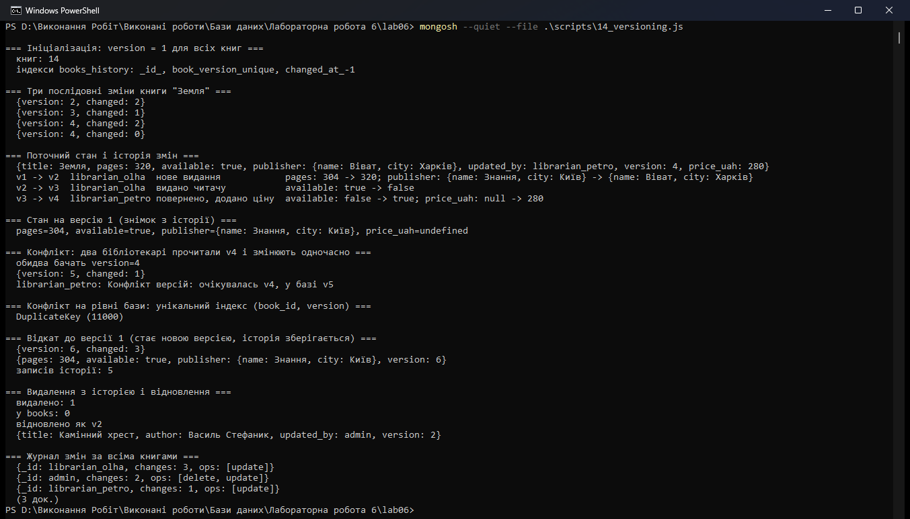

#### Крок 4. Повнотекстовий пошук з підтримкою української мови

Методичка пропонує два шляхи: MongoDB Atlas Search з аналізатором `lucene.ukrainian` або обхід обмежень вбудованого індексу. Atlas Search працює в хмарі Atlas, а пошуковий процес `mongot` для Community Edition випускається лише для Linux. Тому на Windows реалізовано другий шлях: **стемінг на рівні застосунку** ([`lib/uk_stemmer.js`](scripts/lib/uk_stemmer.js)).

Алгоритм легкого стемера (light stemming):

1. нижній регістр, видалення апострофа (`пам'ять` → `память`), заміна `ґ` → `г`;
2. відкидання стоп-слів (`і, в, на, про, для, що, ...`) і слів, коротших за 3 літери;
3. відкидання найдовшого відмінкового закінчення іменників і прикметників (`-ями, -ами, -ові, -ого, -ому, -ах, -ях, -ів, -ий, -ій, -ою, -а, -и, -і, ...`) так, щоб основа мала не менше 3 літер. Дієслівні закінчення свідомо не відкидаються: у першій версії `-ати`, `-ять`, `-ла` перетворювали «Карпати» на «карп», «пам'ять» на «пам», «новела» на «нове»;
4. відкидання суфіксів `-ськ/-цьк/-зьк` (карпатських → карпат, Коцюбинського → коцюбин), кінцевого `-ь` і заміна `-нн` на `-н` (кохання, коханий → кохан).

Основи слів назви, автора, опису і жанрів зберігаються в полі `search_terms`. Текстовий індекс з рівня 2 замінено одним новим (у колекції може бути лише один текстовий індекс) з вагами: назва 10, автор 5, основи 3, опис 1. Запит користувача теж зводиться до основ:

```javascript
db.books.createIndex({ title: 'text', author: 'text', search_terms: 'text', description: 'text' },
                     { name: 'books_text_uk', default_language: 'none',
                       weights: { title: 10, author: 5, search_terms: 3, description: 1 } });

searchUk = text => db.books.find({ $text: { $search: UkStem.query(text) } },
                                 { title: 1, author: 1, score: { $meta: 'textScore' } })
                           .sort({ score: { $meta: 'textScore' } });
```

| Запит | Старий індекс (без стемінгу) | Новий індекс | Основи запиту |
|---|---|---|---|
| Карпати | 0 | 2 | `карпат` |
| селяни | 0 | 2 | `селян` |
| повісті | 0 | 4 | `повіст` |
| коханий | 0 | 3 | `кохан` |
| боротьбу горян | 2 | 2 | `боротьб горян` |
| українських новел | 1 | 4 | `україн новел` |

«Карпати» тепер знаходить і «Тіні забутих предків» (у описі «Карпатах»), і «Захар Беркут» («карпатських горян»). Автора можна шукати в будь-якому відмінку: «Франка», «Коцюбинського». Пошук працює разом з іншими умовами (`$match` з `$text` і `available: true`). Для нової книги «Царівна» поле `search_terms` обчислюється під час вставки функцією `refreshSearchTerms()`. У наборі реплік це поле оновлюється автоматично через change stream (крок 5).

Обмеження підходу: стемер евристичний. Він не обробляє чергування (`ріг` / `рогу`), а дієслова зводяться до основи неповністю. Для промислового пошуку доцільно використовувати Atlas Search (`lucene.ukrainian`) або зовнішній пошуковий рушій.

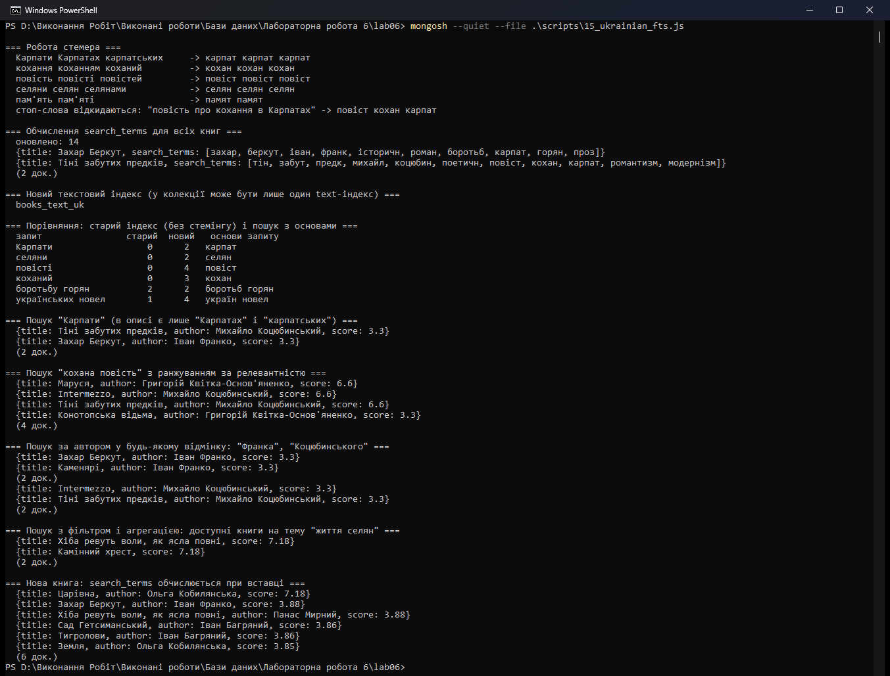

#### Крок 5. Реплікація: набір реплік із трьох вузлів

Реплікацію налаштовано на одному комп'ютері: три процеси `mongod` на портах 27018, 27019, 27020 з параметром `--replSet rs0`. Кожен має свій каталог даних у `replica/data/`. Основний сервер (служба на 27017) не змінювався. Скрипти: [`replica/start-replica.ps1`](replica/start-replica.ps1), [`replica/stop-replica.ps1`](replica/stop-replica.ps1) (параметр `-Kill` імітує аварію вузла), [`16_replica_init.js`](scripts/16_replica_init.js).

```javascript
rs.initiate({ _id: 'rs0', members: [
  { _id: 0, host: 'localhost:27018', priority: 2 },   // бажаний PRIMARY
  { _id: 1, host: 'localhost:27019', priority: 1 },
  { _id: 2, host: 'localhost:27020', priority: 1 } ] });
```

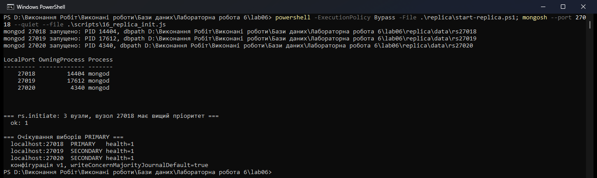

Дані перенесено з основного сервера командами `mongodump --db library --gzip --archive=...` і `mongorestore --uri "mongodb://localhost:27018,...?replicaSet=rs0" --archive=... --drop` (300 051 документ). Скрипт [`16_replica_demo.js`](scripts/16_replica_demo.js) показує:

- однакові дані на всіх трьох вузлах;
- запис з `writeConcern: { w: 'majority' }`, підтверджений за 4 мс;
- новий документ одразу читається з обох вторинних вузлів;
- запис безпосередньо на SECONDARY відхилено (`NotWritablePrimary`);
- `readPreference=secondary`: звіт виконано на вторинному вузлі 27020, щоб розвантажити PRIMARY;
- **транзакція**: видача книги змінює книгу через `Versioning.update(..., session)`, записує історію і змінює картку читача атомарно. Друга транзакція з порушенням JSON Schema (`pages: -1`) відкочена повністю: книга «Земля» не додалася читачу;
- **change stream**: `db.books.watch()` отримує подію зміни опису «Царівни», і `search_terms` перераховується автоматично (на окремому сервері change streams недоступні);
- записи `oplog` (журнал операцій, з якого вторинні вузли повторюють зміни). Розмір oplog 19 320 МБ, бо за замовчуванням це 5 % вільного місця на диску.

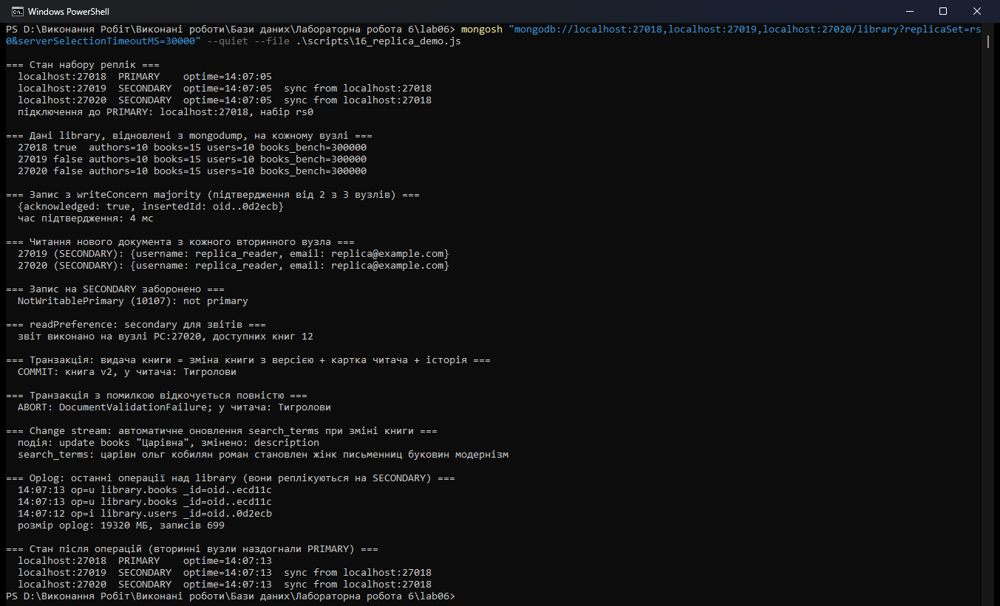

**Автоматичне перемикання (failover).** Процес PRIMARY (27018) примусово завершено. За кілька секунд вузли обрали новий PRIMARY (27019), і запис з `w: majority` продовжив працювати: більшість з 3 вузлів становить 2, і обидва живі вузли підтвердили запис.

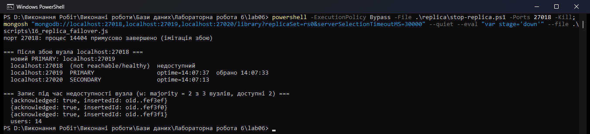

Після повторного запуску вузол 27018 наздогнав зміни, зроблені без нього (3 нові читачі, 14 документів на обох вузлах). Через 10,7 с він знову став PRIMARY, бо має вищий пріоритет.

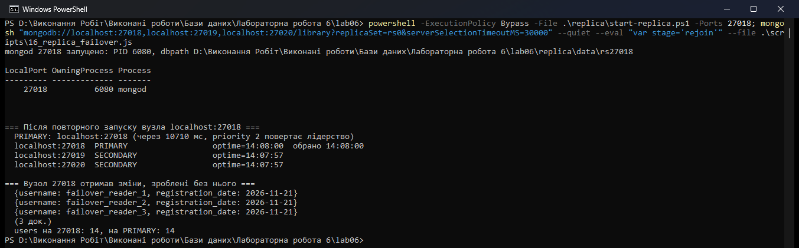

Обмеження: усі три вузли працюють на одній машині, тому набір реплік захищає від збою процесу, але не від збою комп'ютера чи диска. У реальній системі вузли розміщують на різних серверах, а для зменшення витрат можна використати арбітр.

#### Крок 6. Автоматизоване резервне копіювання з `mongodump`

Спочатку виконано всі команди з методички. Резервні копії бази і окремої колекції створено командою `mongodump --out`, вивантаження в JSON командою `mongoexport --jsonArray --pretty`. Потім виконано імпорт `mongoimport` і відновлення колекції `books` в іншу базу через `mongorestore --nsFrom/--nsTo`.

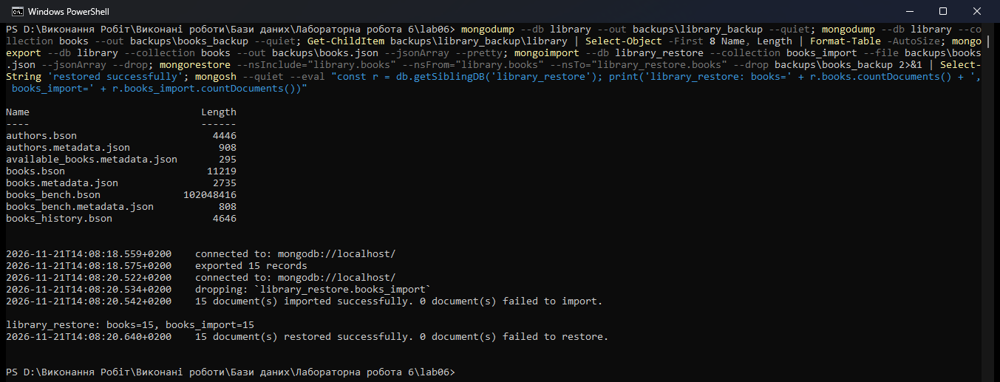

Скрипт [`backup.ps1`](backup.ps1) автоматизує процес:

1. `mongodump --gzip --archive` створює один стиснений файл `backups\library_<дата_час>.archive.gz`;
2. з журналу `mongodump` збирається кількість документів кожної колекції;
3. **перевірка архіву**: `mongorestore --dryRun` повністю читає архів без запису в базу. Пошкоджений архів дасть ненульовий код;
4. **ротація**: зберігаються лише останні `-Keep` архівів;
5. усе пишеться в журнал `backups\backup.log`; у разі помилки скрипт завершується з кодом 1 або 2 (для планувальника).

```powershell
$p = Start-Process -FilePath $mongodump -NoNewWindow -Wait -PassThru -RedirectStandardError $errFile `
     -ArgumentList "--uri=`"$Uri`"", "--db=$Db", "--gzip", "--archive=`"$archive`""
...
$p = Start-Process -FilePath $mongorestore ... -ArgumentList ..., "--dryRun", "--nsFrom=`"$Db.*`"", "--nsTo=`"${Db}_check.*`""
...
$old = Get-ChildItem $OutDir -Filter "${Db}_*.archive.gz" | Sort-Object LastWriteTime -Descending | Select-Object -Skip $Keep
foreach ($f in $old) { Remove-Item $f.FullName; Write-Log "ротація: видалено $($f.Name)" }
```

Копія бази з 300 тис. документів займає 12,39 МБ і створюється за 2 с:

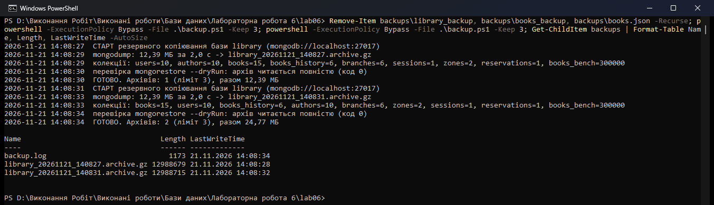

Запуск з `-Keep 2` видалив два найстаріші архіви:

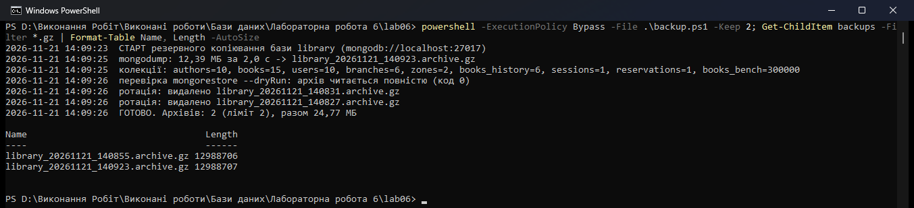

Скрипт [`restore.ps1`](restore.ps1) відновлює останній архів у **нову** базу `library_restore` (`--nsFrom library.* --nsTo library_restore.*`), щоб не зачепити робочу. Потім він порівнює кількість документів та індексів кожної колекції і представлення: усі 12 збігаються.

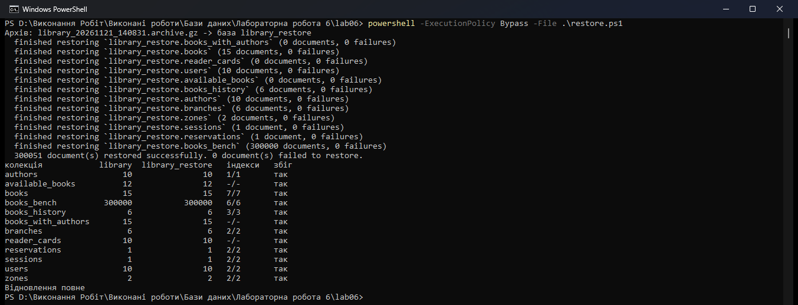

Для щоденного запуску `backup.ps1 -Register -At 23:00` реєструє завдання в Планувальнику завдань Windows. Завдання запущено вручну (`Start-ScheduledTask`). Воно завершилося з кодом 0 і записало новий архів у журнал. Після перевірки завдання видалено, щоб не залишати щоденний запуск на навчальному ПК.

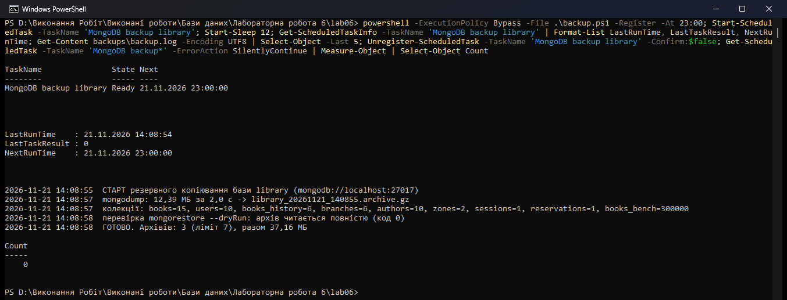

#### Крок 7. Порівняльний аналіз реляційного і документного підходів

Порівняння виконано практично. Ту саму бібліотеку побудовано в PostgreSQL 17 (база `library_rel` у контейнері `car_import_db` з ЛР4), і дані **мігровано з MongoDB**.

**Реляційна модель** ([`sql/18_relational_schema.sql`](sql/18_relational_schema.sql)) у третій нормальній формі. Три колекції перетворилися на 10 таблиць:

| Елемент документа MongoDB | Реляційне подання |
|---|---|
| колекція `authors`, масив `pseudonyms` | `authors` + `author_pseudonyms` |
| вкладений документ `publisher` | таблиця `publishers` (UNIQUE `(name, city)`) + `books.publisher_id` |
| масив `genres` | `genres` + зв'язок M:N `book_genres` |
| масив вкладених документів `ratings` | `ratings` |
| `users.address` | стовпці `city`, `street` |
| масиви `borrowed_books`, `fines` | `loans`, `fines` |
| правила `$jsonSchema` | `NOT NULL`, `CHECK` (рік, сторінки, оцінка 1-5, `death_year >= birth_year`, шаблони ISBN і username), `UNIQUE`, `FOREIGN KEY` |

Міграція: `mongoexport` вивантажує колекції в NDJSON, файли копіюються в контейнер, а `\copy` читає кожен рядок як `jsonb`. Далі `INSERT ... SELECT` розкладає документи по таблицях: `jsonb_array_elements_text` для масивів, `->` і `->>` для вкладених полів, `$date` для дат. Режим `FORMAT csv` із символами, яких немає в даних, як `QUOTE` і `DELIMITER` не дає `COPY` зіпсувати зворотні скісні риски в JSON.

```sql
INSERT INTO book_genres
SELECT b.book_id, g.genre_id
FROM s_books s JOIN books b ON b.isbn = s.doc->>'isbn',
     jsonb_array_elements_text(s.doc->'genres') AS gn JOIN genres g ON g.genre_name = gn;
```

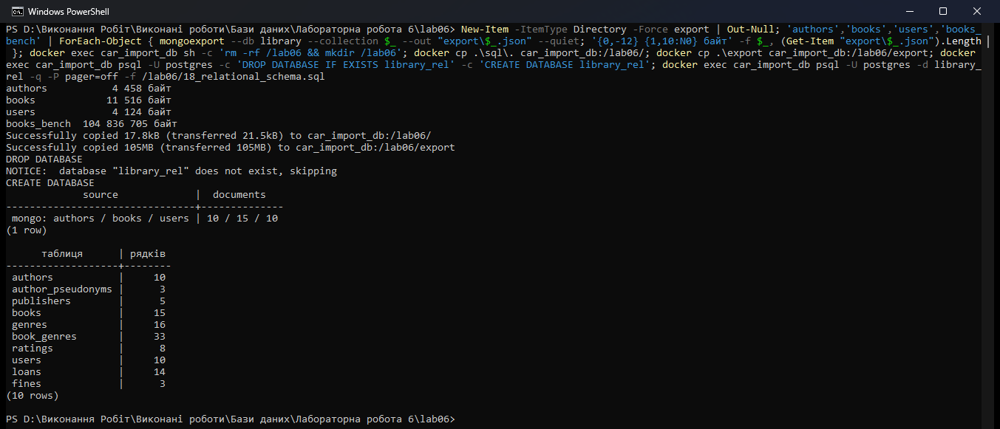

**Ті самі запити в SQL** ([`sql/19_relational_queries.sql`](sql/19_relational_queries.sql)). Каталог доступних книг з автором і жанрами в MongoDB є одним `find()`, а в SQL потребує 5 таблиць і `GROUP BY`. Щоб отримати книгу у вигляді документа (аналог `findOne`), потрібні `jsonb_build_object` і два підзапити. Натомість SQL забезпечує цілісність, якої MongoDB не має: видалити автора, на якого посилаються книги, неможливо (порушення `FOREIGN KEY`). У MongoDB `db.authors.deleteOne()` виконається, і `books.author_id` вказуватиме на неіснуючий документ.

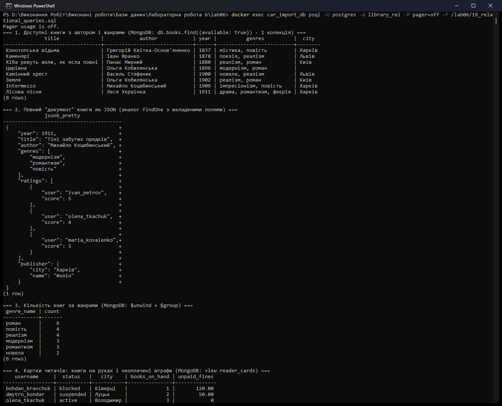

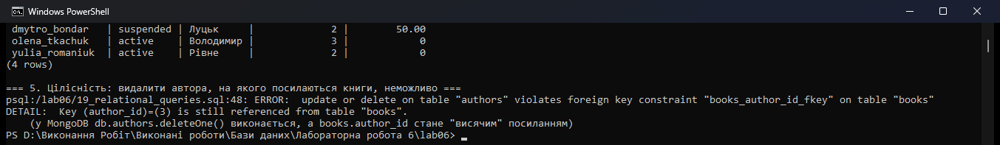

**Вимірювання на 300 000 книгах.** Ті самі документи `books_bench` вивантажено і нормалізовано в схему `bench` ([`sql/20_relational_bench.sql`](sql/20_relational_bench.sql)): 10 000 авторів, 240 видавництв, 15 жанрів, 300 000 книг і 548 479 зв'язків книга-жанр. Створено індекси, аналогічні індексам MongoDB. Три однакові запити виміряно середнім часом 10 повторів (Q3: 5 повторів) функцією `bench.avg_ms` у PostgreSQL і скриптом [`17_compare_mongo.js`](scripts/17_compare_mongo.js) у MongoDB.

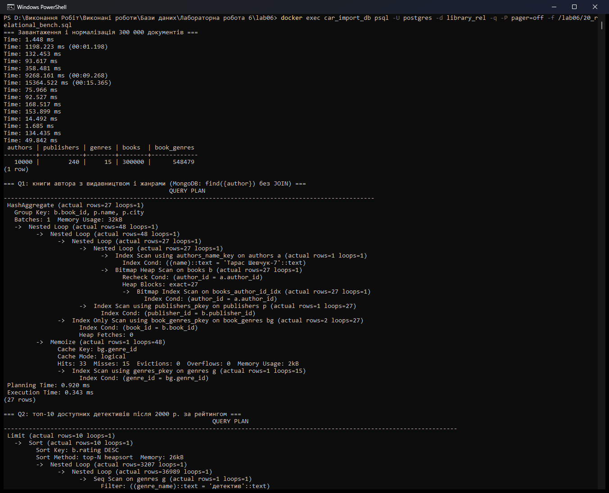

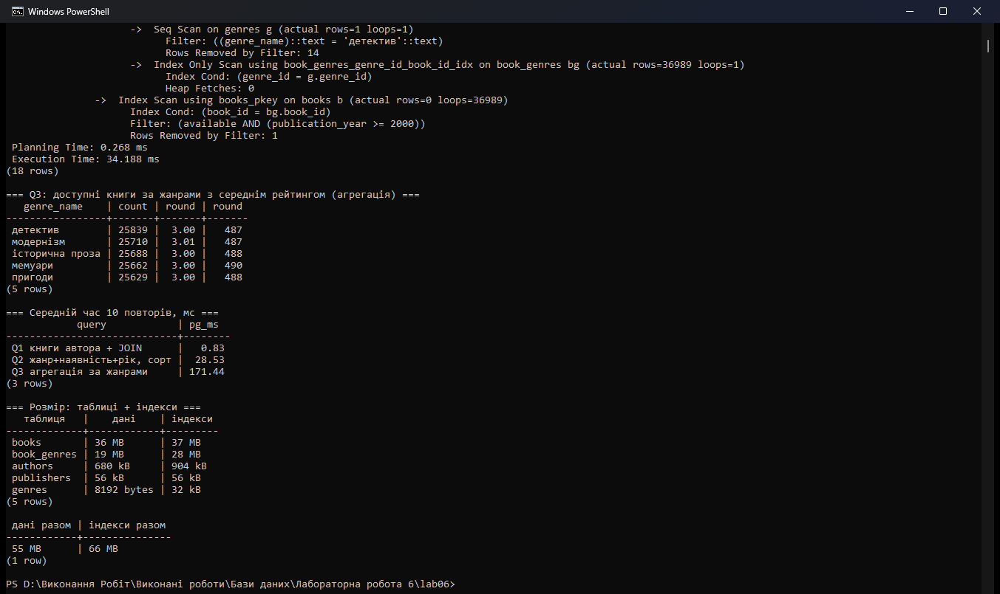

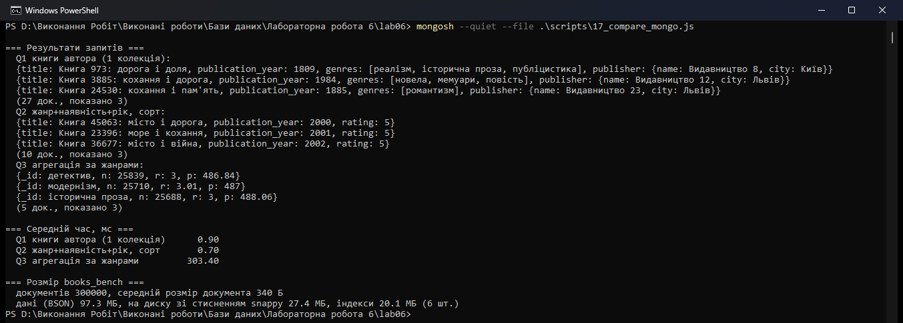

| Показник | MongoDB 9.0 (`books_bench`) | PostgreSQL 17 (схема `bench`) |
|---|---|---|
| Q1: книги автора з видавництвом і жанрами | **0,90 мс**: 1 колекція, `IXSCAN(author_1)` | **0,83 мс**: 5 таблиць, 4 `Nested Loop` |
| Q2: доступні детективи після 2000 р., топ-10 за рейтингом | **0,70 мс**: складений multikey-індекс, 11 ключів | **28,53 мс**: 36 989 рядків `book_genres` → перевірка кожної книги → сортування |
| Q3: агрегація всіх доступних книг за жанрами | **303,4 мс**: `$unwind` у pipeline | **171,4 мс**: `HashAggregate` по `JOIN` |
| Завантаження 300 000 записів | 9,5 с (генерація + `insertMany`, 1 колекція) | ≈ 27 с (`COPY` 1,2 с + розкладання по 5 таблицях, з них `book_genres` 15,4 с) |
| Розмір даних | 97,3 МБ BSON, **27,4 МБ на диску** (стиснення snappy) | **55 МБ** (без стиснення) |
| Розмір індексів | 20,1 МБ (6 індексів) | 66 МБ (первинні ключі, UNIQUE і 4 додаткові) |

Пояснення результатів:

- **Q1 (читання «агрегату» за ключем)**: обидві СУБД працюють менш ніж за 1 мс. У MongoDB книга вже містить видавництво і жанри, а в PostgreSQL дані збираються з 5 таблиць через індекси, і `Memoize` кешує жанри. На такому запиті різниці немає.
- **Q2 (фільтр за атрибутом з іншої сутності + сортування)**: виграє MongoDB у 40 разів. Жанр і рейтинг лежать в одному документі, тому один складений індекс `(genres, available, rating, year)` віддає 10 потрібних книг одразу. У PostgreSQL жанр і рейтинг знаходяться в різних таблицях, і жоден індекс не може охопити обидва поля. Довелося перебрати 36 989 детективів. Пришвидшити це можна лише денормалізацією (масив `genre_ids int[]` з GIN-індексом) або матеріалізованим представленням, тобто наблизившись до документної моделі.
- **Q3 (аналітика по всій колекції)**: виграє PostgreSQL майже вдвічі. `HashAggregate` по вузьких таблицях працює швидше, ніж `$unwind`, який створює 548 тис. проміжних документів у pipeline.
- **Запис і місце**: денормалізований документ записується однією операцією. Нормалізація потребує пошуку ключів і вставки в кілька таблиць. Стиснення WiredTiger зробило колекцію MongoDB вдвічі меншою на диску, хоча в BSON назви полів повторюються в кожному документі.

**Узагальнене порівняння для предметної області «бібліотека»:**

| Аспект | Реляційний підхід (PostgreSQL) | Документний підхід (MongoDB) |
|---|---|---|
| Модель | 10 таблиць у 3НФ; жанри, видавництва, оцінки окремо | 3 колекції; книга разом з жанрами, видавництвом і оцінками в одному документі |
| Схема | Жорстка: нове поле потребує `ALTER TABLE` | Гнучка: `price_uah`, `search_terms`, `version` додано без міграцій; контроль через `$jsonSchema`, причому лише там, де він потрібен |
| Цілісність | `FOREIGN KEY`, `CHECK`, каскади | Посилань між колекціями СУБД не перевіряє; `author_id` контролює застосунок |
| Дублювання | Немає: назва жанру зберігається один раз | Є: назва автора і в `books.author`, і в `authors`; зміна імені потребує `updateMany` |
| Читання картки книги | `JOIN` 5 таблиць або `jsonb_build_object` | Один `find()` за індексом |
| Фільтр за кількома сутностями | Обмежений: індекс охоплює лише одну таблицю | Один складений індекс по полях документа і масивах (Q2: ×40) |
| Аналітика, звіти | Сильна сторона: SQL, `GROUP BY`, віконні функції (Q3: ×1,8) | Pipeline виразний, але `$unwind` по великих масивах повільніший |
| Транзакції | ACID для будь-яких операцій на одному сервері | Атомарний запис одного документа завжди; багатодокументні транзакції лише в replica set (крок 5) |
| Масштабування | Переважно вертикальне; репліки для читання | Вбудовані replica set з автоматичним failover (крок 5) і шардинг |
| Повнотекстовий пошук українською | `tsvector` без українського словника, потрібні розширення (hunspell) | Немає української мови; власний стемер (крок 4) або Atlas Search |
| Резервне копіювання | `pg_dump` / `pg_restore`, PITR через WAL | `mongodump` / `mongorestore`, PITR через oplog (`--oplog`) |

**Висновок порівняння.** Для каталогу бібліотеки, де книгу найчастіше читають цілком, а набір атрибутів різних видань відрізняється, зручніша документна модель: менше об'єднань, гнучка схема, складені індекси по вкладених полях. Облік видач, штрафів і оплат потребує суворої цілісності і транзакцій, тож для нього краще підходить реляційна модель. Оптимальною для бібліотеки була б гібридна схема: облікова частина в PostgreSQL, а каталог і пошук у MongoDB (або в стовпцях `jsonb` PostgreSQL).

## Особливості виконання

1. **Версія і спосіб встановлення.** Встановлено MongoDB 9.0.8 (методичка описує 8.0 і дозволяє новішу). `winget` завантажував інсталятор сервера (970 МБ) надто повільно, тому MSI завантажено напряму з `fastdl.mongodb.org` у 16 паралельних потоків і звірено SHA256 з маніфестом winget. Перша спроба встановити Database Tools через winget завершилася кодом 1602, бо запит UAC скасовано, тому MSI запущено повторно. Compass встановлено окремим MSI (`SHOULD_INSTALL_COMPASS=0` в інсталяторі сервера, бо ця опція завантажує Compass окремо під час встановлення).
2. **PATH для Database Tools.** Інсталятор Database Tools не додає `C:\Program Files\MongoDB\Tools\100\bin` до `PATH`. Тому перший запуск `mongodump --version` у консолі завершився помилкою. Шлях додано до `$env:Path` поточного сеансу, а скрипти `backup.ps1` і `restore.ps1` знаходять утиліти за повним шляхом.
3. **Тестова колекція `books_bench`.** Методичка вимагає порівняти швидкість з індексами і без. На 13 книгах різниці не видно (0 мс), тому для кроків 6 (Р1), 3 (Р2) і 7 (Р3) згенеровано 300 000 документів. Основні колекції містять по 10+ документів, як у завданні.
4. **Український повнотекстовий пошук.** Atlas Search з аналізатором `lucene.ukrainian` потребує хмари Atlas або процесу `mongot` для Linux. Тому реалізовано власний легкий стемер у застосунку. Його обмеження описано в кроці 4 рівня 3.
5. **Реплікація на одному ПК.** Три вузли набору реплік працюють як окремі процеси на одному комп'ютері. Це демонструє вибори, синхронізацію і транзакції, але не захищає від збою машини. Каталоги даних (`replica/data`, 1,3 ГБ) не додано в репозиторій.
6. **Перенесення даних у набір реплік.** Спершу перенесення виконувалося конвеєром `mongodump --archive | mongorestore --archive`. У Windows PowerShell 5.1 конвеєр передає текст, а не байти, і архів пошкоджується (`stream or file does not appear to be a mongodump archive`). Тому використано проміжний файл архіву. Набір реплік після невдалої спроби створено заново з порожніми каталогами. Окремий скриншот команди перенесення не зберігся (його перезаписав наступний знімок), але результат видно на скриншоті 25: однакові 300 000+ документів на всіх вузлах.
7. **Планувальник завдань.** Завдання `MongoDB backup library` зареєстровано, запущено і після перевірки видалено (скриншот 32), щоб не залишати щоденний запуск на ПК. Для постійної роботи достатньо виконати `backup.ps1 -Register`.
8. **Дані для бібліотеки.** Біографічні дані авторів відповідають дійсності. ISBN, видавництва, читачі та координати філій вигадані, а email мають домен `example.com`.
9. **Розмір індексу `_id_` 0,0 МБ** на скриншоті 10: статистику розміру взято одразу після масової вставки, до контрольної точки WiredTiger, тому індекс `_id_` ще не записаний на диск. У Compass розміри індексів показано після контрольної точки.
10. **Відмінності від методички:**
    - до трьох колекцій додано допоміжні: `books_bench`, `books_history`, `branches`, `zones`, `sessions`, `reservations`;
    - на рівні 3 виконано і геопросторові, і TTL-індекси, хоча критерій вимагає одне з двох;
    - порівняльний аналіз виконано практично (міграція в PostgreSQL і вимірювання), а не лише теоретичною таблицею.

## Контрольні запитання

**1. У чому полягають основні відмінності між реляційними та документо-орієнтованими базами даних? Коли доцільно використовувати кожен підхід?**

Реляційна БД зберігає дані в таблицях з фіксованою схемою. Зв'язки між таблицями задаються зовнішніми ключами, дані нормалізуються, а для отримання цілісного об'єкта виконуються `JOIN`. Документна БД зберігає самодостатні документи (у MongoDB у форматі BSON) з довільною вкладеністю і масивами. Схема гнучка, пов'язані дані зазвичай вкладаються в документ.

У роботі одна книга MongoDB відповідає рядкам 6 таблиць PostgreSQL (`books`, `authors`, `publishers`, `book_genres`, `genres`, `ratings`).

- Реляційний підхід доцільний, коли важливі цілісність і транзакції (облік, фінанси, видачі книг), дані добре структуровані і потрібна складна аналітика (у роботі SQL удвічі швидше агрегував 300 тис. книг).
- Документний підхід доцільний для каталогів, профілів, контенту, журналів подій: коли об'єкт читається цілком, структура змінюється або відрізняється між записами, потрібне горизонтальне масштабування (у роботі складений індекс по вкладених полях дав виграш у 40 разів на запиті Q2).

**2. Що таке BSON і чим він відрізняється від JSON? Які переваги надає використання BSON у MongoDB?**

BSON (Binary JSON) є двійковим форматом серіалізації документів MongoDB. На відміну від текстового JSON:

- має **більше типів**: `ObjectId`, `Date`, `Int32`, `Int64`, `Double`, `Decimal128`, `Binary`, `Regex`, `Timestamp`. JSON має лише число, рядок, логічне значення, `null`, масив і об'єкт. Завдяки цьому валідатор у роботі розрізняє `int` і `string` для року видання, а дати можна порівнювати;
- зберігає **довжину** кожного елемента, тому сервер швидко пропускає непотрібні поля і переходить до вкладених документів без розбору всього тексту;
- числа зберігаються у двійковому вигляді, без перетворення з тексту.

Недолік: назви полів повторюються в кожному документі. Через це 300 000 книг займають 97 МБ BSON, але стиснення WiredTiger зменшило їх до 27 МБ на диску. Для обміну між системами BSON перетворюють на Extended JSON (`{"$oid": ...}`, `{"$date": ...}`), що видно у файлах `mongoexport`, з якими працювала міграція в PostgreSQL.

**3. Поясніть концепцію денормалізації в контексті NoSQL баз даних. Які переваги та недоліки цього підходу?**

Денормалізація означає свідоме дублювання або вкладення пов'язаних даних у документ, щоб читати їх без об'єднань. У роботі книга містить назву автора (`author`), видавництво (`publisher`), жанри і оцінки, хоча в реляційній моделі це окремі таблиці.

Переваги:

- одне читання за одним індексом повертає весь об'єкт;
- запис об'єкта атомарний, бо зміна одного документа в MongoDB атомарна завжди;
- складені індекси можуть охопити поля різних «сутностей» (запит Q2);
- простіше горизонтальне масштабування, бо документ не залежить від інших.

Недоліки:

- дублювання: зміна імені автора потребує `updateMany` по книгах, інакше дані стануть суперечливими;
- немає перевірки посилань (`author_id`);
- документ може необмежено рости (ліміт 16 МБ), якщо в нього вкладати, наприклад, усю історію видач;
- складніші довільні аналітичні запити.

Тому в роботі історію змін винесено в окрему колекцію `books_history`, а не вкладено в книгу.

**4. Як працює агрегаційний pipeline в MongoDB? Опишіть основні етапи та їх призначення.**

Pipeline є масивом етапів. Документи проходять через них послідовно, і вихід кожного етапу стає входом наступного. Основні етапи, використані в роботі:

- `$match`: фільтрація (на початку pipeline використовує індекси);
- `$project` / `$addFields`: вибір і обчислення полів (`$ceil`, `$subtract`, `$size`, `$cond`, `$map`);
- `$group`: групування з акумуляторами `$sum`, `$avg`, `$min`, `$push`, `$addToSet`;
- `$sort`, `$limit`, `$skip`: впорядкування і обмеження;
- `$unwind`: розгортання масиву в окремі документи (жанри, оцінки);
- `$lookup`: об'єднання з іншою колекцією (простий за полями або з вкладеним pipeline);
- `$bucket`: групування за діапазонами;
- `$facet`: кілька незалежних pipeline над тими самими даними;
- `$geoNear`: геопошук з відстанню;
- `$out` / `$merge`: запис результату в колекцію.

Сервер оптимізує pipeline: переносить `$match` і `$sort` на початок, об'єднує `$sort` з `$limit`. Pipeline також лежить в основі представлень.

**5. Що таке індекси в MongoDB і як вони впливають на продуктивність запитів? Які типи індексів підтримує MongoDB?**

Індекс є впорядкованою структурою B-tree зі значеннями полів і посиланнями на документи. Без індексу виконується `COLLSCAN`, тобто перегляд кожного документа. З індексом виконується `IXSCAN`, і переглядається стільки ключів, скільки потрібно. У роботі це прискорило запити в 75-165 разів (300 000 переглянутих документів → 1-27). Індекс також усуває сортування в пам'яті і дає покривні запити, які взагалі не читають документи. Ціна індексів: місце (9,2 МБ на 3 індекси) і сповільнення запису.

Типи індексів:

- **простий** (`title_1`);
- **складений** (`author_1_publication_year_-1`, ESR-індекси кроку 3);
- **multikey** для масивів (автоматично на `genres`);
- **унікальний** (`isbn_unique`);
- **text** (`books_text_uk`);
- **2dsphere / 2d** для геопросторових даних (`branches.location`);
- **TTL** (`sessions.created_at`);
- **частковий** (`partialFilterExpression`);
- **розріджений** (`sparse`, використано для `users.location`);
- **hashed** для шардингу;
- **wildcard** (`$**`);
- **кластеризовані** колекції.

**6. Поясніть різницю між операторами updateOne, updateMany та replaceOne. Коли використовувати кожен з них?**

- `updateOne(filter, update)` змінює **перший** знайдений документ операторами оновлення (`$set`, `$inc`, `$push`, `$addToSet`, `$pull`, `$unset`). Інші поля залишаються. Використовується для зміни конкретного документа за унікальною умовою: «Кобзар» став недоступним, оцінка додана «Лісовій пісні».
- `updateMany(filter, update)` застосовує ту саму зміну до **всіх** документів за умовою: 6 книг XIX століття отримали категорію, а на кроці `$lookup` усім книгам автора додано `author_id`.
- `replaceOne(filter, document)` **повністю замінює** документ новим (крім `_id`). Оператори `$...` у ньому заборонені. Використовується, коли застосунок має повну нову версію об'єкта. У роботі після `replaceOne` у читача зникло поле `address`, якого не було в новому документі.

Усі три підтримують `upsert: true` (вставити, якщо не знайдено) і повертають `matchedCount` / `modifiedCount`. У роботі повторний `$addToSet` дав `modifiedCount: 0`.

**7. Що таке валідація схеми в MongoDB і як вона реалізується через JSON Schema?**

Валідація схеми є правилами, які сервер перевіряє під час кожної вставки та оновлення. Задається параметром `validator` у `createCollection` або командою `collMod`. Оператор `$jsonSchema` описує:

- обов'язкові поля (`required`);
- типи (`bsonType`: `int`, `string`, `bool`, `date`, `objectId`, масив дозволених типів);
- діапазони (`minimum`, `maximum`), довжини (`minLength`, `maxItems`);
- шаблони (`pattern`), переліки (`enum`), унікальність елементів (`uniqueItems`);
- схеми вкладених документів і елементів масивів (`items`).

Валідатор можна поєднати зі звичайними операторами запиту, наприклад `$expr` для міжпольових правил, як у колекції `authors`.

`validationLevel` визначає, які документи перевіряються: `strict` (усі) або `moderate` (лише ті, що вже відповідали схемі). `validationAction` визначає дію: `error` (відхилити) або `warn` (записати в журнал). Помилка має код 121 і `errInfo.details` з переліком порушених правил. Валідація не перевіряє посилань між колекціями.

**8. Як реалізувати зв'язки між документами в MongoDB? Порівняйте підходи з вбудованими документами та посиланнями.**

- **Вбудовування (embedding).** Пов'язані дані лежать усередині документа: `publisher`, `ratings`, `address`, `fines` у роботі. Підходить для зв'язків «один до кількох», коли дані читаються разом з батьківським документом, не потрібні окремо і не ростуть необмежено. Переваги: одне читання і атомарне оновлення.
- **Посилання (referencing).** Документ зберігає `_id` іншого (`books.author_id`) або масив ідентифікаторів. Дані об'єднуються через `$lookup` або другим запитом. Підходить для «багато до багатьох», для сутностей, що змінюються незалежно або потрібні окремо (автор має власну біографію), і для великих або необмежених масивів (історія версій `books_history.book_id`).
- **Гібрид (extended reference).** Разом із посиланням зберігається копія часто потрібних полів (`books.author` + `books.author_id`). Так список книг можна показати без `$lookup`, а повні дані автора отримати за посиланням.

Посилання в MongoDB не перевіряються сервером, тому цілісність забезпечує застосунок.

**9. Що таке текстовий індекс і як він використовується для повнотекстового пошуку?**

Текстовий індекс розбиває значення рядкових полів на слова (токени) і зберігає їх в індексі. Для підтримуваних мов слова зводяться до основи (стемінг) і відкидаються стоп-слова. Створюється як `createIndex({ title: 'text', description: 'text' }, { weights, default_language })`, у колекції може бути лише один такий індекс.

Пошук виконується оператором `$text: { $search: '...' }`:

- кілька слів працюють як «будь-яке зі слів»;
- фраза в лапках означає точну фразу;
- `-слово` виключає документи з цим словом;
- регістр і діакритика не враховуються.

Релевантність повертає `{ $meta: 'textScore' }`, і за нею можна сортувати. Ваги полів змінюють внесок збігу (назва важить більше за опис).

Обмеження: немає пошуку за частиною слова, а для мов поза списком (зокрема української) немає стемінгу. У роботі це розв'язано власним стемером і полем `search_terms`. Повноцінна альтернатива: Atlas Search на базі Lucene з аналізаторами мов, нечітким пошуком і автодоповненням.

**10. Опишіть стратегії масштабування MongoDB. Що таке sharding і реплікація?**

- **Вертикальне масштабування** означає потужніший сервер (пам'ять для кешу WiredTiger, швидкі диски).
- **Реплікація (replica set)** означає кілька копій тих самих даних. Один PRIMARY приймає записи і пише їх в oplog, SECONDARY повторюють oplog. Під час збою PRIMARY вузли за кілька секунд обирають новий (у роботі 27018 → 27019, потім назад завдяки `priority: 2`). Реплікація дає відмовостійкість, читання з вторинних вузлів (`readPreference`), підтвердження запису більшістю (`w: majority`), а також є умовою для транзакцій і change streams. Обсяг даних і продуктивність запису вона не збільшує.
- **Шардинг (sharding)** розподіляє дані між кількома шардами (кожен є набором реплік) за **ключем шардингу**. Діапазонний ключ дає ефективні діапазонні запити, хешований рівномірно розподіляє записи. Маршрутизатор `mongos` направляє запит лише на потрібні шарди, конфігураційні сервери зберігають розподіл чанків, а балансувальник переносить чанки між шардами. Шардинг збільшує і обсяг даних, і пропускну здатність запису. Від вдало обраного ключа залежить рівномірність навантаження: для бібліотеки, наприклад, хешований `_id` книги або `{ library_branch, _id }` для мережі філій.

## Висновки

У результаті виконання лабораторної роботи встановлено MongoDB Community Server 9.0 з mongosh, Database Tools і Compass, створено базу `library` і опановано документну модель даних на прикладі бібліотеки.

1. Створено три колекції з документами різної структури (вкладені документи, масиви рядків і вкладених документів, необов'язкові поля). Виконано всі CRUD-операції, у тому числі `$push`, `$addToSet`, `$pull`, `$inc`, `$unset` і показано різницю між `updateOne` і `replaceOne`.
2. Простий, складений і унікальний індекси прискорили запити до 300 000 документів у 75-165 разів, а складені індекси за правилом ESR прискорили складний запит у 75 разів і дали покривні запити без читання документів.
3. Опановано складні запити (`$and`, `$or`, `$in`, `$regex`, `$elemMatch`, `$all`), 9 агрегаційних pipeline (`$group`, `$unwind`, `$bucket`, `$facet`), `$lookup` трьох видів і три представлення.
4. Реалізовано валідацію JSON Schema з міжпольовим правилом `$expr`, геопросторові запити і TTL-індекси, систему версіонування з оптимістичним блокуванням і відкатом, повнотекстовий пошук українською на основі власного стемера (запити «Карпати», «повісті», «Франка» почали знаходити книги).
5. Налаштовано набір реплік із трьох вузлів: перевірено запис з `w: majority`, читання з вторинних вузлів, багатодокументні транзакції, change stream і автоматичне перемикання під час збою PRIMARY без втрати даних.
6. Розроблено скрипти резервного копіювання з перевіркою архіву, ротацією, журналом і реєстрацією в Планувальнику Windows, а також скрипт відновлення з перевіркою всіх колекцій.
7. Практичне порівняння з PostgreSQL на тих самих даних показало, що жоден підхід не кращий в усьому. MongoDB виграє на читанні цілісних об'єктів і фільтрах по вкладених полях (у 40 разів), PostgreSQL виграє на аналітиці (у 1,8 раза) і гарантує цілісність посилань.

**Самооцінка:** 5 (виконано всі завдання рівнів 1-3).

## Посилання на проєкт

Репозиторій: `https://github.com/dmutrokondratyk2008/db_labs`

Файли проєкту (`lab06/`):

- `scripts/01_create_db.js` ... `06_index_benchmark.js`: база, дані, CRUD, індекси, порівняння швидкості (рівень 1);
- `scripts/07_complex_queries.js` ... `11_lookup_views.js`: складні запити, агрегація, складені й текстовий індекси, `$lookup`, представлення (рівень 2);
- `scripts/12_validation.js` ... `16_replica_*.js`, `17_compare_mongo.js`: валідація, гео/TTL, версіонування, український пошук, реплікація, порівняння (рівень 3);
- `scripts/lib/`: `common.js`, `versioning.js`, `uk_stemmer.js`;
- `sql/18_relational_schema.sql` ... `20_relational_bench.sql`: реляційна модель, міграція, порівняльні запити;
- `replica/start-replica.ps1`, `replica/stop-replica.ps1`: керування набором реплік;
- `backup.ps1`, `restore.ps1`: резервне копіювання і відновлення;
- `screenshots/lab06/`: скриншоти виконання (`1.png`-`38.png`).

Резервні копії (`backups/`), вивантаження (`export/`, 100 МБ) і каталоги даних реплік (`replica/data/`, 1,3 ГБ) у репозиторій не додано через розмір.

## Додаток А. Скріншоти виконання

| Файл | Розділ і зміст |
|---|---|
| `1.png` | Р1, крок 1: версії MongoDB, служба, `mongod.cfg` |
| `2.png` | Р1, крок 1: MongoDB Compass, база `library` |
| `3.png` | Р1, крок 2: створення бази і колекцій |
| `4.png` | Р1, крок 3: наповнення колекцій |
| `5.png` | Р1, крок 3: документи `books` у Compass |
| `6.png` | Р1, крок 4: CRUD, вставка і читання |
| `7.png` | Р1, крок 4: CRUD, оновлення, заміна, видалення |
| `8.png` | Р1, крок 5: три індекси і плани запитів |
| `9.png` | Р1, крок 6: генерація 300 000 документів |
| `10.png` | Р1, крок 6: порівняння швидкості з індексами і без |
| `11.png` | Р2, крок 1: складні запити |
| `12.png` | Р2, крок 2: агрегація (жанри, автори, століття, читачі, оцінки) |
| `13.png` | Р2, крок 2: агрегація (`$bucket`, `$facet`, 300 тис. документів) |
| `14.png` | Р2, крок 3: складені індекси |
| `15.png` | Р2, крок 4: текстовий пошук |
| `16.png` | Р2, крок 4: індекси колекції `books` у Compass |
| `17.png` | Р2, крок 5: `$lookup` |
| `18.png` | Р2, крок 6: представлення |
| `19.png` | Р3, крок 1: валідація JSON Schema |
| `20.png` | Р3, крок 1: валідація в Compass |
| `21.png` | Р3, крок 2: геопросторові і TTL-індекси |
| `22.png` | Р3, крок 3: версіонування документів |
| `23.png` | Р3, крок 4: повнотекстовий пошук українською |
| `24.png` | Р3, крок 5: запуск і ініціалізація набору реплік |
| `25.png` | Р3, крок 5: запис, читання, транзакції, change stream, oplog |
| `26.png` | Р3, крок 5: збій PRIMARY і вибори |
| `27.png` | Р3, крок 5: повернення вузла і синхронізація |
| `28.png` | Р3, крок 6: команди `mongodump`, `mongoexport`, `mongoimport`, `mongorestore` |
| `29.png` | Р3, крок 6: скрипт `backup.ps1` |
| `30.png` | Р3, крок 6: ротація архівів |
| `31.png` | Р3, крок 6: відновлення `restore.ps1` і перевірка |
| `32.png` | Р3, крок 6: завдання в Планувальнику Windows |
| `33.png` | Р3, крок 7: міграція в PostgreSQL |
| `34.png` | Р3, крок 7: еквівалентні SQL-запити |
| `35.png` | Р3, крок 7: картки читачів, перевірка `FOREIGN KEY` |
| `36.png` | Р3, крок 7: PostgreSQL, завантаження і плани |
| `37.png` | Р3, крок 7: PostgreSQL, час запитів і розмір |
| `38.png` | Р3, крок 7: MongoDB, ті самі запити і розмір |
