# Звіт з лабораторної роботи 7. Повний цикл розробки NoSQL застосунку з інтеграцією

**Виконав:** Кондратюк Дмитро  
**Група:** ІПЗ-32  
**Варіант (предметна область):** Блог-система (користувачі, пости з коментарями, категорії й теги)  
**Рівень виконання:** 3 (відмінно)

## Мета роботи

Застосувати знання роботи з NoSQL базами даних для створення повноцінного вебзастосунку, навчитися проєктувати документні схеми для реальних предметних областей, опанувати інтеграцію MongoDB з клієнтськими вебтехнологіями, розвинути навички аналізу та оптимізації продуктивності документо-орієнтованих систем.

## Виконання роботи

### Підготовка середовища

Роботу виконано 25 листопада 2026 року на Windows 11. Використано:

- MongoDB Community Server **9.0.8** (служба Windows `MongoDB`, порт 27017), MongoDB Shell `mongosh` 2.14.1, MongoDB Compass;
- Node.js **26.13.1** (LTS) і npm 11.20.0, встановлені через `winget install OpenJS.NodeJS.LTS`;
- пакети вебзастосунку: Express 5.3.0, офіційний драйвер `mongodb` 6.22.0, Chart.js 4.6.2 (графіки), `pg` 8.23.1 (драйвер PostgreSQL для порівняльних тестів);
- PostgreSQL 17.11 у Docker-контейнері `car_import_db` з ЛР4 (для порівняльного аналізу рівня 3), Docker 29.9.2;
- Windows PowerShell 5.1, VS Code, git.

Методичка описує Node.js «актуальної LTS-версії»; на момент виконання це 26.x. Express 5 сумісний з прикладами методички (`express.json()`, `express.static`).

Скрипти `mongosh` лежать у каталозі [`scripts/`](scripts/) і виконуються командою `mongosh --quiet --file .\scripts\<скрипт>.js`. Спільний код винесено в [`scripts/lib/`](scripts/lib/):

- `common.js` - компактний вивід (`table`, `fmt`, `planSummary`), детермінований генератор псевдовипадкових чисел `makeRng`, транслітерація `slugify` за постановою КМУ № 55;
- `seed_data.js` - довідники для наповнення (міста, користувачі, категорії, теги, назви постів, пули речень);
- `blog.js` - операції блогу для mongosh (перерахунок статистики, реакції, перегляди, коментарі, модерація, версіонування, пагінація).

Вебзастосунок - у [`blog-app/`](blog-app/): сервер `server.js`, сервісний шар `lib/blog.js` (та сама логіка, що й у `scripts/lib/blog.js`, але асинхронна для Node.js-драйвера), кеш `lib/cache.js`, сторінки в `public/`. Повний прогін усіх кроків з записом виводу в [`results/`](results/) виконує [`run-all.ps1`](run-all.ps1).

```powershell
& "C:\Program Files\MongoDB\Server\9.0\bin\mongod.exe" --version | Select-Object -First 1   # mongod не додано в PATH
mongosh --version
node --version; npm --version
docker exec car_import_db psql -U postgres -tAc "SELECT version()"
```

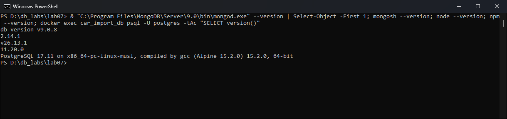

### Рівень 1. Основна функціональність

#### Крок 1. Проєктування схеми бази даних

Схему спроєктовано від патернів доступу блогу: найчастіші операції - показати стрічку постів, відкрити пост разом з автором, категорією, тегами й коментарями, додати коментар або лайк. Тому дані, які читаються разом, зберігаються разом (вбудовування), а сутності з незалежним життєвим циклом - окремо (посилання).

| Колекція | Призначення | Підхід |
|---|---|---|
| `users` | користувачі з ролями `admin`, `author`, `reader`; профіль, статистика | окремі документи; лічильники `statistics` - патерн Computed |
| `posts` | статті з вбудованими коментарями, автором, категорією, тегами, статистикою, геолокацією | гібридний: коментарі вбудовані, автор і категорія - посилання + копія імені |
| `categories` | категорії **і** теги в одній колекції з дискримінатором `type` | патерн Polymorphic |
| `reactions` | один документ на пару (пост, користувач): лайк `1` або дизлайк `-1` | посилання, унікальний індекс |
| `post_views` | перегляди посту за днями, документ на пост і місяць | патерн Bucket |
| `post_versions` | знімки попередніх версій посту | окрема колекція історії |
| `notifications` | сповіщення авторам | окрема колекція з TTL-індексом |

Документ `posts` (скорочено, справжній документ з бази):

```javascript
{
  _id: ObjectId("..."),
  title: "Проєктування документної схеми в MongoDB",
  slug: "proiektuvannia-dokumentnoi-skhemy-v-mongodb",       // унікальний, транслітерація назви
  content: "Тема «Проєктування документної схеми в MongoDB» ...",  // щонайменше 100 символів
  excerpt: "Для зв’язку «багато до багатьох» ...",
  author:   { user_id: ObjectId("..."), username: "andrii.bondar", avatar_url: "https://..." },
  category: { category_id: ObjectId("..."), name: "Бази даних", slug: "databases" },
  tags: ["mongodb", "nosql"],                                // slug-и тегів з колекції categories
  featured_image: "https://picsum.photos/seed/.../800/400",
  status: "published",                                       // draft | published | archived
  comments: [
    { comment_id: ObjectId("..."), parent_id: null, depth: 0,          // коментар першого рівня
      author: { user_id: ObjectId("..."), username: "taras.hnatiuk" },
      text: "...", status: "approved", likes: 2, created_at: ISODate("..."),
      moderation: { by: ObjectId("..."), at: ISODate("...") } },
    { comment_id: ObjectId("..."), parent_id: ObjectId("..."), depth: 1, ... }   // відповідь
  ],
  statistics: { views: 918, likes: 4, dislikes: 2, rating: 2, comments_count: 3 },
  location: { type: "Point", coordinates: [30.50137, 50.45884], place: "Київ" },
  version: 1,
  created_at: ISODate("..."), updated_at: ISODate("..."), published_at: ISODate("...")
}
```

Основні рішення:

1. **Коментарі вбудовані в пост** (відношення «один до кількох», завжди читаються разом з постом): сторінка посту - один запит без `JOIN`. Коментарі зберігаються плоским масивом з `parent_id` і `depth` (модель «дерево з посиланням на батька»), а не вкладеними масивами `replies`: так кожен коментар оновлюється одним `arrayFilters` незалежно від глибини (див. рівень 3, крок 2). Кількість коментарів у блозі обмежена (до сотень на пост), тому ліміт 16 МБ на документ не загрожує.
2. **Автор і категорія - посилання + копія імені** (гібридний підхід з методички): стрічку можна показати без `$lookup`, а повні дані користувача лишаються в `users`. Ціна - при перейменуванні користувача треба оновити копії (виміряно в рівні 3, крок 8).
3. **Теги - масив рядків** у пості (multikey-індекс, пошук `$all`/`$in`), а опис і лічильник тегу - документ `type: "tag"` у `categories`. Методичка описує колекцію як «категорії та теги», тому обидві сутності зберігаються в одній колекції з полем-дискримінатором (патерн Polymorphic з теоретичних відомостей).
4. **Лайки - окрема колекція `reactions`**, бо треба пам'ятати, хто саме поставив реакцію (заборона повторного лайку, скасування, зміна на дизлайк). Лічильники `statistics.likes/dislikes/rating` у пості - денормалізовані (Computed) для швидкого сортування.
5. **Перегляди - патерн Bucket**: документ `post_views` на пост і місяць з лічильниками за днями `daily: {"01": 12, ...}`. Інкремент одного дня - `$inc` по полю без росту масиву.
6. **Категорії вкладені**: поле `parent_id` (наприклад, «Хмарні технології» - підкатегорія «DevOps»).

#### Крок 2. Створення колекцій з валідацією

Скрипт [`01_create_collections.js`](scripts/01_create_collections.js) створює базу `blog_system` і сім колекцій з `$jsonSchema` (`validationLevel: "strict"`, `validationAction: "error"`). Порівняно з методичкою схеми розширено: `additionalProperties: false` для основних колекцій (зайві поля не потрапляють у базу), валідація вкладених документів (автор, категорія, кожен коментар у масиві, координати GeoJSON), шаблон `slug`, обмеження довжини і переліки значень.

```javascript
db.createCollection('posts', {
  validationLevel: 'strict', validationAction: 'error',
  validator: { $jsonSchema: {
    bsonType: 'object',
    required: ['title', 'slug', 'content', 'author', 'category', 'tags', 'status',
               'comments', 'statistics', 'version', 'created_at', 'updated_at'],
    additionalProperties: false,
    properties: {
      title:   { bsonType: 'string', minLength: 3, maxLength: 200 },
      slug:    { bsonType: 'string', pattern: '^[a-z0-9]+(-[a-z0-9]+)*$', maxLength: 220 },
      content: { bsonType: 'string', minLength: 100 },
      author:  { bsonType: 'object', required: ['user_id', 'username'], additionalProperties: false,
                 properties: { user_id: { bsonType: 'objectId' }, username: { bsonType: 'string' },
                               avatar_url: { bsonType: 'string' } } },
      tags:    { bsonType: 'array', maxItems: 10, uniqueItems: true,
                 items: { bsonType: 'string', pattern: '^[a-z0-9]+(-[a-z0-9]+)*$' } },
      status:  { enum: ['draft', 'published', 'archived'] },
      comments: { bsonType: 'array', items: {
        bsonType: 'object',
        required: ['comment_id', 'parent_id', 'depth', 'author', 'text', 'status', 'created_at'],
        properties: {
          parent_id: { bsonType: ['objectId', 'null'] },
          depth:  { bsonType: 'int', minimum: 0, maximum: 5 },
          status: { enum: ['pending', 'approved', 'rejected'] }, ... } } },
      location: { bsonType: 'object', required: ['type', 'coordinates'], properties: {
        type: { enum: ['Point'] },
        coordinates: { bsonType: 'array', minItems: 2, maxItems: 2, items: [
          { bsonType: ['double', 'int'], minimum: -180, maximum: 180 },
          { bsonType: ['double', 'int'], minimum: -90,  maximum: 90 } ] } } },
      version: { bsonType: 'int', minimum: 1 }, ...
    } } }
});
```

Користувачі мають шаблон email, `role` з переліку, `password_hash` щонайменше 60 символів; `reactions.value` лише `1` або `-1`; `post_views.daily` дозволяє лише ключі-дні `^[0-3][0-9]$`. Наприкінці скрипт пробує вставити сім некоректних документів - усі відхилено з кодом `DocumentValidationFailure`:

```
=== Перевірка валідації: некоректні документи ===
  users      роль "moderator" не з переліку       -> відхилено: DocumentValidationFailure
  users      некоректний email                    -> відхилено: DocumentValidationFailure
  posts      контент коротший за 100 символів     -> відхилено: DocumentValidationFailure
  posts      slug з великими літерами і пробілом  -> відхилено: DocumentValidationFailure
  posts      коментар зі статусом "spam"          -> відхилено: DocumentValidationFailure
  categories type "rubric" не з переліку          -> відхилено: DocumentValidationFailure
  reactions  value = 5 (дозволено лише 1 або -1)  -> відхилено: DocumentValidationFailure
```

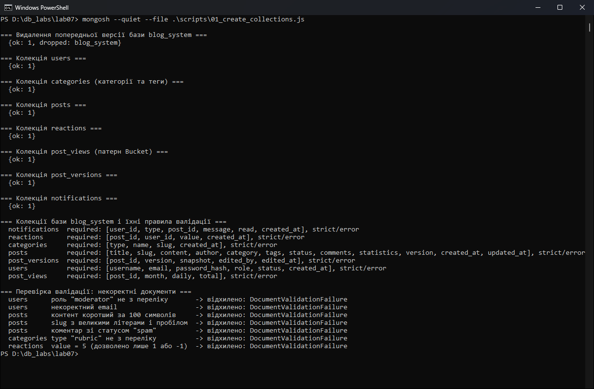

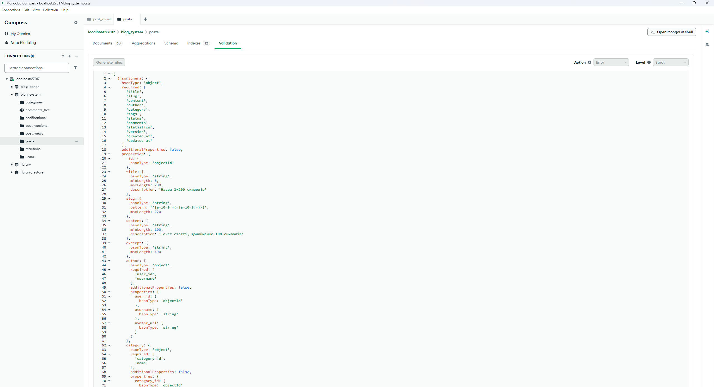

#### Крок 3. Створення індексів

Унікальні індекси створюються **до** наповнення ([`02_indexes.js`](scripts/02_indexes.js)), щоб уже під час вставки гарантувати відсутність дублікатів. Індекси для завдання 5 рівня 1 (пошук постів за автором, категорією та датою):

```javascript
db.posts.createIndex({ slug: 1 }, { unique: true });
db.posts.createIndex({ 'author.user_id': 1, created_at: -1 });                         // пости автора
db.posts.createIndex({ 'category.category_id': 1, status: 1, published_at: -1 });      // пости категорії
db.posts.createIndex({ status: 1, published_at: -1, _id: -1 });                        // стрічка, дати, пагінація
db.posts.createIndex({ published_at: -1 }, { name: 'published_at_partial',
                       partialFilterExpression: { status: 'published' } });           // частковий
db.posts.createIndex({ tags: 1, published_at: -1 });                                   // multikey
db.posts.createIndex({ title: 'text', excerpt: 'text', content: 'text' },
                     { name: 'posts_text', default_language: 'none', weights: { title: 10, excerpt: 4, content: 1 } });
db.posts.createIndex({ location: '2dsphere' });
db.posts.createIndex({ 'comments.comment_id': 1 });
db.posts.createIndex({ 'comments.status': 1 }, { name: 'comments_pending_partial',
                       partialFilterExpression: { 'comments.status': 'pending' } });
db.posts.createIndex({ 'statistics.rating': -1 }, { partialFilterExpression: { status: 'published' } });
```

Також: `users` - унікальні `username` і `email`; `categories` - унікальні `{type, slug}` і `{type, name}` з українською колацією (`strength: 2`, назви без урахування регістру); `reactions` - унікальний `{post_id, user_id}`; `post_views` - унікальний `{post_id, month}`; `post_versions` - унікальний `{post_id, version}`; `notifications` - `{user_id, read, created_at}` і TTL-індекс `read_at` (30 днів, лише прочитані). Разом 32 індекси, з них 12 у `posts`.

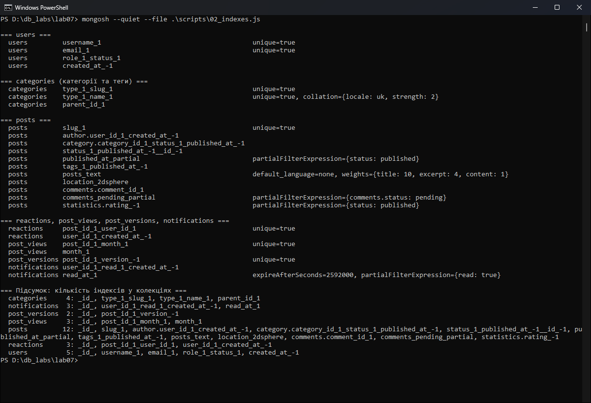

#### Крок 4. Заповнення бази реалістичними даними

[`03_seed.js`](scripts/03_seed.js) генерує дані з фіксованим seed генератора `makeRng`, тому при кожному запуску набір однаковий (відрізняються лише `ObjectId` і хеші паролів):

- **20 користувачів** з українськими іменами: 2 адміністратори, 11 авторів, 7 читачів (один заблокований, `status: "suspended"`). Пароль хешується `crypto.scryptSync` з випадковою сіллю у форматі PHC (`$scrypt$ln=14,r=8,p=1$<сіль>$<хеш>`), паролі тестові;
- **10 категорій** з методички (одна вкладена) і **30 тегів**;
- **60 постів** (55 опублікованих, 3 чернетки, 2 архівні) з осмисленими назвами (по 6 на категорію) і текстами з тематичних пулів речень; автор обирається з вагою активності, 85% постів мають геолокацію міста автора;
- **355 коментарів** (330 схвалено, 16 очікують модерації, 9 відхилено як спам), з них 112 відповідей до 2 рівнів; коментарі адміністраторів і автора посту схвалюються автоматично, решта свіжих частково чекають модерації;
- 385 реакцій, 204 бакети переглядів за днями, 76 сповіщень за останні 21 день.

Після наповнення лічильники перераховуються з первинних даних стадією `$merge` (патерн Computed), наприклад для постів:

```javascript
db.posts.aggregate([
  { $lookup: { from: 'reactions', localField: '_id', foreignField: 'post_id', as: 'r', pipeline: [
      { $group: { _id: null, likes: { $sum: { $cond: [{ $eq: ['$value', 1] }, 1, 0] } },
                  dislikes: { $sum: { $cond: [{ $eq: ['$value', -1] }, 1, 0] } } } }] } },
  { $lookup: { from: 'post_views', localField: '_id', foreignField: 'post_id', as: 'v', pipeline: [
      { $group: { _id: null, total: { $sum: '$total' } } }] } },
  { $set: { likes: { $ifNull: [{ $first: '$r.likes' }, 0] }, dislikes: { $ifNull: [{ $first: '$r.dislikes' }, 0] } } },
  { $project: { statistics: { views: { $ifNull: [{ $first: '$v.total' }, 0] }, likes: '$likes', dislikes: '$dislikes',
                rating: { $subtract: ['$likes', '$dislikes'] },
                comments_count: { $size: { $filter: { input: '$comments', as: 'c', cond: { $eq: ['$$c.status', 'approved'] } } } } } } },
  { $merge: { into: 'posts', on: '_id', whenMatched: 'merge', whenNotMatched: 'discard' } }
]);
```

```
=== Підсумок наповнення ===
  users | categories | tags | posts | published | comments | reactions | view_buckets | notifications
  20    | 10         | 30   | 60    | 55        | 355      | 385       | 204          | 76
```

Усі документи пройшли валідацію `$jsonSchema`. Вимоги методички (мінімум 50 постів, 200 коментарів, 20 користувачів, 10 категорій) виконано.

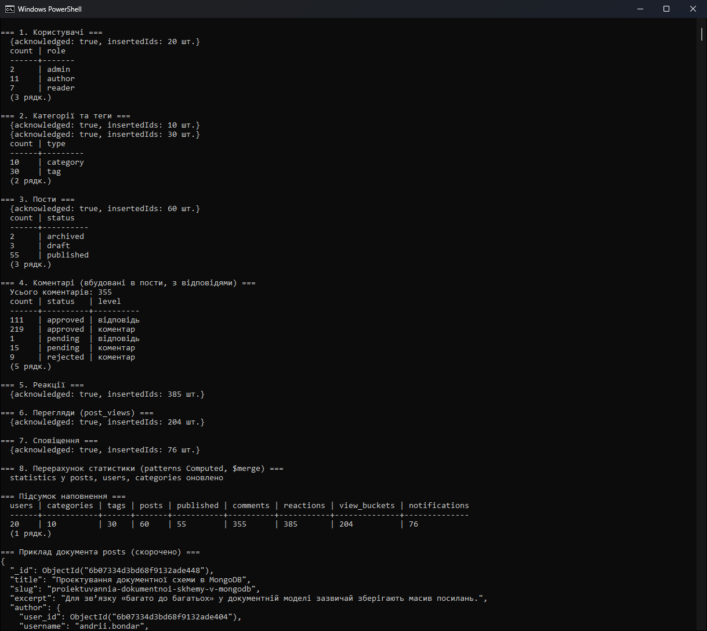

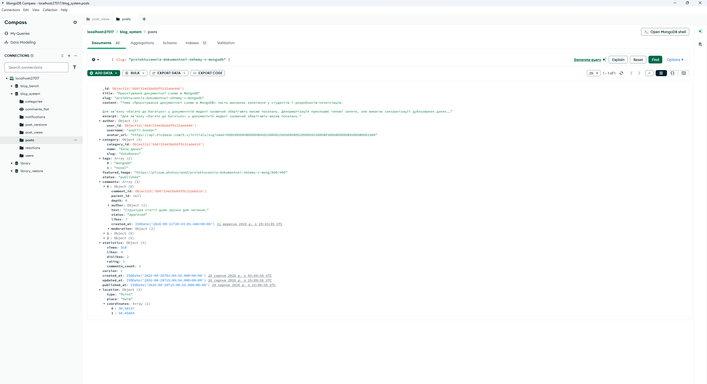

#### Крок 5. Агрегаційні запити для статистики

[`04_aggregations.js`](scripts/04_aggregations.js). **Топ 10 авторів** - групування опублікованих постів за `author.user_id` і `$lookup` до `users` за повним ім'ям і роллю:

```javascript
db.posts.aggregate([
  { $match: { status: 'published' } },
  { $group: { _id: '$author.user_id', username: { $first: '$author.username' }, posts_count: { $sum: 1 },
              total_views: { $sum: '$statistics.views' }, total_likes: { $sum: '$statistics.likes' },
              comments: { $sum: '$statistics.comments_count' }, categories: { $addToSet: '$category.name' },
              last_post: { $max: '$published_at' } } },
  { $sort: { posts_count: -1, total_views: -1 } }, { $limit: 10 },
  { $lookup: { from: 'users', localField: '_id', foreignField: '_id', as: 'u',
               pipeline: [{ $project: { _id: 0, full_name: '$profile.full_name', role: 1 } }] } },
  { $project: { _id: 0, username: 1, full_name: { $first: '$u.full_name' }, role: { $first: '$u.role' },
                posts: '$posts_count', views: '$total_views', likes: '$total_likes', comments: 1,
                avg_views: { $round: [{ $divide: ['$total_views', '$posts_count'] }, 0] },
                categories: { $size: '$categories' }, last_post: 1 } }
]);
```

```
  username          | full_name        | role   | posts | views | avg_views | likes | comments | categories | last_post
  kateryna.lysenko  | Катерина Лисенко | author | 13    | 19238 | 1480      | 70    | 85       | 8          | 2026-11-17
  ivan.petrenko     | Іван Петренко    | author | 10    | 14180 | 1418      | 72    | 49       | 7          | 2026-11-17
  oksana.kravets    | Оксана Кравець   | author | 10    | 12939 | 1294      | 65    | 60       | 8          | 2026-11-05
  ...
```

**Популярні категорії** - агрегація починається з `categories`, тому в результат потрапляють і категорії без постів; підконвеєр `$lookup` рахує пости, перегляди й середні лайки, другий `$lookup` дає назву батьківської категорії, `share_pct` - частка від усіх опублікованих постів:

```
  category          | parent | posts | share_pct | views | avg_likes | comments
  Архітектура ПЗ    | -      | 6     | 10.9      | 9546  | 7.17      | 35
  Безпека           | -      | 6     | 10.9      | 9267  | 5.33      | 40
  ...
  Хмарні технології | DevOps | 5     | 9.1       | 6852  | 4.6       | 24
```

**Статистика коментарів** - один `$facet` з п'ятьма незалежними підконвеєрами: загальна статистика (усього, схвалено, відповідей, середнє, медіана `$median`, мінімум, максимум, пости без схвалених коментарів), розподіл за статусом модерації, 5 постів з найбільшою кількістю коментарів, 5 найактивніших коментаторів і коментарі за місяцями:

```
  posts | total_comments | approved | replies | avg_per_post | avg_approved_per_post | median_per_post | min_per_post | max_per_post | no_comments
  55    | 355            | 330      | 112     | 6.45         | 6                     | 6               | 3            | 12           | 1
```

Додатково - розподіл постів за тегами (`$unwind` + `$group`, назва тегу через `$lookup` до `categories` з `type: "tag"`) і публікації за місяцями (`$dateTrunc`).

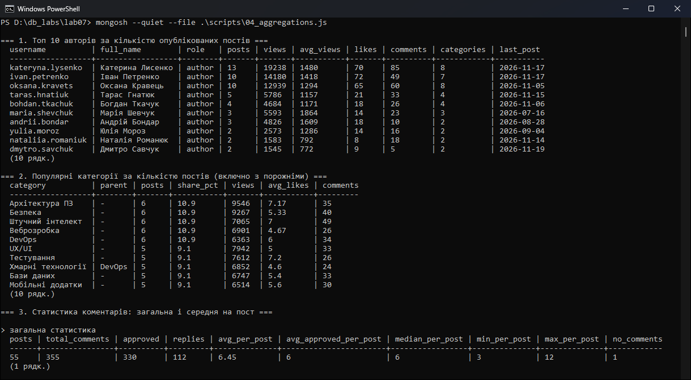

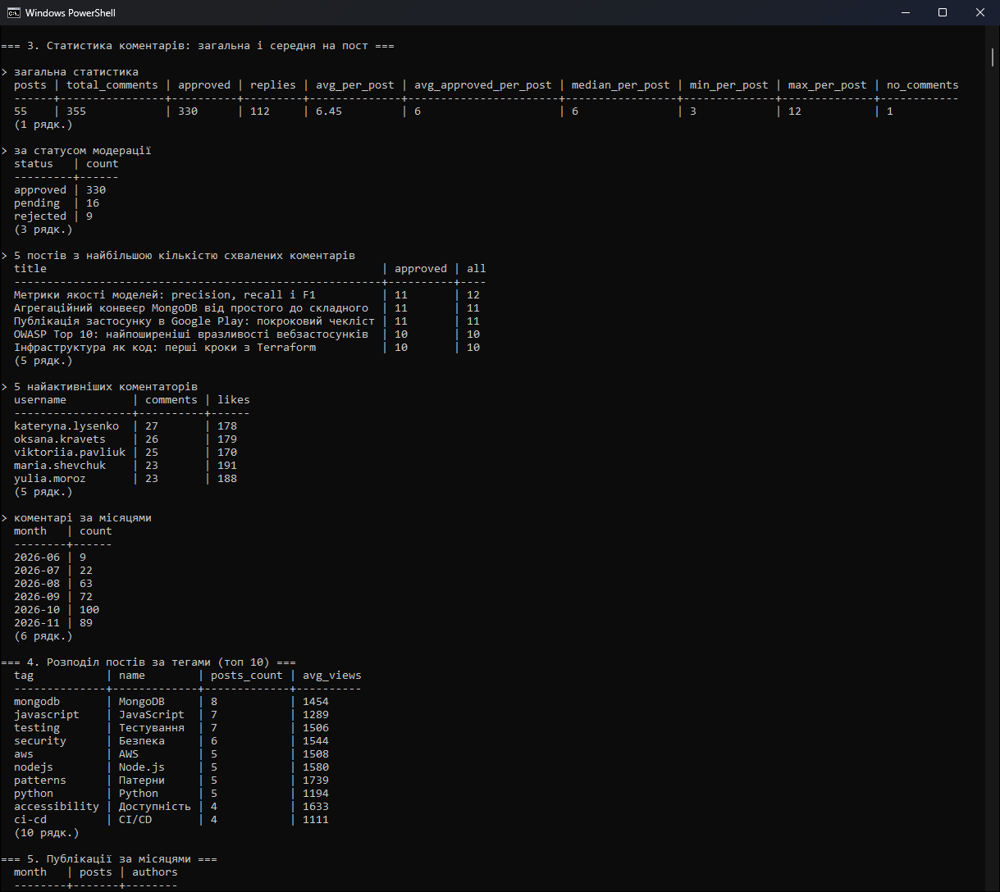

#### Крок 6. Перевірка індексів для пошуку за автором, категорією та датою

[`05_index_check.js`](scripts/05_index_check.js) виконує п'ять запитів з `explain("executionStats")` і для порівняння ті самі запити з `hint({ $natural: 1 })` (повний перегляд колекції):

```
  query                                        | returned | keys | docs_ix | docs_collscan | plan
  Пости автора, новіші першими                 | 10       | 10   | 10      | 60            | LIMIT <- FETCH <- IXSCAN(author.user_id_1_created_at_-1)
  Опубліковані пости категорії, новіші першими | 5        | 5    | 5       | 60            | LIMIT <- FETCH <- IXSCAN(category.category_id_1_status_1_published_at_-1)
  Опубліковані за жовтень 2026 (діапазон дат)  | 4        | 4    | 4       | 60            | LIMIT <- FETCH <- IXSCAN(status_1_published_at_-1__id_-1)
  Пости з тегом mongodb, новіші першими        | 9        | 9    | 9       | 60            | LIMIT <- FETCH <- IXSCAN(tags_1_published_at_-1)
  Головна стрічка: 10 останніх опублікованих   | 10       | 10   | 10      | 60            | LIMIT <- FETCH <- IXSCAN(status_1_published_at_-1__id_-1)
```

У кожному випадку переглядається рівно стільки документів, скільки повертається, і немає окремої стадії `SORT`: порядок дає індекс. Без індексу MongoDB читає всі 60 документів і сортує їх у пам'яті. На 20 000 постів (рівень 3) різниця відповідно більша.

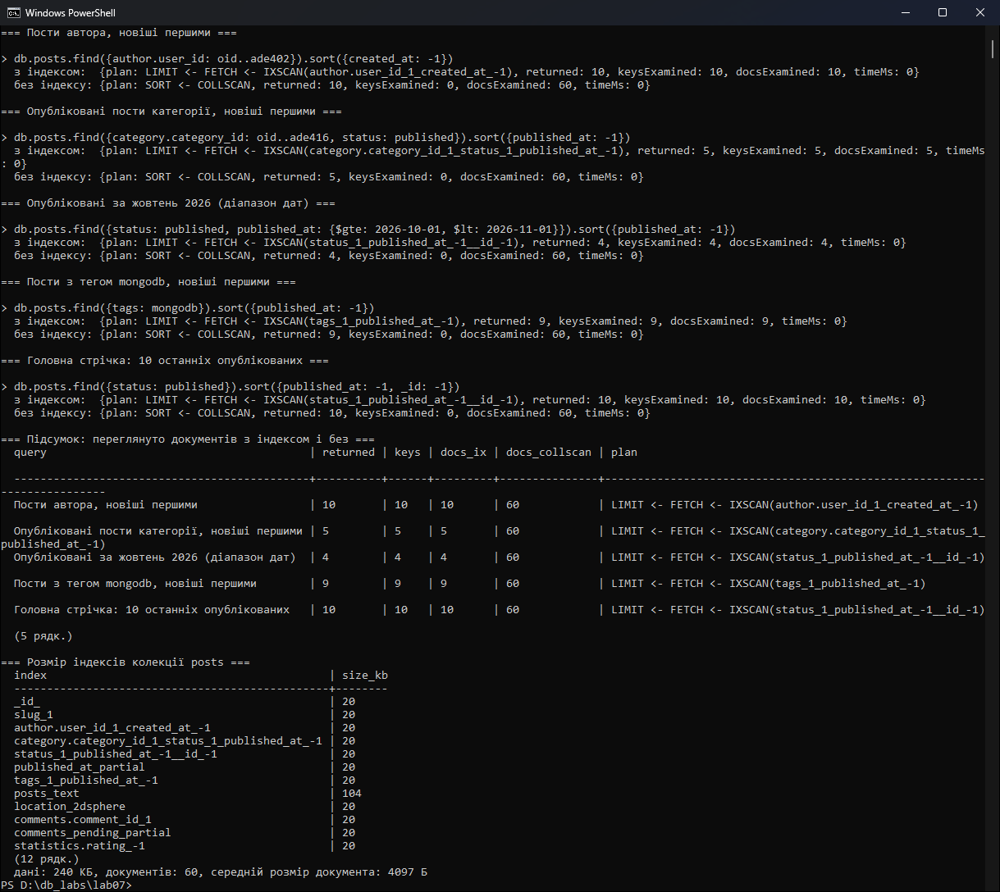

#### Крок 7. HTML-інтерфейс для відображення постів

Сторінка не звертається до MongoDB напряму: між нею і базою стоїть сервер Express ([`blog-app/server.js`](blog-app/server.js)), який віддає JSON. Підключення до MongoDB створюється один раз під час старту (`MongoClient` з пулом `maxPoolSize: 20`), як радить методичка.

```powershell
cd blog-app
npm install
npm start          # Сервер працює: http://localhost:3000
```

Стрічка ([`public/index.html`](blog-app/public/index.html), [`public/app.js`](blog-app/public/app.js)) показує картки постів (обкладинка, категорія, автор, дата, перегляди, лайки, коментарі, теги), панель фільтрів і пагінацію. Клік на картку відкриває модальне вікно з повним текстом, реакціями, схожими постами і деревом коментарів. Увесь текст з бази перед вставкою в HTML екранується функцією `esc()` (захист від XSS), як у прикладі методички. У шапці обирається користувач, від імені якого працює сторінка (адміністратор, автор, читач або гість); вибір зберігається в `localStorage`.


### Рівень 2. Додаткова функціональність

#### Крок 1. Система тегів з пошуком за множинними тегами

[`06_tags_fulltext.js`](scripts/06_tags_fulltext.js), розділи 1-3. Пошук використовує multikey-індекс `tags_1_published_at_-1`:

```javascript
db.posts.find({ status: 'published', tags: { $all: ['mongodb', 'nosql'] } });          // усі теги
db.posts.find({ status: 'published', tags: { $in: ['docker', 'kubernetes'] } });       // будь-який
db.posts.find({ status: 'published', tags: { $all: ['javascript', 'testing'], $nin: ['jest'] } });
```

Ранжування за кількістю збігів з набором тегів - `$setIntersection` і `$size`:

```javascript
db.posts.aggregate([
  { $match: { status: 'published', tags: { $in: wanted } } },
  { $set: { matched: { $setIntersection: ['$tags', wanted] } } },
  { $set: { score: { $size: '$matched' } } },
  { $match: { score: { $gte: 2 } } },
  { $sort: { score: -1, 'statistics.views': -1 } }
]);
```

Той самий підхід дає «схожі пости»: спільний тег важить 2 бали, та сама категорія - 1. Хмара тегів береться з лічильників `statistics.posts_count` у документах `type: "tag"`. План `$all`: `FETCH <- IXSCAN(tags_1_published_at_-1)`, переглянуто 5 ключів для 4 результатів.

У вебінтерфейсі теги - кнопки-чипи з лічильниками; кілька вибраних тегів комбінуються в режимі «усі ($all)» або «будь-який ($in)». Параметри також можна задати адресою, наприклад `/?tags=mongodb,nosql&tag_mode=all`.

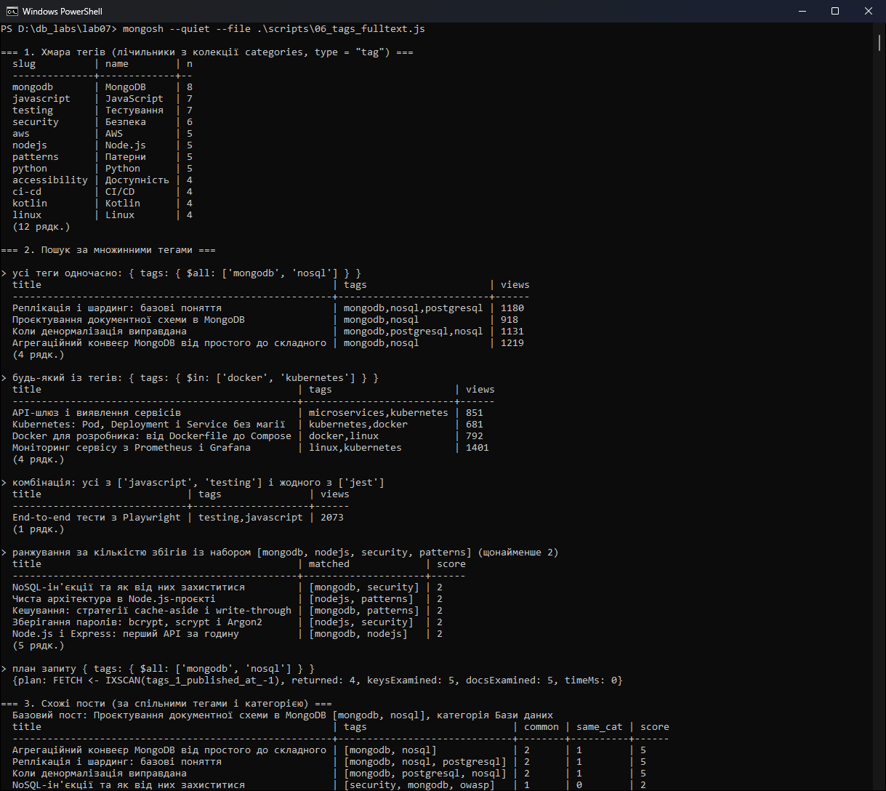


#### Крок 2. Повнотекстовий пошук за назвою та змістом

Текстовий індекс `posts_text` охоплює `title`, `excerpt` і `content` з вагами 10, 4 і 1: збіг у назві важливіший за збіг у тексті. Української мови серед мов стемінгу MongoDB немає, тому, як рекомендує методичка, `default_language: "none"` (розбиття на слова без стемінгу).

```javascript
db.posts.find({ status: 'published', $text: { $search: 'docker kubernetes' } },
              { title: 1, score: { $meta: 'textScore' } })
        .sort({ score: { $meta: 'textScore' } }).limit(5);
```

Продемонстровано: одне слово, кілька слів (логічне АБО), точну фразу `"\"агрегаційний конвеєр\""`, виключення слова `тести -jest`, поєднання з фільтром за категорією, пошук слова, що є лише в тексті. Без стемінгу форми слова розрізняються: «індекси» знаходить 1 пост, «індексів» - 0, а запит з кількома формами «індекси індексів індекс» - 6. План: `TEXT_MATCH(posts_text) <- FETCH <- IXSCAN(posts_text)`.

У стрічці пошук запускається під час введення (затримка 350 мс), результати сортуються за релевантністю, яка показується на картці.

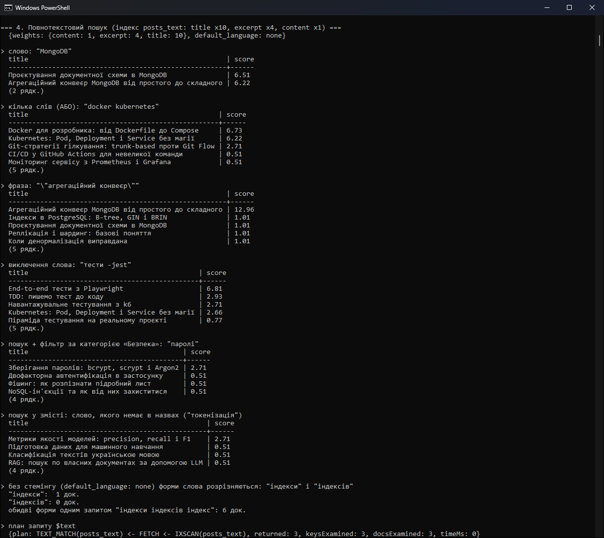


#### Крок 3. Система рейтингів з лайками і дизлайками

[`07_ratings_views.js`](scripts/07_ratings_views.js), функція `react()` у [`scripts/lib/blog.js`](scripts/lib/blog.js). Реакція зберігається в `reactions` (унікальний індекс `{post_id, user_id}` не дозволяє дві реакції одного користувача). Повторне натискання тієї ж кнопки скасовує реакцію, протилежної - змінює її. Лічильники посту оновлюються конвеєрним оновленням, тому `rating` перераховується атомарно в тому самому документі:

```javascript
db.posts.findOneAndUpdate({ _id: postId }, [
  { $set: { 'statistics.likes':    { $add: ['$statistics.likes', dl] },
            'statistics.dislikes': { $add: ['$statistics.dislikes', dd] } } },
  { $set: { 'statistics.rating': { $subtract: ['$statistics.likes', '$statistics.dislikes'] } } }
], { returnDocument: 'after', projection: { statistics: 1 } });
```

```
  початковий стан: {views: 792, likes: 5, dislikes: 0, rating: 5, comments_count: 8}
> anna.sydorenko ставить лайк                         {action: added, likes: 6, dislikes: 0, rating: 6}
> oleh.marchuk ставить дизлайк                        {action: added, likes: 6, dislikes: 1, rating: 5}
> oleh.marchuk змінює дизлайк на лайк                 {action: switched, likes: 7, dislikes: 0, rating: 7}
> anna.sydorenko натискає лайк повторно (скасування)  {action: removed, likes: 6, dislikes: 0, rating: 6}
> спроба вставити другу реакцію того самого користувача напряму
  відхилено: DuplicateKey (унікальний індекс post_id_1_user_id_1)
> перевірка узгодженості: лічильники в posts дорівнюють підрахунку в reactions для всіх постів
  постів із розбіжностями: 0
```

Для рейтингу постів, крім простої різниці лайків і дизлайків, обчислено нижню межу довірчого інтервалу Вільсона (повністю в агрегаційному конвеєрі). Вона враховує кількість оцінок: пост «Оптимізація розміру APK і часу запуску» з 8 лайками без дизлайків (100%, оцінка 0.68) стоїть нижче за «Чиста архітектура в Node.js-проєкті» з 13 лайками і 1 дизлайком (93%, оцінка 0.69).

#### Крок 4. Пагінація через агрегаційний pipeline

[`08_pagination.js`](scripts/08_pagination.js), функція `paginate()`. Один запит повертає і сторінку, і загальну кількість:

```javascript
db.posts.aggregate([
  { $match: Object.assign({ status: 'published' }, filter) },
  { $sort: { published_at: -1, _id: -1 } },
  { $facet: {
      items: [{ $skip: (page - 1) * perPage }, { $limit: perPage }, { $project: { ... } }],
      total: [{ $count: 'count' }] } },
  { $project: { items: 1, total: { $ifNull: [{ $first: '$total.count' }, 0] } } },
  { $set: { page, per_page: perPage, pages: { $ceil: { $divide: ['$total', perPage] } } } }
]);
```

`_id` у сортуванні робить порядок стабільним для постів з однаковою датою. Показано сторінки 1, 3 і неповну останню (5 з 10), пагінацію з фільтром за тегом і з сортуванням за переглядами. `$match` і `$sort` виконуються за індексом `status_1_published_at_-1__id_-1`. Для порівняння реалізовано курсорну (keyset) пагінацію «після останнього показаного»: результат сторінки 2 збігається з `$facet`, а для 5-ї сторінки keyset переглядає 10 ключів індексу проти 50 у `skip(40)`.

Сервер використовує ту саму схему для `GET /api/posts` (разом з фільтрами, пошуком і геопошуком), а сторінка показує номери сторінок зі скороченням `1 2 3 … 7`.

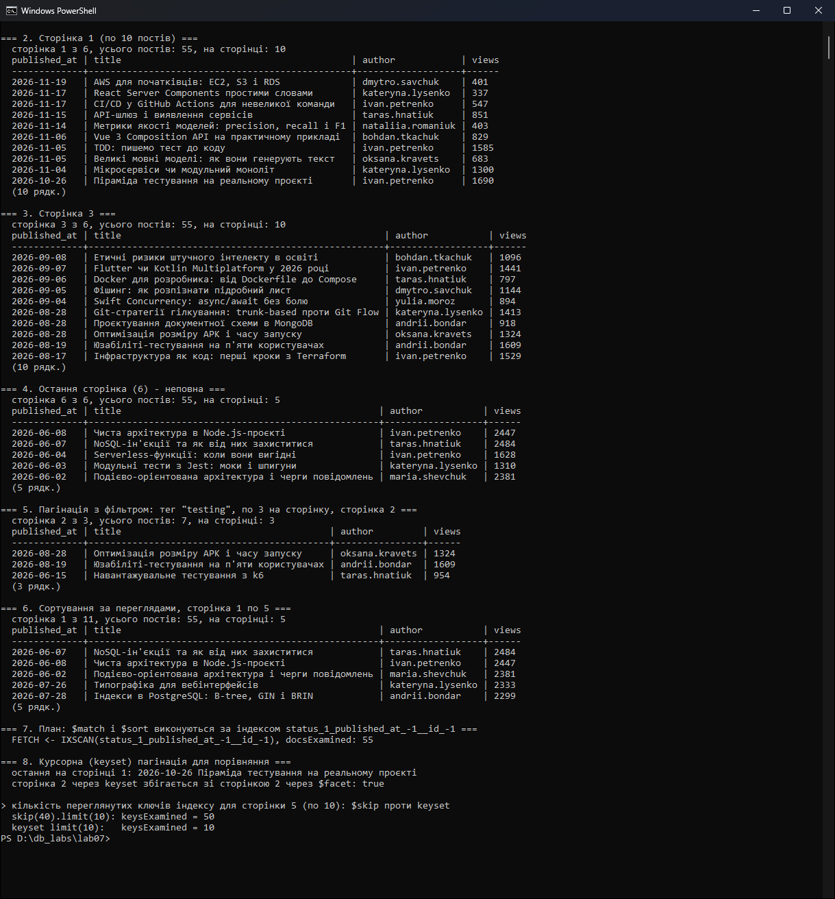


#### Крок 5. Статистика переглядів з інкрементацією лічильників

Перегляд - дві операції `$inc` (функція `addView()`): загальний лічильник у пості і денний лічильник у бакеті місяця, бакет створюється за потреби (`upsert`):

```javascript
db.posts.updateOne({ _id: postId }, { $inc: { 'statistics.views': 1 } });
db.post_views.updateOne({ post_id: postId, month: '2026-11' },
                        { $inc: { 'daily.25': 1, total: 1 } }, { upsert: true });
```

```
  до:    statistics.views = 792, бакет 2026-11: total = 66, daily.25 = 2
> 5 переглядів
  після: statistics.views = 797, бакет 2026-11: total = 71, daily.25 = 7
  {post_id: oid..493e80, month: 2026-11, daily: {20: 2, 21: 4, 22: 3, 23: 3, 24: 4, 25: 7}, total: 71}
```

Статистика за днями будується розгортанням бакетів (`$objectToArray` + `$unwind` + `$group`): перегляди всього блогу за останні 10 днів і найпопулярніші пости за 7 днів. У вебінтерфейсі відкриття посту викликає `POST /api/posts/:id/view`.

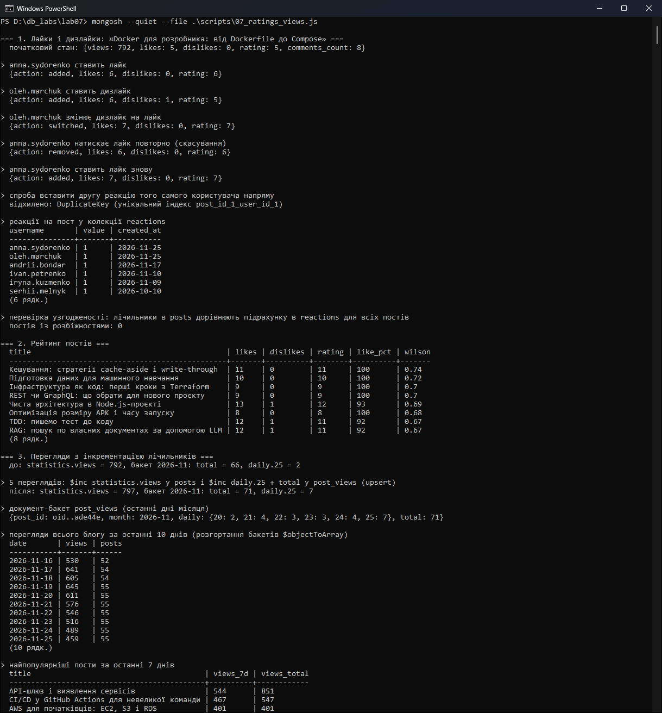

#### Крок 6. Модерація коментарів

[`09_moderation.js`](scripts/09_moderation.js). Статуси: `pending` (очікує перевірки), `approved` (схвалено), `rejected` (відхилено). Коментарі адміністраторів і автора посту схвалюються автоматично, решта потрапляють у чергу. Черга модерації - `$unwind` вбудованих коментарів, фільтр за статусом використовує частковий індекс `comments_pending_partial`. Зміна статусу одного коментаря в масиві - позиційний оператор з `arrayFilters`, після чого `comments_count` перераховується (рахуються лише схвалені):

```javascript
db.posts.findOneAndUpdate({ 'comments.comment_id': commentId },
  { $set: { 'comments.$[c].status': 'rejected',
            'comments.$[c].moderation': { by: moderator._id, at: new Date(), reason: 'Реклама' } } },
  { arrayFilters: [{ 'c.comment_id': commentId }] });
```

```
  roman.zaitsev -> status: pending
  olena.kovalenko (admin) -> status: approved
  comments_count посту: 7 -> 8 (рахуються лише схвалені)
```

Публічний вигляд посту показує лише схвалені коментарі (`$filter`); автор коментаря бачить і свій коментар, що очікує модерації, з позначкою. Статистика модерації за модераторами показує кількість рішень і середній час реакції, автоматичні схвалення виділено окремим рядком. Кожне рішення створює сповіщення автору коментаря.

Сторінка [`moderation.html`](blog-app/public/moderation.html) показує чергу (для відповіді - і батьківський коментар) з кнопками «Схвалити» / «Відхилити» (з причиною). Переглядати чергу і змінювати статус може лише адміністратор: для інших ролей і гостя сервер повертає 403, а сторінка показує попередження замість черги.

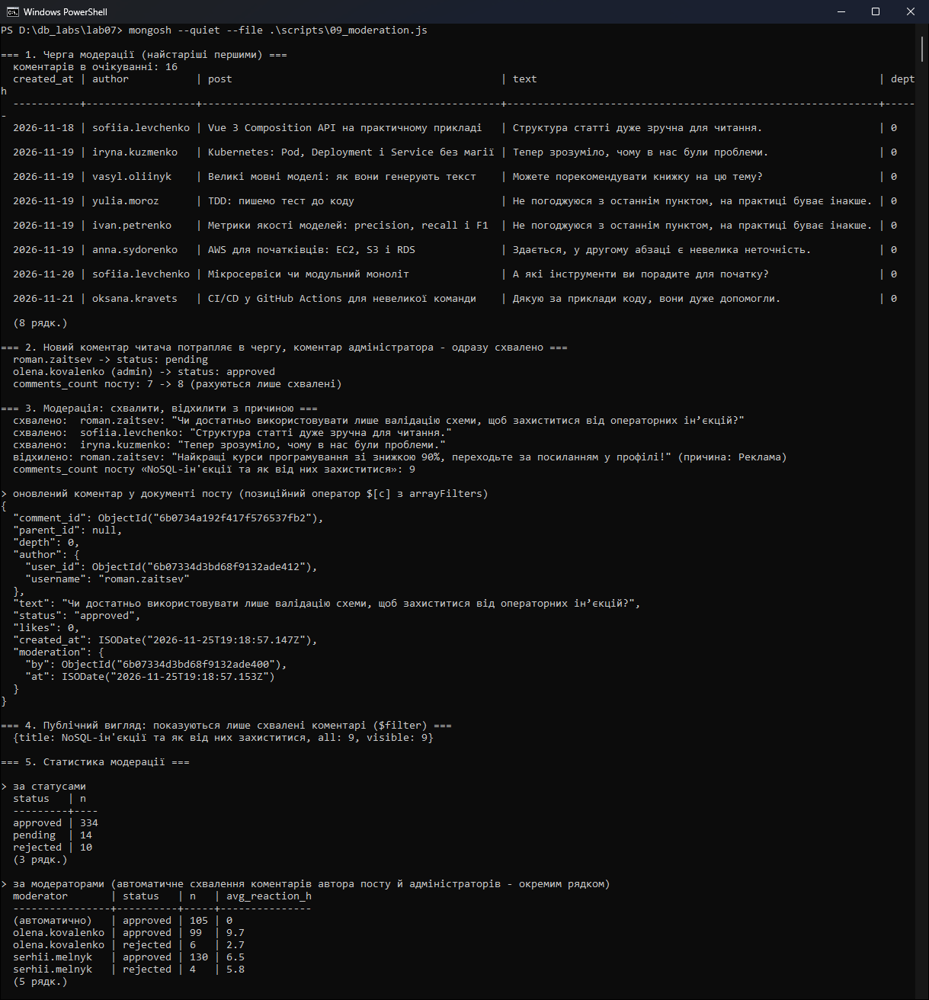

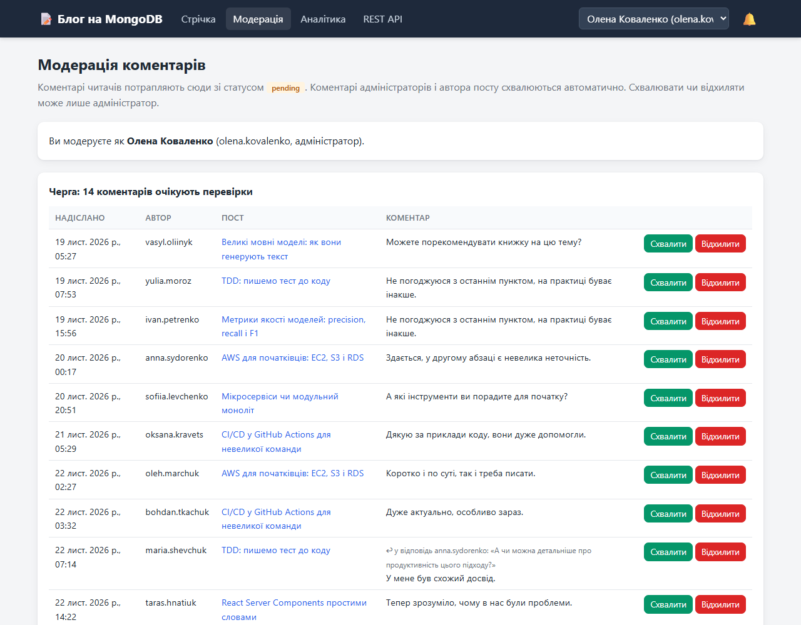

#### Крок 7. Вебформа для додавання постів

Кнопка «Новий пост» доступна авторам і адміністраторам. Форма: назва, категорія, статус (опублікувати / чернетка), теги через кому (з підказками), короткий опис, текст з лічильником символів, геолокація (місто). Дані надсилаються `POST /api/posts`. Сервер перевіряє роль і довжину полів, нормалізує теги в slug (`JSON Schema` -> `json-schema`), генерує унікальний `slug` з назви (транслітерація; за збігу додається суфікс) і збільшує лічильники автора, категорії й тегів. Якщо документ не пройде `$jsonSchema`, сервер поверне 400 з деталями помилки валідації MongoDB.


Пост, створений для скриншота, після цього видалено, щоб стан бази відповідав результатам скриптів.

### Рівень 3. Творче розширення

#### Крок 1. Версіонування постів з історією редагувань

[`10_versioning.js`](scripts/10_versioning.js), функції `editPost()` і `restoreVersion()`. Перед кожним редагуванням поточний стан полів `title`, `content`, `excerpt`, `tags`, `category`, `status` зберігається в `post_versions` разом зі списком змінених полів, коментарем і автором правки; номер версії в пості збільшується. Оновлення виконується з умовою `version: <прочитана версія>` (оптимістичне блокування): якщо пост змінили паралельно, `matchedCount = 0`, знімок видаляється і повертається конфлікт. Якщо оновлення не пройшло `$jsonSchema`, знімок теж видаляється, тож в історії не лишається «зайвої» версії, яка заблокувала б наступні редагування через унікальний індекс `{post_id, version}`; довжину назви (3-200) сервер перевіряє ще до збереження знімка. Збереження без змін нову версію не створює. Відновлення старої версії теж створює нову версію, тому історія не втрачається.

```javascript
const r = db.posts.updateOne({ _id: postId, version: post.version },
                             { $set: changedFields, $inc: { version: 1 } });
if (r.matchedCount === 0) { db.post_versions.deleteOne({ _id: snapshotId }); throw new Error('Конфлікт версій'); }
```

```
  version | title                                        | content_len | tags | changed         | note                        | by
  1       | Node.js і Express: перший API за годину      | 749         | 3    | [title]         | Уточнено назву              | kateryna.lysenko
  2       | Node.js і Express: перший REST API за годину | 749         | 3    | [content, tags] | Додано розділ про валідацію | kateryna.lysenko
  3       | Node.js і Express: перший REST API за годину | 901         | 4    | [title]         | Редакторська правка         | olena.kovalenko
=== 5. Оптимістичне блокування: два редактори відкрили версію одночасно ===
  редактор А зберіг: {version: 5, changed: [tags]}
  редактор Б: Конфлікт версій: очікувалась v4, поточна v5
=== 6. Відновлення першої версії ===
  {version: 6, changed: [title, content]}
```

У вебінтерфейсі автор посту й адміністратор бачать кнопки «Редагувати», «Історія (vN)» і «В архів». Форма редагування надсилає `expected_version`; за конфлікту сервер відповідає 409. Вікно історії показує всі версії з кнопкою «Відновити».

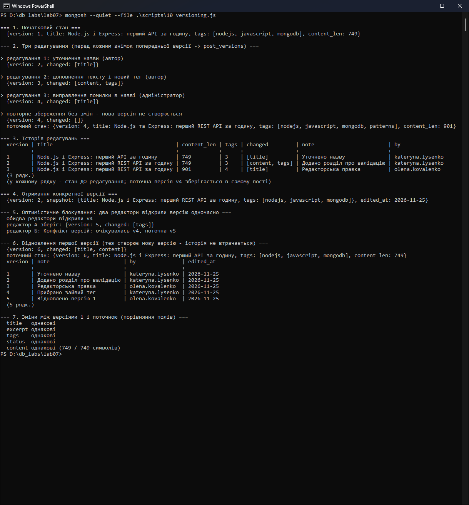

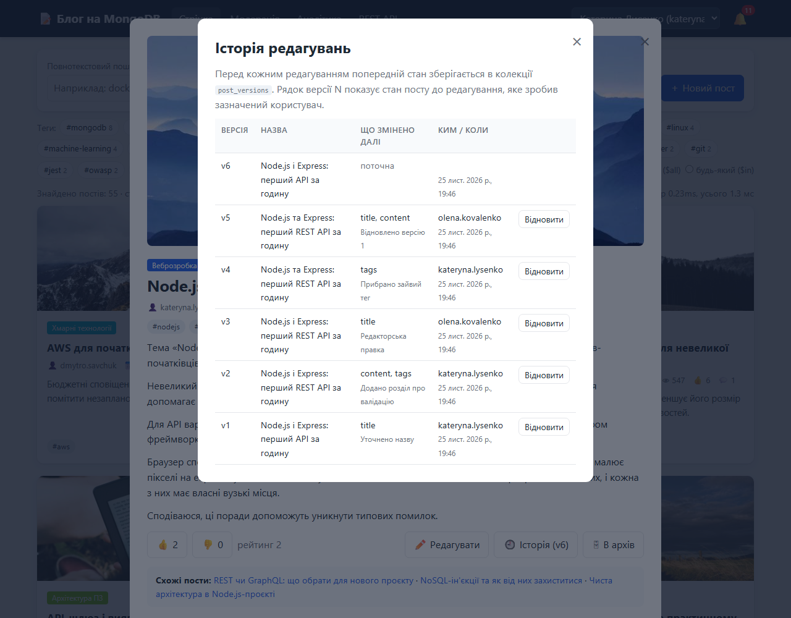

#### Крок 2. Вкладені коментарі з рекурсивною структурою

[`11_nested_comments.js`](scripts/11_nested_comments.js). Кожен коментар має `parent_id` (батьківський коментар або `null`) і `depth` (0-5). Відповідь додається `$push` у той самий масив; глибину понад 5 сервер не дозволяє. Дерево будується рекурсивною функцією:

```javascript
function commentTree(comments, parentId, onlyApproved) {
  return comments
    .filter(c => (parentId ? c.parent_id && c.parent_id.equals(parentId) : c.parent_id === null))
    .filter(c => !onlyApproved || c.status === 'approved')
    .sort((a, b) => a.created_at - b.created_at)
    .map(c => Object.assign({}, c, { replies: commentTree(comments, c.comment_id, onlyApproved) }));
}
```

```
  • anna.sydorenko [approved, 2026-11-25]: Чи варто команді з трьох розробників одразу починати з мікросервісів?
     └─ kateryna.lysenko [approved, 2026-11-25]: Для невеликої команди я б радив модульний моноліт ...
        └─ maksym.polishchuk [approved, 2026-11-25]: А як тоді масштабувати окремі частини ...
           └─ kateryna.lysenko [approved, 2026-11-25]: Найнавантаженіший модуль можна винести ...
              └─ iryna.kuzmenko [approved, 2026-11-25]: Ми саме так і зробили з модулем звітів.
                 └─ anna.sydorenko [approved, 2026-11-25]: Дякую всім, дуже допомогло!
     └─ iryna.kuzmenko [approved, 2026-11-25]: Підтримую, мікросервіси додають багато операційних витрат.
> відповідь на коментар глибини 5 відхиляється (максимальна вкладеність 5)
```

Рекурсивний обхід виконано і засобами СУБД: представлення `comments_flat` розгортає вбудовані коментарі в окремі документи (`_id = comment_id`), а `$graphLookup` знаходить усіх нащадків кожного коментаря першого рівня (кількість відповідей, глибина гілки, кількість учасників) і, у зворотному напрямку, шлях від найглибшої відповіді до кореня. `restrictSearchWithMatch: { post_id }` обмежує пошук одним постом.

```javascript
{ $graphLookup: { from: 'comments_flat', startWith: '$comments.comment_id', connectFromField: 'comment_id',
                  connectToField: 'parent_id', as: 'descendants', depthField: 'level',
                  restrictSearchWithMatch: { post_id: post._id, status: 'approved' } } }
```

Вебінтерфейс відображає дерево рекурсивною функцією `renderTree()` з відступами; під кожним схваленим коментарем глибини менше 5 є кнопка «Відповісти».

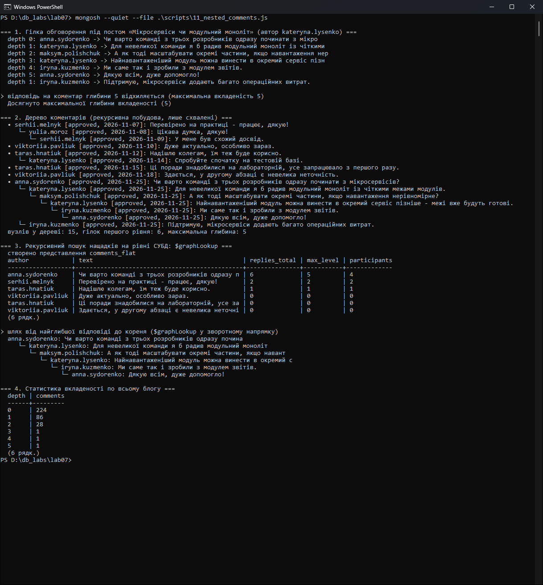


#### Крок 3. Система сповіщень для авторів

[`12_notifications.js`](scripts/12_notifications.js). Сповіщення створюються в момент дії: новий коментар під постом (`new_comment` автору посту, з позначкою «очікує модерації»), відповідь на коментар (`comment_reply` автору батьківського коментаря), рішення модератора (`comment_approved` / `comment_rejected` автору коментаря). Себе не сповіщаємо. Стрічка користувача читається за індексом `user_id_1_read_1_created_at_-1`, позначення прочитаними - `updateMany`, а прочитані сповіщення автоматично видаляються через 30 днів (TTL-індекс на `read_at` з `partialFilterExpression: { read: true }`).

```
=== 2. Новий коментар під постом «Індекси в PostgreSQL: B-tree, GIN і BRIN» (автор andrii.bondar) ===
  непрочитаних у автора до: 0
  sofiia.levchenko залишила коментар (status: pending)
  непрочитаних у автора після: 1
=== 6. Чому не Change Streams ===
  db.posts.watch(): Location40573 - The $changeStream stage is only supported on replica sets or mongos
```

Change Streams були б природним механізмом для сповіщень, але вони працюють лише на наборі реплік, а сервер у цій роботі одиночний (скрипт перевіряє це явно). Тому сповіщення створює прикладний рівень (`addComment()`, `moderate()`).

У шапці вебінтерфейсу - дзвіночок з кількістю непрочитаних (оновлюється кожні 15 секунд) і випадна стрічка з кнопкою «Прочитати всі».

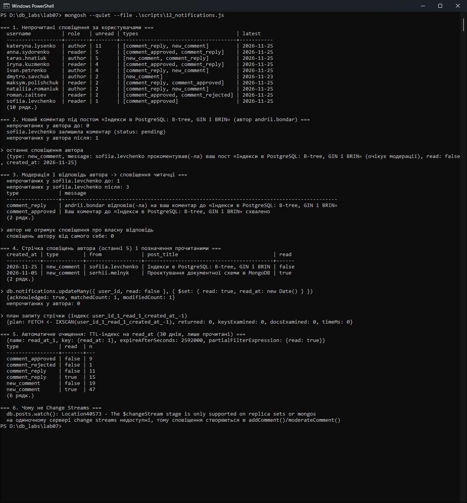


#### Крок 4. Геолокація постів з пошуком за координатами

[`13_geo.js`](scripts/13_geo.js). Координати зберігаються як GeoJSON `Point` (`[довгота, широта]`, перевіряються `$jsonSchema`), індекс `location_2dsphere`. Запити:

```javascript
// найближчі пости в радіусі 100 км
db.posts.find({ status: 'published', location: { $near: { $geometry: lutsk, $maxDistance: 100000 } } });
// відстань до кожного посту
db.posts.aggregate([{ $geoNear: { near: lutsk, distanceField: 'dist_m', spherical: true, query: { status: 'published' } } }, ...]);
// усередині кола і багатокутника
{ location: { $geoWithin: { $centerSphere: [[rLng, rLat], 200 / 6378.1] } } }
{ location: { $geoWithin: { $geometry: { type: 'Polygon', coordinates: [[[22, 48], [27, 48], [27, 52], [22, 52], [22, 48]]] } } } }
```

```
=== 3. $geoNear: відстань до кожного посту (км), групування за містами ===
  place     | posts | km_from_lutsk
  Луцьк     | 10    | 0
  Рівне     | 5     | 64
  Ковель    | 2     | 66
  Тернопіль | 9     | 132
  ...
  Харків    | 10    | 776
```

Також показано пошук «поруч зі мною» з фільтром за категорією (`$geoNear` з `query`), план `GEO_NEAR_2DSPHERE(location_2dsphere)` і відхилення некоректних координат `[250, 50]` валідацією. У стрічці фільтр «Поруч з містом» показує на картках відстань до посту; API - `GET /api/geo/near?lng=&lat=&km=`.

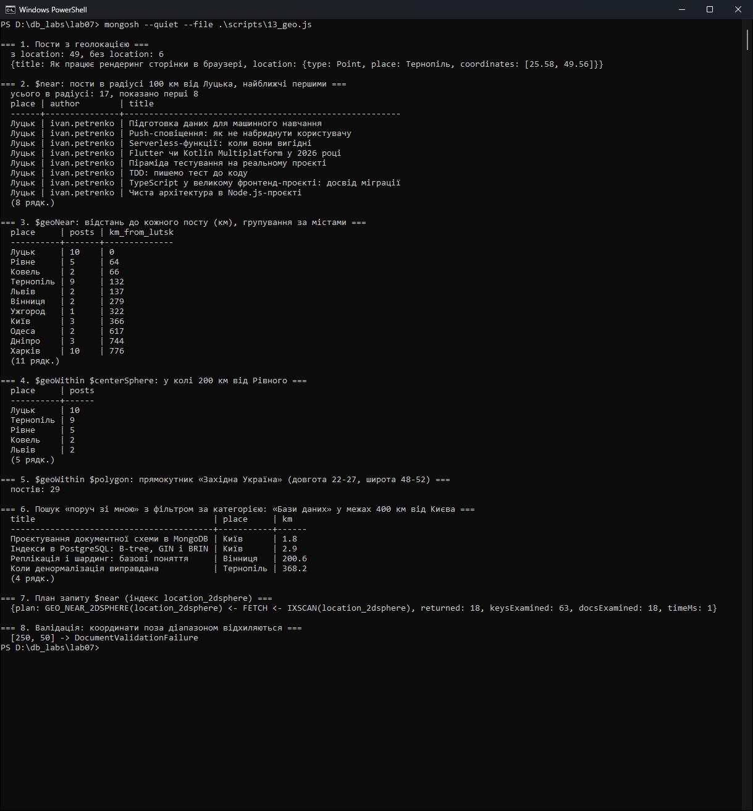


#### Крок 5. Аналітична панель з візуалізацією

[`dashboard.html`](blog-app/public/dashboard.html) завантажує паралельно 9 агрегаційних запитів (`/api/stats/*`) і будує графіки Chart.js (бібліотека віддається сервером з `node_modules`, без зовнішнього CDN):

- KPI: опубліковані пости, перегляди, лайки, дизлайки, коментарі, середня кількість коментарів на пост, черга модерації, активні автори;
- перегляди за 30 днів (з бакетів `post_views`), популярні категорії (кольори з документів категорій), топ-10 авторів, коментарі за статусом модерації, коментарі за місяцями, теги, пости за містами, публікації за місяцями, вкладеність коментарів (логарифмічна шкала);
- таблиця 10 найпопулярніших постів і панель кешу (див. крок 7).


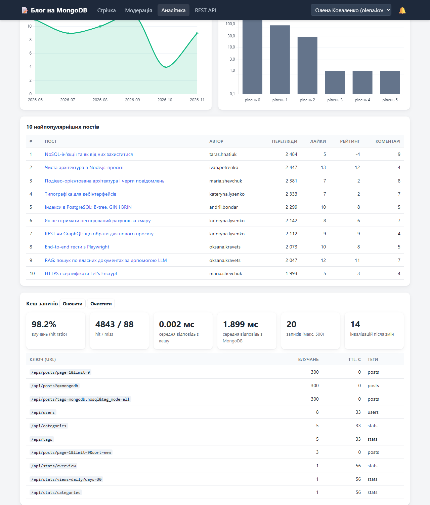

#### Крок 6. RESTful API

Усі операції доступні через REST API ([`server.js`](blog-app/server.js)); ресурси - іменники, дії - HTTP-методи, відповіді - JSON з правильними кодами стану:

| Метод | Шлях | Дія |
|---|---|---|
| GET | `/api/posts` | список з пагінацією; `page, limit, q, tags, tag_mode, category, author, sort, lng, lat, km`; `status=draft\|archived\|all` - лише автору (власні) й адміністратору (усі), інакше 403 |
| GET | `/api/posts/:slug` | пост з деревом коментарів, моєю реакцією, схожими постами |
| POST | `/api/posts` | створити пост (201) |
| PUT | `/api/posts/:id` | редагувати з версіонуванням (`expected_version`, 409 при конфлікті) |
| DELETE | `/api/posts/:id` | перемістити в архів (м'яке видалення, нова версія) |
| POST | `/api/posts/:id/view` | зарахувати перегляд |
| POST | `/api/posts/:id/reactions` | лайк / дизлайк / скасування |
| GET | `/api/posts/:id/versions`, `/versions/:v` | історія і конкретна версія |
| POST | `/api/posts/:id/versions/:v/restore` | відновити версію |
| POST | `/api/posts/:id/comments` | коментар або відповідь (`parent_id`) |
| GET | `/api/moderation/queue` | черга модерації (лише admin) |
| PATCH | `/api/comments/:id` | змінити статус коментаря (лише admin) |
| GET, PATCH | `/api/notifications`, `/api/notifications/read` | сповіщення, позначити прочитаними |
| GET | `/api/users`, `/api/categories`, `/api/tags` | довідники (без email і хешу пароля) |
| GET | `/api/geo/near` | пости поруч з відстанню |
| GET | `/api/stats/{overview, top-authors, categories, tags, comments, views-daily, posts-by-month, top-posts, geo}` | аналітика |
| GET, DELETE | `/api/cache/stats`, `/api/cache` | статистика й очищення кешу |

Помилки обробляє один middleware: власні помилки сервісу (400/403/404/409), порушення `$jsonSchema` (код MongoDB 121 -> 400 з `errInfo.details`), дублікат унікального ключа (11000 -> 409), некоректний JSON (400). Некоректний `ObjectId` у шляху дає 400, а не 500. Поточний користувач передається заголовком `X-User-Id` - це свідоме спрощення замість автентифікації (паролі в базі хешовані, але логін не реалізовано). Сторінка [`api.html`](blog-app/public/api.html) містить довідник маршрутів і форму для надсилання запитів.

Наскрізний тест [`test/api-test.js`](blog-app/test/api-test.js) проходить усі сценарії через HTTP: фільтри й пошук, права ролей (зокрема доступ до чернеток і черги модерації), валідацію, реакції, ланцюжок коментарів до глибини 5 і відмову на 6-му рівні, модерацію і сповіщення, версіонування з конфліктом 409 і відмовою на занадто довгу назву без «зайвої» версії, інвалідацію кешу, геопошук, усі маршрути статистики й помилки. Тестові пости наприкінці видаляються, а лічильники перераховуються.

```
=== Версіонування ===
  OK   інший автор не може редагувати -> Редагувати пост може лише автор або адміністратор
  OK   редагування v1 -> v2 -> {"version":2,"changed":["title"]}
  OK   редагування адміністратором v2 -> v3 -> {"version":3,"changed":["tags"]}
  OK   конфлікт версій -> 409 -> Конфлікт версій: ви редагували v2, а поточна v3
  ...
Підсумок: 67 перевірок пройдено, 0 не пройдено (тестові пости видалено)
```

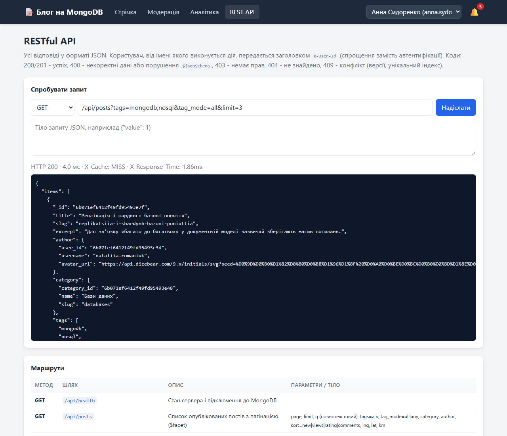

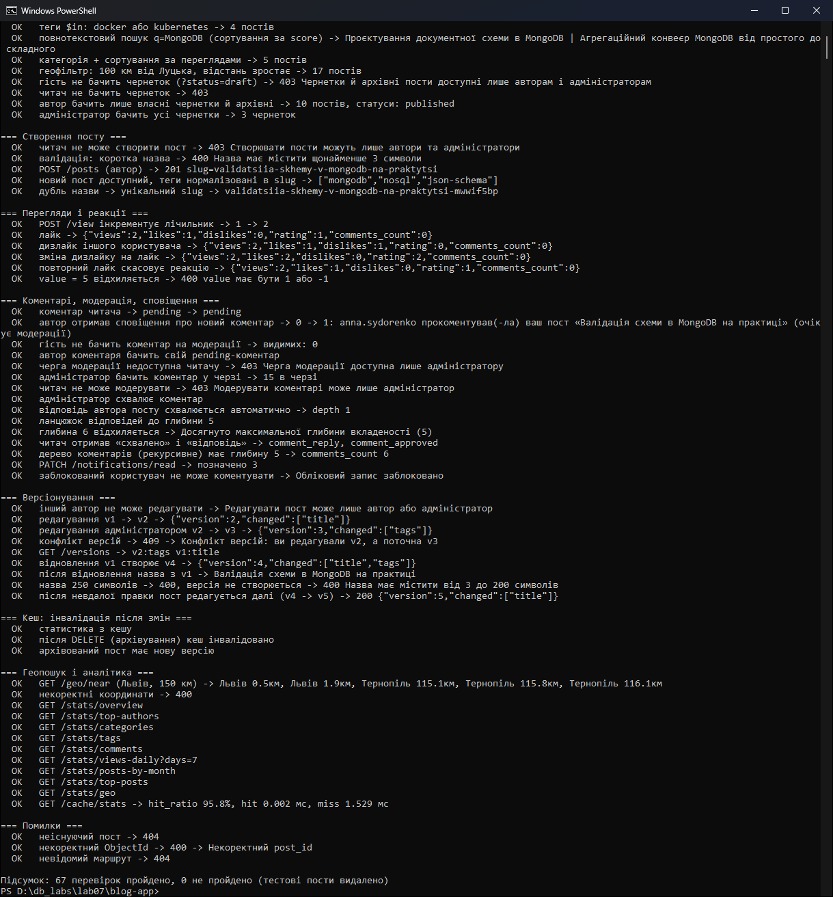

#### Крок 7. Кешування популярних запитів

[`lib/cache.js`](blog-app/lib/cache.js) - кеш у пам'яті процесу за стратегією cache-aside: middleware спершу шукає відповідь за ключем (повний URL), а за промаху виконує запит до MongoDB і зберігає JSON. Особливості:

- **TTL**: стрічка і пошук - 30 с, аналітика й довідники - 60 с;
- **LRU-витіснення** при перевищенні 500 записів;
- **теги інвалідації**: записи стрічки мають тег `posts`, аналітики - `stats`; після успішного `POST`/`PUT`/`DELETE`/`PATCH` інвалідуються залежні записи, тому новий пост чи коментар одразу видно;
- заголовки `X-Cache: HIT|MISS` і `X-Response-Time`, статистика влучань і середнього часу (`/api/cache/stats`, панель на сторінці аналітики).

Перегляди не інвалідують кеш (інакше кожне відкриття посту скидало б стрічку), тому лічильник переглядів у стрічці може відставати до 30 секунд - свідомий компроміс.

Вимірювання [`bench/cache-bench.js`](blog-app/bench/cache-bench.js): по 300 послідовних HTTP-запитів на маршрут без кешу (`?nocache=1`) і з кешу:

```
Запит                          | без кешу: медіана  p95   зап/с | з кешу: медіана  p95   зап/с | прискорення
Головна стрічка ($facet)       |             1.07  1.44     897 |           0.38  0.57    2507 |    2.8 разів
Повнотекстовий пошук           |             0.87  1.09    1108 |           0.26  0.36    3595 |    3.4 разів
Пошук за тегами ($all)         |             0.89  1.12    1089 |           0.27  0.38    3453 |    3.2 разів
Загальна статистика            |             2.05  2.39     478 |           0.23  0.33    3900 |    9.0 разів
Топ-10 авторів                 |             1.40  1.58     702 |           0.23  0.35    3944 |    6.1 разів
Популярні категорії ($lookup)  |             2.37  2.87     412 |           0.23  0.34    3980 |   10.2 разів
Статистика коментарів ($facet) |             1.27  1.58     758 |           0.22  0.31    3964 |    5.7 разів
Перегляди за 30 днів (бакети)  |             3.08  3.72     315 |           0.23  0.34    3846 |   13.5 разів
Статистика кешу на сервері: hit ratio 97.7%, середній час обробки: з кешу 0.002 мс, із запитом до MongoDB 1.516 мс
```

Чим важча агрегація, тим більший ефект: до 13.5 раза для статистики переглядів. Решта часу з кешем (~0.2-0.4 мс) - це HTTP і серіалізація.

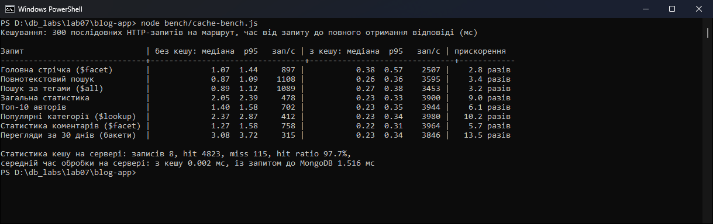

#### Крок 8. Порівняльний аналіз з реляційною схемою і тести продуктивності

**Реляційна схема.** [`sql/01_schema.sql`](sql/01_schema.sql) реалізує схему з методички (`users`, `categories`, `posts`, `tags`, `post_tags`, `comments`) з `GENERATED BY DEFAULT AS IDENTITY` (замість `ALWAYS` з методички: ключі з CSV вставляються явно, щоб збігатися з полем `n` у MongoDB, після чого лічильники узгоджуються `setval`), доповнену полями й таблицями рівнів 2-3: `comments.parent_id` і `status`, `reactions`, `post_views` (рядок на пост і день), `post_versions`, `notifications`, координати, `CHECK`-обмеження, зовнішні ключі, генерований стовпець `tsv tsvector` з вагами A/B/D і GIN-індекс, індекси, еквівалентні індексам MongoDB. База `blog_system` створена в контейнері `car_import_db` з ЛР4 (PostgreSQL 17.11): 10 таблиць проти 7 колекцій.

**Однакові дані.** На 60 постах різниця в продуктивності непомітна, тому для тестів [`14_bench_generate.js`](scripts/14_bench_generate.js) генерує окремий більший набір - 2 000 користувачів, 20 000 постів, 109 016 коментарів - одночасно в базу MongoDB `blog_bench` (документи з вбудованими коментарями; індекси як у `blog_system` для тестових запитів плюс `n` і `comments.author.user_id`, без часткових) і в CSV для PostgreSQL (нормалізовані таблиці). Числовий ключ `n` кожного документа стає первинним ключем у PostgreSQL, тому записи однозначно відповідають один одному. [`sql/02_load_bench.sql`](sql/02_load_bench.sql) завантажує CSV через `\copy` (20 000 постів - 4.0 с, 109 016 коментарів - 3.5 с; генерація і вставка в MongoDB разом з CSV - 6.5 с) і перевіряє зовнішній ключ.

[`sql/03_queries.sql`](sql/03_queries.sql) містить еквівалентні запити з `EXPLAIN ANALYZE`, зокрема сторінку посту (5 з'єднань), пошук за двома тегами (`GROUP BY ... HAVING count(*) = 2`), повнотекстовий пошук `tsv @@ to_tsquery('simple', ...)` з `ts_rank`, пагінацію з `count(*) OVER ()` і рекурсивний CTE для дерева коментарів (аналог `$graphLookup`).

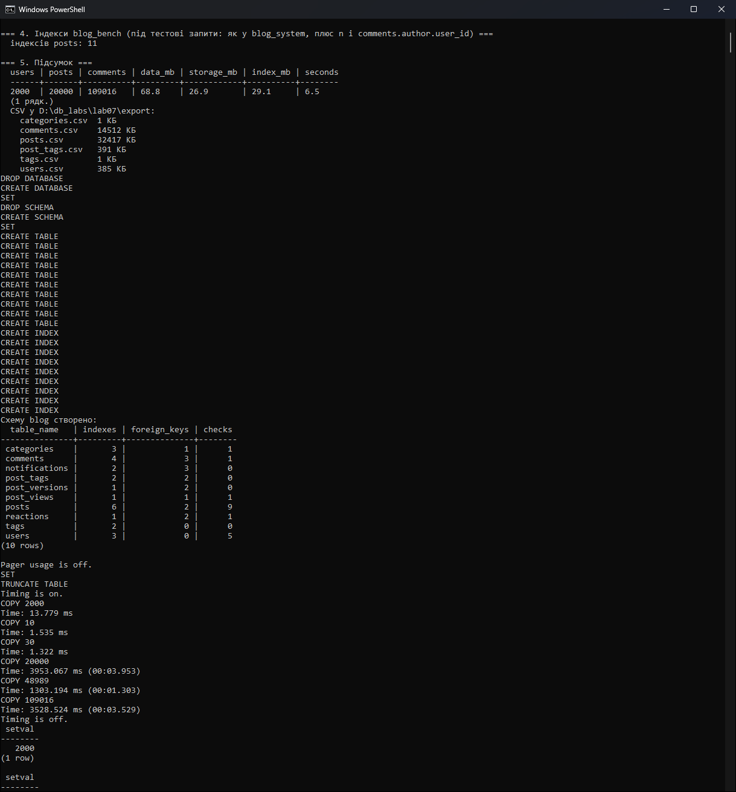

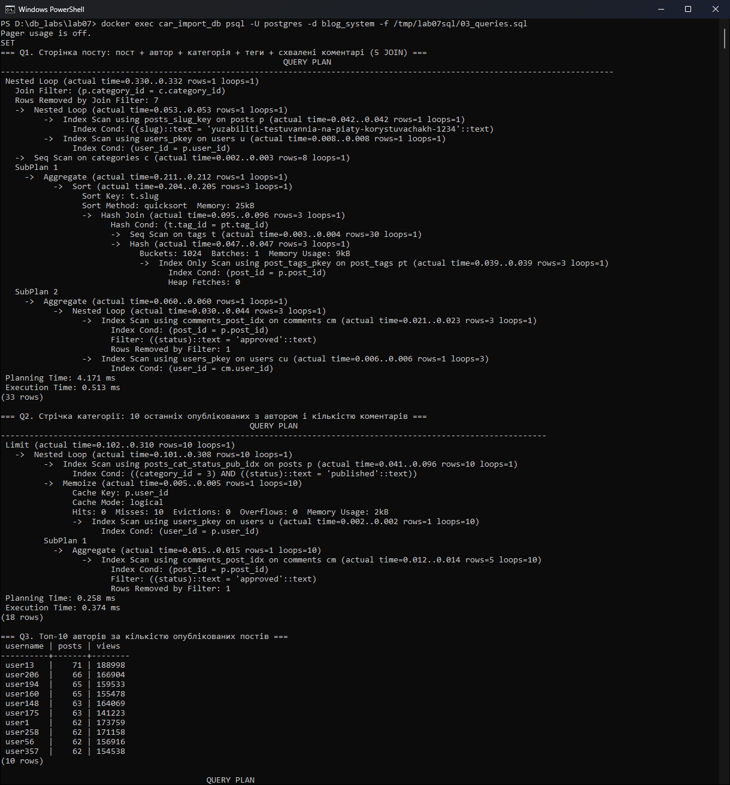

**Методика тестів.** [`bench/compare.js`](blog-app/bench/compare.js) виконує однакові операції з одного процесу Node.js через офіційні драйвери (`mongodb`, `pg`), послідовно, після 20 прогрівальних запитів, з однаковими псевдовипадковими параметрами для обох СУБД; вимірюється час від відправлення запиту до отримання результату (медіана і 95-й перцентиль). Спершу скрипт перевіряє, що обидві бази повертають однакові результати:

```
  збігається | Топ-5 авторів (username, кількість): MongoDB user13:71 user206:66 ... | PostgreSQL user13:71 user206:66 ...
  збігається | Пости з тегами mongodb і nosql: MongoDB 1199 | PostgreSQL 1199
  збігається | Коментарів до опублікованих постів: MongoDB 109016 | PostgreSQL 109016
  збігається | Повнотекстовий пошук "docker": MongoDB 319 | PostgreSQL 319
```

**Результати (медіана, мс):**

| Тест | MongoDB | PostgreSQL | Швидше |
|---|---:|---:|---|
| Q0 Порожній запит (ping / `SELECT 1`) | 0.151 | 0.340 | MongoDB ×2.3 |
| Q1 Сторінка посту з автором, категорією, тегами і коментарями | 0.266 | 1.189 | MongoDB ×4.5 |
| Q2 Стрічка категорії: 10 нових з кількістю коментарів | 0.337 | 0.791 | MongoDB ×2.3 |
| Q3 Сторінка автора: 10 останніх постів | 0.297 | 0.457 | MongoDB ×1.5 |
| Q4 Пошук за двома тегами одночасно | 0.357 | 2.185 | MongoDB ×6.1 |
| Q5 Повнотекстовий пошук, 10 найрелевантніших | 3.477 | 13.090 | MongoDB ×3.8 |
| Q6 Пагінація: випадкова сторінка 1-100 + загальна кількість | 37.495 | 8.731 | PostgreSQL ×4.3 |
| Q7 Топ-10 авторів (агрегація всіх постів) | 28.759 | 6.311 | PostgreSQL ×4.6 |
| Q8 Статистика коментарів | 52.859 | 19.747 | PostgreSQL ×2.7 |
| Q9 Популярні категорії | 18.200 | 2.342 | PostgreSQL ×7.8 |
| W1 Додати коментар | 0.299 | 1.002 | MongoDB ×3.4 |
| W2 Лайк: інкремент лічильника | 0.250 | 1.018 | MongoDB ×4.1 |
| W3 Перейменувати автора (денормалізоване ім'я) | 5.162 | 1.965 | PostgreSQL ×2.6 |

Обсяг: MongoDB - 68.8 МБ даних і 29.2 МБ індексів; на диску колекція займала 26.9 МБ одразу після завантаження (стиснення snappy, `14_bench_generate.js`) і 54.2 МБ після тестів запису (`compare.js` додає коментарі в документи, які через це перезаписуються, а WiredTiger не повертає звільнене місце у файлі одразу); PostgreSQL - 84.4 МБ таблиць і 27.9 МБ індексів.

**Застереження щодо умов.** MongoDB працює як служба Windows, а PostgreSQL - у Docker (через віртуальну машину WSL2), тому кожен запит до PostgreSQL додатково проходить мережевий перехід: порожній запит Q0 повільніший на ~0.19 мс. Для запитів тривалістю менше 1 мс (Q1-Q4, W1, W2) це помітна частка різниці. Крім того, PostgreSQL з `synchronous_commit=on` чекає запису WAL на диск при кожному `COMMIT`, а MongoDB на окремому сервері з `writeConcern {w: 1}` скидає журнал пакетно (до 100 мс), тобто гарантії довговічності запису різні. Навіть з поправкою на Q0 MongoDB лишається швидшим у Q1 і Q4, де реляційна модель потребує з'єднань і групування.

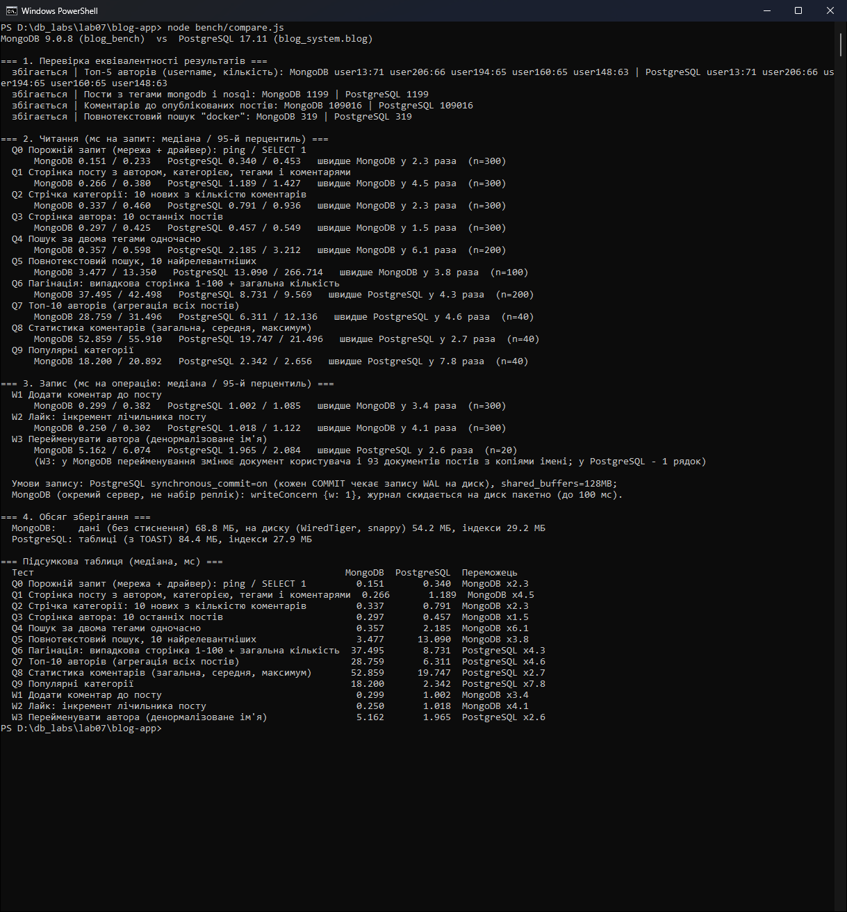

**Аналіз і оптимізація.** Агрегації по всій колекції (Q6-Q9) MongoDB програла, бо `$group` читає повні документи (у середньому 3.5 КБ з текстом і вбудованими коментарями), тоді як PostgreSQL групує вузькі рядки. [`15_optimization.js`](scripts/15_optimization.js) перевіряє три способи це виправити на тих самих 20 000 постах:

```
=== 1. Популярні категорії ===
  variant                               | median_ms | keys  | docs  | plan
  до оптимізації                        | 24        | 18054 | 18054 | GROUP <- FETCH <- IXSCAN(status_1_published_at_-1__id_-1)
  індекс {status, category.category_id} | 18        | 18054 | 0     | GROUP <- PROJECTION_DEFAULT <- IXSCAN(status_1_category.category_id_1)
=== 3. Пагінація: сторінка 50 + загальна кількість ===
  один $facet (items + total)              | 28 |
  find().skip().limit() + countDocuments() | 4  | COUNT <- COUNT_SCAN
=== 4. Патерн Computed: попередньо обчислені лічильники ===
  агрегація при кожному запиті (до оптимізації) | 24
  покривний індекс                              | 18
  Computed: читання готових лічильників         | 1
  Computed: повний перерахунок ($merge), рідко  | 19
```

1. **Покривний індекс** прибирає читання документів (`docs = 0`), але групування 18 054 ключів лишається: виграш невеликий і нестабільний: для категорій 24 -> 18 мс (~25%), для топу авторів 28 -> 28 мс, тобто без виграшу.
2. **Пагінація**: `$facet` рахує `total`, проходячи всі документи; розділення на `find().skip().limit()` і `countDocuments()` (план `COUNT_SCAN` за індексом) прискорює сторінку в 7 разів (28 -> 4 мс). Для блогу з 55 постами у вебзастосунку лишено `$facet` (цього вимагає завдання), а для великих обсягів правильніше розділяти запити або використовувати keyset-пагінацію.
3. **Патерн Computed**: лічильник у документі категорії (`statistics.posts_count`, який у `blog_system` оновлюється `$inc` під час публікації) читається за ~1 мс, тобто швидше за `GROUP BY` у PostgreSQL. Саме тому документна схема зберігає `statistics` у користувачах, категоріях і постах.

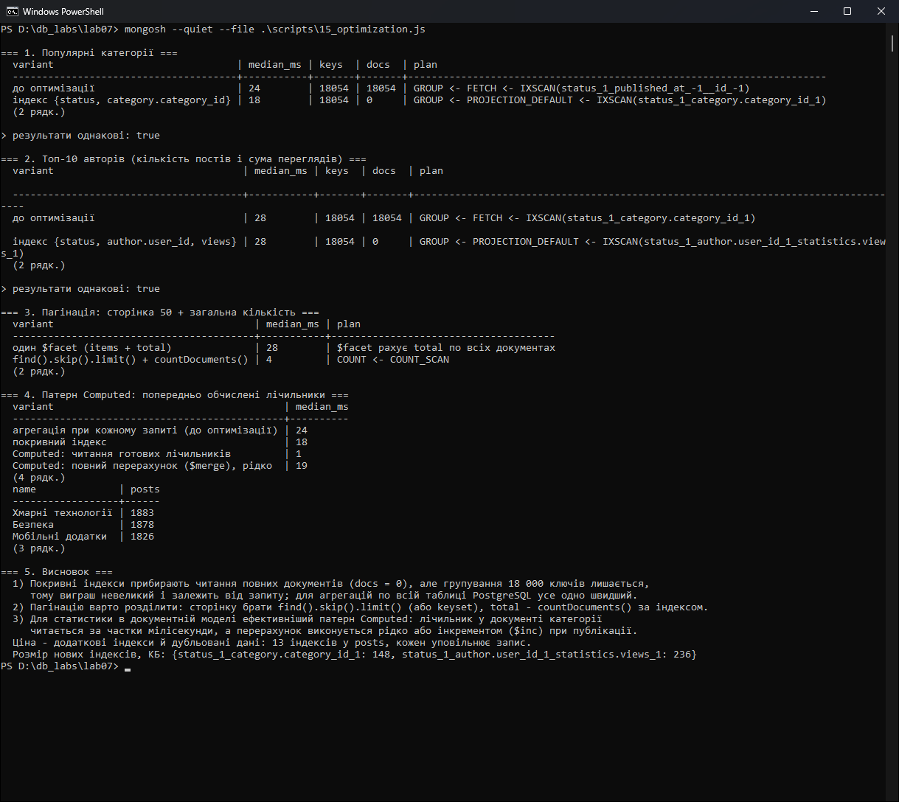

**Порівняльна таблиця підходів (за результатами вимірювань):**

| Критерій | PostgreSQL (нормалізована схема) | MongoDB (документна схема) |
|---|---|---|
| Кількість таблиць/колекцій | 10 таблиць (6 з методички + 4 для рівнів 2-3) | 7 колекцій, основні дані в 3 |
| Сторінка посту з коментарями | 5 з'єднань, 1.19 мс | 1 документ без з'єднань, 0.27 мс |
| Пошук за кількома тегами | `GROUP BY ... HAVING`, 2.2 мс | `$all` по multikey-індексу, 0.36 мс |
| Агрегації по всіх даних | швидше в 3-8 разів (вузькі рядки) | повільніше; покривні індекси дають щонайбільше ~25%, рятує патерн Computed (~1 мс) |
| Запис коментаря / лайка | `INSERT`/`UPDATE` з `fsync` WAL, 1.0 мс | `$push`/`$inc` в один документ, 0.25-0.3 мс |
| Оновлення дубльованих даних | 1 рядок, 2.0 мс | 1 документ користувача + 93 документи постів, 5.2 мс |
| Цілісність | `FOREIGN KEY`, `CHECK`, `UNIQUE` (вставка коментаря до неіснуючого посту відхиляється) | `$jsonSchema` і унікальні індекси; існування `post_id`/`user_id` перевіряє застосунок |
| Гнучкість схеми | зміни через міграції | нові поля (геолокація, версія) додаються без міграції, обмеження - `$jsonSchema` |
| Рекурсія (дерево коментарів) | `WITH RECURSIVE` | `$graphLookup` через представлення або рекурсія в застосунку |
| Повнотекстовий пошук | `tsvector` + GIN, ваги A/B/D, словник `simple` | текстовий індекс з вагами, `default_language: none`; обидва без стемінгу української |
| Обсяг (20 000 постів) | 84.4 МБ + 27.9 МБ індексів | 68.8 МБ (26.9 МБ на диску після завантаження, 54.2 МБ після тестів запису) + 29.2 МБ індексів |
| Транзакції | ACID для будь-якої кількості рядків | атомарність одного документа; багатодокументні транзакції лише на наборі реплік |

**Висновок порівняння.** Документна модель виграє на операціях, під які її спроєктовано: прочитати або змінити один агрегат «пост + коментарі + статистика». Реляційна модель виграє на аналітиці по всіх даних і на змінах сутностей, що дублюються в документах, а також дає сильніші гарантії цілісності. Для блогу з переважанням читання сторінок і стрічок документна схема з патерном Computed для статистики є доцільною.

### Підсумковий огляд

```
Колекції blog_system: users, categories, posts, reactions, post_views, post_versions, notifications
                      + представлення comments_flat
Індекси: 32 (posts - 12, з них 3 часткові, текстовий і 2dsphere; TTL у notifications)
Скрипти mongosh: 15; SQL-скрипти: 3; вебзастосунок: 4 сторінки, 31 маршрут REST API
Автоматичні перевірки: 67/67 (test/api-test.js)
```

## Особливості виконання

1. **Відмінності від методички.** Схеми валідації розширено (`additionalProperties: false`, валідація вкладених коментарів, координат, шаблон slug). Теги зберігаються в колекції `categories` з дискримінатором `type` (патерн Polymorphic), а не в окремій колекції. До поста додано `statistics.dislikes`, `statistics.rating`, `location`, `version`; до коментаря - `parent_id`, `depth`, `moderation`. Тестові дані з методички (`user1`, «Стаття N: Цікава тема...») замінено реалістичними, згенерованими з фіксованим seed.
2. **Стан бази між скриптами.** Скрипти 07-13 змінюють дані (реакції, перегляди, коментарі, версії), тому числа в кожному наступному скрипті відповідають стану після попереднього. Повний прогін з нуля - `run-all.ps1`; скрипти 07, 10 і 11 при повторному запуску спершу прибирають результати свого попереднього запуску, тому їх можна виконувати повторно. Лічильник переглядів між запусками росте.
3. **Числа на скриншотах.** Дані детерміновані, але `ObjectId`, дати «сьогодні» і час виконання запитів відрізняються між запусками. Скриншоти вебінтерфейсу зроблено після повного прогону, тому деякі лічильники переглядів на них більші, ніж у виводі скриптів (кожне відкриття посту - це перегляд).
4. **Change Streams** для сповіщень не використано: сервер одиночний, а `watch()` вимагає набору реплік (перевірено в скрипті 12). Набір реплік з ЛР6 можна було б запустити, але тоді й вебзастосунок мав би працювати з ним.
5. **Автентифікацію спрощено** до заголовка `X-User-Id`: завдання не вимагає входу, а права ролей (читач не створює пости, лише адміністратор модерує, редагує лише автор або адміністратор) перевіряються на сервері. Паролі в базі - справжні scrypt-хеші тестових паролів.
6. **`GENERATED BY DEFAULT AS IDENTITY`** у PostgreSQL замість `ALWAYS`: потрібна явна вставка ключів з CSV (`\copy`), щоб записи відповідали документам MongoDB.
7. **Умови порівняльних тестів** нерівні: PostgreSQL у Docker (додаткові ~0.19 мс на запит) і з синхронним комітом; це враховано в аналізі. Обидві СУБД мають налаштування за замовчуванням.
8. **Скриншоти вебінтерфейсу** зроблено в браузері з шириною вікна 1280 пікселів; користувача, від імені якого показано сторінку, обрано параметром адреси `?as=username` (наприклад, `/moderation.html?as=olena.kovalenko`).

## Контрольні запитання

**1. Які принципи слід враховувати при проєктуванні документної схеми для NoSQL баз даних?**

Схему проєктують від запитів, а не від сутностей: спершу визначають найчастіші операції, потім так розміщують дані, щоб кожна з них зачіпала якомога менше документів. Дані, що читаються разом, зберігаються разом (пост з коментарями). Ураховують співвідношення читання і запису (блог - переважно читання, тому денормалізація імен виправдана), кардинальність зв'язків (до сотень коментарів - вбудовування, тисячі реакцій - окрема колекція), ріст документа (ліміт 16 МБ, необмежено зростаючі масиви - антипатерн, тому перегляди винесено в бакети), атомарність (зміни в одному документі атомарні, тому лічильники посту живуть у пості). Структуру захищають `$jsonSchema` і унікальні індекси, а повторювані задачі розв'язують патернами: Bucket (перегляди), Computed (статистика), Polymorphic (категорії й теги).

**2. Коли доцільно використовувати вбудовані документи, а коли посилання між документами?**

Вбудовування - коли дочірні дані належать одному батькові, читаються разом з ним, їх обмежена кількість і вони рідко потрібні окремо: коментарі в пості, профіль у користувачі, координати. Посилання - коли сутність має власний життєвий цикл, використовується в багатьох місцях, часто змінюється або її кількість необмежена: користувачі, категорії, реакції, історія версій, сповіщення. У роботі використано гібрид: в пості посилання `author.user_id` разом з копією `username`, тож стрічку показано без `$lookup`, а повний профіль лишається в `users`.

**3. Поясніть переваги та недоліки денормалізації даних в документних базах даних.**

Переваги: менше запитів і з'єднань під час читання (сторінка посту - один документ, у 4.5 раза швидше за 5 з'єднань у PostgreSQL), атомарні зміни в межах документа, простіший код. Недоліки: дубльовані дані треба синхронізувати (перейменування автора змінило 1 документ користувача і 93 документи постів, у 2.6 раза повільніше за 1 рядок у PostgreSQL), більший обсяг, ризик розбіжностей між копіями і первинними даними, складніша аналітика по всіх документах (Q6-Q9 повільніші). Тому денормалізують дані, що рідко змінюються (імена, назви категорій), а лічильники перевіряють і перераховують з первинних даних (`recalcPostStats` і перевірка «постів із розбіжностями: 0»).

**4. Як реалізувати ефективну пагінацію в MongoDB для великих обсягів даних?**

Сортування має йти за індексом зі стабільним порядком (`{ status: 1, published_at: -1, _id: -1 }`), інакше MongoDB сортує в пам'яті. `skip(N)` переглядає N ключів, тому для глибоких сторінок краща курсорна (keyset) пагінація: наступна сторінка - документи «після» останнього показаного `(published_at, _id)`; у роботі для 5-ї сторінки це 10 ключів проти 50. Загальну кількість у `$facet` зручно отримати одним запитом, але на 20 000 документів це 28 мс проти 4 мс для окремих `find().skip().limit()` і `countDocuments()` з `COUNT_SCAN`. Тому на великих обсягах total рахують окремо, кешують або показують приблизно, а для нескінченної стрічки використовують keyset.

**5. Що таке патерн "Bucket" і для яких завдань він використовується?**

Bucket групує багато дрібних подій або вимірювань у один документ за період, замість документа на кожну подію чи необмеженого масиву в батьківському документі. Підходить для часових рядів: перегляди, метрики, показники датчиків, журнали. У роботі `post_views` - документ на пост і місяць з лічильниками за днями `daily: {"25": 7}` і підсумком `total`. Запис - один `$inc` з `upsert`, документ росте не більше ніж до 31 поля, кількість документів - пости × місяці (204 замість ~75 000 окремих переглядів), а статистика за період - `$objectToArray` + `$unwind` + `$group` по кількох бакетах.

**6. Як забезпечити консистентність даних при денормалізації в MongoDB?**

(1) Тримати пов'язані зміни в одному документі - його оновлення атомарне (лайк змінює `likes`, `dislikes` і `rating` одним конвеєрним оновленням). (2) Використовувати атомарні оператори `$inc`, `$push`, `arrayFilters` замість схеми «прочитати - змінити - записати». (3) Мати первинне джерело правди і перераховувати похідні дані з нього (`reactions` -> `statistics.likes` через `$merge`, перевірка розбіжностей). (4) Оптимістичне блокування за номером версії для конкурентних редагувань. (5) Унікальні індекси і `$jsonSchema` як обмеження на рівні СУБД. (6) Для змін у кількох документах - багатодокументні транзакції на наборі реплік, або подія/черга з ідемпотентною обробкою і подальше узгодження (eventual consistency).

**7. Які стратегії індексування найбільш ефективні для блог-системи?**

Складені індекси за правилом ESR (рівність - сортування - діапазон) під конкретні запити: `{status, published_at, _id}` для стрічки й пагінації, `{category_id, status, published_at}` для категорії, `{author.user_id, created_at}` для сторінки автора - усі повертають рівно стільки документів, скільки переглядають, без сортування в пам'яті. Multikey-індекс для тегів, текстовий індекс з вагами для пошуку, 2dsphere для геолокації, унікальні індекси для `slug`, `username`, `email` і реакцій, часткові індекси для черги модерації й опублікованих постів (менший розмір), TTL для сповіщень. Для агрегацій - покривні індекси (документи не читаються). Кожен індекс уповільнює запис і займає пам'ять, тому зайвих індексів не створюють і перевіряють плани через `explain`.

**8. Поясніть різницю між горизонтальним та вертикальним масштабуванням баз даних.**

Вертикальне - потужніший сервер (більше ЦП, пам'яті, швидші диски): простіше, не змінює застосунок, але має фізичну і цінову межу та лишає одну точку відмови. Горизонтальне - більше серверів: репліки для читання і відмовостійкості, шардинг (розподіл даних між серверами за ключем) для запису й обсягу. MongoDB підтримує шардинг вбудовано, а документна модель йому сприяє: агрегат «пост з коментарями» живе на одному шарді, тому типові запити не потребують розподілених з'єднань. PostgreSQL зазвичай масштабують вертикально і репліками для читання, горизонтально - секціонуванням або розширеннями (наприклад, Citus).

**9. Як реалізувати транзакції в MongoDB і які обмеження вони мають?**

Операції над одним документом атомарні завжди - на цьому в роботі побудовано реакції, модерацію й лічильники. Багатодокументні транзакції (з версії 4.0, для шардів - з 4.2) запускаються в сесії: `session.withTransaction(async () => { ... })` з `readConcern: 'snapshot'` і `writeConcern: 'majority'`. Обмеження: потрібен набір реплік або шардований кластер (на одиночному сервері, як у цій роботі, недоступні - тому версіонування використовує оптимістичне блокування), транзакція за замовчуванням обмежена 60 секундами, великі транзакції тримають кеш WiredTiger і погіршують продуктивність, можливі конфлікти запису (`WriteConflict`) з повтором, деякі операції всередині заборонені. Тому в MongoDB схему проєктують так, щоб транзакції були винятком, а не правилом.

**10. Які метрики продуктивності важливі при порівнянні реляційних та документних баз даних?**

Затримка запиту (медіана і хвости p95/p99 - у повнотекстовому пошуку PostgreSQL p95 сягав 267 мс при медіані 13 мс), пропускна здатність (запитів за секунду), кількість переглянутих ключів і документів/рядків (`explain` / `EXPLAIN ANALYZE`), використання індексів і сортування в пам'яті, швидкість запису і гарантії довговічності (`writeConcern`, `synchronous_commit`), обсяг даних і індексів на диску, час завантаження даних, вартість оновлення дубльованих даних, поведінка під конкурентним навантаженням (блокування, конфлікти), а також базова затримка мережі й драйвера (порожній запит), щоб не приписувати СУБД різницю в інфраструктурі. Порівнювати слід на однакових даних і з перевіркою однаковості результатів, що і зроблено в розділі 1 `bench/compare.js`.

## Висновки

У результаті виконання лабораторної роботи створено повноцінний вебзастосунок блог-системи на MongoDB і проаналізовано його продуктивність.

1. Спроєктовано документну схему з гібридним підходом (вбудовані коментарі, посилання з копіями імен) і патернами Bucket, Computed, Polymorphic; сім колекцій захищено `$jsonSchema`, валідація відхилила всі сім некоректних документів.
2. Базу заповнено реалістичними детермінованими даними: 20 користувачів, 10 категорій, 30 тегів, 60 постів, 355 коментарів.
3. Розроблено агрегації: топ-10 авторів, популярні категорії (включно з порожніми), статистика коментарів через `$facet`, розподіл за тегами і місяцями.
4. Створено 32 індекси; пошук за автором, категорією, датою і тегами переглядає лише потрібні документи.
5. Реалізовано теги з `$all`/`$in` і ранжуванням, повнотекстовий пошук з вагами, лайки/дизлайки з окремою колекцією і рейтингом Вільсона, пагінацію через `$facet`, перегляди з `$inc` у бакетах, модерацію з `arrayFilters`.
6. Реалізовано версіонування з оптимістичним блокуванням, вкладені коментарі до 5 рівнів з рекурсивним деревом і `$graphLookup`, сповіщення з TTL, геопошук `$near`/`$geoNear`/`$geoWithin`.
7. Створено вебзастосунок на Express: стрічку з фільтрами, сторінку посту, форми створення й редагування, модерацію, аналітичну панель з 9 графіками, RESTful API з 31 маршрутом; наскрізний тест - 67 перевірок без помилок.
8. Кеш запитів із TTL, LRU і тегами інвалідації прискорив відповіді в 2.8-13.5 раза.
9. Порівняння з PostgreSQL на 20 000 постів показало: MongoDB швидша в 1.5-6.1 раза на читанні й зміні одного агрегату, PostgreSQL - у 2.6-7.8 раза на агрегаціях по всіх даних і на оновленні дубльованих даних; патерн Computed зводить агрегацію в MongoDB до ~1 мс.

**Обмеження реалізації:** автентифікацію спрощено до заголовка `X-User-Id`; сповіщення створюються застосунком, а не Change Streams (одиночний сервер); кеш живе в пам'яті одного процесу (для кількох екземплярів сервера потрібен спільний кеш, наприклад Redis); стемінгу української мови в повнотекстовому пошуку немає.

**Самооцінка:** 5.

## Посилання на проєкт

Репозиторій: `https://github.com/dmutrokondratyk2008/db_labs`

Файли проєкту:

- `lab07/scripts/01_create_collections.js` ... `15_optimization.js`: скрипти mongosh у порядку виконання, `scripts/lib/`: спільний код;
- `lab07/sql/01_schema.sql`, `02_load_bench.sql`, `03_queries.sql`: реляційна модель PostgreSQL;
- `lab07/blog-app/`: вебзастосунок (`server.js`, `lib/`, `public/`, `test/api-test.js`, `bench/`);
- `lab07/results/`: вивід кожного кроку повного прогону;
- `lab07/run-all.ps1`: повний прогін;
- `screenshots/lab07/`: скриншоти виконання (`1.png`-`39.png`).

## Додаток А. Скріншоти виконання

| Файл | Розділ і зміст |
|---|---|
| `1.png` | Підготовка: версії MongoDB, mongosh, Node.js, npm, PostgreSQL |
| `2.png` | Р1, крок 2: створення колекцій і перевірка валідації |
| `3.png` | Р1, крок 2: правила валідації `posts` у Compass |
| `4.png` | Р1, крок 3: індекси |
| `5.png` | Р1, крок 4: наповнення бази |
| `6.png` | Р1, крок 4: документ `posts` у Compass |
| `7.png` | Р1, крок 5: топ авторів, популярні категорії |
| `8.png` | Р1, крок 5: статистика коментарів, теги, місяці |
| `9.png` | Р1, крок 6: плани запитів з індексами і без |
| `10.png` | Р1, крок 7: головна стрічка |
| `11.png` | Р1, крок 7: сторінка посту |
| `12.png` | Р2, крок 1: теги `$all`, `$in`, ранжування, схожі пости |
| `13.png` | Р2, крок 2: повнотекстовий пошук у mongosh |
| `14.png` | Р2, крок 1: фільтр за тегами у вебінтерфейсі |
| `15.png` | Р2, крок 2: повнотекстовий пошук у вебінтерфейсі |
| `16.png` | Р2, кроки 3 і 5: реакції, рейтинг, перегляди |
| `17.png` | Р2, крок 4: пагінація в mongosh |
| `18.png` | Р2, крок 4: пагінація у вебінтерфейсі |
| `19.png` | Р2, крок 6: модерація в mongosh |
| `20.png` | Р2, крок 6: сторінка модерації |
| `21.png` | Р2, крок 7: форма нового посту |
| `22.png` | Р2, крок 7: створений пост |
| `23.png` | Р3, крок 1: версіонування в mongosh |
| `24.png` | Р3, крок 1: історія редагувань у вебінтерфейсі |
| `25.png` | Р3, крок 2: вкладені коментарі, `$graphLookup` |
| `26.png` | Р3, крок 2: дерево коментарів у вебінтерфейсі |
| `27.png` | Р3, крок 3: сповіщення в mongosh |
| `28.png` | Р3, крок 3: панель сповіщень |
| `29.png` | Р3, крок 4: геопошук у mongosh |
| `30.png` | Р3, крок 4: пости поруч з Луцьком |
| `31.png` | Р3, крок 5: аналітична панель, графіки |
| `32.png` | Р3, крок 5: найпопулярніші пости і кеш |
| `33.png` | Р3, крок 6: сторінка REST API |
| `34.png` | Р3, крок 6: наскрізний тест API |
| `35.png` | Р3, крок 7: тест кешу |
| `36.png` | Р3, крок 8: генерація даних, схема і завантаження PostgreSQL |
| `37.png` | Р3, крок 8: `EXPLAIN ANALYZE` у PostgreSQL |
| `38.png` | Р3, крок 8: порівняльні тести |
| `39.png` | Р3, крок 8: оптимізація агрегацій |
